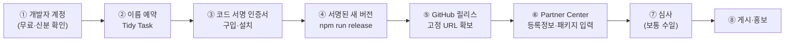
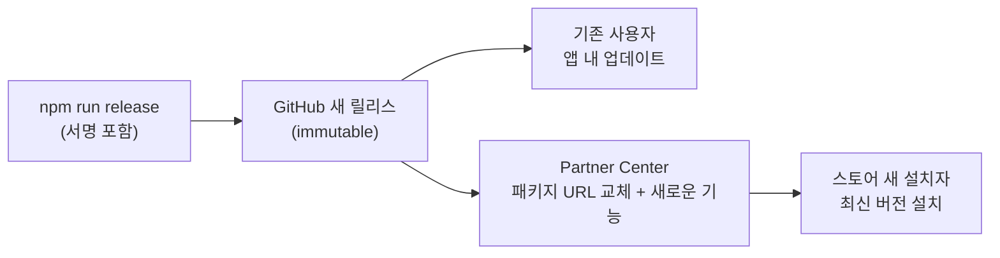

# Tidy Task — Microsoft Store 게시 가이드

> 작성: 2026-10-07 · 기준: Tidy Task 5.6.5 (Tauri v2, NSIS `.exe` 설치 파일)
> 함께 쓰는 문서
> - 붙여넣기용 문구·이미지 순서·연령 등급 답변: [store/스토어-등록정보.md](store/스토어-등록정보.md)
> - 개인정보처리방침 원문: [store/privacy-policy.md](store/privacy-policy.md)
> - 기존 배포 절차(버전 맞추기·`npm run release`): [업데이트-배포-가이드.md](업데이트-배포-가이드.md)
> - 스토어 이미지: `artwork/store/` (8절)

---

## 0. 한눈에 보기



| 구분 | 내용 |
| --- | --- |
| 추천 경로 | **기존 `.exe` 설치 파일 그대로 제출 + 코드 서명** (코드 변경 최소, 앱 내 업데이트 유지) |
| 반드시 필요한 것 | 개발자 계정, **Microsoft 신뢰 루트에 연결된 코드 서명 인증서**, 지원 연락처, 개인정보처리방침 URL |
| 이미 준비된 것 | 등록 문구 전체, 스크린샷 10장, 상자 아트·포스터 아트·홍보 이미지, 개인정보처리방침 초안, 연령 등급 답변 |
| 비용 | 계정 **무료**(개인) + 코드 서명 인증서 연간 비용 |
| 가장 큰 관문 | **현재 5.6.5 설치 파일은 서명되어 있지 않아 그대로는 제출 불가** → 서명된 다음 버전이 첫 스토어 버전 |

> [!IMPORTANT]
> 이 문서는 절차와 자료를 준비한 것입니다. **인증서 연결·설치 파일 설정·버전 변경·릴리스는 아직 하나도 적용하지 않았습니다.**
> 10절의 결정 사항을 정해 주시면 그에 맞춰 코드·설정을 바꿉니다.

---

## 1. 어떤 방식으로 올릴까 — 경로 비교

Microsoft Store는 Win32 앱을 두 방식으로 받습니다.

| | **A. EXE 그대로 제출 (추천)** | B. MSIX로 다시 포장 |
| --- | --- | --- |
| 제출물 | 지금의 NSIS `.exe`를 **고정 URL**로 등록 | `.msix` 패키지 업로드 |
| 서명 | **직접 코드 서명 필수**(유료 인증서) | 스토어가 서명해 줌(무료) |
| 앱 내 업데이트 | **그대로 사용 가능**(정책 10.2.9: 게임이 아닌 EXE/MSI 앱은 자체 업데이트 허용) | 꺼야 함. 스토어 업데이트만 사용 |
| 자동 실행 | 지금 방식(레지스트리) 그대로 | 매니페스트 StartupTask로 다시 구현 |
| 사용자 자료 | 기존과 같은 폴더 → **기존 사용자 자료 그대로** | AppData 가상화로 **기존 설치본과 자료가 갈라질 위험** |
| 개발량 | 서명 설정 + 검증 추가 | 패키징 도구, 업데이터 분기, 자동 실행·경로 재작업, 재검수 |
| 덤 | 서명 덕분에 GitHub 직접 다운로드의 "알 수 없는 게시자" 표시도 사라짐 | 스토어 밖 배포에는 변화 없음 |

**결론:** 데이터 보존 원칙(`claude.md`)과 앱 내 업데이트를 지키려면 **A안**이 맞습니다. 비용이 전혀 없어야 한다면 B안도 가능하지만, 업데이터·자동 실행·자료 경로를 다시 만들고 검수해야 하는 큰 작업입니다.

---

## 2. 준비물 체크리스트

| # | 준비물 | 상태 | 비고 |
| --- | --- | --- | --- |
| 1 | Microsoft 계정(개인) | ☐ | 개발자 계정용. 가능하면 업무 전용 계정 |
| 2 | 신분증 + 휴대전화 카메라 | ☐ | 개인 개발자 신원 확인(셀카 포함) |
| 3 | 게시자 표시 이름 | ☐ | 스토어에 "제작: ○○○"로 보임. 예: `찰떡쌤` |
| 4 | 지원 이메일 | ☐ | 등록정보 필수 항목, 개인정보처리방침에도 기재 |
| 5 | 개인정보처리방침 게시 주소 | ☐ | [privacy-policy.md](store/privacy-policy.md)를 웹에 게시(3단계 참고) |
| 6 | 코드 서명 인증서 | ☐ | 3단계 |
| 7 | 서명된 새 버전 설치 파일 URL | ☐ | 4·5단계 |
| 8 | 등록 문구·이미지 | ✅ | [스토어-등록정보.md](store/스토어-등록정보.md), `artwork/store/` |
| 9 | 연령 등급 답변 | ✅ | 등록정보 문서 10절 |

### 예상 비용·기간

| 단계 | 기간(대략) | 비용 |
| --- | --- | --- |
| 개발자 계정 가입·신원 확인 | 몇 시간 ~ 수일 | 무료(개인) |
| 코드 서명 인증서 발급 | 수일 ~ 2주(신원 확인 포함) | 연간 유료 — 업체·형태별 상이, 구매 시점 가격 확인 |
| 서명 연결·새 버전 빌드 | 1일 | — |
| Partner Center 입력 | 1~2시간 | — |
| 심사 | 보통 수일(영업일 기준 3일 안팎) | — |

---

## 3. 단계별 절차

### ① 개발자 계정 만들기

1. **storedeveloper.microsoft.com** 접속 → **개인(Individual)** 개발자로 가입합니다.
2. 신분증 촬영과 셀카로 신원 확인을 마칩니다. 개인 계정은 등록비가 없고 카드 등록도 필요 없습니다.
3. **게시자 표시 이름(Publisher display name)**을 정합니다. 스토어에 노출되며 나중에 바꾸기 번거롭습니다.
   - 추천: `찰떡쌤` (블로그·유튜브와 같은 이름 → 검색·신뢰 연결)
4. 가입이 끝나면 **Partner Center → 앱 및 게임(Apps and games)**으로 들어갑니다.

> [!WARNING]
> 코드 서명 인증서의 **이름(개인 실명)**과 게시자 표시 이름은 달라도 됩니다. 다만 설치 화면의 게시자에는 인증서 이름이 보이므로, 블로그 소개에 "인증서상 게시자: (실명)"을 한 줄 적어 두면 사용자 혼란이 줄어듭니다.

### ② 앱 이름 예약

1. Partner Center → **새 제품 → MSI 또는 EXE 앱**을 선택합니다. (MSIX/PWA 아님)
2. 이름 `Tidy Task`를 예약합니다. 이미 쓰이고 있으면 순서대로 시도합니다.
   - `Tidy Task - 선생님 메모·교실 도구` → `Tidy Task for Teachers`
3. 예약한 이름은 일정 기간(보통 3개월) 안에 제출하지 않으면 풀릴 수 있으니, 인증서 준비 일정과 맞춰 예약합니다.

### ③ 코드 서명 인증서 준비 — 가장 중요한 관문

**스토어 요구 사항:** 설치 파일과 그 안의 모든 실행 파일(PE: `.exe`·`.dll`)이 **Microsoft 신뢰 루트 프로그램에 포함된 인증 기관(CA)**의 인증서로 Authenticode 서명되어야 합니다. **자체 서명 인증서는 거절**됩니다.

| 선택지 | 개인 가능 여부 | 특징 |
| --- | --- | --- |
| **Azure Trusted(Artifact) Signing** | ✕ 개인은 미국·캐나다만 | 가장 싸지만 한국 개인은 현재 불가 |
| **상용 CA의 OV 코드 서명(개인용)** — Certum, SSL.com, Sectigo 계열 등 | ○ | 표준 방식. 2023년 이후 개인 키는 **USB 보안 토큰 또는 클라우드 서명**으로만 발급 |
| **Certum 오픈소스 코드 서명** | ○ (오픈소스 조건) | 저렴. 단 공개 저장소 + **오픈소스 라이선스**가 필요한데, 현재 저장소에는 LICENSE가 없음 |
| EV 코드 서명 | 보통 사업자 대상 | 개인에게는 과함. 2024년부터 SmartScreen 즉시 신뢰 혜택도 없어짐 |

**추천:** 상용 CA의 **개인용 OV 코드 서명 + 클라우드 서명**(예: Certum SimplySign, SSL.com eSigner).
USB 토큰은 분실·고장 위험이 있고, 클라우드 서명은 지금 쓰는 PC에서 `signtool`로 바로 서명할 수 있습니다.

> [!CAUTION]
> 인증서 개인 키·클라우드 서명 비밀번호·OTP는 **절대 저장소에 커밋하지 않습니다.** 업데이터 개인 키와 같은 등급으로 관리하세요.
> 오픈소스 라이선스를 붙이는 것은 소스 공개 범위를 바꾸는 큰 결정이므로, Certum 오픈소스 인증서를 위해 서두르지 마세요.

#### 서명을 빌드에 연결하는 방법 (제안 — 아직 적용 안 함)

Tauri v2는 번들 단계에서 앱 실행 파일과 NSIS 설치 파일을 서명할 수 있습니다. 인증서를 Windows 인증서 저장소에 올린 뒤(클라우드 서명 앱이 가상 카드로 연결), `src-tauri/tauri.conf.json`에 다음처럼 지정하는 방식입니다.

```jsonc
// 제안 예시 — 인증서 발급 후 지문·타임스탬프 주소를 실제 값으로 바꿔 적용
"bundle": {
  "windows": {
    "certificateThumbprint": "<인증서 SHA-1 지문>",
    "digestAlgorithm": "sha256",
    "timestampUrl": "<인증 기관이 안내한 타임스탬프 주소>",
    "nsis": { "installerHooks": "windows/data-preserving-uninstall.nsh" }
  }
}
```

인증 기관 전용 도구를 써야 하면 `"signCommand"`로 `signtool sign /fd sha256 /tr <타임스탬프> /td sha256 /sha1 <지문> %1` 같은 명령을 지정합니다.

함께 할 일:
- `scripts/release-verify.mjs`에 **서명 확인 단계**를 추가합니다. 설치 파일과 설치된 `Tidy Task.exe`·`uninstall.exe`의 `Get-AuthenticodeSignature` 결과가 `Valid`이고 서명자가 예상 인증서인지 검사해, 서명이 빠진 릴리스가 나가지 않게 막습니다.
- 통계 토큰 검사·`npm run release` 단일 경로는 그대로 둡니다. 서명 때문에 검사를 건너뛰는 옵션을 만들지 않습니다.
- 업데이터 서명(minisign, `latest.json`)은 코드 서명과 별개이므로 계속 유지합니다.

### ④ 설치 파일을 스토어 규칙에 맞추기

| 스토어 규칙 | 현재 상태 | 조치 |
| --- | --- | --- |
| 무인(silent) 설치 지원 | NSIS는 `/S` 지원 | Partner Center 설치 매개변수에 `/S` 입력. 아래 명령으로 직접 확인 |
| 오프라인 단독 설치 파일 | WebView2 설치 방식이 기본값(`downloadBootstrapper`) — WebView2가 없는 PC에서는 설치 중 내려받음 | **결정 필요(10절)** — 아래 표 |
| 관리자 권한 | `currentUser` 설치 → UAC 없음 | 그대로 |
| 모든 PE 서명 | 서명 없음 | ③단계 |
| 고정 URL | GitHub 릴리스가 **immutable**(5.6.3·5.6.5 모두 `immutable: true`) | 그대로 활용 |
| 제거 시 자료 | 훅이 자료를 항상 보존 | 그대로(데이터 보존 원칙) |

**WebView2 설치 방식 선택지**

| 값 | 설치 파일 크기 | 인터넷 없는 PC | 비고 |
| --- | --- | --- | --- |
| `downloadBootstrapper`(현재) | 그대로(약 77MB) | WebView2가 없으면 실패 | Windows 11·최신 Windows 10은 WebView2가 이미 있어 대부분 문제없음 |
| `embedBootstrapper` | +약 2MB | WebView2가 없으면 여전히 내려받기 필요 | 부트스트래퍼 다운로드 단계만 없어짐 |
| `offlineInstaller` | +약 130MB | **완전 오프라인 설치** | 규칙에 가장 확실히 맞지만, 앱 내 업데이트 다운로드도 그만큼 커짐 |

추천: 첫 제출은 **`embedBootstrapper`**(작은 증가로 위험 감소). 심사에서 오프라인 문제로 반려되면 `offlineInstaller`로 바꿉니다.

**무인 설치·서명 직접 확인** (새 버전 설치 파일로, 테스트용 Windows 사용자 계정이나 가상 머신에서)

```powershell
# 1) 무인 설치: 창 없이 끝나고 종료 코드 0이어야 함
$p = Start-Process ".\Tidy.Task_x.y.z_x64-setup.exe" -ArgumentList "/S" -Wait -PassThru; $p.ExitCode

# 2) 설치 파일과 설치된 실행 파일의 서명 확인: 모두 Valid
Get-AuthenticodeSignature ".\Tidy.Task_x.y.z_x64-setup.exe" | Format-List Status, SignerCertificate
Get-ChildItem "$env:LOCALAPPDATA\Programs\Tidy Task" -Include *.exe, *.dll -Recurse |
  Get-AuthenticodeSignature | Format-Table Status, Path -AutoSize

# 3) 무인 제거 후 자료 폴더가 남아 있는지 확인 (데이터 보존)
Start-Process "$env:LOCALAPPDATA\Programs\Tidy Task\uninstall.exe" -ArgumentList "/S" -Wait
Test-Path "$env:APPDATA\com.tidy.task"
```

> 설치 경로는 PC 설정에 따라 다를 수 있습니다. 실제 경로는 설치 후 시작 메뉴 바로가기의 "파일 위치 열기"로 확인하세요.

### ⑤ 서명된 새 버전 릴리스 → 고정 URL 확보

1. [업데이트-배포-가이드.md](업데이트-배포-가이드.md)대로 버전을 올립니다(기준: `package.json` → Cargo·lock·설정·첫 실행·도움말 맞춤).
2. 서명이 연결된 상태에서 **`npm run release`만** 실행합니다. (`--skip-build`는 변경 반영 수단이 아님)
3. 결과 설치 파일의 서명을 ④단계 명령으로 확인합니다.
4. GitHub에 **새 릴리스**로 올립니다. 설치 파일 주소가 스토어 **패키지 URL**이 됩니다.

```text
https://github.com/djqanrudgns12/Tidy-Task-Local/releases/download/v<버전>/Tidy.Task_<버전>_x64-setup.exe
```

> [!WARNING]
> 스토어에 등록한 URL의 파일은 **절대 바꾸면 안 됩니다.** 같은 태그에 파일을 덮어쓰면 심사·설치 검증이 실패합니다. 새 버전은 항상 새 URL로 제출합니다(GitHub immutable 릴리스라 실수로 덮어쓸 걱정은 적음).
> `releases/latest/download/...` 같은 **변하는 주소는 쓰지 않습니다.**

### ⑥ Partner Center 제출 — 화면 순서대로

제출(Submission) 화면의 각 항목에 다음 값을 넣습니다. 문구는 모두 [스토어-등록정보.md](store/스토어-등록정보.md)에서 복사합니다.

#### 6-1. 가격 및 사용 가능 여부 (Pricing and availability)

| 항목 | 값 |
| --- | --- |
| 시장(Markets) | **대한민국만** 우선 추천 — 급식(나이스)·한국어 화면, 사용 통계 동의 기준이 국가별로 다른 점 고려. 해외 한국학교까지 원하면 "모든 시장" |
| 표시 여부(Visibility) | 공개, 스토어 검색 노출 |
| 가격 | 무료 |
| 게시 일정 | **인증 후 수동 게시** 추천 — 블로그·쇼츠 공개 시점에 맞춰 직접 게시 버튼 |

#### 6-2. 속성 (Properties)

| 항목 | 값 |
| --- | --- |
| 범주 | 교육 (하위 범주에 교사용 도구가 있으면 선택) |
| 보조 범주 | 생산성 |
| 개인정보 | "개인정보에 접근·수집·전송함" **예** → 개인정보처리방침 URL 입력 (무작위 설치 ID·사용 통계 전송 때문) |
| 웹 사이트 | 블로그 Tidy Task 소개 글 |
| 지원 연락처 | 지원 이메일 |
| 시스템 요구 사항 | 키보드·마우스 사용. 최소 하드웨어는 선택 항목 — 실측 없이 숫자를 지어내지 않기 |
| 제품 선언 | 실제로 확인한 항목만 체크(예: 접근성 테스트를 하지 않았다면 체크하지 않음) |

#### 6-3. 연령 등급 (Age ratings)

IARC 질문지에 답합니다. 답변표는 [등록정보 10절](store/스토어-등록정보.md#10-연령-등급iarc-질문지-답변-가이드). 핵심은 **'방구' 효과음을 저속한 유머 질문에서 숨기지 않는 것**입니다(7+가 되어도 문제없음).

#### 6-4. 패키지 (Packages)

| 항목 | 값 |
| --- | --- |
| 패키지 URL | ⑤단계의 버전 고정 GitHub 주소 |
| 아키텍처 | x64 |
| 언어 | 한국어(ko-kr) |
| 앱 유형 | EXE |
| 설치 매개변수(무인 설치 스위치) | `/S` |
| 반환 코드 | 기본값 유지(선택 항목) |

#### 6-5. 스토어 등록정보 (Store listings) — 한국어

| 칸 | 넣을 것 |
| --- | --- |
| 제품 이름 | 예약한 이름 |
| 설명 / 요약 설명 | 등록정보 문서 3절 / 2절 |
| 새로운 기능 | 첫 제출은 비움 |
| 제품 기능 | 등록정보 문서 4절(20줄) |
| 스크린샷 | 등록정보 문서 8.1절 순서대로 10장 + 캡션 |
| 상자 아트 1:1 | `artwork/store/logos/box-art-1x1-2160.png` |
| 포스터 아트 2:3 | `artwork/store/logos/poster-art-2x3-1440x2160.png` |
| 추가 시스템 요구 사항 | 등록정보 문서 5절 |
| 검색어 | 등록정보 문서 6절(7개) |
| 저작권 / 개발자 | `© 2026 찰떡쌤` / `찰떡쌤` |

#### 6-6. 제출

모든 항목이 "완료"가 되면 **스토어에 제출(Submit to the Store)**. 심사 상태는 Partner Center와 이메일로 알려 줍니다.

### ⑦ 심사 — 자주 반려되는 이유와 대비

| 반려 사유 | Tidy Task에서의 위험 | 대비 |
| --- | --- | --- |
| 설치 파일·실행 파일 서명 누락 | **확실히 걸림(현재 미서명)** | ③단계 + 릴리스 검증에 서명 검사 |
| 무인 설치 실패·창이 뜸 | 낮음 | ④단계 `/S` 테스트 |
| 오프라인 설치 불가 | 중간(WebView2 없는 PC) | `embedBootstrapper` 또는 `offlineInstaller` |
| URL 파일 변경·접근 불가 | 낮음(immutable) | 버전 고정 주소만 사용 |
| 설명과 실제 기능 불일치 | 낮음 | 문구를 5.6.5 기능 문서와 대조해 작성. 기능이 바뀌면 문구도 수정 |
| 개인정보처리방침 누락·불일치 | 낮음 | 실제 통계 코드 기준으로 작성. 통계 항목을 바꾸면 방침도 수정 |
| 사용자 동의 없는 시작 프로그램 등록 | **낮음~중간**(자동 실행 기본 켜짐) | 설명에 이미 공개함. 지적받으면 첫 실행 화면에 자동 실행 선택을 추가하거나 기본값을 끄는 방안 검토 |
| 연령 등급 질문 허위 응답 | 낮음 | 답변표대로 정직하게 |

반려되면 사유가 구체적으로 오므로, 해당 항목만 고쳐 같은 제출을 다시 보냅니다.

---

## 4. 게시 후 업데이트 운영



1. 지금처럼 `npm run release` → GitHub 릴리스를 만들면 **기존 사용자(스토어 설치자 포함)는 앱 안에서 업데이트**됩니다.
2. 그다음 Partner Center에서 **새 제출**을 만들고 패키지 URL만 새 버전 주소로 바꾼 뒤 "새로운 기능"을 채워 제출합니다.
3. 2를 잊어도 스토어 신규 설치자는 옛 버전을 설치했다가 앱 안에서 업데이트를 받으므로 큰 문제는 없지만, 첫인상과 심사 기록을 위해 매 버전 갱신을 권장합니다.
4. 통계 검증 규칙은 그대로입니다. HTTP·빌드 성공만으로 완료라고 쓰지 않고, `environment=test` 실제 수신과 대시보드의 `environment=production` 필터를 확인합니다.

---

## 5. 출시 후 다운로드를 끌어올리는 전략

### 5.1 스토어 안에서

- **첫 3장의 스크린샷이 승부처:** 1장 "무엇을 하는 앱인지" → 2장 "툴킷 12가지" → 3장 "인형 뽑기"(가장 신기한 장면) 순서로 이미 배치했습니다.
- **별점·리뷰가 순위를 끌어올립니다.** 출시 첫 2주 동안 기존 사용자에게 별점을 부탁하세요(블로그·앱 내 소식).
- **포스터 아트**를 반드시 올려야 스토어 추천 영역에 실릴 수 있습니다(준비 완료).
- 검색어 7개는 시즌에 맞춰 바꿀 수 있습니다. 예: 3월에는 `자리 배치`·`학급 명단`, 회장 선거 시기에는 `회장 선거`.

### 5.2 스토어 밖에서 (유입 경로)

| 채널 | 할 일 |
| --- | --- |
| 네이버 블로그 | 소개 글 상단에 **"Microsoft Store에서 받기" 배지·링크**를 가장 먼저. 기존 GitHub 링크는 "직접 다운로드"로 아래에 |
| 유튜브·쇼츠 | 설명란 첫 줄과 고정 댓글에 스토어 링크. 쇼츠 제목 예: "선생님, 아직도 타이머 사이트 검색하세요?" |
| 교사 커뮤니티 | 인디스쿨 등에 "스토어 정식 등록" 소식 + 써 본 장면 GIF. 문구는 등록정보 11절 |
| 앱 내 소식 | 다음 버전의 업데이트 소식에 "이제 Microsoft Store에서도 받을 수 있어요 — 별점 부탁드려요". 새 공지로 보이게 하려면 공지 ID를 의도적으로 갱신 |
| 동료 교사 공유 | 스토어 링크는 "Tidy Task" 검색만으로도 찾을 수 있어 말로 전하기 쉬움 |
| winget(고급 사용자) | 스토어 게시 후 `winget search "Tidy Task"`로 나오는 ID(보통 `XP…`)를 블로그에 함께 적기 |

### 5.3 시기

- **2월 말~3월 첫 주(새 학기 준비)**가 가장 큰 기회입니다. 학급 명단·자리 배치·알림장 장면을 앞세우세요.
- 8월 말 2학기 시작, 회장 선거 시기, 학기말 학급 행사도 좋은 타이밍입니다.

---

## 6. 개인정보처리방침 게시 방법

스토어에는 **누구나 열 수 있는 웹 주소**가 필요합니다. 쉬운 순서:

1. **네이버 블로그 공개 글**로 [privacy-policy.md](store/privacy-policy.md) 내용을 올리기 (가장 간단)
2. GitHub 저장소에 커밋 후 파일 주소 사용 — 커밋·푸시는 요청하실 때만 진행
3. GitHub Pages 등 별도 페이지

올리기 전 `【지원 이메일 입력】`, `【게시일 입력】` 자리를 채웁니다.

---

## 7. 사용 통계와 스토어 — 함께 알아둘 점

- 지금은 앱 안에서 **통계 전송을 끄는 설정이 없습니다.** 방침에 사실대로 적었고, 대한민국 시장만 먼저 여는 것을 추천한 이유 중 하나입니다.
- 장기적으로는 설정에 "사용 통계 보내기" 끄기 옵션을 두면 해외 시장 확대·심사 대응이 쉬워집니다. 통계 계약(`AGENTS.md`)과 집계 지표에 영향이 있으므로 별도 결정이 필요합니다.

---

## 8. 스토어 이미지 — 구성과 다시 만들기

| 폴더 | 내용 |
| --- | --- |
| `artwork/store/screenshots/` | 스토어 스크린샷 10장(2560×1440) |
| `artwork/store/logos/` | 상자 아트 1:1(일반·투명), 포스터 아트 2:3 |
| `artwork/store/promo/` | 16:9 홍보 이미지(3840×2160) — 블로그·유튜브 커버·트레일러 썸네일 |
| `artwork/store/_source/` | 원본: 블로그의 **실제 앱 캡처**, 유튜브 썸네일, 문구 없는 장식용 생성 일러스트 2장 |
| `artwork/store/_build/` | 템플릿 `store-assets.html`과 렌더 스크립트 `render.cjs` |

- 스크린샷의 앱 화면은 모두 실제 캡처입니다. 생성 이미지는 포스터·홍보 이미지의 **장식 배경에만** 썼습니다(스토어 정책상 스크린샷은 실제 앱이어야 함).
- 문구는 앱 내장 글꼴(메이플스토리)로 그려 한글이 또렷합니다.

**다시 만들기** (문구를 고친 뒤): `playwright-core`는 프로젝트 의존성에 넣지 않았습니다. 별도 폴더에 설치하고 경로만 알려 줍니다.

```powershell
# 한 번만: 임시 폴더에 playwright-core와 Chromium 설치
npm install --prefix $env:TEMP\tidy-render playwright-core
node $env:TEMP\tidy-render\node_modules\playwright-core\cli.js install chromium

# 렌더
$env:NODE_PATH = "$env:TEMP\tidy-render\node_modules"
node artwork/store/_build/render.cjs
```

새 기능 화면을 넣으려면 실제 앱을 캡처해 `_source/`에 넣고, `store-assets.html`의 해당 슬라이드 ``와 자르기 값(`data-x/y/w/h`)을 바꿉니다.

---

## 9. 만든 자료 목록

| 파일 | 용도 |
| --- | --- |
| [MS-스토어-게시-가이드.md](MS-스토어-게시-가이드.md) | 이 문서 — 절차·판단 근거 |
| [store/스토어-등록정보.md](store/스토어-등록정보.md) | 붙여넣기용 문구 전체, 글자 수 검증, 이미지 순서·캡션, IARC 답변, 홍보 문구 |
| [store/privacy-policy.md](store/privacy-policy.md) | 개인정보처리방침(한·영) |
| `artwork/store/**` | 스토어 이미지 14개와 원본·템플릿 |

---

## 10. 결정이 필요한 사항

| # | 질문 | 추천 |
| --- | --- | --- |
| 1 | 경로: EXE+유료 서명(A) / MSIX 재포장(B) | **A** |
| 2 | 인증서 종류·업체 | 개인 OV + 클라우드 서명 |
| 3 | 저장소에 오픈소스 라이선스를 붙일지(Certum 오픈소스 인증서 조건) | 서두르지 않기 |
| 4 | WebView2 설치 방식 | `embedBootstrapper` |
| 5 | 게시자 표시 이름 | `찰떡쌤` |
| 6 | 지원 이메일 | 직접 입력 필요 |
| 7 | 개인정보처리방침 게시 위치 | 네이버 블로그 공개 글 |
| 8 | 시장 범위 | 대한민국 우선 |
| 9 | 첫 스토어 버전 번호 | 다음 패치 버전(예: 5.6.6) |

결정해 주시면 서명 연결(`tauri.conf.json`), 릴리스 검증의 서명 검사, WebView2 설정, 버전 변경을 `npm test`·`npm run check`·Rust 테스트와 함께 진행하겠습니다.

---

### 참고(Microsoft Learn)

- Partner Center의 MSI/EXE 앱 제출: 앱 패키지 요구 사항(버전 고정 HTTPS URL, 무인 설치, 오프라인 단독 설치 파일, 신뢰 루트 CA 코드 서명)
- 스토어 등록정보 필드 제한(설명 10,000자, 제품 기능 20개×200자, 추가 시스템 요구 사항 11개×200자, 검색어 7개)
- 스크린샷 1366×768~3840×2160 PNG 최대 10장, 1:1 상자 아트 필수, 2:3 포스터 아트 권장
- Microsoft Store 정책 10.2.9(게임이 아닌 EXE/MSI 앱의 자체 업데이트 허용)
