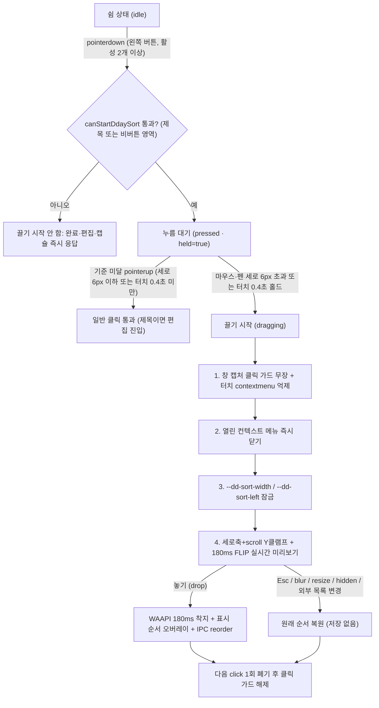
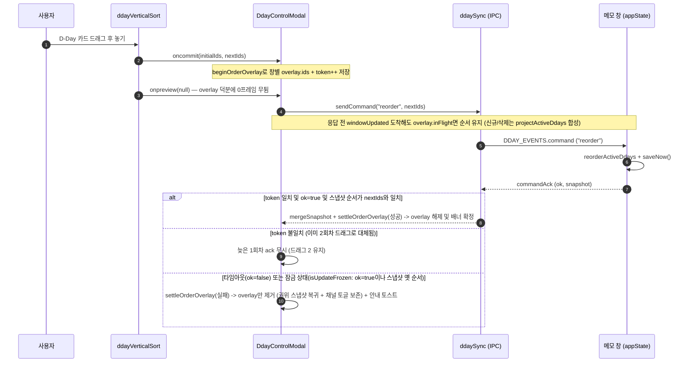

# PRD — D-Day 컨트롤 패널 고도화 (무잔상 프레임 · 15종 테마/글꼴 연동 · 스마트 드래그 재정렬 · 창 크기 하네스)

| 항목 | 내용 |
|---|---|
| 문서 판 | **v2** (v1 작성 2026-11-19 → Claude Opus 5.5 검수 및 사용자 4대 결정 반영) |
| 작성 | 2026-11-19 |
| 상태 | **검수 반영 완료 (Claude Opus 5.5 검수 완료 · 구현 준비)** |
| 대상 | [DdayControlModal.svelte](file:///c:/Users/User/Desktop/vibecoding/Tidy-Task-Local/src/components/dday/DdayControlModal.svelte), [DdayRowCard.svelte](file:///c:/Users/User/Desktop/vibecoding/Tidy-Task-Local/src/components/dday/DdayRowCard.svelte), [DdayEditSheet.svelte](file:///c:/Users/User/Desktop/vibecoding/Tidy-Task-Local/src/components/dday/DdayEditSheet.svelte), [DdaySettingsTab.svelte](file:///c:/Users/User/Desktop/vibecoding/Tidy-Task-Local/src/components/dday/DdaySettingsTab.svelte), [DdayArchiveView.svelte](file:///c:/Users/User/Desktop/vibecoding/Tidy-Task-Local/src/components/dday/DdayArchiveView.svelte), [DdayBanner.svelte](file:///c:/Users/User/Desktop/vibecoding/Tidy-Task-Local/src/components/dday/DdayBanner.svelte), [DdayResizeHandles.svelte](file:///c:/Users/User/Desktop/vibecoding/Tidy-Task-Local/src/components/dday/DdayResizeHandles.svelte), [ddayModel.js](file:///c:/Users/User/Desktop/vibecoding/Tidy-Task-Local/src/lib/dday/ddayModel.js), [ddayWindowBounds.js](file:///c:/Users/User/Desktop/vibecoding/Tidy-Task-Local/src/lib/dday/ddayWindowBounds.js), [ddayLayout.js](file:///c:/Users/User/Desktop/vibecoding/Tidy-Task-Local/src/lib/dday/ddayLayout.js), [ddaySync.js](file:///c:/Users/User/Desktop/vibecoding/Tidy-Task-Local/src/lib/dday/ddaySync.js), [ddayModel.test.js](file:///c:/Users/User/Desktop/vibecoding/Tidy-Task-Local/src/lib/dday/ddayModel.test.js), [ddayWindowBounds.test.js](file:///c:/Users/User/Desktop/vibecoding/Tidy-Task-Local/src/lib/dday/ddayWindowBounds.test.js), [ddayLayout.test.js](file:///c:/Users/User/Desktop/vibecoding/Tidy-Task-Local/src/lib/dday/ddayLayout.test.js), 신규 모듈 (`ddayControlTheme.js`, `ddayControlTheme.test.js`, `ddaySort.js`, `ddaySort.test.js`, `createVerticalSort.js`, `ddayVerticalSort.js`, `scripts/qa-dday-control.cjs`), [claude.md](file:///c:/Users/User/Desktop/vibecoding/Tidy-Task-Local/claude.md) |
| 재사용(무수정) | [rowGestures.js](file:///c:/Users/User/Desktop/vibecoding/Tidy-Task-Local/src/lib/todos/rowGestures.js), [order.js](file:///c:/Users/User/Desktop/vibecoding/Tidy-Task-Local/src/lib/todos/order.js), [appearance.js](file:///c:/Users/User/Desktop/vibecoding/Tidy-Task-Local/src/lib/toolkit/appearance.js) (`watchCustomFonts`), [fonts.js](file:///c:/Users/User/Desktop/vibecoding/Tidy-Task-Local/src/lib/fonts.js) (`registerFontFace`), [builtinFonts.js](file:///c:/Users/User/Desktop/vibecoding/Tidy-Task-Local/src/lib/builtinFonts.js), [themes.js](file:///c:/Users/User/Desktop/vibecoding/Tidy-Task-Local/src/lib/themes.js), [ddayBadge.js](file:///c:/Users/User/Desktop/vibecoding/Tidy-Task-Local/src/lib/dday/ddayBadge.js), [default.json](file:///c:/Users/User/Desktop/vibecoding/Tidy-Task-Local/src-tauri/capabilities/default.json) |
| 바꾸지 않는 것 | [TodoList.svelte](file:///c:/Users/User/Desktop/vibecoding/Tidy-Task-Local/src/components/TodoList.svelte), [verticalSort.js](file:///c:/Users/User/Desktop/vibecoding/Tidy-Task-Local/src/lib/todos/verticalSort.js), [DdayWidget.svelte](file:///c:/Users/User/Desktop/vibecoding/Tidy-Task-Local/src/components/dday/DdayWidget.svelte), `DdayItem` 저장 스키마(`tidy-task-config.json`), PostHog 이벤트 계약, 앱 버전 |
| 병행 작업 호환 | D-Day 컨트롤 자유 리사이즈([DdayResizeHandles.svelte](file:///c:/Users/User/Desktop/vibecoding/Tidy-Task-Local/src/components/dday/DdayResizeHandles.svelte), [ddayLayout.js](file:///c:/Users/User/Desktop/vibecoding/Tidy-Task-Local/src/lib/dday/ddayLayout.js), [ddayWindowBounds.js](file:///c:/Users/User/Desktop/vibecoding/Tidy-Task-Local/src/lib/dday/ddayWindowBounds.js)) 및 스마트 글리프([DdayControlGlyph.svelte](file:///c:/Users/User/Desktop/vibecoding/Tidy-Task-Local/src/components/dday/DdayControlGlyph.svelte), [ddayBadge.js](file:///c:/Users/User/Desktop/vibecoding/Tidy-Task-Local/src/lib/dday/ddayBadge.js))와 완전 통합 |

### v1 → v2 주요 변경 이력

| 구분 | 변경 내용 | 근거 |
|---|---|---|
| **사용자 결정 Q1** | 상호작용 요소 기본 차단(Deny-by-default) + 제목(`.dd-title-btn[data-dday-sortable]`) 명시 허용, `.dd-capsule` 래퍼 차단, `<button>` 속성 강제 정적 테스트, 발견성 3종 추가 | 편의성·안전성 극대화 + I1 |
| **사용자 결정 Q2** | `.ctrl-list` 영구 1열 수직 리스트 고정(`is-grid2` 제거) + **과제 4: 4계층 창 크기 조절 하네스**(적정 폭 `340~580` × 높이 `460~860`, 작은 모니터 `effectiveMin`, 위치 보존 클램프, Playwright 매트릭스) 신설 | Q2 + C2 + C3 + I10 + I11 |
| **사용자 결정 Q3** | 라이트·다크 하단 `[완료]` 버튼을 `--dd-accent-fill` + `--dd-on-accent`로 통일 + `title="창 닫기"` 툴팁 부여 | Q3 + I10 메모 |
| **사용자 결정 Q4** | 메모 창 `uiFontFamily` 동시 연동: `BUILTIN_FONTS` 48종(시스템 10종 `name → family`) + `watchCustomFonts` / `registerFontFace` 커스텀 글꼴 창별 등록 + `--ui-font-family` & `--global-font-family` 동시 주입 | Q4 + I7 |
| **검수 Critical (C1~C7)** | ① URL 부트스트랩 쿼리 및 `setTarget` + 글꼴 대기 show 게이트(C1), ② 위치 보존 크기 클램프 정규화(C2), ③ 4경로 `setMaxSize`/`maximizable: false`/작은 모니터 `effectiveMin`(C3), ④ 창별 **표시 순서 오버레이 리듀서**(C4), ⑤ 터치 길게 누름 중 `contextmenu` 억제(C5), ⑥ 스크롤바 `margin-right`로 동쪽 리사이즈 핸들 비겹침(C6), ⑦ `@dnd-kit/dom` top-layer 5대 안전장치(C7) | Claude Opus 5.5 검수 §0~§1 |
| **검수 Important (I1~I12)** | 빠른 메뉴 백드롭 기대 수정(I2), `Esc` 6단계 우선순위+아카이브 다이얼로그 `Esc`(I3), `position: absolute` 무레이아웃 시프트 키보드 손잡이(I4), `completingIds` 낙관적 제거+연타 보호(I5), 자식 인라인 `--dd-accent` 제거+`DdayBanner` 폴백/`--header-*` 3종(I6), 다크 스크롤바·셸 한정 `color-scheme`·계산 대비 측정(I8), 불투명 보더+`border-box`+`shellW` 단일 기준+`cornerSize: 10`(I9), DPI 전환 500ms 저장 억제(I11), 공용 `createVerticalSort.js` 코어 분리(I12) | Claude Opus 5.5 검수 §2 |

---

## 1. 배경 및 현황 진단 (Forensic Audit)

사용자가 전달한 스크린샷(메모 테마 **페리윙클 에어** `periwinkle` 적용 상태)과 2026-11-19 작업 트리의 실제 코드를 전수 대조한 결과, D-Day 컨트롤 패널(`dday-control`)에는 구조·테마/글꼴·조작·창 크기 하네스 4가지 축의 결함이 확인되었습니다.

### 1.1 미세 테두리 흔적(그림자·잔선·잔상)의 4가지 실제 원인 및 v2 회귀 예방

스크린샷 외곽 테두리 바깥에 얇고 흐릿한 **사각형 음영 띠와 1px 잔선 흔적**이 남는 원인과, 여백 제거 시 발생하는 신규 회귀 위험은 아래와 같습니다.

1. **원인 A (주원인 — 4px 투명 여백 안에서 잘린 외부 `box-shadow`):**
   - [ddaySync.js](file:///c:/Users/User/Desktop/vibecoding/Tidy-Task-Local/src/lib/dday/ddaySync.js#L548-L553)는 창을 `decorations: false, transparent: true, shadow: false`로 엽니다.
   - 그런데 [DdayControlModal.svelte](file:///c:/Users/User/Desktop/vibecoding/Tidy-Task-Local/src/components/dday/DdayControlModal.svelte#L1152-L1193)에서 `.ctrl-host`가 `padding: 4px`를 두고, 내부 `.ctrl-shell`에 `border-radius: 18px`와 함께 **`box-shadow: 0 12px 32px rgba(15, 23, 42, 0.16)`**(다크 모드 `0 16px 38px rgba(0, 0, 0, 0.45)`)가 걸려 있습니다.
   - 그림자 블러 반경(`32px`)과 Y 오프셋(`12px`)이 `.ctrl-host`의 `4px` 여백을 넘기 때문에, WebView 창 경계(`100vw × 100vh`)에서 **그림자가 직사각형 칼로 잘린 듯 절단**되어 둥근 모서리 바깥쪽 `4px` 투명 띠에 사각 음영 잔상이 노출됩니다.
2. **원인 B (고배율 DPI 4px 띠 반올림 불일치 & `shellW` 측정 기준 혼재):**
   - Windows 배율(125%·150%·175%)에서 고정 `4px` 투명 띠의 물리↔논리 픽셀 경계가 서브픽셀로 번져 가장자리에 1px 잔선이 남을 수 있습니다.
   - 동시에 [DdayControlModal.svelte](file:///c:/Users/User/Desktop/vibecoding/Tidy-Task-Local/src/components/dday/DdayControlModal.svelte#L682-L689)는 초기 측정을 `getBoundingClientRect().width`(border-box)로 읽고 이후 `ResizeObserver`에서는 `entry.contentRect.width`(content-box)를 읽어 보더 `2px`만큼 `shellW` 기준이 어긋납니다.
3. **원인 C (반투명 `rgba` 곡면 번짐 & 카드 외부 `highlighted` 링 잘림):**
   - 현재 `.ctrl-shell`은 `border: 1px solid rgba(15, 23, 42, 0.1)`(다크 `rgba(255, 255, 255, 0.12)`)의 반투명 보더를 써서 투명 창 가장자리 안티앨리어싱 경계 픽셀이 뒤 화면 색과 섞입니다.
   - *(v2 보정)* 선례인 [SettingsModal.svelte](file:///c:/Users/User/Desktop/vibecoding/Tidy-Task-Local/src/components/SettingsModal.svelte#L948-L974)는 불투명 보더 색(`--st-edge-solid`)을 내측 `inset` 링으로 그렸고, 반대로 불투명 `border`에 `background-clip: padding-box`를 쓰면 고DPI 곡면에서 보더 안쪽 곡선과 배경 가장자리가 따로 안티앨리어싱되어 **투명 이음선**이 생길 위험이 있습니다. 따라서 v2에서는 **불투명 6자리 Hex 보더 + 기본 `border-box`**(또는 내측 `inset 0 0 0 1px` 링)를 사용합니다.
   - 또한 `.dd-row.highlighted`([DdayRowCard.svelte](file:///c:/Users/User/Desktop/vibecoding/Tidy-Task-Local/src/components/dday/DdayRowCard.svelte#L266-L269))의 외부 `box-shadow: 0 0 0 2px ...`와 NE 코너 `12px` 리사이즈 히트존([DdayControlModal.svelte](file:///c:/Users/User/Desktop/vibecoding/Tidy-Task-Local/src/components/dday/DdayControlModal.svelte#L1141-L1148))의 좁은 창 닫기 버튼 `2×4px` 겹침을 함께 정비해야 합니다.
4. **원인 D (v2 신규 회귀 예방 — 우측 스크롤바 ↔ 동쪽 리사이즈 핸들 겹침, C6):**
   - `.ctrl-host`의 `padding: 4px`를 `0`으로 바꾸면, 내부 스크롤 영역(`.ctrl-scroll`, [DdayEditSheet.svelte](file:///c:/Users/User/Desktop/vibecoding/Tidy-Task-Local/src/components/dday/DdayEditSheet.svelte#L653-L660)의 `.es-scroll`, [DdayArchiveView.svelte](file:///c:/Users/User/Desktop/vibecoding/Tidy-Task-Local/src/components/dday/DdayArchiveView.svelte#L330-L336)의 `.ar-scroll`)의 오른쪽 thin 스크롤바가 창 우측 끝에서 `1px` 안쪽에 붙게 됩니다.
   - 이때 형제 요소 [DdayResizeHandles.svelte](file:///c:/Users/User/Desktop/vibecoding/Tidy-Task-Local/src/components/dday/DdayResizeHandles.svelte#L162-L168)의 `.dd-edge-e`(`width: 5px; z-index: 60; right: 0;`)가 스크롤바 썸 위를 덮어버려 **스크롤바를 잡으면 동쪽 창 크기 조절이 시작되는 회귀**가 발생하므로 스크롤바 여백 분리가 필수입니다.

#### 코드베이스 검증 선례 대조표

| 기존 구현 | 해결 방식 | 적용 근거 |
|---|---|---|
| [SettingsModal.svelte](file:///c:/Users/User/Desktop/vibecoding/Tidy-Task-Local/src/components/SettingsModal.svelte#L493-L495), [줄 948-974](file:///c:/Users/User/Desktop/vibecoding/Tidy-Task-Local/src/components/SettingsModal.svelte#L948-L974) | 루트 여백 `0`, `width: 100vw; height: 100vh`, `border-radius: 14px`, `box-shadow: none`, 내측 불투명 `1px` 림 `--st-edge-solid`, `:global(body)` 투명 | *"여백을 주면 창 가장자리에 투명 띠가 생기는데, transparent:true 라서 둥근 모서리와 맞물려 네 귀퉁이에 각진 잔재처럼 보이던 원인"* 해소 선례 |
| [MealFrame.svelte](file:///c:/Users/User/Desktop/vibecoding/Tidy-Task-Local/src/components/meal/MealFrame.svelte#L65-L81) | `width: 100%; height: 100dvh; border-radius: 14px; border: 1px solid var(--meal-border);` (외부 `box-shadow` 없음), `.meal-frame` 자신에만 `color-scheme` 적용 | [tray.rs](file:///c:/Users/User/Desktop/vibecoding/Tidy-Task-Local/src-tauri/src/tray.rs#L325-L330) `.shadow(false)`와 짝을 이뤄 1px 흰 테두리·잔상을 제거한 선례 |
| [ddayWidgetTheme.js](file:///c:/Users/User/Desktop/vibecoding/Tidy-Task-Local/src/lib/dday/ddayWidgetTheme.js#L163-L250) | CSS `light-dark()` 금지, `themes.js` 15개 테마 × 라이트/다크 6자리 Hex 토큰 및 `ensureContrastAgainstAll` 대비 보정 | lightningcss 빌드 변수 소실 방지 및 다크 밝은 파스텔 강조색 대비 보장 선례 |

---

### 1.2 테마 색 · UI 글꼴 · 첫 프레임 미연동 현황 (전수 감사표)

[DdayControlModal.svelte](file:///c:/Users/User/Desktop/vibecoding/Tidy-Task-Local/src/components/dday/DdayControlModal.svelte#L146-L148)는 현재 `accent = getThemeAccent(themeColor, dark)`만 꺼내 `--dd-accent`로 넘길 뿐, [themes.js](file:///c:/Users/User/Desktop/vibecoding/Tidy-Task-Local/src/lib/themes.js#L12-L83)의 테마별 `bg`, `section`, `border`와 메모 창 `uiFontFamily`를 사용하지 않습니다.

| 대상/파일 | 현재 결함 위치 | 실제 증상 및 문제점 |
|---|---|---|
| **첫 프레임 타 창 번쩍임 (C1)** | [DdayControlModal.svelte](file:///c:/Users/User/Desktop/vibecoding/Tidy-Task-Local/src/components/dday/DdayControlModal.svelte#L784-L787), [ddaySync.js](file:///c:/Users/User/Desktop/vibecoding/Tidy-Task-Local/src/lib/dday/ddaySync.js#L501-L529) | 새 창은 `controlReady` emit 직후 곧바로 `win.show()`를 부르는데, `ddaySync.js`는 그 이벤트를 받은 **뒤에야** `setTarget`(appearance 포함)을 보냅니다. 기존 창 재사용 경로도 `show()`/`setFocus()` 뒤 `50ms` 후 `setTarget`을 보냅니다. 그 결과 `note-1`(세이지 가든)에서 열면 첫 프레임에 **`main` 창의 테마와 D-Day 목록이 먼저 번쩍**입니다. |
| **패널 셸·탭·배너·푸터** | [DdayControlModal.svelte](file:///c:/Users/User/Desktop/vibecoding/Tidy-Task-Local/src/components/dday/DdayControlModal.svelte#L1170-L1756) | `.ctrl-shell` (`#fdfaf3`/`#1b1e26`), `.ctrl-foot`, `.ctrl-tabs`, `.ctrl-tab.on`, `.ctrl-banner-box`, `.ctrl-banner-modes`, `.ctrl-done-btn` (`#1e2430`), `.ctrl-win-pill` 전부 앰버/무채색 고정. 스크롤바 `scrollbar-color` 미지정. |
| **자식 루트 `--dd-accent` 덮어쓰기 (I6)** | [DdayRowCard.svelte](file:///c:/Users/User/Desktop/vibecoding/Tidy-Task-Local/src/components/dday/DdayRowCard.svelte#L98), [DdaySettingsTab.svelte](file:///c:/Users/User/Desktop/vibecoding/Tidy-Task-Local/src/components/dday/DdaySettingsTab.svelte#L106), [DdayArchiveView.svelte](file:///c:/Users/User/Desktop/vibecoding/Tidy-Task-Local/src/components/dday/DdayArchiveView.svelte#L70), [DdayEditSheet.svelte](file:///c:/Users/User/Desktop/vibecoding/Tidy-Task-Local/src/components/dday/DdayEditSheet.svelte#L216) | 각 하위 컴포넌트 루트가 `style="--dd-accent: {accent};"`를 인라인으로 재선언해 셸의 보정 토큰(`white`/`slate` 대비 보정, `--dd-accent-ink`)을 덮어쓸 위험이 있습니다. |
| **카드·편집·설정·보관 하위 뷰** | [DdayRowCard.svelte](file:///c:/Users/User/Desktop/vibecoding/Tidy-Task-Local/src/components/dday/DdayRowCard.svelte#L249-L584), [DdayEditSheet.svelte](file:///c:/Users/User/Desktop/vibecoding/Tidy-Task-Local/src/components/dday/DdayEditSheet.svelte#L555-L1200), [DdaySettingsTab.svelte](file:///c:/Users/User/Desktop/vibecoding/Tidy-Task-Local/src/components/dday/DdaySettingsTab.svelte#L290-L661), [DdayArchiveView.svelte](file:///c:/Users/User/Desktop/vibecoding/Tidy-Task-Local/src/components/dday/DdayArchiveView.svelte#L209-L598) | 페이퍼 테마(`linen`, `kraft`, `sepia`)·페리윙클 등에서도 순백/슬레이트 표면 고정, `.st-startup-btn` 및 `.es-count.limit` `#d97706` 앰버 하드코딩. |
| **메모 상단 배너 프리뷰** | [DdayBanner.svelte](file:///c:/Users/User/Desktop/vibecoding/Tidy-Task-Local/src/components/dday/DdayBanner.svelte#L213), [줄 295·396](file:///c:/Users/User/Desktop/vibecoding/Tidy-Task-Local/src/components/dday/DdayBanner.svelte#L295), [줄 437-455](file:///c:/Users/User/Desktop/vibecoding/Tidy-Task-Local/src/components/dday/DdayBanner.svelte#L437-L455) | `.b3-dot.on`/`.b3-ctrl-link`가 `var(--header-accent, #d97706)`, `--header-tint`, `--header-line`을 참조해 컨트롤 패널에서 항상 주황으로 남고, 제목 글꼴은 `var(--global-font-family, var(--ui-font-family, ...))` 순으로 읽어 `:root`의 `'메이플스토리 L'`로 고정됩니다. |
| **UI 글꼴 경로 (I7)** | [app.css](file:///c:/Users/User/Desktop/vibecoding/Tidy-Task-Local/src/app.css#L52-L64), [builtinFonts.js](file:///c:/Users/User/Desktop/vibecoding/Tidy-Task-Local/src/lib/builtinFonts.js#L2-L14), [fonts.js](file:///c:/Users/User/Desktop/vibecoding/Tidy-Task-Local/src/lib/fonts.js#L4-L17) | 스냅샷에 글꼴 이름(`uiFontFamily`)만 들어 있으며, 내장 48종 중 시스템 글꼴 10종은 이름≠family(`'맑은고딕'` → `"Malgun Gothic"`). 또한 커스텀 `.ttf`/`.otf` 글꼴은 WebView 창마다 따로 `registerFontFace`로 등록해야 합니다. |
| **다크 파스텔 대비 결함** | [themes.js](file:///c:/Users/User/Desktop/vibecoding/Tidy-Task-Local/src/lib/themes.js#L20-L81) | 다크 강조색(`amber #fbbf24`, `pistachio #bef264`, `sea-glass #5eead4`, `linen #d6c6a5`, `kraft #e4bd7d`) 위에 `#ffffff` 글자가 고정되어 대비율이 1.3~1.8:1 수준으로 저하됩니다. |

---

### 1.3 좌측 순서 이동 아이콘 제거 및 스마트 드래그·오버레이 IPC 필요성

- [DdayRowCard.svelte](file:///c:/Users/User/Desktop/vibecoding/Tidy-Task-Local/src/components/dday/DdayRowCard.svelte#L103-L124)의 `.dd-order`(`ChevronUp`/`ChevronDown`, 폭 `15px` + 간격 `6px` = `21px`)는 카드 가로 폭을 잠식해 제목이 일찍 말줄임되고, 맨 아래 항목을 1번으로 올리려면 작은 화살표를 여러 번 클릭해야 합니다.
- 메모 창 할 일 목록([TodoList.svelte](file:///c:/Users/User/Desktop/vibecoding/Tidy-Task-Local/src/components/TodoList.svelte), [rowGestures.js](file:///c:/Users/User/Desktop/vibecoding/Tidy-Task-Local/src/lib/todos/rowGestures.js), [order.js](file:///c:/Users/User/Desktop/vibecoding/Tidy-Task-Local/src/lib/todos/order.js))은 `@dnd-kit/dom@0.5.0` 기반의 마우스 세로 `> 6px` / 터치 `0.4s` / 창 캡처 클릭 가드 / `180ms` WAAPI 착지 모션을 이미 검증했습니다.
- **IPC 비동기 계약 문제(C4):** [appState.svelte.js](file:///c:/Users/User/Desktop/vibecoding/Tidy-Task-Local/src/lib/appState.svelte.js#L2748-L2763)의 `applyDdayCommand`는 `isUpdateFrozen` 등으로 명령을 무시해도 **`ok: true`와 옛 스냅샷**을 회신하며, 타임아웃(`1500ms`) 시 `ddaySync.js`의 `closedWindowWriteQueue`는 `{ ok: false }`를 돌려주지만 메모 창은 뒤늦게 반영할 수 있습니다. 따라서 `windows` 배열을 직접 변이하거나 `prevItems`로 단순 롤백하는 방식은 되튐·진동·동시 편집 유실을 일으키므로 **창별 표시 순서 오버레이 리듀서**가 필수입니다.

---

### 1.4 창 크기 조절 하네스(Resize Harness) 필요성 (C2, C3, I10, I11)

- 현재 [ddayModel.js](file:///c:/Users/User/Desktop/vibecoding/Tidy-Task-Local/src/lib/dday/ddayModel.js#L64-L73)의 `DDAY_CONTROL_BOUNDS`는 `300..1200 × 400..1400`으로 상한이 과도하게 넓고, 저장소 전체에 `setMaxSize`와 `maximizable: false` 호출이 없어([default.json](file:///c:/Users/User/Desktop/vibecoding/Tidy-Task-Local/src-tauri/capabilities/default.json#L22) 권한은 이미 존재) `Win+↑`나 에어로 스냅 시 창이 모니터 전체로 팽창합니다.
- 반면 새 하한(`340×460`)과 적정 상한(`580×860`)을 그대로 [normalizeBoundedGeometry](file:///c:/Users/User/Desktop/vibecoding/Tidy-Task-Local/src/lib/dday/ddayModel.js#L401-L437)에 적용하면 기존 사용자의 범위 밖 기하학(`300×400`, `900×1000` 등)이 전부 `null`이 되어 **창 위치까지 초기화되는 데이터 손실(C2)** 이 발생합니다.
- 또한 `1280×720@150%`(논리 작업영역 높이 `448px < 460px`) 같은 작은 모니터에서는 [clampSizeToMonitor](file:///c:/Users/User/Desktop/vibecoding/Tidy-Task-Local/src/lib/dday/ddayWindowBounds.js#L33-L45)가 `minHeight`를 우선해 **창이 화면보다 커진 채 `setMinSize`로 줄일 수도 없는 상태(C3)** 에 빠지며, 배율 변경 직후 `innerSize`와 `scaleFactor`의 시점 차이로 잘못된 크기가 `580`으로 저장될 위험(I11)도 존재합니다.

---

## 2. 목표와 비목표 (Goals & Non-goals)

### 목표
1. **무잔상 프레임 & 0ms 첫 프레임 정확성:** 창 외곽 사각 그림자 띠·1px 잔선·곡면 번짐 0px, 스크롤바↔동쪽 리사이즈 핸들 0px 비겹침, 대상 메모 창 테마·목록의 첫 프레임 무번쩍임을 달성합니다.
2. **15개 테마 × 라이트/다크 + `uiFontFamily` 전수 연동:** 내장 48종(시스템 10종 포함) 및 커스텀 등록 폰트, 15종 테마 × 2모드 30조합(자식 뷰·배너 프리뷰·하단 `[완료]` CTA·스크롤바 포함)에서 텍스트 대비 ≥ 4.5:1 및 비텍스트 UI 대비 ≥ 3.0:1을 보장합니다.
3. **좌측 화살표 완전 제거 & 발견성 확보:** `.dd-order` 제거로 카드당 `21px` 가로 폭을 회복하고, 툴팁·섹션 힌트·빠른 메뉴 `"맨 위로"` 타일로 재정렬 접근성을 보강합니다.
4. **치밀한 클릭 vs 드래그 구분 + TodoList 동일 모션 + 오버레이 IPC:** 상호작용 요소 기본 차단 + 제목(`.dd-title-btn[data-dday-sortable]`) 명시 허용, 창 캡처 클릭 가드, `@dnd-kit/dom` top-layer 안전장치, `180ms` 세로 FLIP + WAAPI 착지, 창별 표시 순서 오버레이 리듀서, 무레이아웃 시프트 키보드 손잡이(`.dd-kbd-handle`)를 구현합니다.
5. **1열 수직 리스트 고정 + 4계층 창 크기 조절 하네스:** `.ctrl-list`는 항상 1열을 유지하되 적정 범위(`340..580 × 460..860`) 안에서 자유롭게 늘리고 줄여도 깨지지 않는 OS 제한·위치 보존 클램프·DPI 저장 억제·Playwright 매트릭스 자동 검증을 완비합니다.
6. **기존 `TodoList` 무회귀:** [TodoList.svelte](file:///c:/Users/User/Desktop/vibecoding/Tidy-Task-Local/src/components/TodoList.svelte)와 [verticalSort.js](file:///c:/Users/User/Desktop/vibecoding/Tidy-Task-Local/src/lib/todos/verticalSort.js) 코드는 100% 수정하지 않습니다.

### 비목표
- `DdayItem` 저장 스키마(`order`, `status` 등) 변경 또는 사용자 설정 마이그레이션 삭제
- 여러 D-Day 카드 다중 선택 드래그
- 데스크톱 위젯([DdayWidget.svelte](file:///c:/Users/User/Desktop/vibecoding/Tidy-Task-Local/src/components/dday/DdayWidget.svelte)) 내부 드래그/스킨 변경
- [TodoList.svelte](file:///c:/Users/User/Desktop/vibecoding/Tidy-Task-Local/src/components/TodoList.svelte)·[verticalSort.js](file:///c:/Users/User/Desktop/vibecoding/Tidy-Task-Local/src/lib/todos/verticalSort.js) 수정 (공용 코어 `createVerticalSort.js`로의 `TodoList` 이전은 후속 과제로 분리)
- 신규 PostHog 이벤트 추가 또는 앱 버전 변경

---

## 3. 용어 정의

| 용어 | 뜻 |
|---|---|
| **무잔상 셸 (Zero-Bleed Shell)** | 투명 창(`transparent: true, shadow: false`)에서 루트 여백 0, 외부 `box-shadow: none`, 불투명 6자리 Hex 보더 + 기본 `border-box`(또는 내측 `1px` 링), 셸 한정 `color-scheme`으로 둥근 모서리 밖 잔선·잔상과 곡면 이음선을 제거한 창 외곽 구조 |
| **컨트롤 테마 토큰 (`--dd-ctrl-*`)** | `ddayControlTheme.js`가 15개 테마 × 라이트/다크 30조합으로 계산하는 패널 배경·표면·선·잉크·강조색·스크롤바 CSS 변수 묶음 |
| **상호작용 기본 차단 (Deny-by-default)** | 카드 내부 포인터 누름 시 `button, a, input, select, textarea, [contenteditable], [role="button"], [data-dday-no-sort]`를 기본 차단하고, `[data-dday-sortable]`(`.dd-title-btn`)과 비버튼 영역(여백·아이콘·뱃지·메타)만 포인터 드래그를 허용하는 규칙 |
| **표시 순서 오버레이 (Display Order Overlay)** | 비동기 `reorder` IPC 진행 중 스냅샷 배열을 직접 변이하지 않고 UI 표시 순서만 창(label)별로 덧씌우는 순수 상태 `{ ids, token, inFlight }` |
| **창 크기 조절 하네스 (Resize Harness)** | 창을 적정 범위로만 늘리고 줄일 수 있게 강제(OS `min/max/maximizable:false` + 작은 화면 `effectiveMin/effectiveMax`)하고, 범위 내 어느 크기·글꼴에서도 깨짐과 겹침이 없음을 검증하는 4계층 방어·검증 체계 |
| **보이지 않는 키보드 손잡이 (`.dd-kbd-handle`)** | 카드 DOM 맨 마지막에 `position: absolute` 오버레이로 배치해 레이아웃 시프트(`0px`) 없이 `:focus-visible`일 때만 `⇅` 알약으로 드러나는 키보드 정렬 버튼 |

---

## 4. 확정 결정 사항 (Decisions — 미결 사항 0건)

### 4.1 사용자 요구사항 및 4대 확정 결정

| # | 항목 | 확정 결론 |
|---|---|---|
| U1 | **미세 테두리 흔적 완전 제거** | `.ctrl-host` `position: fixed; inset: 0; padding: 0`, `.ctrl-shell` `box-shadow: none`, 불투명 6자리 Hex 보더 + 기본 `border-box`, `color-scheme` 셸 한정, 스크롤바 `margin-right`로 동쪽 리사이즈 핸들 분리 |
| U2 | **테마 색상 연동** | `ddayControlTheme.js` 15테마 × 라이트/다크 30조합 전수 연동 + 자식 루트 `--dd-accent` 재선언 제거 + `DdayBanner` `--header-*` 3종 주입 + 첫 프레임 `main` 창 번쩍임 차단 |
| U3 | **좌측 화살표 제거 + 스마트 드래그** | `.dd-order` 완전 제거, TodoList 동일 `@dnd-kit/dom` `180ms` 세로 FLIP + WAAPI 착지(공용 `createVerticalSort.js`), 창 캡처 클릭 가드, 오버레이 리듀서, 발견성 3종 + 키보드 손잡이 |
| Q1 | **소형 버튼 위 드래그 정책** | **상호작용 요소 기본 차단(Deny-by-default) + 제목(`.dd-title-btn[data-dday-sortable]`) 명시 허용**, `.dd-capsule` 래퍼 `div` 차단(`data-dday-no-sort`), 정적 `<button>` 감사 테스트로 미래 버튼 누락 원천 차단 |
| Q2 | **1열 수직 리스트 + 창 크기 조절 하네스** | `.ctrl-list` **항상 1열 수직 리스트 고정**(`is-grid2` 제거) + `340..580 × 460..860` 하네스(`setMinSize`·`setMaxSize`·`maximizable: false`·작은 화면 `effectiveMin`·위치 보존 클램프·DPI 저장 억제·Playwright 매트릭스) |
| Q3 | **라이트 모드 하단 `[완료]` 버튼** | `+ 새 D-Day`와 동일하게 **`--dd-accent-fill` + `--dd-on-accent` 통일** + 카드 완료와 혼동을 막는 `title="창 닫기"` 툴팁 부여 |
| Q4 | **UI 글꼴(`uiFontFamily`) 동시 연동** | 메모 창 `uiFontFamily` 실시간 동기화 (`BUILTIN_FONTS` 48종 `name → family` 매핑 + `watchCustomFonts` / `registerFontFace` 커스텀 글꼴 창별 등록 + `--ui-font-family` & `--global-font-family` 동시 주입) |

### 4.2 핵심 설계 결정 (D1~D24)

| # | 결정 | 근거 |
|---|---|---|
| D1 | 네이티브 창에서 `.ctrl-host` `position: fixed; inset: 0; padding: 0` + `.ctrl-shell` `box-shadow: none` 적용 (프리뷰 `.is-preview.has-preview-frame`에서만 캔버스 여백·그림자, `?frame=native`는 0px 프레임) | 투명 창 내부 외부 `box-shadow`는 뷰포트 경계에서 직사각형으로 절단됨([SettingsModal.svelte](file:///c:/Users/User/Desktop/vibecoding/Tidy-Task-Local/src/components/SettingsModal.svelte#L493-L495)). |
| D2 | 외곽 보더는 **불투명 6자리 Hex `--dd-ctrl-border` + 기본 `border-box`** 적용 (`padding-box` 미사용), `.ctrl-shell`에만 `color-scheme` 선언 | 고DPI 둥근 모서리의 `padding-box` 투명 이음선 위험 차단(I9) 및 `:root` `color-scheme`에 의한 투명 창 불투명화 방지(I8). |
| D3 | 스크롤 영역(`.ctrl-scroll`, `.es-scroll`, `.ar-scroll`)에 `margin-right: 4px; scrollbar-gutter: stable;` 적용, `DdayResizeHandles`는 `edgeSize={4}`, `cornerSize={10}` 설정 | 동쪽 리사이즈 핸들(4px)과 스크롤바 썸 겹침(C6), 좁은 창 닫기 버튼 NE 코너 겹침(I9), 스크롤바 유무에 따른 `measuredNarrow` 깜빡임(I10) 동시 해소. |
| D4 | `shellW`/`shellH` 측정 기준을 초기값과 `ResizeObserver` 모두 `border-box`(`getBoundingClientRect` / `borderBoxSize`)로 단일화 | 보더 `2px` 불일치로 인한 레이아웃 경계 떨림 제거(I9). |
| D5 | 새 창 URL 부트스트랩 쿼리(`?target=&theme=&dark=&uifont=&fs=`) + `(setTarget 수신 + document.fonts.load 상한 350ms)` 뒤 `win.show()`, 기존 창은 `setTarget` 선행 후 `show()`/`setFocus()` | `note-1` 등에서 열 때 첫 프레임에 `main` 창 테마·목록이 번쩍이는 현상(C1) 및 글꼴 FOUT 차단. |
| D6 | `src/lib/dday/ddayControlTheme.js`에서 CSS `light-dark()` 없이 30조합 6자리 Hex 토큰 및 `scrollbar-color`, `--header-accent`/`--header-tint`/`--header-line` 일괄 산출 | [claude.md](file:///c:/Users/User/Desktop/vibecoding/Tidy-Task-Local/claude.md#L180) 규칙 준수 + 30조합 자동 대비 검증(≥ 4.5:1 / 비텍스트 ≥ 3.0:1). |
| D7 | 하위 4개 컴포넌트 루트의 인라인 `--dd-accent: {accent}` 재선언 제거 (카드별 `--dd-tone`만 유지), `DdayBanner.svelte` 변수에는 메모 헤더 호환 폴백 유지 | 셸의 대비 보정 강조색·무채색 테마 토큰이 자식에서 덮어쓰이는 문제(I6) 차단. |
| D8 | `resolveUiFontStack`으로 `BUILTIN_FONTS` `name → family` 매핑 + `watchCustomFonts`/`registerFontFace` 커스텀 글꼴 등록 + `--ui-font-family` & `--global-font-family` 동시 주입 | 시스템 글꼴 10종 미매칭, 커스텀 글꼴 창 간 미공유, `DdayBanner`의 `:root` 메이플스토리 L 폴백 문제(I7) 동시 해결. |
| D9 | `DdayRowCard` 좌측 `.dd-order` 및 `canMoveUp`/`canMoveDown`/`onmove` 제거, 카드 패딩 `9px 10px 8px 10px` 대칭, `.dd-line2` `padding-left: 26px` | 제목 가독 폭 ~21px 확보 및 1행 아이콘 왼쪽 선 수직 정렬. |
| D10 | `canStartDdaySort`를 상호작용 기본 차단 + `[data-dday-sortable]`(`.dd-title-btn`) 예외 허용으로 설계하고 `.dd-capsule` 래퍼에 `data-dday-no-sort` 부여 + `<button>` 정적 감사 테스트 추가 | 2px 캡슐 틈 오드래그와 미래 버튼 추가 시 드래그 누수 원천 차단(Q1, I1). |
| D11 | 발견성 3종 추가: 잡기 영역 툴팁 `"끌어서 순서 변경"`, 섹션 헤더 1회 힌트(활성 ≥ 2), 빠른 메뉴 **"맨 위로 (대표 배너)"** 타일 | 좌측 화살표 제거 뒤에도 드래그 가능성 즉시 인지 및 배너 1순위 원클릭 승격(I1). |
| D12 | 포인터 클릭/끌기 판별 상수는 [rowGestures.js](file:///c:/Users/User/Desktop/vibecoding/Tidy-Task-Local/src/lib/todos/rowGestures.js) 공유(마우스/펜 세로 > 6px, 터치 400ms / 허용 6px) + 창 캡처 `createClickGuard` | `TodoList`와 동일한 조작 감각 유지 및 `Esc` 취소 뒤 제목 위 뗌 편집 진입 방지. |
| D13 | 공용 엔진 `src/lib/sort/createVerticalSort.js` 신설 후 `ddayVerticalSort.js`에서 `@dnd-kit/dom@0.5.0` popover top-layer 5대 안전장치(C7) 적용 (`TodoList.svelte`/`verticalSort.js` 무수정) | 코드 300줄 중복 방지(I12) + 구형 Chromium 가드, `.ctrl-scroll` Y 클램프, IACVT 폭 폴백, Svelte `:global`, `:not([data-dnd-placeholder])` 확보. |
| D14 | 비동기 IPC 재정렬은 `windows` 직접 변이 대신 창(label)별 **표시 순서 오버레이 리듀서(`{ ids, token, inFlight }`)** 로 관리 | `isUpdateFrozen` `ok: true` + 옛 스냅샷 회신, 1500ms 타임아웃 늦은 반영, 연속 2회 드래그 중 `sync()` 취소 문제(C4) 완전 해소. |
| D15 | 드래그 활성 또는 `clickGuard.armed`/`held` 중 `.dd-row` `oncontextmenu`에서 `preventDefault()`만 수행하고 빠른 메뉴 미오픈 | Windows 터치 1초 길게 누름이 드래그 중 빠른 메뉴를 여는 문제(C5) 차단. |
| D16 | 빠른 메뉴 `.ctrl-ctx-backdrop` 열린 상태에서 바깥 첫 누름은 메뉴 닫기, 두 번째 끌기부터 정렬 시작 (프로그래매틱 시작 시엔 즉시 메뉴 닫음) | 실제 백드롭(`z-index: 48`) 히트 테스트 구조와 일치(I2). |
| D17 | 전역 `Esc` 6단계 우선순위: ① 달력/입력 → ② 활성 정렬 취소(document capture, dropping 포함) → ③ 빠른 메뉴 → ④ 아카이브 비우기 확인 다이얼로그 → ⑤ 서브뷰 복귀 → ⑥ 창 닫기(`clickGuard.held` 중 차단) | 아카이브 다이얼로그 `Esc` 누락 및 드래그 취소 시 창 닫힘/편집 진입 방지(I3). |
| D18 | `.dd-kbd-handle`을 `DdayRowCard` DOM 맨 마지막(캡슐 뒤)에 `position: absolute` 오버레이로 배치 (`opacity`·`pointer-events`만 전환) + `.dd-check` 낙관적 `completingIds` + `createRemovalGuard` | [claude.md](file:///c:/Users/User/Desktop/vibecoding/Tidy-Task-Local/claude.md#L125) 무레이아웃 시프트 규칙(I4), Tab 순서 일치, 비동기 완료 연타 차단(I5). |
| D19 | `DDAY_CONTROL_BOUNDS`를 `340..580 × 460..860` (`default 380×580`, `wide 560×660`)으로 조정하고 `maximizable: false` + `setMaxSize` 4경로 적용 | 적당한 리사이즈 자유도 부여 + `Win+↑`/에어로 스냅·4K 과대 팽창 차단(Q2, C3). |
| D20 | 작은 모니터용 `resolveControlSizeLimits(monitor, bounds)` 도입 (`effectiveMin = Math.min(bounds.min, workMax)`) | `1280×720@150%`(작업높이 `448px < 460px`)에서 창이 화면 밖으로 커져 갇히는 문제(C3) 해결. |
| D21 | 컨트롤 전용 위치 보존 클램프 정규화 `normalizeControlGeometry` 도입 + `onScaleChanged` 뒤 `500ms` 저장 억제 & 2연속 동일 측정 가드 | 범위 밖 기존 기하학(`300×400`, `900×1000`)의 위치 유실 방지(C2) 및 DPI 전환 과도기 오저장 차단(I11). |
| D22 | `ddayLayout.js` 임계치 재조정: `listGrid2Col` 영구 `false`, `archiveGrid2Col` `false`, `compactWidth` 진입 `< 360`/해제 `>= 372`, `wideEdit`/`wideSettings` `>= 536`/`< 520`, 툴팁 수치 `DDAY_CONTROL_BOUNDS` 동적 파생 | 340px 좁은 폭 + 손글씨 넘침 방지, `maxWidth 580`과 아카이브 2열 모순 해소(I10). |
| D23 | 하단 `[완료]` 버튼 라이트/다크 모두 `--dd-accent-fill` + `--dd-on-accent` 통일, `title="창 닫기"` 부여 | 테마 일체감(Q3) 및 카드 완료 아카이브와의 의미 구분. |
| D24 | `scripts/qa-dday-control.cjs` Playwright 매트릭스 하네스(폭×높이×글꼴×크기×뷰×항목×테마) + 네이티브 DPI/스냅 수동 QA 분리 운영 | `npm test` 고속 실행 유지 + 계산 대비·비겹침·오버레이 경쟁 자동 단언 확보. |

---

## 5. [과제 1] 무잔상 프레임 & 첫 프레임 무번쩍임 명세

### 5.1 5계층 무잔상 프레임 아키텍처

| 계층 | 위치 | 현재 값 | v2 변경 (네이티브 Tauri) | v2 변경 (브라우저 프리뷰) |
|---|---|---|---|---|
| **1. Tauri 창** | [ddaySync.js](file:///c:/Users/User/Desktop/vibecoding/Tidy-Task-Local/src/lib/dday/ddaySync.js#L540-L554) | `decorations: false, transparent: true, shadow: false, visible: false` | 유지 + `maxWidth`, `maxHeight`, `maximizable: false`, 부트스트랩 URL 쿼리 | — |
| **2. 문서 루트** | [DdayControlModal.svelte](file:///c:/Users/User/Desktop/vibecoding/Tidy-Task-Local/src/components/dday/DdayControlModal.svelte) | 전역 스타일 약함 | `:global(html), :global(body), :global(#app) { background: transparent !important; margin: 0; padding: 0; overflow: hidden; }` (**루트에 `color-scheme` 절대 금지**) | 동일 |
| **3. 호스트 (`.ctrl-host`)** | [DdayControlModal.svelte](file:///c:/Users/User/Desktop/vibecoding/Tidy-Task-Local/src/components/dday/DdayControlModal.svelte#L1152-L1165) | `padding: 4px; width: 100%; height: 100dvh;` | `position: fixed; inset: 0; padding: 0; margin: 0; background: transparent; overflow: hidden;` | `.is-preview.has-preview-frame`만 `padding: 18px; align-items: center; background: var(--dd-preview-stage)` (`?frame=native`면 네이티브와 동일 0px) |
| **4. 셸 (`.ctrl-shell`)** | [DdayControlModal.svelte](file:///c:/Users/User/Desktop/vibecoding/Tidy-Task-Local/src/components/dday/DdayControlModal.svelte#L1170-L1193) | `border-radius: 18px; rgba(...) border; box-shadow: 0 12px 32px ...` | `width: 100%; height: 100%; border-radius: 16px; border: 1px solid var(--dd-ctrl-border); box-shadow: none; overflow: hidden; isolation: isolate;` (불투명 Hex + 기본 `border-box` + 셸 한정 `color-scheme`) | `.is-preview.has-preview-frame .ctrl-shell`에만 모형 그림자 `0 16px 38px rgba(15, 23, 42, 0.16)` 부여 |
| **5. 리사이즈·스크롤·내부 링** | [DdayResizeHandles.svelte](file:///c:/Users/User/Desktop/vibecoding/Tidy-Task-Local/src/components/dday/DdayResizeHandles.svelte), `.ctrl-scroll`/`.es-scroll`/`.ar-scroll`, `DdayRowCard` | `edgeSize: 5`, `cornerSize: 12`, 스크롤바 우측 끝 밀착, `.dd-row.highlighted` 외부 2px 링 | `edgeSize={4}`, `cornerSize={10}`, 스크롤 컨테이너 `margin-right: 4px; scrollbar-gutter: stable;` + 우측 패딩 `calc(var(--dd-pad-x, 14px) - 4px)`, `.dd-row.highlighted` **`inset 0 0 0 1.5px var(--dd-tone)`** | `?handles=1` 시 히트존 동일 배치(시각 오버레이/hit-test 검증 가능) |

### 5.2 핵심 CSS 명세 (참고 구현)

```css
:global(html),
:global(body),
:global(#app) {
  background: transparent !important;
  margin: 0;
  padding: 0;
  overflow: hidden;
}

.ctrl-host {
  position: fixed;
  inset: 0;
  padding: 0;
  margin: 0;
  box-sizing: border-box;
  display: flex;
  justify-content: center;
  align-items: stretch;
  background: transparent;
  overflow: hidden;
}

.ctrl-host.is-preview.has-preview-frame {
  position: relative;
  width: 100vw;
  height: 100vh;
  background: var(--dd-preview-stage, #ece7db);
  padding: 18px;
  align-items: center;
}

.ctrl-shell {
  container: ctrl / size;
  position: relative;
  width: 100%;
  height: 100%;
  min-width: 0;
  min-height: 0;
  border-radius: 16px;
  background: var(--dd-ctrl-bg);
  color: var(--dd-ctrl-ink);
  border: 1px solid var(--dd-ctrl-border);
  box-shadow: none;
  display: flex;
  flex-direction: column;
  overflow: hidden;
  isolation: isolate;
  color-scheme: light;
  font-family: var(--ui-font-family);
  font-size: var(--ctrl-font-size, 12px);
  user-select: none;
}

.ctrl-shell[data-scheme='dark'] {
  color-scheme: dark;
}

.ctrl-host.is-preview.has-preview-frame .ctrl-shell {
  box-shadow: 0 16px 38px rgba(15, 23, 42, 0.16);
}

/* C6 방지: 동쪽 리사이즈 핸들(4px)과 스크롤바 썸이 겹치지 않도록 거터 바깥 4px 분리 */
.ctrl-scroll,
.es-scroll,
.ar-scroll {
  margin-right: 4px;
  padding-right: calc(var(--dd-pad-x, 14px) - 4px);
  scrollbar-gutter: stable;
  scrollbar-width: thin;
  scrollbar-color: var(--dd-scroll-thumb) var(--dd-scroll-track);
}
```

### 5.3 첫 프레임 무번쩍임 쇼 게이트 (C1 해소)

1. **새 창 생성 경로 ([ddaySync.js](file:///c:/Users/User/Desktop/vibecoding/Tidy-Task-Local/src/lib/dday/ddaySync.js#L516-L554) & [DdayControlModal.svelte](file:///c:/Users/User/Desktop/vibecoding/Tidy-Task-Local/src/components/dday/DdayControlModal.svelte#L713-L796)):**
   - `openDdayControlWindow`가 창 생성 URL에 안전한 부트스트랩 쿼리를 포함해 엽니다:
     `index.html?ddayCtrlTarget=<label>&theme=<id>&dark=<0|1>&uifont=<encoded>&fs=<num>`
   - `DdayControlModal`은 `onMount` 초기에 `location.search`에서 부트스트랩 값을 **동기 파싱**해 `targetLabel` 및 `initialAppearance`에 즉시 적재합니다. 따라서 `main` 창 기본값으로 한 프레임도 그려지지 않습니다.
   - `win.show()`는 다음 두 조건이 충족된 직후(상한 타임아웃 포함)에만 호출합니다:
     1) 초기 `collectAllNoteWindowsDdays` 완료 및 `controlReady` emit 후 `setTarget` 수신 완료 (또는 이미 URL 부트스트랩 타깃으로 초기화 + `controlReady` 뒤 `150ms` 이내 `setTarget` 도착 대기)
     2) 선택된 글꼴(`document.fonts.load(...)` + 커스텀 등록) 대기 (최대 **`350ms`** 제한 — 느린 디스크에서도 창 열림 지연 방지)
2. **기존 숨겨진 창 재사용 경로 ([ddaySync.js](file:///c:/Users/User/Desktop/vibecoding/Tidy-Task-Local/src/lib/dday/ddaySync.js#L500-L514)):**
   - 현재 순서(`show()` → `setFocus()` → `50ms` 뒤 `setTarget`)를 역전시켜 **`emitTo(DDAY_CONTROL_LABEL, DDAY_EVENTS.setTarget, payload)`를 먼저 전송**하고 `requestAnimationFrame` 1회 수준(`~16~32ms`) 대기 뒤 `ensureWindowOnScreen` → `unminimize()` → `show()` → `setFocus()` 순으로 창을 드러냅니다.

---

## 6. [과제 2] 15개 테마 × 라이트/다크 + `uiFontFamily` 전수 연동 명세

### 6.1 색상 토큰 생성 규칙 (`ddayControlTheme.js`)

신규 순수 모듈 `src/lib/dday/ddayControlTheme.js`가 [themes.js](file:///c:/Users/User/Desktop/vibecoding/Tidy-Task-Local/src/lib/themes.js#L114-L125)의 `getTidyTheme`와 [ddayBadge.js](file:///c:/Users/User/Desktop/vibecoding/Tidy-Task-Local/src/lib/dday/ddayBadge.js#L150-L209)의 `mixHex`, `ensureContrast`, `contrastRatio`를 재사용해 **CSS `light-dark()` 없이 명시적 6자리 Hex 토큰**을 계산합니다.

| 구분 | 라이트 모드 (`dark === false`) | 다크 모드 (`dark === true`) |
|---|---|---|
| **바탕 (`--dd-ctrl-bg`)** | `theme.tidy.bg` (`periwinkle` `#f6f7ff`, `amber` `#fdfaf3`, `kraft` `#f7e9cf`, `white` `#ffffff` 등) | `paper` 군 `#23201c`, `white`/`slate` `#1b1f29`, 유채 테마 `mixHex(theme.tidy.accentDark, '#1b1f29', 0.04)` |
| **구분 영역 (`--dd-ctrl-section`)** | `theme.tidy.section` | `paper` 군 `#181512`, 그 외 `mixHex(bg, '#000000', 0.22)` |
| **카드 표면 (`--dd-ctrl-surface`)** | `paper` 군 `mixHex('#fffcf4', bg, 0.72)`, `modern` `#fffefd`, `classic` `#ffffff` (`white` 테마는 카드 구분용 `#ffffff` + 선명한 선) | `paper` 군 `#2d2823`, 그 외 `mixHex(theme.tidy.accentDark, '#242834', 0.04)` |
| **외곽 보더 (`--dd-ctrl-border`)** | **불투명 6자리 Hex** `theme.tidy.border` (`white`는 `#d7dce3`) | **불투명 6자리 Hex** `paper` `#453e37`, 그 외 `mixHex(theme.tidy.accentDark, '#363d4f', 0.14)` |
| **내부 구분선 (`--dd-ctrl-line`)** | `mixHex(border, bg, 0.55)` | `mixHex(border, bg, 0.50)` |
| **푸터/상단 바 (`--dd-ctrl-foot-bg`)** | `mixHex(section, bg, 0.38)` | `mixHex(section, bg, 0.55)` |
| **스크롤바 (`--dd-scroll-thumb` / `track`)** | `mixHex(border, ink, 0.18)` / `transparent` | `mixHex('#ffffff', bg, 0.22)` / `transparent` |
| **본문 잉크 (`--dd-ctrl-ink`)** | `paper` `#292118`, 그 외 `#1e2430` (대비 ≥ 10:1) | `paper` `#f5f0e8`, 그 외 `#eef2f9` (대비 ≥ 10:1) |
| **보조/흐린 잉크 (`--dd-ctrl-sub` / `muted`)** | `ensureContrast(mixHex(ink, bg, 0.62 / 0.48), surface, 4.6)` | `ensureContrast(mixHex(ink, bg, 0.68 / 0.52), surface, 4.6)` |
| **강조색 (`--dd-accent`)** | `theme.tidy.accent` (`white`/`slate`는 `#43568a`) | `theme.tidy.accentDark` (`white`/`slate`는 `#9fb3e6`) |
| **텍스트/아이콘 강조 (`--dd-accent-ink`)** | `ensureContrast(accent, surface, 4.6)` | `ensureContrast(accentDark, surface, 4.6)` |
| **채운 버튼 & `[완료]` CTA (`--dd-accent-fill`, `--dd-on-accent`)** | 배경 `ensureContrast(accent, '#ffffff', 4.6)` / 글자 `#ffffff` (`+ 새 D-Day`, **`[완료]`**, `변경 저장`, `함께 켜기`) | 배경 `accentDark`, 글자 `contrastRatio(accentDark, '#111827') >= 4.5 ? '#111827' : '#ffffff'` (`+ 새 D-Day`, **`[완료]`** 동일 통일) |
| **배너 연동 3종 (`--header-*`)** | `--header-accent: --dd-accent-ink`, `--header-tint: --dd-accent-soft`, `--header-line: --dd-ctrl-line` | 동일 |

> [!NOTE]
> **`[완료]` 버튼 의미 명확화 (Q3):** 라이트·다크 모드 모두 `.ctrl-done-btn`에 `--dd-accent-fill`과 `--dd-on-accent`를 적용해 패널 색상 통일성을 확보하되, 카드 안의 완료 처리(아카이브 이동)와 구별되도록 버튼에 `title="창 닫기"` 툴팁을 제공합니다.

### 6.2 하위 컴포넌트 토큰 일원화 및 `DdayBanner` 호환 (I6)

1. **자식 루트 `--dd-accent` 인라인 덮어쓰기 제거:**
   - [DdayRowCard.svelte](file:///c:/Users/User/Desktop/vibecoding/Tidy-Task-Local/src/components/dday/DdayRowCard.svelte#L98): `--dd-tone: {toneColor};`만 인라인 유지하고 `--dd-accent` 재선언 제거.
   - [DdaySettingsTab.svelte](file:///c:/Users/User/Desktop/vibecoding/Tidy-Task-Local/src/components/dday/DdaySettingsTab.svelte#L106), [DdayArchiveView.svelte](file:///c:/Users/User/Desktop/vibecoding/Tidy-Task-Local/src/components/dday/DdayArchiveView.svelte#L70), [DdayEditSheet.svelte](file:///c:/Users/User/Desktop/vibecoding/Tidy-Task-Local/src/components/dday/DdayEditSheet.svelte#L216): 루트 `style="--dd-accent: {accent}"` 재선언을 제거하고 `.ctrl-shell`에서 상속받는 `--dd-accent-ink`, `--dd-accent-fill`, `--dd-on-accent`, `--dd-ctrl-*`를 직접 사용합니다(`DdayEditSheet`는 `--dd-tone: {toneColor}`만 유지).
   - `DdaySettingsTab`의 `.st-startup-btn` 하드코딩 `#d97706`은 `background: var(--dd-accent-fill); color: var(--dd-on-accent);`로, `DdayEditSheet`의 `.es-count.limit` `#d97706`은 `var(--dd-accent-ink)`(또는 경고 코랄 `#e11d48`)로 교체합니다.
2. **공용 [DdayBanner.svelte](file:///c:/Users/User/Desktop/vibecoding/Tidy-Task-Local/src/components/dday/DdayBanner.svelte) 안전 호환:**
   - 메모 창 헤더와 D-Day 컨트롤 패널 두 곳에서 함께 쓰이므로, 컴포넌트 내부의 모든 `--dd-ctrl-*` / `--header-*` 참조에는 반드시 메모 창용 기본 폴백 값을 남깁니다.
   - `.ctrl-shell`이 `--header-accent`, `--header-tint`, `--header-line`을 모두 주입하여 2열 그리드 점(`.b3-dot.on`), 관리 링크(`.b3-ctrl-link`), 호버 틴트가 현재 테마 색상을 정확히 따르게 합니다.

### 6.3 UI 글꼴(`uiFontFamily`) 연동 명세 (결정 4 + I7)

메모 창 설정에서 선택한 `uiFontFamily`와 `uiFontSize`를 [App.svelte](file:///c:/Users/User/Desktop/vibecoding/Tidy-Task-Local/src/App.svelte#L531-L548)와 동일한 체계로 D-Day 컨트롤 패널에 반영합니다.

1. **순수 함수 `resolveUiFontStack(fontName, builtinFonts = BUILTIN_FONTS, customFonts = [])` (`ddayControlTheme.js`):**
   - `BUILTIN_FONTS`([builtinFonts.js](file:///c:/Users/User/Desktop/vibecoding/Tidy-Task-Local/src/lib/builtinFonts.js))를 `name → family`로 조회합니다. 이로써 `'맑은고딕'` → `"Malgun Gothic", "맑은 고딕", sans-serif` 등 **시스템 기본 글꼴 10종**이 CSS `font-family` 불일치 없이 정확히 적용됩니다.
   - 내장 목록에 없고 `customFonts`에 이름이 존재하면 `"<quotedName>", "Malgun Gothic", sans-serif`를 반환합니다(큰따옴표·이스케이프 안전 처리).
   - 삭제된 커스텀 글꼴이나 미등록 이름이면 내장 기본 스택(`'"메이플스토리 L", "Malgun Gothic", sans-serif'`)으로 안전 폴백합니다.
2. **창별 커스텀 글꼴 등록:**
   - Tauri는 WebView 창마다 문서 컨텍스트가 분리되어 있으므로([fonts.js](file:///c:/Users/User/Desktop/vibecoding/Tidy-Task-Local/src/lib/fonts.js#L4)), `DdayControlModal` 마운트 시 [appearance.js](file:///c:/Users/User/Desktop/vibecoding/Tidy-Task-Local/src/lib/toolkit/appearance.js#L29-L43)의 `watchCustomFonts`로 사용자 등록 `.ttf`/`.otf` 목록을 구독하고, 현재 대상 창의 `uiFontFamily`가 커스텀 글꼴일 때 `registerFontFace(font.name, font.path)`를 호출해 해당 창에 폰트를 적재합니다.
3. **두 CSS 변수 동시 주입 (`DdayBanner` 우선순위 차단):**
   - `.b3-title`([DdayBanner.svelte](file:///c:/Users/User/Desktop/vibecoding/Tidy-Task-Local/src/components/dday/DdayBanner.svelte#L295))와 `.b3-mini-ttl`([줄 396](file:///c:/Users/User/Desktop/vibecoding/Tidy-Task-Local/src/components/dday/DdayBanner.svelte#L396))은 `--global-font-family`를 `--ui-font-family`보다 먼저 읽고 있으며, `:root`([app.css](file:///c:/Users/User/Desktop/vibecoding/Tidy-Task-Local/src/app.css#L53))에는 `'메이플스토리 L'`이 고정되어 있습니다.
   - 따라서 `.ctrl-shell` 인라인 스타일에 **`--ui-font-family: ${uiFontStack}; --global-font-family: ${uiFontStack};`** 를 **모두** 주입하여 컨트롤 패널 본문과 배너 프리뷰가 항상 같은 UI 글꼴로 렌더링되도록 통일합니다.
4. **초기 폰트 로딩 대기 + 프리뷰 파라미터:**
   - 창 표시(`win.show()`) 전 `document.fonts.load('12px ' + uiFontStack)`를 최대 `350ms`까지 기다려(timeout/실패 시에도 즉시 진행) 첫 화면 FOUT를 막습니다.
   - 개발 프리뷰에서는 `?dday-control-preview&theme=periwinkle&dark=0&uifont=맑은고딕&fs=11` 쿼리를 지원합니다.

---

## 7. [과제 3] 스마트 D-Day 드래그 재정렬 & 클릭/끌기 구분 & 이동 모션 명세

### 7.1 좌측 화살표 제거 · 카드 정렬 · 발견성 3종 (I1)

```text
[변경 전: DdayRowCard]
┌──────────────────────────────────────────────────────────┐
│ [▲] (○) [스티커] 제목...              [D-6] [✎ 편집]     │
│ [▼]                                                      │
│     [To-do 연동] · 11.25 (수)    (• 할 일 | • 배너 | • 위젯) │
└──────────────────────────────────────────────────────────┘
  └─ 좌측 21px(화살표 15px + gap 6px) 제거

[변경 후: DdayRowCard]
┌──────────────────────────────────────────────────────────┐
│ (○) [스티커] 제목 [data-dday-sortable]  [D-6] [✎ 편집]   │
│     [To-do 연동] · 11.25 (수)    (• 할 일 | • 배너 | • 위젯) [⇅]│
└──────────────────────────────────────────────────────────┘
  ▲                                                          ▲
  └─ 상호작용 요소 기본 차단 (완료·편집·캡슐 래퍼 전체)        └─ absolute 오버레이(폭/높이 0px 변화)
     여백·아이콘·제목·뱃지·날짜 어디든 잡고 세로 끌기 가능        Tab :focus-visible 시에만 노출
```

- **여백·정렬 수치:** `.dd-row` 패딩 `9px 10px 8px 10px` 좌우 대칭, `.dd-line2` `padding-left: 26px`(`.dd-check` 19px + gap 7px — 1행 아이콘 왼쪽 끝과 수직 정렬, `@container (width < 292px)` 시 `4px`).
- **발견성(Discoverability) 3종 확보:**
  1. **카드 툴팁:** 활성 2개 이상일 때 잡기 가능 영역(배경·제목 버튼) `title`에 `"클릭해 편집 · 위아래로 끌어 순서 변경"`(배경은 `"위아래로 끌어 순서 변경"`) 안내 추가.
  2. **섹션 헤더 은은한 힌트:** `activeItems.length >= 2`일 때 `"진행 중 N"` 옆에 작은 보조 라벨 `"끌어서 순서 변경"` 표시(`compactWidth` 시 아이콘/툴팁으로 축약해 넘침 방지).
  3. **우클릭 빠른 메뉴 `"맨 위로 (대표)"` 타일:** `index > 0`인 D-Day에서 우클릭(`activeContextTiles`) 시 1번(대표 배너) 슬롯으로 한 번에 올리는 `"맨 위로"` 타일 제공(드래그 대안 + 1순위 승격 단축 동작).

### 7.2 상호작용 요소 기본 차단 + 제목 명시 허용 & 정적 감사 (Q1, I1)

[claude.md](file:///c:/Users/User/Desktop/vibecoding/Tidy-Task-Local/claude.md#L123)의 안전 방향에 맞춰 **`canStartDdaySort(target, cardEl)`는 상호작용 요소를 기본 차단(deny-by-default)** 하고 `.dd-title-btn`에만 `data-dday-sortable`을 명시 허용합니다.

- `INTERACTIVE_BLOCK_SELECTOR = 'button, a, input, select, textarea, [contenteditable], [role="button"], [data-dday-no-sort]'`
- `DDAY_SORTABLE_ATTR = 'data-dday-sortable'` (`button.dd-title-btn`에 부여)
- `DDAY_NO_SORT_ATTR = 'data-dday-no-sort'` (`.dd-check`, `.dd-edit-btn`, **`.dd-capsule` 래퍼 `div`**, `.dd-kbd-handle`에 부여 — `.dd-capsule` 래퍼 차단으로 세그먼트 사이 2px 틈·패딩에서도 오드래그 원천 봉쇄)
- **판정 알고리즘 `canStartDdaySort(target, cardEl)`:**
  1. `cardEl`이나 `target.closest`가 유효하지 않거나 `!cardEl.contains(target)`이면 `false`.
  2. `hit = target.closest(INTERACTIVE_BLOCK_SELECTOR)` 탐색.
  3. `!hit` 또는 `!cardEl.contains(hit)`이면 카드 본체/여백/아이콘/뱃지/메타이므로 **`true`**.
  4. `hit.hasAttribute(DDAY_SORTABLE_ATTR)`이고 `!hit.hasAttribute(DDAY_NO_SORT_ATTR)`이며 `!hit.closest('[data-dday-no-sort]')`가 카드 내부에 없으면 **`true`**, 그 외 모든 버튼·입력은 **`false`**.
- **정적 방어 테스트 (`ddaySort.test.js`):** [DdayRowCard.svelte](file:///c:/Users/User/Desktop/vibecoding/Tidy-Task-Local/src/components/dday/DdayRowCard.svelte) 소스의 모든 `<button>` 요소가 `data-dday-sortable` 또는 `data-dday-no-sort` 중 하나(및 상위 `[data-dday-no-sort]` 그룹 포함)를 명시적으로 선언했는지 정규식/AST 검사로 검증해, 향후 버튼 추가 시 드래그 누수를 자동 차단합니다.

#### 클릭 vs 끌기 판별 매트릭스

| 누른 위치 | 판정 그룹 | 짧은 클릭 (세로 ≤ 6px) | 가로 이동 20px, 세로 ≤ 6px | 세로 끌기 (마우스·펜 > 6px / 터치 0.4s) | 끌다 `Esc` 취소 후 버튼 위 뗌 | 우클릭 / 터치 1s 길게 |
|---|---|---|---|---|---|---|
| **카드 바탕·여백·아이콘·`D-n`·메타** | 비버튼 (허용) | 무동작 | 끌기 시작 안 함 | **끌기 시작 → 순서 이동** | 원래 순서 복원 | 빠른 메뉴 열림 |
| **제목 (`.dd-title-btn[data-dday-sortable]`)** | 명시 허용 | **편집 시트 진입** | 버튼 안이면 편집 / 밖이면 무시 | **끌기 시작 (클릭 가드가 `click` 폐기 → 편집 안 열림)** | **편집 안 열림 (클릭 가드)** | 빠른 메뉴 열림 |
| **완료 (`.dd-check`)** | 기본 차단 + `no-sort` | **낙관적 숨김 → 완료 아카이브 (+ 연타 보호 0.5s)** | 끌기 시작 안 함 | 끌기 시작 안 함 (버튼 밖 뗌 시 취소) | — | 빠른 메뉴 열림 |
| **`편집` 버튼 (`.dd-edit-btn`)** | 기본 차단 + `no-sort` | **편집 시트 진입** | 끌기 시작 안 함 | 끌기 시작 안 함 | — | 빠른 메뉴 열림 |
| **채널 캡슐 (`.dd-capsule` 전체)** | 래퍼 `no-sort` (2px 틈 포함) | **할 일 / 배너 / 위젯 토글** | 끌기 시작 안 함 | 끌기 시작 안 함 | — | 빠른 메뉴 열림 |
| **키보드 손잡이 (`.dd-kbd-handle`)** | 기본 차단 + `no-sort` | 키보드 전용 (`Space`/`Enter` → `↑↓` → `Space`/`Enter`) | — | — | — | — |

### 7.3 포인터 제스처 상태 전이 흐름



### 7.4 `@dnd-kit/dom@0.5.0` Top-Layer 검증 및 5대 필수 안전장치 (C7)

[DdayControlModal.svelte](file:///c:/Users/User/Desktop/vibecoding/Tidy-Task-Local/src/components/dday/DdayControlModal.svelte#L1171)의 `.ctrl-shell { container: ctrl / size }`는 Layout Containment를 형성해 일반 `position: fixed` 자손의 컨테이닝 블록을 바꿉니다. `@dnd-kit/dom@0.5.0`의 `Feedback`(`node_modules/@dnd-kit/dom/index.js` L530-546, L1044-1049)을 검증한 결과, 드래그 시작 시 원본 `.dd-row`에 `popover="manual"` + `showPopover()`를 호출하여 요소를 **브라우저 Top Layer**(뷰포트 기준 컨테이닝 블록)로 승격시키므로, **Chromium 114 이상의 WebView2에서는 정상 동작**합니다. 단, 잔존 함정 5가지를 아래 장치로 반드시 차단합니다.

1. **`showPopover` 피처 가드 (구형 Chromium < 114 대응):**
   - `const supportsTopLayerPopover = typeof HTMLElement !== 'undefined' && 'showPopover' in HTMLElement.prototype;`
   - 미지원 런타임에서는 `.ctrl-shell` 기준 `fixed` 좌표 어긋남과 잘림이 발생하므로, 포인터 드래그 센서를 비활성화하고 키보드 손잡이(`.dd-kbd-handle`)와 빠른 메뉴 `"맨 위로"` 타일만 활성화하며 QA 기록에 남깁니다.
2. **`.ctrl-scroll` Y축 경계 클램프 모디파이어:**
   - Top Layer는 `overflow: hidden`을 우회해 헤더·탭·푸터·창 밖까지 덮고 그릴 수 있습니다.
   - `RestrictToVerticalAxis` 뒤에 커스텀 모디파이어 `clampToScrollContainerY(scrollEl)`를 체인해 드래그 중인 카드의 뷰포트 Y 범위를 `.ctrl-scroll` 사각형(`[scrollTop, scrollBottom - rowHeight]`) 안으로 묶습니다.
3. **IACVT width 붕괴 방지 폴백:**
   - `.dd-row`는 `container-type: inline-size`를 가지므로 고유 내용 폭 기여가 `0`입니다. CSS에서 `--dnd-width`를 폴백으로 지정해 변수 누락 시 카드가 패딩 폭으로 찌그러지는 사고를 막습니다:
     `width: var(--dd-sort-width, var(--dnd-width)) !important; min-width: var(--dd-sort-width, var(--dnd-width)) !important; max-width: var(--dd-sort-width, var(--dnd-width)) !important;`
4. **Svelte 스코프 CSS `:global()` 필수:**
   - `DdayRowCard.svelte` 스타일에서 `.dd-row[data-dnd-dragging]`로 작성하면 마크업에 해당 속성이 없어 Svelte 컴파일러가 제거하고 `svelte-check --threshold warning`이 실패합니다. [TodoList.svelte](file:///c:/Users/User/Desktop/vibecoding/Tidy-Task-Local/src/components/TodoList.svelte#L665-L696)와 동일하게 **`.dd-row:global([data-dnd-dragging])`**, **`.dd-row:global(:is([data-dnd-dragging], [data-dnd-dropping]))`** 로 작성합니다.
5. **플레이스홀더 클론 중복 ID 차단 & UA 레이어 보호:**
   - `@dnd-kit/dom` `cloneElement`는 `data-dday-id`와 ARIA 속성을 함께 복제합니다. DOM 조회·초점 복구·QA 스크립트 선택자 모두 **`[data-dday-id]:not([data-dnd-placeholder])`** 를 사용합니다.
   - `[popover]` 기본 스타일을 무력화하는 `@layer dnd-kit` 규칙이 컴포넌트 비레이어 CSS보다 약하므로, `.dd-row`에 불필요한 `margin`이나 `overflow` 속성을 새로 추가하지 않습니다.

### 7.5 공용 정렬 엔진 `createVerticalSort.js` + `ddayVerticalSort.js` (I12)

[TodoList.svelte](file:///c:/Users/User/Desktop/vibecoding/Tidy-Task-Local/src/components/TodoList.svelte)와 [verticalSort.js](file:///c:/Users/User/Desktop/vibecoding/Tidy-Task-Local/src/lib/todos/verticalSort.js)를 전혀 건드리지 않으면서 300줄 중복을 피하기 위해, 옵션 주입형 재사용 코어 **`src/lib/sort/createVerticalSort.js`** 를 신설하고 D-Day 어댑터 **`src/lib/dday/ddayVerticalSort.js`** 가 이를 감쌉니다. (*기존 `TodoList`의 코어 이전은 본 PRD 범위 외의 후속 리팩터링 과제로 명시합니다.*)

- **엔진 구성:**
  - `DragDropManager` + `[RestrictToVerticalAxis, clampToContainerY(containerEl)]`
  - 커스텀 `PointerSensor` (`cancel(event)` 구현): `preventActivation`에 `canStartDdaySort`, `activationConstraints`에 `sortActivationFor(event.pointerType)` 적용
  - 커스텀 `KeyboardSensor` (`left: [], right: [], cancel(event)` 구현)
  - `Feedback.configure({ dropAnimation: verticalDrop, keyboardTransition: { duration: 180, easing: 'cubic-bezier(0.2, 0, 0, 1)' } })`
  - `Accessibility.configure` 한국어 안내:
    - `dragstart`: `'D-Day 이동을 시작했습니다.'`
    - `dragover`: `` `${event.operation.source.index + 1}번째 자리로 이동했습니다.` ``
    - `dragend`: `event.canceled ? '이동을 취소했습니다.' : 'D-Day 이동을 마쳤습니다.'`
- **좌표·폭 잠금 & 드롭 애니메이션:**
  - `dragstart`에서 카드 `getBoundingClientRect()`를 읽어 `--dd-sort-width` / `--dd-sort-left` 설정 → 스크롤바 유무와 무관하게 폭·`measuredNarrow` 유지.
  - `dragover`에서 `moveTodoOrder`로 변경 시 `kit.collisionObserver.disable()` → `preview(nextIds)` → `await tick()` → `setDropTarget(source.id)` → `kit.collisionObserver.enable()`.
  - `verticalDrop`이 `DOMRectangle(target, { ignoreTransforms: true }).top`으로 최종 좌표를 계산해 `180ms` WAAPI 착지 실행 (`prefersReducedMotion(window)` 시 `duration: 0`).
  - 드래그 중 `.dd-row:global(:is([data-dnd-dragging], [data-dnd-dropping]))` 상태에서 `.dd-check`, `.dd-edit-btn`, `.dd-cap-seg` 호버 효과와 `.dd-kbd-handle`을 일시 억제하며, 실제로 `:global([data-dnd-dragging])`일 때만 `cursor: grabbing` 표시.

### 7.6 비동기 IPC 표시 순서 오버레이 리듀서 (C4 완전 해소)

v1의 "직접 `windows` 배열 변이 + `prevItems` 롤백"은 ① `isUpdateFrozen` 시 `ok: true`+옛 스냅샷 회신 오인, ② 1500ms 타임아웃 뒤 늦은 반영과의 진동, ③ 동시 채널 토글 덮어쓰기, ④ 연속 2회 드래그 중 ack #1에 의한 드래그 #2 취소 문제를 일으킵니다. v2에서는 **`windows` 스냅샷을 직접 변이하지 않고**, `src/lib/dday/ddaySort.js`의 순수 리듀서가 창(`label`)별 표시 오버레이를 관리합니다.

- **상태 구조 (창별 `Map<string, OrderOverlayEntry>`):**
  `{ label: string, ids: string[], token: number, inFlight: boolean }`
- **순수 함수 규약 (`ddaySort.js`):**
  1. `projectActiveDdays(activeItems, overlayIds)`: `overlayIds`가 없으면 `activeItems` 그대로 반환. 있으면 현재 존재하는 항목만 `overlayIds` 순서로 배치하고, 도중 추가된 새 항목(`!rank.has(id)`)은 **기존 상대 순서대로 뒤에 추가**([ddayActions.js](file:///c:/Users/User/Desktop/vibecoding/Tidy-Task-Local/src/lib/dday/ddayActions.js#L394-L403)의 `9999` 규칙과 100% 일치).
  2. `beginOrderOverlay(state, label, nextIds)`: `nextToken = state.seq + 1` 발급, 해당 창에 `{ label, ids: nextIds, token: nextToken, inFlight: true }` 저장.
  3. `reconcileOverlayWithSnapshot(state, label, snapshotActiveIds)`: `dday:window-updated` 등 외부 스냅샷 도착 시,
     - 스냅샷의 활성 순서(`sameTodoOrder(snapshotActiveIds, overlay.ids)`)가 오버레이와 일치하면 오버레이를 깨끗이 해제.
     - 아직 `inFlight === true`이고 순서가 다르면 **오버레이를 유지**(옛 스냅샷 튐 차단). 단, 항목 추가·삭제가 있어도 `projectActiveDdays`가 표시 목록을 안전하게 합성.
  4. `settleOrderOverlay(state, { label, token, ok, ackActiveIds })`:
     - **`token !== currentOverlay.token`이면 무시** (이미 드래그 #2가 진행/최신 요청으로 대체됨).
     - `ok === true && ackActiveIds && isOverlayAligned(ackActiveIds, currentOverlay.ids)`: **성공 확정 → 오버레이 제거** (스냅샷이 이미 새 순서).
     - 그 외(`ok === false` 타임아웃 또는 `ok === true`인데 **`ackActiveIds`가 옛 순서 그대로인 경우 — `isUpdateFrozen` 잠금!**): **예전 `prevItems`로 되돌리지 않고 오버레이만 제거**(권위 스냅샷이 다른 채널 토글을 잃지 않고 그대로 드러남) + 사유 안내 토스트 표시(`"잠금 중이거나 저장에 실패해 원래 순서로 표시해요"`).
- **표시·엔진 일관성:**
  - `displayedActiveItems = projectActiveDdays(activeItems, activeOverlayIds)`
  - `renderActiveItems = previewOrder ? projectActiveDdays(displayedActiveItems, previewOrder) : displayedActiveItems`
  - `sorter.getIds()`는 **`displayedActiveItems.map((d) => d.id)`** 를 반환합니다. 따라서 드래그 #2 도중 드래그 #1의 `ack`가 도착해도 오버레이가 유지되거나 자연 합의되어 `sync()`가 드래그 #2를 취소하지 않습니다.
  - 상단 [DdayBanner.svelte](file:///c:/Users/User/Desktop/vibecoding/Tidy-Task-Local/src/components/dday/DdayBanner.svelte) 프리뷰는 **`displayedActiveItems`** 만 참조하므로, 드래그(`previewOrder`) 중에는 배너 높이가 출렁이지 않고 드롭 확정 즉시 새 1순위 D-Day가 반영됩니다.



### 7.7 터치 `contextmenu` 차단 · 백드롭 · `Esc` 체인 · 키보드 손잡이 · 완료 연타 보호

1. **터치 1초 길게 누름 `contextmenu` 차단 (C5):**
   - Windows 전자칠판/터치에서는 `400ms` 홀드로 드래그가 시작된 뒤 약 `1000ms` 시점에 OS가 `contextmenu` 이벤트를 발사합니다.
   - `DdayRowCard` / `DdayControlModal`은 정렬이 활성이거나 `clickGuard.armed` 또는 `clickGuard.held` 상태일 때 `oncontextmenu`에서 `e.preventDefault()`만 수행하고 `openRowContext`를 호출하지 않습니다.
2. **빠른 메뉴 백드롭 (I2):**
   - [DdayControlModal.svelte](file:///c:/Users/User/Desktop/vibecoding/Tidy-Task-Local/src/components/dday/DdayControlModal.svelte#L1102-L1106)의 `.ctrl-ctx-backdrop`(`z-index: 48`, `onpointerdown`)이 카드를 가리므로, 빠른 메뉴가 열린 채 다른 영역을 누르면 **첫 누름은 메뉴를 닫고, 다음 누름부터 드래그가 시작**됩니다(만약 키보드/프로그래매틱 경로로 드래그가 시작되면 `onpointerdragstart`에서 `contextMenu = null` 실행).
3. **`Esc` 6단계 우선순위 (I3):**
   - [DdayArchiveView.svelte](file:///c:/Users/User/Desktop/vibecoding/Tidy-Task-Local/src/components/dday/DdayArchiveView.svelte#L181-L192)의 `confirmClear` 다이얼로그에도 `Esc` 닫기를 추가해(현행 코드 누락 결함 수정), 전역 `Escape` 우선순위를 아래처럼 고정합니다:
     1) `CalendarPanel` 열림 / 입력 포커스 내부 처리
     2) 활성 정렬 취소 (`document` capture 단계 리스너, `dragging` 및 `dropping` 착지 단계 포함, `e.preventDefault(); e.stopPropagation();`)
     3) 우클릭 빠른 메뉴(`contextMenu`) 닫기
     4) 아카이브 비우기 확인 다이얼로그(`confirmClear`) 닫기
     5) 서브뷰(`create`/`edit`/`archive`) → `'main'` 복귀
     6) 최상위 창 닫기 (`clickGuard.held`가 `true`인 동안 — 즉 손가락/마우스를 누른 채 대기 중 — 에는 창 닫기 차단)
4. **무레이아웃 시프트 키보드 손잡이 `.dd-kbd-handle` (I4):**
   - [TodoList.svelte](file:///c:/Users/User/Desktop/vibecoding/Tidy-Task-Local/src/components/TodoList.svelte#L430-L441)처럼 각 `DdayRowCard`의 **DOM 맨 마지막**(`.dd-capsule` 뒤 — Tab 순서: 완료 → 제목 → 편집 → 할 일/배너/위젯 → **키보드 손잡이**)에 배치합니다.
   - `position: absolute; right: 8px; top: 50%; transform: translateY(-50%);` 오버레이로 두고, 평상시는 `opacity: 0; pointer-events: none;`, `:focus-visible`일 때만 `opacity: 1; pointer-events: auto; background: var(--dd-accent-soft); color: var(--dd-accent-ink); outline: 2px solid var(--dd-accent);`로 드러납니다. 폭·높이·`display`를 전혀 바꾸지 않아([claude.md](file:///c:/Users/User/Desktop/vibecoding/Tidy-Task-Local/claude.md#L125)) 줄바꿈 흔들림이 `0px`입니다.
   - `activeItems.length < 2`이면 `disabled` + `aria-disabled="true"`.
5. **완료 연타 보호 + 낙관적 숨김 (I5):**
   - `.dd-check` 클릭 시 IPC 회신이 `500ms`보다 늦을 수 있으므로 `completingIds` (`Set<string>`)에 즉시 등록해 **카드를 낙관적으로 숨기고 동일 ID 중복 `complete` 호출을 차단**합니다.
   - 포인터 클릭(`e.detail !== 0`)일 때만 숨기는 시점에 `removalGuard.start(e.clientX, e.clientY)`를 호출하며(키보드 Enter/Space 클릭 제외), `.ctrl-list` `onpointermove`를 `removalGuard.onPointerMove`에 연결합니다.
   - `sendCommand('complete')` 실패 시 `completingIds`에서 해당 ID를 제거해 카드를 복원하고 오류 토스트를 띄웁니다.

---

## 8. [과제 4] 창 크기 조절 하네스 (Window Resize Harness) 명세

사용자가 D-Day 컨트롤 패널의 좌우·상하 크기를 적당히 조절해 쓰되, 너무 크게 펼쳐져 텅 빈 여백이 생기거나 너무 좁혀져 글자·캡슐이 겹치고 망가지지 않도록 **Bounds 규격 · 4경로 OS 제한 · 레이아웃 하네스 · Playwright 자동화 매트릭스**를 결합합니다.

### 8.1 크기 규격(Bounds) 및 1열 고정 정책

| 상수 (`DDAY_CONTROL_BOUNDS`) | v1(현행) | **v2 확정** | 설계 근거 |
|---|---|---|---|
| `minWidth` | `300` | **`340`** | `.dd-check`(19) + 아이콘(25) + 짧은 제목 + `D-6` 뱃지 + `편집` + 스크롤바 거터가 넓은 손글씨/13~15pt에서도 겹치지 않는 최소 안정 폭 |
| `defaultWidth` | `380` | **`380`** | 1열 카드가 여유롭고 2줄 메타·3분할 캡슐 텍스트가 전부 온전히 펼쳐지는 표준 폭 |
| `wideWidth` | `560` | **`560`** | 편집 2단(`es-layout`) 및 설정 2열(`.st-wrap.wide`) 프리셋 토글 목표 폭 |
| `maxWidth` | `1200` | **`580`** | 1열 수직 리스트와 2단 폼이 공허한 여백 없이 조화를 이루는 최대 상한(580px 이상 무의미한 늘림 차단) |
| `minHeight` | `400` | **`460`** | 헤더 + 2탭 + 배너 미리보기 박스 + 최소 1개 이상 D-Day 카드 + 푸터가 스크롤 압박 없이 수용되는 최소 높이 |
| `defaultHeight` | `580` | **`580`** | D-Day 2~3개를 한눈에 보는 기본 높이 |
| `wideHeight` | `640` | **`660`** | 와이드 프리셋 시 2단 폼·달력 열림을 수용하는 균형 높이 |
| `maxHeight` | `1400` | **`860`** | FHD/QHD 화면에서 7~9개 카드를 시원하게 보되 초대형 4K 모니터에서 비정상적으로 길어지는 것 차단 (`workArea` 상한 이내 자동 클램프) |
| `maximizable` | `true`(기본) | **`false`** | Windows `Win+↑` 단축키 및 에어로 스냅 상단 최대화가 `maxWidth: 580`을 무시하고 작업영역 전체로 팽창하는 사고 차단 |
| `.ctrl-list` 열 수 | `≥668` 2열 | **항상 1열** | 수직 우선순위(1번 = 대표 배너) 및 `RestrictToVerticalAxis` 1축 정렬 일관성 유지 |

### 8.2 작은 모니터 안전장치 `resolveControlSizeLimits` & 4개 강제 적용 지점 (C3)

`1280×720@150%`(논리 작업영역 `853×448`)처럼 작업영역이 `bounds.minHeight(460)`보다 작은 화면에서 `clampSizeToMonitor`가 `minHeight`를 우선하면 창이 화면 밖으로 커지고 `setMinSize` 때문에 줄일 수도 없게 됩니다. 이를 막기 위해 `src/lib/dday/ddayWindowBounds.js`에 **`resolveControlSizeLimits(monitor, bounds, margin = 24)`** 를 신설합니다.

```js
// 순수 계산 규약 (ddayWindowBounds.js)
// scale = monitor?.scale > 0 ? monitor.scale : 1
// workMaxW = monitor ? Math.max(260, Math.floor(monitor.work.width / scale - margin)) : bounds.maxWidth
// workMaxH = monitor ? Math.max(260, Math.floor(monitor.work.height / scale - margin)) : bounds.maxHeight
// effectiveMinW = Math.min(bounds.minWidth, workMaxW)
// effectiveMinH = Math.min(bounds.minHeight, workMaxH)
// effectiveMaxW = Math.max(effectiveMinW, Math.min(bounds.maxWidth, workMaxW))
// effectiveMaxH = Math.max(effectiveMinH, Math.min(bounds.maxHeight, workMaxH))
```

이 `effectiveMin` / `effectiveMax` 및 `maximizable: false`를 누락 없이 **4곳 모두**에 적용합니다:

1. **Tauri 창 생성 옵션 ([ddaySync.js](file:///c:/Users/User/Desktop/vibecoding/Tidy-Task-Local/src/lib/dday/ddaySync.js#L540-L554)):**
   - `new WebviewWindow(DDAY_CONTROL_LABEL, { ..., minWidth: limits.minWidth, minHeight: limits.minHeight, maxWidth: limits.maxWidth, maxHeight: limits.maxHeight, maximizable: false })`
   - 초기 `height`도 `[limits.minHeight, limits.maxHeight]` 안으로 클램프.
2. **저장 기하학 복원 경로 ([ddayWindowBounds.js](file:///c:/Users/User/Desktop/vibecoding/Tidy-Task-Local/src/lib/dday/ddayWindowBounds.js#L211-L237) `applyDdayWindowBounds`):**
   - `win.setMinSize(new LogicalSize(limits.minWidth, limits.minHeight))`
   - `win.setMaxSize(new LogicalSize(limits.maxWidth, limits.maxHeight))`
   - `win.setMaximizable(false)`
   - 2-pass `setPosition` / `setSize` 전후 클램프.
3. **저장 기하학 없음(최초 실행/초기화) 폴백 경로 ([DdayControlModal.svelte](file:///c:/Users/User/Desktop/vibecoding/Tidy-Task-Local/src/components/dday/DdayControlModal.svelte#L746-L751)):**
   - 현행 코드는 `setMinSize`만 호출합니다. 대상 모니터를 조회해 `resolveControlSizeLimits`로 **`setMinSize`, `setMaxSize`, `setMaximizable(false)`** 를 모두 적용합니다.
4. **모니터 이동·배율 변경 후 재평가:**
   - `onMoved` 디바운스 정착 후 현재 창 중심 모니터가 바뀌어 `workMax`가 달라졌으면(`4K@200% ↔ 1280×720@150%` 등) `setMinSize` / `setMaxSize`를 해당 모니터의 `effectiveMin`/`effectiveMax`로 갱신하고 창이 `effectiveMax`를 초과할 경우 안전하게 클램프합니다.

### 8.3 위치 보존 클램프 정규화(C2) & DPI 전환 저장 가드(I11)

1. **기존 사용자 `controlGeometry` 데이터 보존 (`ddayModel.js`):**
   - 기존 `normalizeBoundedGeometry`([ddayModel.js](file:///c:/Users/User/Desktop/vibecoding/Tidy-Task-Local/src/lib/dday/ddayModel.js#L401-L437))는 `width`/`height`가 새 범위(`340..580 × 460..860`)를 벗어나면 통째로 `null`을 반환해 **사용자가 창을 놓았던 화면 위치(`x, y, physicalX, physicalY, logicalX, logicalY`)까지 초기화**하고 `captureWindowGeometry`가 저장을 멈추는 문제를 만듭니다.
   - **`normalizeControlGeometry(raw, bounds = DDAY_CONTROL_BOUNDS)`** 는 좌표 유효성(유한수, 최소화 `-32000` 제외 `> -10000 && < 100000`)과 양의 크기(`width > 0 && height > 0`)만 검증하고, **`width`와 `height`는 `null`로 버리지 않고 `[bounds.min, bounds.max]`로 클램프**해 위치를 100% 보존합니다.
   - 바탕화면 위젯용 `normalizeDdayGeometry`는 기존 범위 외 거부 동작을 그대로 유지합니다.
   - [ddayModel.test.js](file:///c:/Users/User/Desktop/vibecoding/Tidy-Task-Local/src/lib/dday/ddayModel.test.js#L122-L135)(`299`/`300×400` → 클램프 동작 기대값)과 [ddayWindowBounds.test.js](file:///c:/Users/User/Desktop/vibecoding/Tidy-Task-Local/src/lib/dday/ddayWindowBounds.test.js#L26-L38)(`smallMonitor` `900×700` → `580×536`) 테스트를 새 계약에 맞게 갱신합니다.
2. **DPI 전환 시 오저장 차단 (`onScaleChanged`, I11):**
   - `tao`가 논리 `min/max`를 유지하므로 `onScaleChanged` 콜백 안에서 루프 위험이 있는 `setSize`를 다시 호출하지 않습니다.
   - 대신 `win.onScaleChanged` 수신 시 **500ms 동안 `scaleTransitionUntil`로 `saveControlGeometry`를 억제**하고, 저장 전 **2회 연속 동일 논리 크기(`±1px`)가 안정 측정될 때만** `controlGeometry`를 디스크에 씁니다(일시적 `innerSize`/`scaleFactor` 시점 불일치가 `580`으로 클램프·영구 저장되는 현상 차단).

### 8.4 `ddayLayout.js` 반응형 임계치 재조정 및 넘침 방지 (I10)

`minWidth: 340`과 `maxWidth: 580`에 맞춰 [ddayLayout.js](file:///c:/Users/User/Desktop/vibecoding/Tidy-Task-Local/src/lib/dday/ddayLayout.js#L78-L140)의 도달 불가 분기와 모순을 정리합니다:

| 항목 | 현행 | v2 확정 | 근거 |
|---|---|---|---|
| `compactWidth` | `< 336` / `>= 352` | **`< 360` / `>= 372`** | 기본 `380px`은 표준, `340..359px`로 줄이면 즉시 콤팩트 패딩·캡슐·헤더 부제 숨김이 동작해 넓은 손글씨/큰 글꼴에서 넘침 방지 |
| `veryNarrow` | `< 316` / `>= 330` | **제거 또는 `compactWidth`에 통합** | `340px` 하한에서 절대 도달하지 않던 죽은 분기 제거(`ControlLayoutState`에서 정리하거나 `compactWidth` 연동) |
| `archiveFullDate` | `>= 452` / `< 436` | **`>= 452` / `< 436`** (유지) | `340..580px` 폭 한가운데서 날짜+요일 표기 자연 전환 |
| `wideEdit`, `wideSettings` | `>= 544` / `>= 548` | **`>= 536` / `< 520`** | `560px` 와이드 프리셋과 `580px` 상한에서 2단 폼 안정 활성화 |
| `listGrid2Col` | `>= 668` 2열 | **항상 `false`** | Q2 확정 결정: 1열 수직 리스트 유지 (`DdayControlModal` `.is-grid2` CSS·클래스 삭제) |
| `archiveGrid2Col` | `>= 668` 2열 | **항상 `false`** | `maxWidth: 580`에서 2열 아카이브는 카드당 ~260px로 과밀하므로 깔끔한 1열 유지(모순 해소) |
| `tier` | `'compact' \| 'standard' \| 'wide' \| 'xwide'` | **`'compact' \| 'standard' \| 'wide'`** | `xwide` 도달 불가 상태 정리 |
| 추가 넘침 방어 | `.ctrl-banner-label` 줄임 없음 | `overflow: hidden; text-overflow: ellipsis;` + `.dd-row` `scrollbar-gutter` | `340px` + `교보 손글씨` + `uiFontSize: 15`에서도 `.ctrl-banner-head`·카드 가로 넘침(`scrollWidth > clientWidth`) 0건 |
| 헤더 토글 툴팁 | `'380×580'`, `'560×640'` 하드코딩 | `DDAY_CONTROL_BOUNDS`에서 동적 생성 | `wideHeight: 660` 등과 자동 동기화([DdayControlModal.svelte](file:///c:/Users/User/Desktop/vibecoding/Tidy-Task-Local/src/components/dday/DdayControlModal.svelte#L900)) |

### 8.5 4계층 창 크기 조절 하네스(Harness) 전체 구조

1. **Layer 1 (OS/Tauri 네이티브 경계):** `new WebviewWindow` · `applyDdayWindowBounds` · 폴백 경로 · 모니터 이동 재계산의 4경로 `min/max` + `maximizable: false` + `resolveControlSizeLimits` + `onScaleChanged` 500ms 가드.
2. **Layer 2 (CSS/레이아웃 반응형 방어):** 히스테리시스(`360/372`, `536/520`) + `computeControlMetrics` 연속 스케일 & `CalendarPanel 15.4em` 수학적 폭 클램프 + `scrollbar-gutter: stable` + `margin-right: 4px`.
3. **Layer 3 (Node 단위 테스트 하네스 — `npm test`):**
   - `ddayModel.test.js`: 위치 보존 크기 클램프 검증(`299×400` → `340×460` + x/y 유지, `900×1000` → `580×860`, `-32000` 거부).
   - `ddayWindowBounds.test.js`: `1366×768@125%`, `1280×720@150%`(작업높이 `448 < 460`), `4K@200%`, 혼합 DPI 모니터 `resolveControlSizeLimits` + `setMaxSize`/`setMaximizable(false)` 호출 검증.
   - `ddayLayout.test.js`: 새 임계치(`360/372`, `536/520`), `listGrid2Col`/`archiveGrid2Col === false`, 최소폭+15pt 달력 클램프 검증.
4. **Layer 4 (Playwright 자동화 매트릭스 하네스 — `scripts/qa-dday-control.cjs`, `npm test`와 분리 실행):**
   - [scripts/qa-ui-font.cjs](file:///c:/Users/User/Desktop/vibecoding/Tidy-Task-Local/scripts/qa-ui-font.cjs) 패턴을 따라 개발 서버 프리뷰를 띄워 전수 매트릭스 검증 후 `output/qa/dday-control/`에 리포트·스크린샷 저장.
   - **프리뷰 쿼리 확장:** `?frame=native`(0px 셸), `?theme=<id>`, `?dark=<0|1>`, `?uifont=<name>`, `?fs=<size>`, `?handles=1`(리사이즈 히트존 가시화 및 `elementFromPoint` 검증), `?w=<n>&h=<n>`(동일 `resolveControlSizeLimits` 클램프), `?ipc-delay=<ms>&ipc-fail=1&ipc-frozen=1`(비동기 IPC 경쟁 재현).
   - **매트릭스 차원:**
     - 폭 `{340, 380, 452, 546, 560, 580}` × 높이 `{460, 580, 660, 860}`
     - 글꼴 `{메이플스토리 L, 맑은고딕, 교보 손글씨 2025, 미존재 커스텀글꼴}` × `uiFontSize {9, 10, 13, 15}`
     - 뷰 `{목록, 설정, 아카이브, 생성/편집(달력 열림 포함), 빠른 메뉴}` × 활성 항목 `{0, 1, 2, 8}` × 창 수 `{1, 3}`
     - 색상: `15개 테마 × 라이트/다크` (30조합 전수)
   - **자동 단언(Assertions):**
     - 모든 뷰 주요 행/컨테이너에서 `scrollWidth <= clientWidth + 1` (가로 넘침 0건)
     - 빠른 메뉴(`ctrl-ctx`) 경계 박스가 `.ctrl-shell` 사각형 + 안전 여백 안에 안착
     - 계산된(computed) 스타일 기준 텍스트 대비 ≥ 4.5:1, 비텍스트 버튼/보더 대비 ≥ 3.0:1 (`color-mix()`·고정 톤 색상 포함)
     - `elementFromPoint` 검증으로 `.ctrl-scroll`/`.es-scroll`/`.ar-scroll` 우측 스크롤바 및 `.ctrl-close` 닫기 버튼이 `.dd-edge-e`/`.dd-corner-ne` 리사이즈 핸들과 **0px 겹침**
     - 포인터 드래그 중 카드 폭(`getBoundingClientRect().width`) 불변, Y 좌표 `.ctrl-scroll` 경계 내부 유지, 드롭 후 순서 되튐 0프레임
     - `ipc-frozen` / `ipc-fail` / `ipc-delay` + 연속 2회 드래그 경쟁 시퀀스 무결성 통과

---

## 9. 경계 상황 전수 검증표 (Edge Cases)

### 9.1 프레임 · 잔선 · 첫 프레임 (F1~F10)

| # | 상황 | 기대 결과 |
|---|---|---|
| F1 | 흰 배경(`#ffffff`) 위에 컨트롤 패널 열기 | 둥근 모서리(`16px`) 바깥 사각 그림자 띠·잔선·회색 테두리 0px |
| F2 | 어두운 배경(`#0f172a`) 위에 라이트/다크 패널 열기 | 둥근 모서리 4귀퉁이 바깥 흰 찌꺼기 픽셀 0px |
| F3 | Windows 100% / 125% / 150% / 200% 배율 및 다중 모니터 이동 | 모서리 절단·1px 투명 이음선(`border-box`+불투명 Hex)·잔선 없음 |
| F4 | 4면/4모서리 리사이즈 및 헤더 더블클릭(380×580 ↔ 560×660) | 외곽 보더와 창 경계 1:1 밀착, `cornerSize={10}`으로 닫기 버튼 비겹침 |
| F5 | 첫 번째 D-Day 카드가 `highlighted` 상태 | `inset 0 0 0 1.5px` 내부 링으로 강조되어 좌우 스크롤 경계에서 잘리지 않음 |
| F6 | 목록 최하단 스크롤 및 `.ctrl-toast` 표시 | 푸터 상단에 자연스럽게 클리핑, 외부 잔상 없음 |
| F7 | 행 우클릭 빠른 메뉴(`ctrl-ctx`) 열림 | `.ctrl-shell` 안쪽 8px 안전 여백 내부 안착 |
| F8 | 브라우저 개발 프리뷰(`?dday-control-preview` vs `&frame=native`) | 기본 프리뷰만 모형 그림자 유지, `?frame=native`는 네이티브 동일 0px 프레임 |
| F9 | 카드 8개 이상/편집·아카이브 스크롤 상태 우측 스크롤바 썸 드래그 | `margin-right: 4px` 분리로 동쪽 리사이즈(`dd-edge-e`)가 오작동하지 않음 |
| F10 | `note-1`(세이지 가든) 메모 창에서 컨트롤 패널 최초 오픈/재오픈 | URL 부트스트랩 + `setTarget` + 글꼴 대기 쇼 게이트로 **`main` 창 테마/목록 0ms 무번쩍임** |

### 9.2 테마 색상 · 글꼴 · 대비 (C1~C10)

| # | 상황 | 기대 결과 |
|---|---|---|
| C1 | 페리윙클 에어(`periwinkle`) 메모 창 | 바탕 `#f6f7ff`, 섹션 `#e5e8fa`, 불투명 보더 `#cdd2f1`, 인디고 강조색 일체화 |
| C2 | 샴페인 앰버(`amber`) · 피스타치오(`pistachio`) · 퓨어 프로스트(`white`) | 텍스트 대비 ≥ 4.5:1, 비텍스트 제어 대비 ≥ 3.0:1, 자식 인라인 덮어쓰기 없음 |
| C3 | 페이퍼 테마군(`linen`, `kraft`, `sepia`) | 따뜻한 크림 표면 + 웜 보더 + 웜 잉크 적용 (차가운 순백 없음) |
| C4 | 다크 모드 밝은 파스텔(`amber`, `pistachio`, `sea-glass`, `linen`) | `+ 새 D-Day`, **`[완료]`**, `변경 저장`, `함께 켜기` 채운 버튼 글자 `#111827` 자동 전환 |
| C5 | 열린 상태에서 메모 창 설정 테마·다크 모드·글꼴 [반영] | `dday:window-updated` 수신 즉시 컨트롤 패널 전 뷰 실시간 전환 |
| C6 | 멀티 메모 창 전환 알약(`.ctrl-win-pill`) 클릭 | 선택한 메모 창의 고유 테마 + 다크 모드 + `uiFontFamily` 즉시 전환 |
| C7 | 2열 그리드 배너 프리뷰 상태 | `.b3-dot.on`, `.b3-ctrl-link`, 호버 틴트가 `--header-*` 3종을 통해 테마 추종 |
| C8 | 편집 시트 · 설정 탭(`[함께 켜기]` 포함) · 아카이브 · 비우기 다이얼로그 | 하위 뷰 전 요소가 셸 테마 토큰(`--dd-ctrl-*`, `--dd-accent-*`) 추종, `#d97706` 하드코딩 0건 |
| C9 | 시스템 글꼴 `'맑은고딕'` 등 10종 & 사용자 업로드 `.ttf` 커스텀 글꼴 | `BUILTIN_FONTS` 매핑 + 창별 `registerFontFace` 적재 + `--ui-font-family` & `--global-font-family` 동시 주입으로 `DdayBanner` 프리뷰 포함 일괄 반영 |
| C10 | 다크 모드 스크롤바 & `color-scheme` 격리 | `color-scheme: dark`는 `.ctrl-shell`에만 선언(루트 캔버스 오염 없음), `scrollbar-color` 테마 추종 |

### 9.3 스마트 드래그 · 클릭 · 터치 · 키보드 · IPC (D1~D28)

| # | 상황 | 기대 결과 |
|---|---|---|
| D1 | 활성 D-Day 1개일 때 위아래 끌기 | 정렬 비활성, 카드 무이동, 섹션 힌트 미표시 |
| D2 | 제목(`.dd-title-btn`) 짧은 클릭 (세로 ≤ 6px) | 편집 시트 정상 진입 |
| D3 | 제목 위를 누르고 가로로만 20px 이동 후 제목 위 뗌 | 끌기 미시작, 편집 진입 |
| D4 | 제목 위에서 세로 7px 이상 끌어 아래로 놓음 | 순서 이동 + `180ms` 착지 + IPC 저장 1회, **편집 안 열림**(클릭 가드) |
| D5 | 카드 여백·아이콘·`D-6` 뱃지·메타 날짜에서 세로 7px 이상 끔 | 끌기 시작 및 순서 변경, 툴팁 발견성 유지 |
| D6 | 완료(`○`) 또는 `.dd-capsule` 2px 틈 위를 누르고 세로 15px 끔 | 기본 차단 + `data-dday-no-sort`로 끌기 미시작 |
| D7 | 완료(`○`) 클릭 즉시 같은 위치 더블클릭 | 첫 클릭 즉시 `completingIds` 낙관적 숨김 + 중복 차단, 두 번째는 연타 보호(`500ms`·`4px`)로 아래 카드 오완료 방지 (키보드 `e.detail === 0` 예외) |
| D8 | `편집` / `할 일`·`배너`·`위젯` 캡슐 클릭·미세 흔들림 | 끌기 미시작, 즉시 동작 |
| D9 | 제목을 잡고 끌다가 `Esc` 취소 후 제목 위에서 마우스 뗌 | 원래 순서 복원, 저장 없음, 편집 안 열림, 창 안 닫힘 |
| D10 | 끄는 중 창 `blur` / `resize` / `hidden` / 탭 전환 / 외부 항목 추가·삭제 | 즉시 드래그 취소, 원래 순서 복원, 클릭 가드 정리 |
| D11 | 카드 위 우클릭(`button === 2`) | 끌기 미시작, 빠른 메뉴(`맨 위로` 타일 포함) 열림 |
| D12 | 빠른 메뉴 열린 상태에서 바깥 카드 영역 누름 | 첫 `pointerdown`은 백드롭(`.ctrl-ctx-backdrop`)이 메뉴를 닫고, 두 번째 끌기부터 정렬 시작 |
| D13 | 터치로 0.4초 이전 세로 7px 쓸어 올림/내림 | 목록 스크롤 |
| D14 | 터치로 0.4초 길게 누른 뒤 위아래 끌기 | 끌기 시작 및 순서 변경 |
| D15 | 터치로 1초 이상 길게 눌러 끄는 중 Windows `contextmenu` 발사 | `clickGuard.armed/held` 또는 활성 드래그 가드가 `preventDefault`로 빠른 메뉴 차단 |
| D16 | 카드 8개 이상 스크롤 목록 맨 위→맨 아래 드래그 | Y 좌표 `.ctrl-scroll` 내부 클램프 + 자동 스크롤 동작 + `180ms` 착지 |
| D17 | 드래그 중 `.ctrl-scroll` 경계를 벗어난 헤더/푸터 위까지 포인터 이동 | top-layer 카드가 헤더·창 밖으로 벗어나지 않고 `.ctrl-scroll` 상하 경계에서 멈춤 |
| D18 | 닫혀 있는 메모 창(`note-2`) 재정렬 | `closedWindowWriteQueue` 저장 + 오버레이 자연 합의 |
| D19 | `sendCommand('reorder')` 실패 또는 1500ms 타임아웃 | 오버레이만 제거해 권위 스냅샷 표시(다른 변경 보존) + 오류 토스트 |
| D20 | 메모 창 `isUpdateFrozen` 상태에서 재정렬 (`ok: true` + 옛 스냅샷 회신) | 회신 순서 불일치 감지로 오버레이 해제 + 잠금 안내 토스트 (옛 순서 방치 없음) |
| D21 | 1회차 드롭 직후 2회차 드래그 진행 중 1회차 `ack` 및 `windowUpdated` 도착 | 오버레이 적용 ID 기준 `sync()` + 토큰 비교로 드래그 #2가 취소되거나 튀지 않음 |
| D22 | 드래그 중 항목 추가/완료 발생 | `projectActiveDdays`가 기존 오버레이 순서를 유지하고 신규 항목만 끝에 안전 추가 |
| D23 | 상단 배너 프리뷰 반영 타이밍 | `previewOrder` 중엔 배너 유지, 드롭 확정 즉시 새 1순위 반영 (빠른 메뉴 `"맨 위로"`도 즉시 1순위) |
| D24 | `Tab` → `.dd-kbd-handle` (캡슐 뒤) → `Space` → `↓↓` → `Space` | `position: absolute` 오버레이 노출로 줄 레이아웃 시프트 `0px`, 포커스 유지 |
| D25 | 아카이브 비우기 확인 다이얼로그(`confirmClear`) 열림 중 `Esc` | 아카이브 뷰 이탈 없이 확인 다이얼로그만 닫힘 |
| D26 | 카드 위를 누르고 있는(`clickGuard.held === true`) 동안 `Esc` 입력 | 창이 닫히지 않고(모달 보호) 드래그/대기만 안전 정리 |
| D27 | `prefers-reduced-motion: reduce` 활성 | 착지·FLIP 애니메이션 `0ms` 즉시 반영 |
| D28 | 구형 WebView2(`< 114`, `'showPopover'` 미지원) | 포인터 드래그 안전 비활성화(좌표 붕괴 없음), 키보드 손잡이·`"맨 위로"` 정상 동작 |

### 9.4 창 크기 조절 하네스 (R1~R10)

| # | 상황 | 기대 결과 |
|---|---|---|
| R1 | 좌/우/상/하 리사이즈 최소 축소 시도 | `340×460`(작은 화면이면 `effectiveMin`) 이하로 줄어들지 않음 |
| R2 | 좌/우/상/하 리사이즈 최대 확장 시도 | `580×860` 이상으로 늘어나지 않음 |
| R3 | 창 활성화 상태에서 `Win+↑` 단축키 및 화면 상단/좌우 에어로 스냅 드래그 | `maximizable: false` + `maxWidth/maxHeight` 제한으로 최대화 확장 차단 |
| R4 | `1280×720@150%`(작업영역 높이 `448px`)에서 최초 실행 또는 열기 | `resolveControlSizeLimits`가 `effectiveMinH`를 작업영역 이내로 낮춰 화면 밖 갇힘 없음 |
| R5 | 기존 설정에 범위 밖 `controlGeometry`(`300×400` 또는 `900×1000`, `x: 400, y: 200`) 보유 | 위치(`400, 200`)가 초기화되지 않고 보존되며 크기만 `340×460` / `580×860`으로 클램프됨 |
| R6 | `100% ↔ 150%` 모니터 간 이동 또는 DPI 배율 변경 | `onScaleChanged` 뒤 `500ms` 저장 억제 + 2회 연속 일치 가드로 `580` 오저장 차단 |
| R7 | `340×460` 최소 창 + `교보 손글씨 2025` + `uiFontSize: 15` | 배너 라벨·카드 2줄·편집·달력 `15.4em` 가로 넘침(`scrollWidth > clientWidth`) 0건 |
| R8 | 카드 5개 → 6개로 늘어나 세로 스크롤바가 방금 생길 때 (`340px` 창) | `scrollbar-gutter: stable`로 `measuredNarrow` 깜빡임 없음 |
| R9 | `560×660` 와이드 프리셋 전환 | `.ctrl-list`는 **여전히 1열 수직**, 편집 시트·설정 탭만 2단 레이아웃 활성화 |
| R10 | 헤더 크기 토글 버튼 툴팁 확인 | `DDAY_CONTROL_BOUNDS`에서 파생된 실제 목표(`380×580` ↔ `560×660`) 표시 |

---

## 10. 모듈 아키텍처 & 전체 파일 변경 지도

### 10.1 신규 파일 (7개)

| 파일 | 역할 |
|---|---|
| `src/lib/dday/ddayControlTheme.js` | 15개 테마 × 라이트/다크 30조합 토큰(`resolveControlThemeTokens`, `controlThemeToStyle`), `--header-*` 3종, `scrollbar-color`, `resolveUiFontStack(name, builtinFonts, customFonts)` |
| `src/lib/dday/ddayControlTheme.test.js` | `node --test`: 30조합 WCAG 텍스트 ≥ 4.5:1 / 비텍스트 ≥ 3.0:1, 불투명 6자리 Hex 보더, 다크 밝은 파스텔 위 `#111827`, 시스템 10종 + 커스텀 + 폴백 글꼴 스택 검증 |
| `src/lib/dday/ddaySort.js` | `DDAY_SORTABLE_ATTR`, `DDAY_NO_SORT_ATTR`, `canStartDdaySort`(deny-by-default), 창별 표시 순서 오버레이 리듀서(`projectActiveDdays`, `beginOrderOverlay`, `reconcileOverlayWithSnapshot`, `settleOrderOverlay`), `rowGestures.js`·`order.js` 재사용 내보내기 |
| `src/lib/dday/ddaySort.test.js` | `node --test`: `canStartDdaySort` 경계, **`DdayRowCard.svelte` 모든 `<button>` 속성 정적 감사**, 경쟁 시퀀스 5종(연속 2회 드래그, `isUpdateFrozen` `ok:true`+옛 스냅샷, 1500ms 타임아웃 늦은 회신, 드래그 중 추가·삭제, 창 전환) 검증 |
| `src/lib/sort/createVerticalSort.js` | 옵션 주입형 재사용 세로 정렬 코어(`@dnd-kit/dom`, `showPopover` 가드, Y 클램프 모디파이어, `180ms` WAAPI `verticalDrop`, `collisionObserver` 토글, 클릭 가드, 외부 취소) |
| `src/lib/dday/ddayVerticalSort.js` | `createVerticalSort` 기반 D-Day 어댑터(한국어 SR 안내, `canStartDdaySort`, `.ctrl-scroll` Y 클램프 연결) |
| `scripts/qa-dday-control.cjs` | Playwright 매트릭스 자동화 하네스(§8.5 Layer 4, `npm test`와 분리 실행, 결과 `output/qa/dday-control/`) |

### 10.2 수정 파일 (14개 — 코드 10 + 기존 테스트 3 + 문서 1)

| 파일 | 주요 수정 내용 |
|---|---|
| [ddayModel.js](file:///c:/Users/User/Desktop/vibecoding/Tidy-Task-Local/src/lib/dday/ddayModel.js) | `DDAY_CONTROL_BOUNDS`(`340..580 × 460..860`, `wide 560×660`) 갱신, 위치 보존 클램프형 `normalizeControlGeometry` 분리(위젯용 `normalizeDdayGeometry` 유지) |
| [ddayModel.test.js](file:///c:/Users/User/Desktop/vibecoding/Tidy-Task-Local/src/lib/dday/ddayModel.test.js) | `normalizeControlGeometry` 위치 보존 + 크기 클램프 검증(`299×400`→`340×460`, `900×1000`→`580×860`, `-32000` null)으로 갱신 |
| [ddayWindowBounds.js](file:///c:/Users/User/Desktop/vibecoding/Tidy-Task-Local/src/lib/dday/ddayWindowBounds.js) | `resolveControlSizeLimits(monitor, bounds, margin)` 신설(작은 화면 `effectiveMin`), `applyDdayWindowBounds`에 `setMaxSize` + `setMaximizable(false)` 추가 |
| [ddayWindowBounds.test.js](file:///c:/Users/User/Desktop/vibecoding/Tidy-Task-Local/src/lib/dday/ddayWindowBounds.test.js) | `smallMonitor` 기대값(`580×536`) 갱신 + `1366×768@125`, `1280×720@150`, `4K@200`, 혼합 DPI `resolveControlSizeLimits` 테스트 추가 |
| [ddayLayout.js](file:///c:/Users/User/Desktop/vibecoding/Tidy-Task-Local/src/lib/dday/ddayLayout.js) | `compactWidth` `<360`/`>=372`, `wideEdit`/`wideSettings` `>=536`/`<520`, `listGrid2Col`/`archiveGrid2Col` `false` 고정, `veryNarrow`/`xwide` 정리, 주석 갱신 |
| [ddayLayout.test.js](file:///c:/Users/User/Desktop/vibecoding/Tidy-Task-Local/src/lib/dday/ddayLayout.test.js) | 새 임계치 히스테리시스 및 1열 고정 검증으로 갱신 |
| [ddaySync.js](file:///c:/Users/User/Desktop/vibecoding/Tidy-Task-Local/src/lib/dday/ddaySync.js) | `openDdayControlWindow` 생성 옵션(`min/maxWidth/Height`, `maximizable: false`) + URL 부트스트랩 쿼리 전달 + 기존 창 `setTarget` 선행 뒤 `show()`/`setFocus()`, 프리뷰 `dispatchDdayCommand` 지연·실패·잠금 시뮬레이션 지원 |
| [DdayResizeHandles.svelte](file:///c:/Users/User/Desktop/vibecoding/Tidy-Task-Local/src/components/dday/DdayResizeHandles.svelte) | 기본 `edgeSize={4}`, `cornerSize={10}` + QA 하네스용 `?handles=1` 히트존 가시화(inspect) 옵션 지원 |
| [DdayControlModal.svelte](file:///c:/Users/User/Desktop/vibecoding/Tidy-Task-Local/src/components/dday/DdayControlModal.svelte) | 무잔상 프레임(루트 투명·`fixed inset:0`·`box-shadow:none`·셸 `color-scheme`·`margin-right:4px`·`border-box` 측정 단일화), URL 부트스트랩 + show 게이트, 4경로 size limits + `onScaleChanged` 500ms 억제·2연속 저장, 15테마+`watchCustomFonts`+`registerFontFace`+`--ui/global-font-family`, 완료 버튼 통일+툴팁, 1열 고정, 오버레이 IPC 리듀서 + 빠른 메뉴 `"맨 위로"` 타일 + `createVerticalSort` + `Esc` 체인 + `completingIds`/`removalGuard`, 동적 툴팁, 프리뷰 확장 쿼리 |
| [DdayRowCard.svelte](file:///c:/Users/User/Desktop/vibecoding/Tidy-Task-Local/src/components/dday/DdayRowCard.svelte) | 좌측 `.dd-order` 및 관련 prop 제거, 루트 `--dd-accent` 인라인 제거, `highlighted` `inset` 링, `[data-dday-sortable]`/랩퍼 `data-dday-no-sort`, `position: absolute` `.dd-kbd-handle`(캡슐 뒤 DOM 끝), `:global([data-dnd-dragging\|dropping])` + `var(--dd-sort-width, var(--dnd-width))`, 터치 `contextmenu` 억제, 툴팁·테마 토큰 적용 |
| [DdayEditSheet.svelte](file:///c:/Users/User/Desktop/vibecoding/Tidy-Task-Local/src/components/dday/DdayEditSheet.svelte) | 루트 `--dd-accent` 인라인 제거, 모든 하드코딩 색상·`.es-count.limit` 테마 토큰화, `.es-scroll` `margin-right: 4px; scrollbar-gutter: stable;` |
| [DdaySettingsTab.svelte](file:///c:/Users/User/Desktop/vibecoding/Tidy-Task-Local/src/components/dday/DdaySettingsTab.svelte) | 루트 `--dd-accent` 인라인 제거, 모든 하드코딩 색상·`.st-startup-btn` `#d97706` 테마 토큰화 |
| [DdayArchiveView.svelte](file:///c:/Users/User/Desktop/vibecoding/Tidy-Task-Local/src/components/dday/DdayArchiveView.svelte) | 루트 `--dd-accent` 인라인 제거, 모든 하드코딩 색상 토큰화, `confirmClear` `Esc` 닫기 추가, `.ar-scroll` `margin-right: 4px; scrollbar-gutter: stable;` |
| [DdayBanner.svelte](file:///c:/Users/User/Desktop/vibecoding/Tidy-Task-Local/src/components/dday/DdayBanner.svelte) | 컨트롤 패널 공유 시에도 메모 헤더 호환용 안전 CSS 변수 폴백 유지 확인(필요 시 보강) |
| [claude.md](file:///c:/Users/User/Desktop/vibecoding/Tidy-Task-Local/claude.md) | 구현 및 QA 완료 후 D-Day 컨트롤 패널 규칙(무잔상 셸, 30조합 토큰·글꼴, 크기 하네스, 오버레이 IPC·드래그 규칙) 요약 추가 |

### 10.3 재사용 및 무수정 보존 파일
- **재사용(무수정):** [rowGestures.js](file:///c:/Users/User/Desktop/vibecoding/Tidy-Task-Local/src/lib/todos/rowGestures.js), [order.js](file:///c:/Users/User/Desktop/vibecoding/Tidy-Task-Local/src/lib/todos/order.js), [appearance.js](file:///c:/Users/User/Desktop/vibecoding/Tidy-Task-Local/src/lib/toolkit/appearance.js), [fonts.js](file:///c:/Users/User/Desktop/vibecoding/Tidy-Task-Local/src/lib/fonts.js), [builtinFonts.js](file:///c:/Users/User/Desktop/vibecoding/Tidy-Task-Local/src/lib/builtinFonts.js), [themes.js](file:///c:/Users/User/Desktop/vibecoding/Tidy-Task-Local/src/lib/themes.js), [ddayBadge.js](file:///c:/Users/User/Desktop/vibecoding/Tidy-Task-Local/src/lib/dday/ddayBadge.js), [default.json](file:///c:/Users/User/Desktop/vibecoding/Tidy-Task-Local/src-tauri/capabilities/default.json)
- **무수정 보존:** [TodoList.svelte](file:///c:/Users/User/Desktop/vibecoding/Tidy-Task-Local/src/components/TodoList.svelte), [verticalSort.js](file:///c:/Users/User/Desktop/vibecoding/Tidy-Task-Local/src/lib/todos/verticalSort.js), [DdayWidget.svelte](file:///c:/Users/User/Desktop/vibecoding/Tidy-Task-Local/src/components/dday/DdayWidget.svelte)

---

## 11. 단계별 세부 구현 계획 (Phase 0 ~ Phase 5)

| 단계 | 작업 내용 및 대상 | 검증 명령 & 통과 게이트 |
|---|---|---|
| **Phase 0**<br>기준선 확인 | 현재 작업 트리 기준선 테스트·타입 체크 수치 기록 | `npm test` · `npm run check` 실행 후 통과/기준치 기록 |
| **Phase 1**<br>순수 로직 & 단위 테스트 | 1) `ddayModel.js`: `DDAY_CONTROL_BOUNDS`(`340..580 × 460..860`), 위치 보존형 `normalizeControlGeometry` 분리<br>2) `ddayWindowBounds.js`: `resolveControlSizeLimits` + `setMaxSize`/`setMaximizable(false)`<br>3) `ddayLayout.js`: `360/372`, `536/520`, 1열 고정<br>4) `ddayControlTheme.js`: 30조합 토큰 + `resolveUiFontStack`<br>5) `ddaySort.js`: `canStartDdaySort`(deny-by-default) + 오버레이 리듀서<br>6) `*.test.js` 5종(기존 3 + 신규 2) 작성/갱신 (단, `DdayRowCard` `<button>` 정적 감사는 Phase 4 직후 최종 활성화 또는 스킵 없이 동시 검증) | `npm test` 전수 통과 + `npm run check` JS JSDoc 무경고 |
| **Phase 2**<br>창 크기 하네스 & 첫 프레임 게이트 | 1) `ddaySync.js`: `new WebviewWindow` `maxWidth/maxHeight/maximizable:false` + URL 부트스트랩 쿼리 + 기존 창 `setTarget` 선행<br>2) `DdayControlModal.svelte`: 부트스트랩 동기 파싱 + `setTarget`/`document.fonts.load` show 게이트, 4경로 size limits 적용, `onScaleChanged` 500ms 억제 + 2연속 일치 저장, `DdayResizeHandles` `edgeSize={4}`, `cornerSize={10}`<br>3) `ddayLayout` 툴팁 `DDAY_CONTROL_BOUNDS` 파생 + `shellW` `border-box` 단일화 | `npm test` · `npm run check` 통과; URL 쿼리 0ms 부트스트랩 동작 확인 |
| **Phase 3**<br>무잔상 프레임 & 15테마·글꼴 연동 | 1) `DdayControlModal.svelte`: `.ctrl-host` `fixed; inset:0; padding:0`, `.ctrl-shell` 불투명 Hex + `border-box` + `box-shadow:none` + 셸 한정 `color-scheme`, `.ctrl-scroll`/`.es-scroll`/`.ar-scroll` `margin-right:4px; scrollbar-gutter:stable`, `.ctrl-done-btn` 통일 + `title="창 닫기"`, `.ctrl-list` 1열 고정<br>2) `watchCustomFonts` + `registerFontFace` + `--ui-font-family` & `--global-font-family` 동시 주입<br>3) `DdayRowCard`, `DdayEditSheet`, `DdaySettingsTab`, `DdayArchiveView`, `DdayBanner`: 인라인 `--dd-accent` 제거 + 전 뷰 토큰 일원화 + `#d97706` 제거 | `npm test` · `npm run check` · `npm run build` 통과 |
| **Phase 4**<br>화살표 제거 & 스마트 드래그 & 오버레이 | 1) `src/lib/sort/createVerticalSort.js` + `src/lib/dday/ddayVerticalSort.js` 구현 (C7 5대 top-layer 장치 포함)<br>2) `DdayRowCard.svelte`: `.dd-order` 제거, `[data-dday-sortable]`/`.dd-capsule` `no-sort`, `highlighted` `inset` 링, `position: absolute` `.dd-kbd-handle`(DOM 맨 끝), `:global([data-dnd-dragging\|dropping])`, 터치 `contextmenu` 억제, 툴팁<br>3) `DdayControlModal.svelte` + `DdayArchiveView.svelte`: 오버레이 리듀서 + `ipc` 정산 + 섹션 헤더 힌트 + 빠른 메뉴 `"맨 위로"` 타일 + `Esc` 6단계(`confirmClear`·`clickGuard.held`) + `completingIds` & `removalGuard`<br>4) `ddaySort.test.js`의 `DdayRowCard` `<button>` 정적 감사 포함 전 테스트 활성화 | `npm test` · `npm run check` · `npm run build` 전원 통과 |
| **Phase 5**<br>Playwright 매트릭스 & 네이티브 QA | 1) 프리뷰 쿼리(`?frame=native`, `?handles=1`, `?ipc-delay/fail/frozen`, `?theme=`, `?uifont=`) 연결<br>2) `scripts/qa-dday-control.cjs` 작성 및 전수 매트릭스 실행 (`scrollWidth`, 대비, `elementFromPoint`, 드래그 폭/Y클램프, 0프레임 무튐)<br>3) **네이티브 Windows Tauri 실창 수동 QA(별도 기록):** DPI 100/125/150/175/200%, 모니터 이동, `Win+↑/←/→`, 에어로 스냅, 범위 밖 기존 기하학(`300×400`, `900×1000`) 이전, 흰/어두운 창 위 모서리 잔선 0px<br>4) 결과 [docs/QA-dday-control-panel.md](file:///c:/Users/User/Desktop/vibecoding/Tidy-Task-Local/docs/QA-dday-control-panel.md) 작성 및 [claude.md](file:///c:/Users/User/Desktop/vibecoding/Tidy-Task-Local/claude.md) 갱신 | `npm test` · `npm run check` · `npm run build` · `node scripts/qa-dday-control.cjs` 100% PASS (배포는 사용자 요청 시 `npm run release`만 사용) |

---

## 12. 검수 기준 체크리스트 (Acceptance Checklist)

- [ ] 네이티브 Windows D-Day 컨트롤 패널을 흰 배경과 어두운 배경 위에서 띄웠을 때 둥근 모서리 밖 사각 그림자 띠·1px 잔선·곡면 이음선이 0px이다.
- [ ] `note-1` 등 보조 메모 창에서 처음 열거나 재오픈할 때 `main` 창 테마·목록이 첫 프레임에 번쩍이지 않는다.
- [ ] 15개 메모 테마 × 라이트/다크 30조합에서 배경·카드·보더·푸터(`[완료]` + `title="창 닫기"` 포함)·편집 시트·설정(`[함께 켜기]` 포함)·아카이브·2열 배너 프리뷰 점이 모두 테마를 따르고 대비(텍스트 ≥ 4.5:1 / 비텍스트 ≥ 3.0:1)를 충족한다.
- [ ] 메모 창의 `uiFontFamily`(시스템 글꼴 10종, 내장 38종, 사용자 등록 커스텀 `.ttf` 포함)가 컨트롤 패널과 내부 `DdayBanner` 프리뷰에 동시 반영된다.
- [ ] `DdayRowCard` 좌측 `▲/▼` 화살표가 완전히 사라지고 카드 본체 21px 폭과 툴팁·섹션 힌트·빠른 메뉴 `"맨 위로"` 타일 발견성이 확보된다.
- [ ] 상호작용 버튼(완료·편집·캡슐 그룹 전체·손잡이)은 드래그 없이 즉시 클릭되고, 제목과 비버튼 영역에서만 세로 6px 초과(터치 0.4s)로 `180ms` 세로 모션 재정렬이 시작된다. `DdayRowCard`의 모든 `<button>` 정적 감사 테스트가 통과한다.
- [ ] 드래그 중 Y가 `.ctrl-scroll` 안에 묶이고 폭이 불변이며, 터치 1초 길게 누름 중 빠른 메뉴가 뜨지 않는다. `Esc` 취소 후 제목 위 뗌에도 편집이 열리지 않고 창도 닫히지 않는다.
- [ ] 비동기 IPC 지연·실패·`isUpdateFrozen` 잠금·연속 2회 드래그·동시 채널 토글 상황에서도 표시 순서 오버레이가 옛 순서 튐이나 편집 유실 없이 정산된다.
- [ ] `.ctrl-list`는 항상 1열 수직을 유지하며, 리사이즈 범위(`340..580 × 460..860`, 작은 화면 `effectiveMin`, `maximizable: false`)에서 스크롤바↔리사이즈 핸들 겹침과 가로 넘침이 0건이다. 기존 범위 밖 저장 기하학의 창 위치가 보존되고 DPI 전환 중 오저장이 발생하지 않는다.
- [ ] `TodoList.svelte`·`verticalSort.js` 무수정, `npm test`, `npm run check`, `npm run build`, `scripts/qa-dday-control.cjs`가 모두 통과하고 네이티브 Windows QA 결과가 별도 기록된다.

---

## 13. Claude Opus 5.5 검수 결과 1:1 추적표 (C1~C7 · I1~I12)

| 검수 ID | 검수 지적 요약 | v2 반영 위치 |
|---|---|---|
| **C1** | `win.show()`가 `setTarget` 전에 실행되어 첫 프레임에 `main` 창 테마·목록이 번쩍임 | §1.2, §4.2(D5), **§5.3**, Phase 2 |
| **C2** | 범위 축소 시 `normalizeBoundedGeometry`가 기존 사용자 창 위치까지 `null`로 폐기 | §1.4, §4.2(D21), **§8.3**, Phase 1 |
| **C3** | `setMaxSize`·`maximizable: false` 미적용(4경로) 및 `1280×720@150%` 작은 모니터 갇힘 위험 | §1.4, §4.2(D19~D20), **§8.2**, Phase 1~2 |
| **C4** | `isUpdateFrozen` `ok:true` 회신·타임아웃 늦은 반영·2회 연속 드래그 `sync()` 취소 문제 | §1.3, §4.2(D14), **§7.6**(오버레이 리듀서 + `sequenceDiagram`), Phase 1·4 |
| **C5** | Windows 터치 press-and-hold 1초 시점 `contextmenu`가 드래그 중 빠른 메뉴를 염 | §4.2(D15), **§7.7(1)**, §9.3(D15), Phase 4 |
| **C6** | `.ctrl-host` `padding: 0` 시 우측 스크롤바와 동쪽 리사이즈 핸들(`dd-edge-e`) 충돌 회귀 | §1.1(4), §4.2(D3), **§5.2**, §8.5, §9.1(F9), Phase 3·5 |
| **C7** | `@dnd-kit/dom` top-layer 5대 안전장치(`showPopover` 가드, Y 클램프, IACVT, `:global()`, 클론 필터) | §4.2(D13), **§7.4**, §9.3(D17·D28), Phase 4 |
| **I1** | 상호작용 기본 차단+제목 허용 전환, `.dd-capsule` 래퍼 차단, `<button>` 정적 감사, 발견성 3종 | Q1, §4.2(D10~D11), **§7.1~7.2**, Phase 1·4 |
| **I2** | `.ctrl-ctx-backdrop`으로 인한 빠른 메뉴 열린 상태 드래그 동작 현실화 | §4.2(D16), **§7.7(2)**, §9.3(D12) |
| **I3** | `Esc` 6단계 우선순위, 아카이브 `confirmClear` `Esc` 누락 수정, `clickGuard.held` 중 닫기 차단 | §4.2(D17), **§7.7(3)**, §9.3(D25·D26), Phase 4 |
| **I4** | `.dd-kbd-handle`을 DOM 맨 끝 `position: absolute` 오버레이로 변경해 레이아웃 시프트 `0px` | §4.2(D18), **§7.7(4)**, §9.3(D24), Phase 4 |
| **I5** | 비동기 완료 대비 `completingIds` 낙관적 숨김 + 숨김 시점 `removalGuard.start` + 키보드 예외 | §4.2(D18), **§7.7(5)**, §9.3(D7), Phase 4 |
| **I6** | 하위 4개 컴포넌트 루트 `--dd-accent` 인라인 덮어쓰기 제거 + `DdayBanner` 폴백/`--header-*` 3종 | §1.2, §4.2(D6~D7), **§6.2**, Phase 3 |
| **I7** | `BUILTIN_FONTS` 48종 매핑 + 창별 `watchCustomFonts`/`registerFontFace` + `--ui/global-font-family` 동시 주입 | Q4, §1.2, §4.2(D8), **§6.3**, §9.2(C9), Phase 1·3 |
| **I8** | 다크 스크롤바 토큰, `.ctrl-shell` 한정 `color-scheme`, Playwright 계산 스타일(`color-mix`) 대비 검증 | §4.2(D2), §5.2, §6.1, **§8.5(Layer 4)**, Phase 3·5 |
| **I9** | 불투명 보더+`border-box`(고DPI 이음선 방지), `fixed inset:0`, `shellW` 측정 기준 단일화, `cornerSize: 10` | §1.1(2~3), §4.2(D1~D4), **§5.1~5.2**, Phase 2·3 |
| **I10** | `compactWidth` `360/372` 조정, `veryNarrow`/`archiveGrid2Col` 모순 해소, `scrollbar-gutter`, `[완료]` 툴팁, 툴팁 수치 파생 | §4.2(D22~D23), §6.1, **§8.4**, Phase 1·2 |
| **I11** | `onScaleChanged` `setSize` 금지 + `500ms` 저장 억제 & 2회 연속 일치 저장 가드 | §1.4, §4.2(D21), **§8.3(2)**, §9.4(R6), Phase 2 |
| **I12** | `TodoList` 무수정 원칙 유지하되 300줄 복제 방지를 위해 `src/lib/sort/createVerticalSort.js` 공용 코어 신설 | §2, §4.2(D13), **§7.5**, §10.1, Phase 4 |
