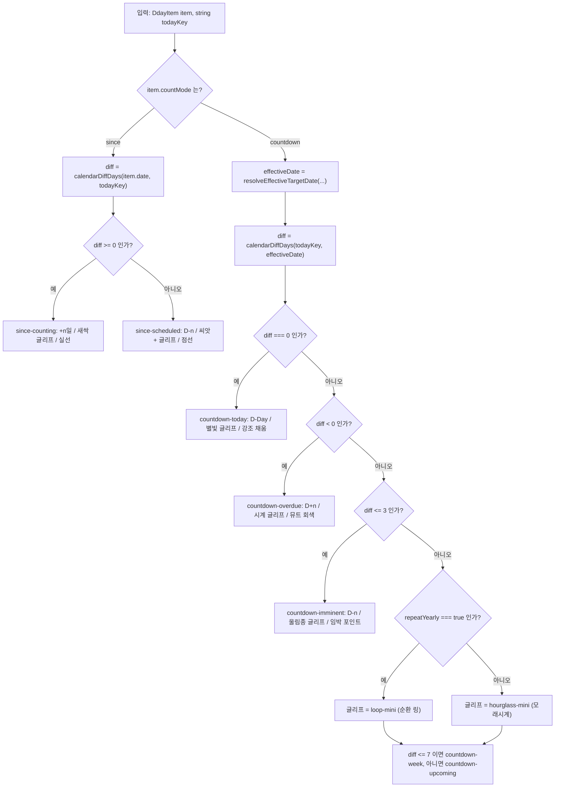

# PRD — D-Day 스마트 칩 & 컨트롤 아이콘 고도화 (시안 10번)

| 항목 | 내용 |
|---|---|
| 문서 판 | v1 |
| 작성 | 2026-11-19 |
| 상태 | 구현·단위/타입/빌드 검수 완료 (2026-11-19 · 네이티브 데스크톱 실기 시각 검수 별도) |
| 기준 시안 | 시안 10번 (`미니멀 D-n 톤 칩` + `D-` 컨트롤 배지) 아기자기·스마트 고도화 |
| 대상 | 할 일 줄(`src/components/TodoList.svelte`), 노트 도구 메뉴(`src/components/HeaderActions.svelte`, `src/lib/header.css`), 상단 툴바·헤더(`src/components/MainToolbar.svelte`), D-Day 컨트롤 헤더(`src/components/dday/DdayControlModal.svelte`), 신규 순수 모듈·컴포넌트(`src/lib/dday/ddayBadge.js`, `src/components/dday/DdayTodoChip.svelte`, `src/components/dday/DdayControlGlyph.svelte`) |
| 바꾸지 않는 것 | `DdayItem` 저장 스키마(`tidy-task-config.json`), `DdayStickerSvg` 21종 스티커(컨트롤 목록·배너·위젯), 할 일 줄 끌기·말랑 X·되돌리기 알림 동작([PRD-todo-row-gestures.md](PRD-todo-row-gestures.md)), PostHog 통계 이벤트 |

---

## 1. 배경 (Problem)

현재 할 일 목록의 D-Day 연동 표식([TodoList.svelte](file:///c:/Users/User/Desktop/vibecoding/Tidy-Task-Local/src/components/TodoList.svelte#L418-L431))은 오른쪽 끝에 놓인 **`11px` 단색 외곽선 `<Flag>` 1종**이 전부입니다.

1. **존재감 및 감성 부족:** 날짜 알약(`11/25(수)`)이나 말랑 X(`SoftX`), 되돌리기 알림(`TrashBuddy`)과 달리 `11px` 단선 깃발은 너무 작고 평면적이어서 할 일 줄에서 이질적으로 보입니다.
2. **스마트 정보 부재:** 사용자가 D-Day 컨트롤에서 공들여 고른 **카운트 방식**(남은 날짜 차감식 `D-n` vs 날짜 수 추산/누적식 `+n일`), **긴급도**(당일·임박·지남), **매년 반복**, **6가지 톤 색상**이 할 일 줄에 전혀 반영되지 않습니다.
3. **진입 아이콘 불일치:** 노트 도구 메뉴([HeaderActions.svelte](file:///c:/Users/User/Desktop/vibecoding/Tidy-Task-Local/src/components/HeaderActions.svelte#L44-L48)), 클래식 툴바·모던 헤더 알약([MainToolbar.svelte](file:///c:/Users/User/Desktop/vibecoding/Tidy-Task-Local/src/components/MainToolbar.svelte#L724-L784)), D-Day 컨트롤 모달 헤더([DdayControlModal.svelte](file:///c:/Users/User/Desktop/vibecoding/Tidy-Task-Local/src/components/dday/DdayControlModal.svelte#L421-L432)) 역시 동일한 얇은 단선 `<Flag>`를 사용하고 있어, D-Day 기능 전체의 상징성이 약합니다.
4. **테마·톤 색상 결합 미비:** 기존 `resolveToneColor()`([ddayModel.js](file:///c:/Users/User/Desktop/vibecoding/Tidy-Task-Local/src/lib/dday/ddayModel.js#L269-L278))는 라이트 모드 단일 Hex만 반환하여 다크 모드나 15개 메모 테마(특히 무채색 `white`/`slate` 및 종이 질감 `linen`/`kraft`/`sepia`) 위에서 명도 대비와 색 조화가 고르지 않습니다.

---

## 2. 목표와 비목표 (Goals & Non-goals)

### 목표
1. 시안 10번(`D-6` 미니멀 톤 칩)을 단순 텍스트·점이 아닌 **아기자기한 초소형 SVG 글리프 + 젤리 딱지 칩(`DdayTodoChip`)** 으로 고도화합니다.
2. **스마트 카운트 로직**으로 차감식(`countdown`: 예정·1주·임박·당일·지남·매년 반복)과 추산/누적식(`since`: 진행 중 누적·시작 예정)을 아이콘·테두리·표기 단위로 즉시 구분합니다.
3. `D-Day 컨트롤` 메뉴·툴바·모달 헤더에 시안 10번의 정체성을 담은 **아기자기한 `D-` / `D+` 미니 플립 태그 SVG(`DdayControlGlyph`)** 를 적용하고, 대표 활성 D-Day 상태에 맞춰 스마트하게 반응시킵니다.
4. **15개 메모 테마(`classic`·`modern`·`paper`) × 6개 D-Day 톤 × 라이트/다크 모드** 조합에서 일관된 색감과 **WCAG AA(대비율 ≥ 4.5:1)** 가독성을 보장합니다.
5. [PRD-todo-row-gestures.md](PRD-todo-row-gestures.md)의 모든 레이아웃·호버·드래그 불변식을 100% 유지합니다.

### 비목표
- `DdayItem` 저장 구조(`countMode`, `repeatYearly`, `tone`, `icon`, `date`, `startDate`) 필드 추가나 마이그레이션. 기존 필드만으로 모두 계산합니다.
- D-Day 컨트롤 행 카드(`DdayRowCard`), 메모 상단 배너(`DdayBanner`), 바탕화면 위젯(`DdayWidget`)의 기존 21종 `DdayStickerSvg` 교체.
- 우클릭 메뉴(`ContextMenu.svelte`) 4칸 Soft-Duotone 타일 및 삭제 알림(`UndoToast.svelte`) 내 보조 `<Flag>`의 1차 범위 포함 (향후 후속 확장 후보로만 검토).
- 신규 PostHog 통계 이벤트 추가 (기존 `dday_*` 이벤트 유지).

---

## 3. 용어 정의

| 용어 | 뜻 |
|---|---|
| **스마트 칩 (`DdayTodoChip`)** | 할 일 줄 오른쪽 끝(`.todo-tail`)에 표시되는 시안 10번 기반 아기자기한 D-Day 카운트 칩 |
| **카운트 글리프** | `DdayTodoChip` 왼쪽에 들어가는 `12px`(16×16 viewBox) 아기자기한 상태별 초소형 SVG 아이콘 |
| **컨트롤 글리프 (`DdayControlGlyph`)** | 노트 도구 메뉴·툴바·컨트롤 모달 헤더에 쓰이는 `D-`/`D+` 미니 플립 캘린더 태그 SVG 아이콘 |
| **차감식 (`countdown`)** | 목표 날짜까지 남은 날을 세는 방식 (`D-n`, 당일 `D-Day`, 지남 `D+n`, 매년 반복 지원) |
| **추산/누적식 (`since`)** | 기준 시작일부터 경과한 누적 일수를 세는 방식 (`+n일`, 시작일이 미래면 `D-n`) |
| **딱지 받침** | `SoftX.svelte`·`UndoToast.svelte`처럼 아래쪽 안쪽 림(`inset 0 -1.5px 0`)으로 도톰한 문구 스티커 질감을 내는 효과 |
| **테마 톤 팔레트** | 메모 창 테마(`TIDY_THEMES` 15종) + D-Day 톤(`DDAY_TONES` 6종) + 다크 모드 + 상태별 색 조합표 |

---

## 4. 결정 사항 (Decisions)

### 4.1 사용자 결정 (2026-11-19)
| # | 요청 내용 | 반영 방향 |
|---|---|---|
| U1 | 시안 **10번** 선택 | `D-n` 미니멀 톤 칩 + `D-` 컨트롤 배지 방향 채택 |
| U2 | **스마트 로직** 반영 (카운트 형식에 따라 다르게) | `countMode` (`countdown` vs `since`), `repeatYearly`, `diff` 부호·임박도를 구분해 글리프·테두리·표기를 자동 분기 |
| U3 | **아기자기하게 아이콘 형태**로 구현 | 단순 색 점(`5px dot`) 대신 7종 전용 16×16 미니 SVG 글리프 + 젤리 딱지 캡슐 + `D-`/`D+` 미니 플립 태그 SVG로 제작 |
| U4 | **테마 톤에 따라 색상도 다르게 고도화** | 15개 테마 그룹(`classic`·`modern`·`paper`)별 바탕/잉크 조화 보정 + 6개 D-Day 톤 라이트/다크 고대비 엔진 설계 |
| U5 | **적용 범위: 전체 통일** | 할 일 줄(`TodoList`), 노트 도구 메뉴(`HeaderActions`), 클래식 툴바·모던 헤더(`MainToolbar`), 컨트롤 모달 헤더·빈 상태(`DdayControlModal`)까지 일괄 교체 |
| U6 | **임박(`D-1~D-3`) 색상 우선순위: 권장안 채택** | `accent` 톤은 코랄 경고 팔레트, 5개 지정 톤(`emerald`/`sky`/`lilac`/`rose`/`gold`)은 톤 바탕·글자색 유지 + 코랄 테두리·종 아이콘 포인트 적용 |
| U7 | **진행 방식: 바로 구현** | 별도 중간 HTML 시안 없이 본 PRD 사양에 따라 즉시 코드 구현 및 검증 진행 |

### 4.2 설계 결정
| # | 결정 | 근거 |
|---|---|---|
| D1 | `ddayModel.js::computeDdayCounter` 반환값은 유지하고, 상위 순수 모듈 `src/lib/dday/ddayBadge.js`를 신설 | 기존 배너·위젯·컨트롤 카드 및 기존 테스트(`ddayModel.test.js`)를 깨뜨리지 않고 7종 스마트 칩 상태(`badgeKind`)를 산출 |
| D2 | `since` 모드에서 `diff < 0`(미래 시작일)은 `since-scheduled`(점선 테두리 + 예고 씨앗 글리프)로 분리 | 차감식 예정(`D-n`)과 "아직 시작 전인 누적일(`D-n`)"이 헷갈리지 않도록 시각적으로 명확히 구분 |
| D3 | 차감식 지남(`D+n`, `countdown-overdue`)과 누적식(`+n일`, `since-counting`)을 색상·글리프·단위 3중으로 분리 | 두 모드 모두 `+` 기호가 들어가므로 지남은 회색 시계(`clock-past`), 누적은 톤 컬러 새싹(`sprout-mini`) + `일` 단위로 오독 차단 |
| D4 | `DdayTodoChip`은 `SoftX.svelte`·`UndoToast.svelte`와 동일한 **딱지 받침 + 젤리 스프링(`cubic-bezier(0.34, 1.56, 0.64, 1)`)** 을 공유 | "짜치지 않고 아기자기한" Tidy Task 고유 손맛 통일 |
| D5 | `DdayControlGlyph`는 단순 텍스트 박스가 아니라 링 스터드·상단 띠·둥근 모서리·모서리 상태 점을 갖춘 24×24 미니 플립 캘린더 SVG로 제작 | "아기자기한 아이콘 형태" 요구 충족 및 작은 크기(`14~19px`)·고배율(200%)에서도 깨짐 방지 |
| D6 | `item.tone === 'accent'`면 15개 테마별 전용 팔레트 사용, 5개 지정 톤(`emerald`/`sky`/`lilac`/`rose`/`gold`)이면 라이트·다크 고대비 톤 쌍 사용 | 메모 테마에 자연스럽게 스미면서도 사용자가 고른 톤 색상을 뚜렷하게 보존 |
| D7 | 페이퍼 테마군(`linen`, `kraft`, `sepia`)에서는 순백(`#ffffff`) 대신 따뜻한 종이 크림(`#fffaf0`)과 바탕색을 혼합 | 종이 메모지 위에 뜬 차가운 흰 칩이 아니라 인쇄된 인덱스 스티커 같은 일체감 확보 |
| D8 | 무채색 테마(`white`, `slate`)의 `accent` 칩은 미세 인디고-슬레이트 틴트와 딥 잉크로 `overdue` 회색과 차별화 | 활성 D-Day가 "기한 지남"처럼 죽어 보이지 않게 방지 |
| D9 | 당일(`countdown-today`)은 **소프트 솔리드 강조 칩 + 반짝이 별 글리프(`star-burst`)** 로 승격 | 오늘 마감 D-Day가 여러 할 일 사이에서 한눈에 들어오게 함 |
| D10 | CSS `light-dark()` 사용 금지 ([claude.md](file:///c:/Users/User/Desktop/vibecoding/Tidy-Task-Local/claude.md) 규칙) | 배포 번들의 lightningcss 변환 문제를 피하고 `[data-scheme]` / `.is-dark` 및 인라인 CSS 변수로 일관 제어 |
| D11 | `DdayTodoChip`은 `.todo-tail` 안에서만 폭을 차지하며, `data-sort-activator`를 붙이지 않음 | 마우스를 올릴 때 `.todo-float`(`SoftX`)가 칩 왼쪽에 겹쳐 뜨고, 줄바꿈·드래그 정렬이 한 픽셀도 흔들리지 않음 |
| D12 | 칩 글자 크기는 `--global-font-size`에 연동하되 `clamp(9.5px, calc(var(--global-font-size, 10pt) * 0.78), 13.5px)`로 상·하한 캡 적용 | 메모 글씨를 24~40pt로 키워도 D-Day 칩이 할 일 본문 폭을 과도하게 잠식하지 않음 |
| D13 | 모든 `15테마 × 6톤 × 라이트/다크 × 상태` 조합의 텍스트-배경 대비율(≥ 4.5:1)을 단위 테스트로 전수 검증 | 특히 노란 계열(`amber`, `gold`, `pistachio`, `linen`) 라이트 모드 및 다크 파스텔 텍스트 가독성 보장 |
| D14 | `prefers-reduced-motion: reduce`에서는 스프링 확대·눌림·당일 미세 반짝임을 끄고 색상 전환만 유지 | 모션 민감 사용자 배려 |

---

## 5. 적용 범위 (Surface Map)

| 위치 | 현재 구현 | 변경 후 | 비고 |
|---|---|---|---|
| **① 할 일 줄 오른쪽** | [TodoList.svelte](file:///c:/Users/User/Desktop/vibecoding/Tidy-Task-Local/src/components/TodoList.svelte#L418-L431) — `<Flag size={11} strokeWidth={2.4} />` | `<DdayTodoChip item={linkedDday} todayKey={appState.todayKey} themeColor={appState.themeColor} dark={appState.isDarkMode} accent={appState.getThemeAccentColor()} onclick={...} />` | 핵심 대상. `.todo-tail` 내 위치·클릭 동작 유지 |
| **② 노트 도구 메뉴** | [HeaderActions.svelte](file:///c:/Users/User/Desktop/vibecoding/Tidy-Task-Local/src/components/HeaderActions.svelte#L44-L48) — `<Flag size={17} />` | `<DdayControlGlyph>` (`size={19}`, 대표 활성 D-Day 연동) | [header.css](file:///c:/Users/User/Desktop/vibecoding/Tidy-Task-Local/src/lib/header.css#L59)의 `.tidy-header-menuitem > svg { padding: 5px }` 보정 필요 (`padding: 3px`) |
| **③ 모던 헤더 상단 알약** | [MainToolbar.svelte](file:///c:/Users/User/Desktop/vibecoding/Tidy-Task-Local/src/components/MainToolbar.svelte#L771-L784) — `<Flag size={10} />` + `{topCounter.label}` | 스마트 상태 글리프(`11px`) + `{topCounter.label}` + 테마/톤 고도화 색감 | 대표 `topDday`의 카운트 모드(`countdown`/`since`) 및 임박·당일 색감 반영 |
| **④ 클래식 툴바 버튼** | [MainToolbar.svelte](file:///c:/Users/User/Desktop/vibecoding/Tidy-Task-Local/src/components/MainToolbar.svelte#L724-L741) — `<Flag size={11} />` + 우상단 5px 점 | `<DdayControlGlyph size={14} ... />` (활성 뱃지 내장) | 우상단 분리 점 대신 글리프 모서리 상태 점으로 일체화 |
| **⑤ D-Day 컨트롤 모달** | [DdayControlModal.svelte](file:///c:/Users/User/Desktop/vibecoding/Tidy-Task-Local/src/components/dday/DdayControlModal.svelte#L422-L424) — 헤더 로고 `<Flag size={15} />`, [빈 상태](file:///c:/Users/User/Desktop/vibecoding/Tidy-Task-Local/src/components/dday/DdayControlModal.svelte#L549) `<Flag size={18} />` | `<DdayControlGlyph>` (헤더 `size={17}`, 빈 상태 `size={22}` idle) | 창 정체성 통일 |

### 1차 범위에서 제외하는 곳
- `DdayBanner.svelte` · `DdayRowCard.svelte` · `DdayWidget.svelte`: 이미 사용자가 고른 21종 파스텔 스티커(`DdayStickerSvg`)가 크게 자리잡고 있으므로 유지합니다.
- `ContextMenu.svelte` ([줄 374](file:///c:/Users/User/Desktop/vibecoding/Tidy-Task-Local/src/components/ContextMenu.svelte#L374)): 4칸 포켓 타일의 Soft-Duotone 세트(`D-Day / 마감일 / 완료 / 삭제`)는 1차 제외하고 추후 통합 검토합니다.
- `UndoToast.svelte` ([줄 107](file:///c:/Users/User/Desktop/vibecoding/Tidy-Task-Local/src/components/todo/UndoToast.svelte#L107)): 둘째 줄 보조 아이콘(`10px Flag`)은 1차 제외합니다.

---

## 6. 스마트 카운트 판별 로직 명세 (`src/lib/dday/ddayBadge.js`)

기존 `computeDdayCounter(item, todayKey)` 및 `resolveEffectiveTargetDate(...)`([ddayModel.js](file:///c:/Users/User/Desktop/vibecoding/Tidy-Task-Local/src/lib/dday/ddayModel.js#L197-L240))를 기반으로, 칩과 컨트롤 글리프가 쓸 세부 상태 모델을 순수 함수로 도출합니다.

### 6.1 할 일 스마트 칩 판별 흐름 (`resolveTodoBadgeModel`)



### 6.2 7종 상태(및 매년 반복 모디파이어) 명세표

| `badgeKind` | 발생 조건 | 기본 `glyph` (`repeatYearly` 시) | 표기 `label` | 테두리 | 시각 강도 (`emphasis`) | 툴팁 (`title`) 예시 | `aria-label` 패턴 |
|---|---|---|---|---|---|---|---|
| `countdown-upcoming` | `countdown`, `diff > 7` | `hourglass-mini` (`loop-mini`) | `D-{diff}` | 실선 `1px` | `normal` | `차감식 · 11.25 (수)까지 {diff}일 남음 · D-Day 컨트롤 보기` | `D-Day 차감식 D-{diff}, D-Day 컨트롤 열기` |
| `countdown-week` | `countdown`, `4 <= diff <= 7` | `hourglass-mini` (`loop-mini`) | `D-{diff}` | 실선 `1px` | `normal` | `차감식 · 1주 이내 (11.25 (수)) · D-Day 컨트롤 보기` | `D-Day 1주 이내 D-{diff}, D-Day 컨트롤 열기` |
| `countdown-imminent` | `countdown`, `1 <= diff <= 3` | `bell-spark` (임박 우선, 툴팁에 `매년 반복` 병기) | `D-{diff}` | 실선 `1.25px` | `imminent` | `차감식 · 마감 임박 D-{diff} (11.25 (수)) · D-Day 컨트롤 보기` | `D-Day 마감 임박 D-{diff}, D-Day 컨트롤 열기` |
| `countdown-today` | `countdown`, `diff === 0` | `star-burst` | `D-Day` | 실선 `1.25px` | `today` | `차감식 · 오늘이 D-Day입니다! · D-Day 컨트롤 보기` | `오늘이 D-Day입니다, D-Day 컨트롤 열기` |
| `countdown-overdue` | `countdown`, `diff < 0` | `clock-past` (`loop-mini` 미적용 — 반복이면 미래로 자동 넘김) | `D+{Math.abs(diff)}` | 실선 `1px` | `muted` | `차감식 · 예정일로부터 {abs}일 지남 · D-Day 컨트롤 보기` | `D-Day 기한 {abs}일 지남, D-Day 컨트롤 열기` |
| `since-counting` | `since`, `diff >= 0` | `sprout-mini` | `+{diff + 1}일` | 실선 `1px` | `normal` | `추산식 · 시작일 포함 {diff + 1}일째 · D-Day 컨트롤 보기` | `D-Day 날짜 수 세기 {diff + 1}일째, D-Day 컨트롤 열기` |
| `since-scheduled` | `since`, `diff < 0` | `seed-plus` | `D-{Math.abs(diff)}` | **점선 `1px dashed`** | `soft` | `추산식 · {abs}일 뒤 카운트 시작 · D-Day 컨트롤 보기` | `D-Day {abs}일 뒤 시작 예정, D-Day 컨트롤 열기` |

> **참고 (`repeatYearly` 모디파이어):** `countMode === 'countdown' && item.repeatYearly === true`인 항목은 `diff > 3` 구간(`countdown-upcoming`, `countdown-week`)에서 `glyph`를 `loop-mini`로 자동 교체하고 `isRepeat: true` 플래그와 툴팁 문구(`매년 반복`)를 추가합니다. `today`(`D-Day`)와 `imminent`(`D-1~D-3`)는 당일/임박 인지성이 최우선이므로 `star-burst`·`bell-spark`를 유지합니다.

### 6.3 컨트롤 글리프 스마트 상태 (`resolveControlGlyphState`)

노트 도구 메뉴·클래식 툴바·모달 헤더의 `<DdayControlGlyph>`가 현재 창(또는 전체)의 활성 D-Day 목록을 받아 상태를 결정합니다.

| 조건 (`activeDdays`) | `mode` | 아이콘 내 표기 | `urgency` | `tone` | 시각 변화 |
|---|---|---|---|---|---|
| `activeDdays.length === 0` | `idle` | `D-` | `none` | `accent` | 차분한 빈 태그 + 모서리 점 없음 |
| `top = activeDdays[0]`, `countMode === 'since'`, `diff < 0` | `since` | `D+` | `scheduled` | `top.tone` | 파스텔 `D+` 태그 + 점선/연한 민트 예고 점 |
| `top = activeDdays[0]`, `countMode === 'since'`, `diff >= 0` | `since` | `D+` | `counting` | `top.tone` | 파스텔 `D+` 태그 + 생동감 있는 새싹/톤 포인트 |
| `top = activeDdays[0]`, `countMode === 'countdown'`, `diff === 0` | `countdown` | `D-` | `today` | `top.tone` | 파스텔 `D-` 태그 + 황금/톤 스파클 점 |
| `top = activeDdays[0]`, `countMode === 'countdown'`, `1 <= diff <= 3` | `countdown` | `D-` | `imminent` | `top.tone` | 파스텔 `D-` 태그 + 코랄 알림 점 |
| `top = activeDdays[0]`, `countMode === 'countdown'`, `diff < 0` | `countdown` | `D-` | `overdue` | `top.tone` | 차분한 슬레이트 `D-` 태그 |
| 그 외 `countMode === 'countdown'` | `countdown` | `D-` | `normal` | `top.tone` | 테마/톤 색상이 입혀진 `D-` 태그 |

### 6.4 경계 사례 처리

| 경계 사례 | 처리 방식 |
|---|---|
| `item.date`가 비어 있거나 파싱 실패 (`!parseDateKey`) | `computeDdayCounter` 폴백(`D-0` / `+1일`)을 그대로 따르고 크래시 없이 기본 글리프 렌더 |
| `repeatYearly === true` + 2월 29일 윤년/평년 | `resolveEffectiveTargetDate()`가 평년 2/28 보정 및 지난 날짜 차년도 이월을 이미 처리하므로 그대로 위임 |
| 4자리 이상 큰 일수 (`D-1024`, `+1500일`) | `white-space: nowrap; flex-shrink: 0; font-variant-numeric: tabular-nums;` 유지. `todo-text`가 자연스럽게 줄바꿈되어 칩이 잘리지 않음 |
| 자정 넘김 | `TodoList`·`MainToolbar`·`HeaderActions` 모두 반응형 `appState.todayKey`(60초 주기 + 창 포커스 갱신)를 전달하므로 자정 직후 즉시 갱신 |
| `countMode === 'since'`인데 `repeatYearly === true`가 남아 있는 레거시 데이터 | `since` 분기에서 `repeatYearly`를 완전히 무시 (`DdayEditSheet.svelte:187` 규칙과 일치) |

---

## 7. 아기자기한 아이콘 형태 디자인 명세

### 7.1 `DdayTodoChip.svelte` 구조 & 시각 해부

시안 10번의 깔끔한 미니멀 알약을 바탕으로, 단순 점(`•`) 대신 **딱지 받침이 있는 21px 캡슐 + 12px 아기자기한 듀오톤/파스텔 SVG 글리프 + 굵은 숫자**로 구성합니다.

```text
  ╭────────────────────────────────────╮  ← height: ~20–21px, border-radius: 999px
  │  [12px 미니 SVG]   D - 6           │  ← gap: 3.5px, padding: 0 7px 0 5px
  ╰────────────────────────────────────╯
   └─ inset 0 -1.5px 0 var(--dd-rim) ─┘   ← SoftX·UndoToast와 같은 도톰한 딱지 받침
```

#### 7종 미니 SVG 글리프 명세 (`viewBox="0 0 16 16"`, `12×12px` 기본, `stroke-linecap="round"`, `stroke-linejoin="round"`, `stroke-width="1.55"`)

| 글리프 ID | 적용 상태 | 아기자기한 도형 구성 (모두 정적 인라인 SVG) | 색 채움 전략 |
|---|---|---|---|
| `hourglass-mini` | 차감식 여유/1주 | 둥근 상하 캡선 + 통통한 모래시계 몸통 + 아래쪽 작은 모래 언덕 채움 | 선 `--dd-icon`, 모래 채움 `--dd-icon-soft` |
| `bell-spark` | 차감식 임박 (`D-1~3`) | 동글동글 알림종 + 아래 방울 + 좌우 짧은 울림 호(`2개`) | 종 몸통 `--dd-icon-soft`, 윤곽·울림선 `--dd-icon` |
| `star-burst` | 차감식 당일 (`D-Day`) | 둥근 4각 스파클 별 + 우상단 작은 반짝 점 | 채움 `--dd-icon` / 테두리 또렷 |
| `clock-past` | 차감식 지남 (`D+n`) | 동그란 작은 시계 + 9시/12시 방향 시분침 | 시계판 `--dd-icon-soft`, 바늘 `--dd-icon` |
| `loop-mini` | 매년 반복 차감식 | 둥글게 감기는 양방향 순환 호 2개 + 중앙 작은 점 | 선 `--dd-icon`, 중앙 점 `--dd-icon-soft` |
| `sprout-mini` | 추산/누적식 (`+n일`) | 짧은 줄기에서 양쪽으로 통통하게 뻗은 두 잎 새싹 | 잎 채움 `--dd-icon-soft`, 윤곽·줄기 `--dd-icon` |
| `seed-plus` | 추산/누적식 시작 예정 | 작은 둥근 씨앗 원 + 우상단 `+` 기호 (점선 칩 테두리와 조합) | 채움/선 `--dd-icon` |

#### 상호작용 마이크로 인터랙션
| 상태 | 변형·효과 |
|---|---|
| 평상시 (`rest`) | `transform: none`, 1px 테두리 + `1.5px` 아래쪽 딱지 받침 |
| 마우스 올림 (`hover`) | `transform: translateY(-0.5px) scale(1.05)`, 배경 틴트 4% 상승, 테두리 선명화 |
| 누름 (`active`) | `transform: scale(1.03, 0.90)` (90ms 젤리 눌림, `SoftX` 손맛 일치) |
| 키보드 초점 (`focus-visible`) | `outline: 2px solid var(--dd-focus); outline-offset: 1.5px;` |
| 모션 축소 (`prefers-reduced-motion: reduce`) | `transform` 애니메이션 비활성화, 색 전환만 `140ms ease` |

### 7.2 `DdayControlGlyph.svelte` 구조 & 시각 해부

단순 `<Flag>`나 사각 텍스트를 넘어, **Tidy Task 문구 스티커 감성의 미니 플립 캘린더 태그(`viewBox="0 0 24 24"`)** 로 제작합니다.

```text
     ╭─●───────●─╮   ← 상단 미니 링 스터드 2개 + 파스텔 상단 띠
     │ ░░░░░░░░░ │   ← 상단 띠 (테마/톤 색)
     │   D -     │   ← 굵고 동글동글한 기하학 path ("D-" 또는 "D+")
     ╰─────────●─╯   ← 우하단 모서리 활성/상태 포인트 점(또는 당일 스파클)
```

- **크기별 최적화:**
  - `size={14}` (클래식 툴바 버튼): 선 두께 `1.9`, 깔끔한 `D-` / `D+` 획 가독성 확보
  - `size={17~19}` (노트 도구 메뉴, 모달 헤더): 상단 링 스터드 + 2톤 채움 + 모서리 상태 점 풀 디테일 표현
  - `size={22}` (모달 빈 상태): `idle` 모드(`D-` + 점 없음)로 차분하게 안내
- **`header.css` 규칙 보정 ([src/lib/header.css:59](file:///c:/Users/User/Desktop/vibecoding/Tidy-Task-Local/src/lib/header.css#L59)):**
  - 기존 `.tidy-header-menuitem > svg`가 `width: 25px; height: 25px; padding: 5px;`를 강제해 내부 아이콘이 `15px`로 줄어듭니다.
  - `DdayControlGlyph` 루트 `<svg>`에 `.dday-ctrl-glyph` 클래스를 부여하고 `.tidy-header-menuitem > svg.dday-ctrl-glyph { padding: 2.5px; }`를 추가해 `25×25` 슬롯 안에서 `20×20`으로 여유 있게 보이게 합니다.

### 7.3 타이포그래피 · 배율 · 접근성
- 글꼴: `font-family: var(--ui-font-family)` + `font-variant-numeric: tabular-nums; letter-spacing: -0.025em;`
- 반응형 크기: `font-size: clamp(9.5px, calc(var(--global-font-size, 10pt) * 0.78), 13.5px);` (글리프 크기는 `1.15em`, 칩 높이는 `min-height: 20px; padding: 0.18em 0.55em 0.18em 0.42em;`)
- 스크린 리더: `aria-label`에 카운트 방식·상태·값을 모두 담고(`D-Day 차감식 D-6, D-Day 컨트롤 열기`), 내부 SVG에는 `aria-hidden="true"`를 유지합니다.

---

## 8. 테마·톤 연동 색상 고도화 명세

모든 색상 산출은 `src/lib/dday/ddayBadge.js`의 순수 함수 `resolveBadgePalette({ themeColor, tone, badgeKind, dark })` 한 곳에서 결정합니다. (`light-dark()` 금지, `Hex` 기반 명시적 sRGB 혼합으로 계산·테스트 가능)

### 8.1 색상 결정 우선순위 파이프라인

1. **기한 지남 (`countdown-overdue`)**
   - 테마군에 따라 쿨 슬레이트(classic/modern) 또는 웜 토프(paper) 뮤트 팔레트 적용. (사용자가 고른 톤과 무관하게 "이미 지난 일정"임을 차분히 구분)
2. **당일 (`countdown-today`)**
   - 오늘 마감이라는 최대 중요도를 드러내기 위해 선택 톤(또는 테마 강조색) 기반 **고대비 채움(Soft-Solid) 칩 + 별빛 글리프** 적용. (다크 모드에서는 밝은 강조 바탕 위 어두운 잉크 `#111827` 자동 전환 — `UndoToast.svelte:270`과 동일)
3. **임박 (`countdown-imminent`, `D-1 ~ D-3`)**
   - `tone === 'accent'`일 때: 테마와 조화로운 로즈-코랄 경고 팔레트 적용.
   - 사용자가 특정 톤(`emerald`/`sky`/`lilac`/`rose`/`gold`)을 직접 지정했을 때: **지정한 톤 바탕·글자색을 유지하되 테두리와 `bell-spark` 글리프에 코랄 알림 포인트를 결합** (구현 전 확인 사항 §13 #2 참고).
4. **일반 (`countdown-upcoming`, `countdown-week`, `countdown-repeat`, `since-counting`, `since-scheduled`)**
   - `item.tone === 'accent'` → **15개 메모 테마별 전용 팔레트** 적용
   - `item.tone !== 'accent'` → **5개 개별 D-Day 톤 고대비 팔레트** 적용
   - `since-counting`은 아이콘 채움(`--dd-icon-soft`)을 더 따뜻/선명한 듀오톤으로 강조하고, `since-scheduled`는 바탕 채도를 낮추고 점선 테두리(`border-style: dashed`)를 적용.

### 8.2 15개 메모 테마 × 3개 그룹별 고도화 전략 ([themes.js](file:///c:/Users/User/Desktop/vibecoding/Tidy-Task-Local/src/lib/themes.js#L12-L83))

| 그룹 | 포함 테마 (15종) | 라이트 모드 바탕·잉크 전략 | 다크 모드 바탕·잉크 전략 | 특별 보정 |
|---|---|---|---|---|
| **`classic` (유채 5종)** | `amber`, `blue`, `green`, `rose`, `purple` | `#ffffff` + `accent` 12% 혼합 바탕, `accent`를 명도 보정한 진한 잉크(특히 `amber`는 `#b45309` 이상으로 가독성 보정) | `#1e222c` + `accentDark` 22% 혼합 바탕, `accentDark`를 고명도 파스텔로 보정 | `amber` 당일/일반 텍스트가 연해지지 않게 하한 휘도 제한 |
| **`classic` (무채 2종)** | `white`, `slate` | 순수 회색으로 죽어 `overdue`와 겹치지 않게 **미세 쿨 인디고-슬레이트(`#eef2f8` 바탕, `#334155` 글자, `#4f46e5` 글리프 포인트)** 적용 | `#232938` 바탕, `#cbd5e1` 글자, `#818cf8` 글리프 포인트 | `overdue`는 글리프까지 완전 무채색(`#64748b`)으로 분리 |
| **`modern` (5종)** | `sea-glass`, `apricot`, `pistachio`, `periwinkle`, `mauve` | `#fffdf8` 크림 화이트 + `accent` 12% 혼합 바탕, `pistachio`·`apricot` 등 중간 명도 색은 어두운 딥 톤 잉크(`#3f6212`, `#9a3412`) 적용 | `#1e222c` + `accentDark` 20% 혼합 바탕, 밝은 민트·피치·라임·인디고·모브 잉크 | 배경 `bg`와 채도가 겹쳐 흐려지지 않도록 테두리 28% 혼합 |
| **`paper` (3종)** | `linen`, `kraft`, `sepia` | 순백 혼합 대신 **따뜻한 종이 크림(`#fffaf0`) + 테마 `bg` + `accent` 14% 혼합 바탕**, 딥 브라운/에스프레소 계열 잉크(`#524229`, `#5c3b14`) | 어두운 모카-차콜(`#26221e`) + `accentDark` 22% 혼합, 따뜻한 샌드·카라멜 파스텔 잉크 | `overdue`도 쿨 그레이 대신 **웜 토프(`#f3eee7` / `#78716c`)** 를 써서 종이 감성 유지 |

### 8.3 6개 D-Day 톤(`DDAY_TONES`) 라이트/다크 고대비 토큰 명세

| `tone` ID | 라이트 기준색 (`ink` / `icon`) | 라이트 바탕(`bg`) / 테두리(`border`) | 다크 기준색 (`ink` / `icon`) | 다크 바탕(`bg`) / 테두리(`border`) |
|---|---|---|---|---|
| `accent` | 위 §8.2의 15개 테마별 전용 팔레트 사용 | 테마 그룹 베이스 + 12~14% 혼합 | 테마 `accentDark` 고명도 보정 | `#1e222c` / `#26221e` + 20~22% 혼합 |
| `emerald` | `#047857` / `#059669` | `#ecfdf5` / `#6ee7b7` (페이퍼: `#f4fbf5`) | `#6ee7b7` / `#34d399` | `rgba(16,185,129,0.20)` / `rgba(110,231,183,0.34)` |
| `sky` | `#1d4ed8` / `#2563eb` | `#eff6ff` / `#93c5fd` | `#93c5fd` / `#60a5fa` | `rgba(59,130,246,0.20)` / `rgba(147,197,253,0.34)` |
| `lilac` | `#6d28d9` / `#7c3aed` | `#f5f3ff` / `#c4b5fd` | `#c4b5fd` / `#a78bfa` | `rgba(139,92,246,0.21)` / `rgba(196,181,253,0.36)` |
| `rose` | `#be123c` / `#e11d48` | `#fff1f2` / `#fda4af` | `#fda4af` / `#fb7185` | `rgba(244,63,94,0.21)` / `rgba(253,164,175,0.36)` |
| `gold` | `#92400e` / `#b45309` *(기존 `#ca8a04` 대비 강화)* | `#fffbeb` / `#fcd34d` | `#fde68a` / `#fbbf24` | `rgba(245,158,11,0.20)` / `rgba(252,211,77,0.34)` |

### 8.4 WCAG AA(≥ 4.5:1) 자동 검증 규칙
- `ddayBadge.js`가 모든 색상을 순수 Hex(`#RRGGBB`) 또는 알파 합성 완료된 sRGB 값으로 계산할 수 있는 헬퍼를 제공합니다.
- `ddayBadge.test.js`에서 **15개 테마 × 6개 톤 × 2개 모드(라이트/다크) × 7개 `badgeKind`** 전 조합의 `textInk` vs 실제 칩 바탕(테마 창 배경 위 알파 합성 결과) 상대 휘도 대비율이 **4.5:1 이상**임을 자동 단언합니다.

---

## 9. 레이아웃·상호작용 불변식 ([PRD-todo-row-gestures.md](PRD-todo-row-gestures.md) 호환)

1. **줄 폭·줄바꿈 불변:** `DdayTodoChip`은 `.todo-tail` 안에서만 자연 폭을 차지하며, 마우스를 올리거나 떼고, 글을 편집하거나, 줄 순서를 끌어도 칩 자체의 크기·위치·텍스트 줄바꿈이 흔들리지 않습니다.
2. **말랑 X(`SoftX`) 겹침 공존:** 마우스를 줄에 올리면 `.todo-float`(흐림 받침 `.todo-veil` + `<SoftX>`)이 `.todo-tail`의 왼쪽(`right: 100%`)에 겹쳐 뜨므로, 오른쪽의 `DdayTodoChip`은 가려지지 않고 X와 칩 둘 다 명확히 눌립니다.
3. **드래그 정렬 비간섭:** `DdayTodoChip`에는 `data-sort-activator`를 붙이지 않으며, `onmousedown={(e) => e.preventDefault()}`로 다른 줄을 편집 중이던 포커스를 빼앗지 않게 합니다.
4. **터치 기기(`@media (hover: none)`):** 기존 `.todo-text { padding-right: 26px; }` 규칙이 `.todo-float` 공간만큼을 비우므로, 칩 왼쪽의 상시 노출 X와 칩·본문 사이 겹침이 없도록 [TodoList.svelte](file:///c:/Users/User/Desktop/vibecoding/Tidy-Task-Local/src/components/TodoList.svelte#L708-L713)를 함께 검증합니다.
5. **좁은 창 최소 폭(약 220px) 대응:** 날짜 알약(`11/25(수)`) + 한두 어절 본문 + `DdayTodoChip`이 한 줄에 놓였을 때 칩이 찌그러지거나 잘리지 않게 `flex-shrink: 0`을 보장합니다.

---

## 10. 모듈 아키텍처 & 파일 변경 계획

### 10.1 신규 파일 (4개)
| 파일 | 역할 |
|---|---|
| `src/lib/dday/ddayBadge.js` | 스마트 7종 상태 판별(`resolveTodoBadgeModel`), 컨트롤 글리프 상태 판별(`resolveControlGlyphState`), 15테마×6톤 고대비 색상 엔진(`resolveBadgePalette`), 대비율 검증용 sRGB 유틸리티 |
| `src/lib/dday/ddayBadge.test.js` | `node --test` 단위 테스트: 7종 상태 분기, `repeatYearly` 윤년/연말 경계, 오류 입력 폴백, 15테마×6톤×2모드×7상태 WCAG AA 대비 전수 검증 |
| `src/components/dday/DdayTodoChip.svelte` | 시안 10번 고도화 칩 컴포넌트 (7종 아기자기 SVG 글리프 + 젤리 딱지 받침 + 점선/강조 변형 + 모션 축소 지원) |
| `src/components/dday/DdayControlGlyph.svelte` | 아기자기 `D-`/`D+` 미니 플립 캘린더 태그 SVG 컴포넌트 (`idle`/`countdown`/`since` 및 모서리 상태 점 지원) |

### 10.2 수정 파일 (5개)
| 파일 | 수정 내용 |
|---|---|
| [TodoList.svelte](file:///c:/Users/User/Desktop/vibecoding/Tidy-Task-Local/src/components/TodoList.svelte#L418-L431) | `<Flag size={11} />` → `<DdayTodoChip>` 교체 (기존 `.todo-tail.has-flag` 및 `@media (hover: none)` 레이아웃 유지) |
| [HeaderActions.svelte](file:///c:/Users/User/Desktop/vibecoding/Tidy-Task-Local/src/components/HeaderActions.svelte#L44-L48) | `D-Day 컨트롤` 메뉴의 `<Flag size={17} />` → `<DdayControlGlyph size={19}>` 교체 (활성 D-Day 상태 연동) |
| [header.css](file:///c:/Users/User/Desktop/vibecoding/Tidy-Task-Local/src/lib/header.css#L59-L60) | `.tidy-header-menuitem > svg.dday-ctrl-glyph` 여백 보정(`padding: 2.5px;`) |
| [MainToolbar.svelte](file:///c:/Users/User/Desktop/vibecoding/Tidy-Task-Local/src/components/MainToolbar.svelte#L704-L766) | 클래식 툴바 `<Flag>` → `<DdayControlGlyph size={15} />`, 모던 헤더 알약(`.dday-header-pill`) → `<DdayTodoChip variant="header">` 교체 |
| [DdayControlModal.svelte](file:///c:/Users/User/Desktop/vibecoding/Tidy-Task-Local/src/components/dday/DdayControlModal.svelte#L541-L672) | 모달 헤더 로고(`size={18}`) 및 빈 상태(`size={22}`) `<Flag>` → `<DdayControlGlyph>` 교체 |

---

## 11. 단계별 구현 계획

1. **Phase 1 — 순수 로직 & 색상 엔진 (`ddayBadge.js` + `ddayBadge.test.js`)**
   - 7종 상태 판별 및 컨트롤 글리프 상태 판별 구현
   - 15개 테마 × 6개 D-Day 톤 × 라이트/다크 색상 엔진 구현
   - `npm test` 통과 및 WCAG AA 전수 테스트 확인
2. **Phase 2 — UI 컴포넌트 제작 (`DdayTodoChip.svelte` + `DdayControlGlyph.svelte`)**
   - 7종 16×16 미니 SVG 글리프 + 딱지 받침 캡슐 스타일 구현
   - `D-` / `D+` 미니 플립 태그 SVG 구현 (`14px`~`22px` 선명도 검증)
3. **Phase 3 — 기존 화면 연동**
   - `TodoList.svelte`, `HeaderActions.svelte`, `header.css`, `MainToolbar.svelte`, `DdayControlModal.svelte` 교체 및 JSDoc 타입 정합성 맞춤
4. **Phase 4 — 테스트·시각 검수**
   - `npm test` 및 `npm run check` 통과
   - 개발 프리뷰(`?header-preview` 등)와 실제 앱 화면에서 15테마(특히 `periwinkle`, `white`, `kraft`, `sepia`, `amber`) × 다크/라이트 × 7종 상태 × DPI 100%/200% 검수
   - 검수 결과를 `docs/QA-dday-smart-badge.md`로 기록

---

## 12. 검수 기준 (Acceptance Checklist)

- [x] 차감식(`D-n`, `D-Day`, `D+n`, 매년 반복)과 추산/누적식(`+n일`, 시작 예정 점선 `D-n`)이 칩 글리프·테두리·텍스트로 즉시 구별된다. *(단위 테스트 검증)*
- [ ] `DdayTodoChip`과 `DdayControlGlyph`가 100%~200% 배율에서도 뭉개지지 않고 아기자기한 아이콘 형태를 유지한다. *(네이티브 데스크톱 실기 시각 검수 필요)*
- [x] 15개 테마 × 6개 톤 × 라이트/다크 모드 × 7종 상태 전 조합(1,260개)의 텍스트 대비율이 WCAG AA(4.5:1 이상)를 충족한다. *(단위 테스트 전수 검증)*
- [x] 페이퍼 테마(`linen`, `kraft`, `sepia`)와 무채색 테마(`white`, `slate`)에서 `overdue`와 색감 분리 및 종이 바탕 조화가 적용되었다. *(단위 테스트 검증 · 실기 시각 확인 권장)*
- [ ] 할 일 줄 호버 시 말랑 X(`SoftX`) 겹침, 클릭·편집·드래그 순서 변경, `@media (hover: none)` 레이아웃이 깨지지 않는다. *(네이티브/브라우저 실기 동작 검수 필요)*
- [ ] 자정이 지나거나 창 포커스가 돌아오면 할 일 칩과 상단 컨트롤 글리프의 일수·긴급도가 자동 갱신된다. *(반응형 `appState.todayKey` 바인딩 완료 · 실기 자정 테스트 별도)*
- [ ] 키보드 탐색(`Tab`, `Enter`, `Space`) 및 `focus-visible` 외곽선, `aria-label` 한국어 안내, `prefers-reduced-motion`이 정상 동작한다. *(마크업·CSS 적용 완료 · 실기 검수 별도)*
- [x] `npm test` (846건 통과), `npm run check` (변경·신규 파일 오류/경고 0건, 기존 `DdayWidget.svelte` 경고 3건 유지), `npm run build`가 오류 없이 통과한다.

---

## 13. 구현 전 확인 사항 (Open Questions — 확정 완료)

1. **적용 범위:** **전체 통일** 확정 (`TodoList`, `HeaderActions` + `header.css`, `MainToolbar`, `DdayControlModal`)
2. **임박(`D-1 ~ D-3`) 색상 우선순위:** **권장안(지정 톤 유지 + 코랄 테두리/종 아이콘 경고 포인트)** 확정
3. **다음 진행 순서:** **바로 구현** 확정 (2026-11-19 완료)
