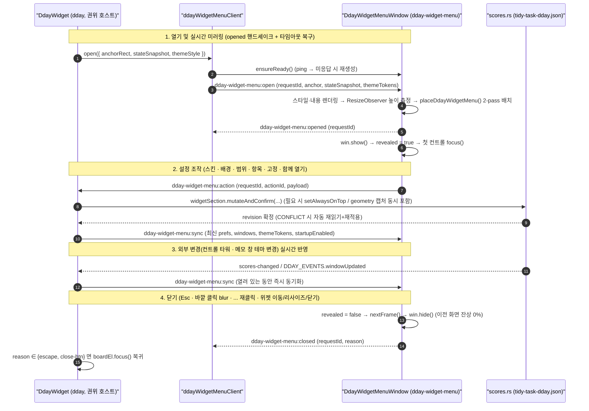

# PRD — D-Day 위젯 고도화(독립 설정 팝업 · 자동 테마 연동 · 무잔상 프레임 · macOS 호버 컨트롤) & 시스템 설정 창 무잔상 보정

| 항목 | 내용 |
|---|---|
| 문서 판 | v1 |
| 작성 | 2026-11-19 |
| 상태 | 초안 (구현 전 검토 대기) |
| 대상 | [DdayWidget.svelte](file:///c:/Users/User/Desktop/vibecoding/Tidy-Task-Local/src/components/dday/DdayWidget.svelte), [dday-widget.css](file:///c:/Users/User/Desktop/vibecoding/Tidy-Task-Local/src/components/dday/dday-widget.css), [DdayResizeHandles.svelte](file:///c:/Users/User/Desktop/vibecoding/Tidy-Task-Local/src/components/dday/DdayResizeHandles.svelte), [SettingsModal.svelte](file:///c:/Users/User/Desktop/vibecoding/Tidy-Task-Local/src/components/SettingsModal.svelte), [headerWindows.js](file:///c:/Users/User/Desktop/vibecoding/Tidy-Task-Local/src/lib/headerWindows.js), [main.js](file:///c:/Users/User/Desktop/vibecoding/Tidy-Task-Local/src/main.js), [tray.rs](file:///c:/Users/User/Desktop/vibecoding/Tidy-Task-Local/src-tauri/src/tray.rs), [lib.rs](file:///c:/Users/User/Desktop/vibecoding/Tidy-Task-Local/src-tauri/src/lib.rs), [analytics.rs](file:///c:/Users/User/Desktop/vibecoding/Tidy-Task-Local/src-tauri/src/analytics.rs), 신규 모듈(`ddayWidgetTheme.js`, `ddayWidgetTheme.test.js`, `ddayWidgetMenuProtocol.js`, `ddayWidgetMenuProtocol.test.js`, `ddayWidgetMenuClient.svelte.js`, `DdayWidgetSettingsPanel.svelte`, `DdayWidgetMenuWindow.svelte`) |
| 바꾸지 않는 것 | `DdayWidgetPrefs` 기존 저장 키(`skin`, `appearanceMode`, `displayScope`, `hiddenIds`, `alwaysOnTop`, `autoOpen`, `geometry`) 호환, `DdayItem` 저장 스키마(`tidy-task-config.json`), [TodoList.svelte](file:///c:/Users/User/Desktop/vibecoding/Tidy-Task-Local/src/components/TodoList.svelte), [DdayControlModal.svelte](file:///c:/Users/User/Desktop/vibecoding/Tidy-Task-Local/src/components/dday/DdayControlModal.svelte) 기존 기능, PostHog 기존 행동 이벤트 계약(신규 행동 이벤트 없음 — 단 `analytics.rs::window_kind`에 새 팝업 라벨 `"dday-widget-menu" => "dday"` 분류만 추가) |
| 병행 작업 호환 | [PRD-dday-control-panel.md](file:///c:/Users/User/Desktop/vibecoding/Tidy-Task-Local/docs/PRD-dday-control-panel.md)(컨트롤 패널 무잔상·15종 테마·스마트 드래그) 및 [PRD-dday-smart-badge.md](file:///c:/Users/User/Desktop/vibecoding/Tidy-Task-Local/docs/PRD-dday-smart-badge.md)(스마트 칩·글리프)와 저장소·이벤트 충돌 없이 공존하도록 설계 |

---

## 1. 배경 및 현황 진단 (Forensic Audit)

사용자가 전달한 스크린샷 4장(D-Day 위젯 `w1` 플립 캘린더 설정 열림, `w4` 폴라로이드 설정 열림, 시스템 설정 페리윙클 에어 테마, `w4` 폴라로이드 기본 화면)과 실제 소스코드를 대조한 결과, D-Day 위젯(모든 스킨·빈 상태 포함)과 시스템 설정 창에 아래 5가지 구조적·시각적 결함이 존재합니다.

### 1.1 D-Day 위젯 설정 모달 잘림 & `z-index` 관통 (`w1` · `w4` · 빈 상태 전수 동일 발생)

1. **원인 1 — 협소한 위젯 창 내부에 430px+ 인라인 모달 구겨 넣기 (1·2번째 스크린샷):**
   - [DdayWidget.svelte](file:///c:/Users/User/Desktop/vibecoding/Tidy-Task-Local/src/components/dday/DdayWidget.svelte#L925-L1104)는 스킨(`w1` 플립 캘린더 · `w4` 폴라로이드 스티커)이나 빈 상태(`.dw-empty-card`) 여부와 무관하게, 동일한 인라인 `<div class="dw-menu">`를 위젯 창 내부에 띄웁니다.
   - 위젯 창의 기본 크기는 `236×256` 논리px, 최소 크기는 `170×175` 논리px([ddayModel.js](file:///c:/Users/User/Desktop/vibecoding/Tidy-Task-Local/src/lib/dday/ddayModel.js#L76-L83), [toolkit.rs](file:///c:/Users/User/Desktop/vibecoding/Tidy-Task-Local/src-tauri/src/toolkit.rs#L471))입니다. 반면 [dday-widget.css](file:///c:/Users/User/Desktop/vibecoding/Tidy-Task-Local/src/components/dday/dday-widget.css#L704-L715)는 `.dw-menu`를 `width: min(256px, calc(100vw - 14px)); max-height: calc(100dvh - 14px);`로 묶어 두어, 기본 크기에서는 `222×242px`, 최소 크기에서는 `156×161px` 공간에 ~430px+ 높이의 설정(스킨·배경·창 범위·항목 타일·창 동작 스위치·하단 버튼)을 억지로 집어넣습니다.
   - 그 결과 `w1`에서도 `w4`에서도 설정 패널 상·하단이 심하게 잘리고, 굵은 네이티브 Windows 스크롤바가 우측에 생성되며, 최소 크기(`170×175`)에서는 스킨 카드·타일·하단 버튼까지 찌그러집니다. 빈 상태(`.dw-empty-card`) 역시 동일 `.dw-menu`를 공유하므로 100% 동일하게 잘립니다.
2. **원인 2 — `z-index` 역전으로 인한 컨트롤 버튼 관통 (1·2번째 스크린샷 실측):**
   - `.dw-win-controls`([dday-widget.css](file:///c:/Users/User/Desktop/vibecoding/Tidy-Task-Local/src/components/dday/dday-widget.css#L45-L47), `z-index: 30`)와 `.dw-empty-top`([dday-widget.css](file:///c:/Users/User/Desktop/vibecoding/Tidy-Task-Local/src/components/dday/dday-widget.css#L610-L615), `z-index: 30`)이 설정 모달 백드롭 `.dw-dismiss`(`z-index: 24`) 및 설정 모달 `.dw-menu`(`z-index: 25`)보다 높습니다.
   - 실제로 1번째 사진(스크롤 상단 위치)에서는 모달의 "스킨" 영역 우상단에, 2번째 사진(스크롤 내려간 위치)에서는 모달의 "배경" 영역 우상단에 위젯의 **핀/점 세 개/닫기(`X`) 버튼이 설정 창을 뚫고 떠 있습니다.**
3. **원인 3 — 실시간 위젯 확인 불가:**
   - 인라인 모달이 위젯 카드 전체를 덮기 때문에 스킨·배경·표시 항목을 바꿀 때 위젯 본체가 어떻게 변하는지 즉시 눈으로 보며 고를 수 없습니다.

### 1.2 D-Day 위젯 "자동(`auto`)" 배경의 테마색 미연동 (1·2·3번째 스크린샷 대조)

| 항목 | 현재 구현 | 결함 내용 |
|---|---|---|
| 배경 모드 판정 | [DdayWidget.svelte](file:///c:/Users/User/Desktop/vibecoding/Tidy-Task-Local/src/components/dday/DdayWidget.svelte#L93-L98): `return systemDark || Boolean(windows[0]?.isDarkMode);` | ① 메모 창의 `themeColor`를 전혀 읽지 않음.<br>② 툴킷 다크 모드(`systemDark`)를 OR 조건으로 섞어, 메모 창이 라이트 모드여도 툴킷만 다크면 위젯이 강제 다크로 바뀜.<br>③ `windows[0]`만 보고 `displayScope`가 가리키는 창이나 현재 카드의 창을 따르지 않음. |
| 카드 바탕·띠 색 | [dday-widget.css](file:///c:/Users/User/Desktop/vibecoding/Tidy-Task-Local/src/components/dday/dday-widget.css#L134-L169), [415-455](file:///c:/Users/User/Desktop/vibecoding/Tidy-Task-Local/src/components/dday/dday-widget.css#L415-L455), [589-609](file:///c:/Users/User/Desktop/vibecoding/Tidy-Task-Local/src/components/dday/dday-widget.css#L589-L609) | `.w1-card`, `.w4-frame`, `.dw-empty-card` 바탕이 `#fffdf8` / `#232734` 크림·차콜로 하드코딩되어, 시스템 설정(3번째 사진)에서 **페리윙클 에어(`periwinkle`)** 테마를 골라도 위젯은 여전히 앰버 크림색에 머묾. |
| `accent` 톤 폴백 | [DdayWidget.svelte](file:///c:/Users/User/Desktop/vibecoding/Tidy-Task-Local/src/components/dday/DdayWidget.svelte#L116-L118) | `resolveToneColor(currentEntry.item.tone, '#d97706')`가 2번째 인수로 `#d97706`(샴페인 앰버)을 하드코딩해 `accent` 톤 D-Day도 테마색을 못 따라감. |
| 설정 메뉴 강조색 | [dday-widget.css](file:///c:/Users/User/Desktop/vibecoding/Tidy-Task-Local/src/components/dday/dday-widget.css#L725-L806) | 설정 메뉴(`dw-menu`) 역시 툴킷 변수 `--tk-accent`만 보고 있어 메모 창 테마색과 어긋남. |

### 1.3 D-Day 위젯 테두리 바깥 그림자·번짐·돌출 현상 (1·2·4번째 스크린샷)

1. **원인 A — 투명 6px 거터 안에서 잘린 외부 `box-shadow` (2번째 사진 하단·좌우 음영 띠):**
   - [dday-widget.css](file:///c:/Users/User/Desktop/vibecoding/Tidy-Task-Local/src/components/dday/dday-widget.css#L4-L12)는 `.dw-root`에 `padding: 6px` 투명 여백을 두고, 내부 `.w1-card`([줄 137-140](file:///c:/Users/User/Desktop/vibecoding/Tidy-Task-Local/src/components/dday/dday-widget.css#L137-L140))에 `box-shadow: 0 2px 0 #ede5d4, 0 4px 0 #e3d9c5, 0 10px 22px rgba(15, 23, 42, 0.16)`, `.w4-frame`([줄 422](file:///c:/Users/User/Desktop/vibecoding/Tidy-Task-Local/src/components/dday/dday-widget.css#L422))에 `box-shadow: 0 10px 24px rgba(15, 23, 42, 0.18), 0 2px 5px rgba(15, 23, 42, 0.08)`를 걸고 있습니다.
   - `22~24px` 블러와 `10px` Y 오프셋이 `6px` 창 경계를 넘어가며 WebView 창 모서리에서 직사각형 칼로 잘립니다. 2번째 스크린샷 아래쪽·오른쪽 끝에서 보이는 흐릿한 그림자 띠와 직각 절단 흔적이 바로 이 현상입니다.
2. **원인 B — 카드 바깥 투명 여백으로 돌출된 상단 장식 + `filter: drop-shadow`:**
   - `.w1-wrap { padding-top: 9px }`의 `.w1-rings`([줄 103-127](file:///c:/Users/User/Desktop/vibecoding/Tidy-Task-Local/src/components/dday/dday-widget.css#L103-L127))와 `.w4-wrap { padding-top: 10px }`의 `.w4-tape`([줄 395-413](file:///c:/Users/User/Desktop/vibecoding/Tidy-Task-Local/src/components/dday/dday-widget.css#L395-L413))가 카드 테두리 밖 투명 영역 위로 삐져나오며 각각 `filter: drop-shadow(...)`를 가집니다.
   - 이로 인해 위젯 상단이 사각형 창 테두리와 어긋나고, 상단 리사이즈 테두리 안쪽에 투명 클릭 공백이 생기며, 테이프/링 그림자가 창 끝에서 미세하게 번집니다.
3. **원인 C — 반투명 `rgba(...)` 보더와 `background-clip: border-box`:**
   - `.w1-card`·`.w4-frame` 모두 반투명 보더(`rgba(15, 23, 42, 0.1)` / `rgba(255, 255, 255, 0.12)`)에 `background-clip: border-box` 기본값을 써서, Windows DPI 배율(125%/150%/200%)의 둥근 모서리에서 배경과 반투명 선이 섞여 미세하게 번져 보입니다.

### 1.4 D-Day 위젯 우측 상단 컨트롤(고정 · 설정 · 닫기) 위치·디자인·상시 노출 문제 (4번째 스크린샷)

- **위치 애매함:** `w4` 폴라로이드에서는 `.dw-win-controls`가 `.dw-root(6px) + .w4-frame(12px) + .w4-mat(8px)` = 창 테두리로부터 **약 `26px` 안쪽**에 붕 떠 있어(4번째 사진 우측 상단), 사진 매트 내부 공간을 어색하게 가립니다. `w1`에서는 `.w1-topband` 우측에 고정 배치되어 좁은 창에서 `.w1-scope-tag`(메모 창 이름) 공간을 상시 빼앗습니다.
- **시각 디자인 및 상시 노출:** 현재는 평상시에도 `opacity: 0.78`로 계속 보이며([dday-widget.css](file:///c:/Users/User/Desktop/vibecoding/Tidy-Task-Local/src/components/dday/dday-widget.css#L53)), `alwaysOnTop`을 켜면 `opacity: 1`로 박혀 있어 위젯이 깔끔한 데스크톱 스티커/캘린더 오브제로 보이지 않습니다. 아이콘도 투박한 회색 단선 버튼 3개 나열 형태입니다.

### 1.5 시스템 설정 창(`settings`) 테두리 바깥 미세 돌출·번짐 현상 (3번째 스크린샷)

사용자가 짚어 준 3번째 스크린샷 외곽 테두리의 미세 돌출·번짐은 아래 3가지 원인이 겹친 결과입니다.

1. **주원인 — [headerWindows.js](file:///c:/Users/User/Desktop/vibecoding/Tidy-Task-Local/src/lib/headerWindows.js#L44-L55)의 `shadow: false` 누락:**
   - `new WebviewWindow('settings', { decorations: false, transparent: true, alwaysOnTop: true, center: true, visible: true })`에 **`shadow: false`가 빠져 있습니다.**
   - Tauri v2 Windows(tao/WebView2)는 `shadow`를 생략하면 기본값 `true`가 적용되어 OS DWM이 **창의 사각형 외곽을 따라 1px 반투명/흰 테두리와 직각 그림자 흔적**을 그립니다. (같은 저장소의 [tray.rs](file:///c:/Users/User/Desktop/vibecoding/Tidy-Task-Local/src-tauri/src/tray.rs#L324-L328), [protocol.js](file:///c:/Users/User/Desktop/vibecoding/Tidy-Task-Local/src/lib/datePicker/protocol.js#L46-L47)가 이미 정확히 이 원인을 명시하고 `.shadow(false)`로 해결한 바 있습니다.)
2. **부원인 — [SettingsModal.svelte](file:///c:/Users/User/Desktop/vibecoding/Tidy-Task-Local/src/components/SettingsModal.svelte#L932-L973)의 외곽 반투명 보더 + `background-clip: border-box` + 루트 투명 범위:**
   - `.st-root`가 `border: 1px solid var(--st-edge)`(`rgba(15, 23, 42, 0.12)` / `rgba(255, 255, 255, 0.16)`)를 기본 `background-clip: border-box`로 그려, 고DPI 둥근 모서리(`border-radius: 14px`)에서 배경색이 반투명 보더 밑을 통과하며 안티앨리어싱 픽셀이 밖으로 미세하게 번집니다.
   - 또한 `:global(body)`만 `transparent !important`이고 `:global(html)`, `:global(#app)`이 빠져 있으며, `visible: true`로 창을 띄워 초기 테마(`set-settings-target`) 수신 전 1프레임 잔상 위험이 있습니다.
3. **모서리 아크·하위 그림자 클리핑:** `SettingsModal.svelte`는 `overflow: hidden`이 있어 내부 그림자(`.st-btn-apply` 등)는 잘리지 않지만, `.st-root`의 `border-radius: 14px`와 `App.svelte:1553`의 직각 래퍼 `<div class="h-screen w-screen bg-transparent overflow-hidden">` 사이에서 `shadow: true`와 반투명 보더가 맞물려 4귀퉁이 외곽에 미세 돌출로 드러납니다.

#### 코드베이스 검증 선례 대조표 (타이머 무여백 위젯 & 기존 창 기준)

| 검증 선례 | 구현 핵심 (`Zero-Halo Flush Edge`) | 본 PRD 반영 위치 |
|---|---|---|
| **타이머 무여백 위젯** ([toolkit.css](file:///c:/Users/User/Desktop/vibecoding/Tidy-Task-Local/src/lib/toolkit/toolkit.css#L1907-L1964), [toolkit.rs](file:///c:/Users/User/Desktop/vibecoding/Tidy-Task-Local/src-tauri/src/toolkit.rs#L595-L597)) | `.decorations(false).transparent(true).shadow(false)` + 루트 여백 `0` + `border: 0` + `background-clip: padding-box` + `overflow: hidden` + 내측 `inset 0 0 0 1px` 림 + 모서리 곡률 일치 리사이즈 핸들([TimerResizeHandles.svelte](file:///c:/Users/User/Desktop/vibecoding/Tidy-Task-Local/src/components/timers/TimerResizeHandles.svelte#L960-L995)) | **D-Day 위젯 (`dday`) · 설정 팝업 (`dday-widget-menu`) · 시스템 설정 창 (`settings`)** 3곳 모두 동일 원리 적용 |
| **급식 창** ([MealFrame.svelte](file:///c:/Users/User/Desktop/vibecoding/Tidy-Task-Local/src/components/meal/MealFrame.svelte#L65-L78), [tray.rs](file:///c:/Users/User/Desktop/vibecoding/Tidy-Task-Local/src-tauri/src/tray.rs#L324-L328)) | `shadow(false)`로 투명 모서리 1px 흰 테두리 제거 + 100dvh 꽉 채운 불투명 보더 프레임 | `headerWindows.js` `settings` 창 `shadow: false` 및 `SettingsModal.svelte` `::after` 내측 불투명 테두리 |
| **날짜 선택 창** ([DatePickerWindow.svelte](file:///c:/Users/User/Desktop/vibecoding/Tidy-Task-Local/src/components/datePicker/DatePickerWindow.svelte), [datePickerClient.svelte.js](file:///c:/Users/User/Desktop/vibecoding/Tidy-Task-Local/src/lib/datePicker/datePickerClient.svelte.js), [popupPlacement.js](file:///c:/Users/User/Desktop/vibecoding/Tidy-Task-Local/src/lib/windows/popupPlacement.js)) | 숨어 상주하는 독립 팝업 창, `TRANSIENT_LABELS` 등록, 요청 창이 권위 보유, 2-pass DPI 배치 + `verifyGeometry`, `pointerdown` 토글 보호 + blur 이중 확인(70ms/350ms), `revealed` 잔상 방지 | **`dday-widget-menu` 독립 설정 팝업 창** 아키텍처 기반 |

---

## 2. 목표와 비목표 (Goals & Non-goals)

### 목표
1. **D-Day 위젯 설정 잘림 영구 해결:** 모든 스킨(`w1`, `w4`)과 빈 상태, 최소 크기(`170×175`)에서도 설정 UI가 1px도 잘리거나 위젯 버튼에 관통당하지 않도록, 위젯 창 바깥에 뜨는 **독립 설정 팝업 창(`dday-widget-menu`)**으로 전환하고 **권위 호스트(`dday`) 프로토콜**로 설정을 100% 안정 반영합니다.
2. **"자동(`auto`)" 배경 15종 테마색 실시간 연동:** 위젯 배경이 `자동`일 때 메모 창의 15개 컬러 테마(`classic` · `modern` · `paper`)와 라이트/다크 모드를 실시간으로 그대로 입히며, `크림`/`더스크`에서도 선택 톤·강조색이 조화롭고 WCAG AA(≥ 4.5:1) 대비를 지킵니다.
3. **D-Day 위젯 무잔상 일체형 프레임 (`Zero-Halo Flush Edge`):** 위젯 테두리 바깥의 그림자, `drop-shadow`, 투명 여백 번짐, 반투명 보더 이중선을 0px로 완전히 제거해 **깔끔한 테두리 선 안쪽에만 위젯이 온전히 머무르게** 합니다.
4. **macOS 감성 우측 상단 호버 컨트롤:** `w1`, `w4`, 빈 상태 모두 우측 상단 끝쪽에 정돈된 macOS 스타일 글래스 알약 컨트롤(고정 · 설정 · 닫기)을 배치하되, **평소에는 완전히 숨겨 두고 커서를 그 구역에 가져다 댈 때만 활성화**합니다(키보드 포커스·터치 접근성 예외 포함).
5. **시스템 설정 창(`settings`) 외곽 미세 돌출·번짐 제거:** OS 창 그림자 비활성화(`shadow: false`)와 `Zero-Halo` 내측 1px 림 오버레이를 적용해 둥근 모서리 밖 어떠한 잔선·번짐도 남지 않게 합니다.

### 비목표
- `DdayWidgetPrefs` 기존 저장 키 구조 변경 또는 파괴적 마이그레이션(기존 사용자 설정 100% 호환 유지).
- 신규 3번째 위젯 스킨 추가 (`w1`, `w4` 2종 고도화 집중).
- [DdayControlModal.svelte](file:///c:/Users/User/Desktop/vibecoding/Tidy-Task-Local/src/components/dday/DdayControlModal.svelte)의 기능·레이아웃 변경 (별도 [PRD-dday-control-panel.md](file:///c:/Users/User/Desktop/vibecoding/Tidy-Task-Local/docs/PRD-dday-control-panel.md) 범위).
- [TodoList.svelte](file:///c:/Users/User/Desktop/vibecoding/Tidy-Task-Local/src/components/TodoList.svelte) 또는 할 일 드래그 로직 수정.
- 신규 PostHog 행동 이벤트 추가 (`analytics.rs::window_kind`에 `"dday-widget-menu" => "dday"` 분류만 등록).

---

## 3. 용어 정의

| 용어 | 뜻 |
|---|---|
| **`Zero-Halo Flush Edge` (무여백 일체형 프레임)** | 투명 창(`decorations: false, transparent: true, shadow: false`)에서 루트 여백 0px, 외부 `box-shadow` 0px, `background-clip: padding-box`, `overflow: hidden`으로 카드 외곽과 창 경계를 1:1 일치시키는 프레임 규격 |
| **내측 1px 림 오버레이 (`::after inset rim`)** | 카드 본체 위에 `position: absolute; inset: 0; pointer-events: none; border-radius: inherit; box-shadow: inset 0 0 0 1px <불투명 Hex>`를 씌워, 반투명 보더의 안티앨리어싱 번짐과 내부 배경 침범을 동시에 막는 기법 |
| **독립 설정 팝업 (`dday-widget-menu`)** | D-Day 위젯 옆 바탕화면에 뜨는 숨어 상주형 보조 팝업 창. 위젯 창 크기에 갇히지 않고 전체 설정을 여유 있게 표시 |
| **권위 호스트 프로토콜 (Authoritative Host Protocol)** | 설정 팝업(`dday-widget-menu`)이 디스크(`tidy-task-dday.json`)를 직접 쓰지 않고, 모든 변경 액션을 호스트 창(`dday`)으로 보내 `dday`가 단일 큐(`widgetSection`)로 저장·검증·브로드캐스트하는 통신 규칙 |
| **위젯 테마 토큰 (`--dw-*`)** | `ddayWidgetTheme.js`가 메모 창 테마(15종) × 라이트/다크 × 배경 모드(`auto`/`light`/`dark`) × D-Day 톤(6종)으로부터 계산하는 명시적 Hex 색상 토큰 묶음 |
| **macOS 글래스 컨트롤 독 (`.dw-mac-dock`)** | 위젯 우측 상단에 떠 있는 초소형 반투명 알약 캡슐 안에 고정·설정·닫기 원형 버튼을 담는 macOS 감성 창 제어 UI |
| **호버 전용 구역 (`.dw-ctrl-zone`)** | 위젯 우측 상단 모서리 안쪽(`top: 0; right: 0; width: 92px; height: 42px;`)에 놓여 마우스 커서가 들어올 때만 `.dw-mac-dock`을 활성화하는 투명 감지 영역 |

---

## 4. 결정 사항 (Decisions)

### 4.1 사용자 요구사항 매핑

| # | 사용자 요청 | 반영 방향 |
|---|---|---|
| U1 | **사진처럼 짤리고 난리남 — 다른 스타일(`w4` 등)도 확인하고 잘리는 오류 제거** | `w1`·`w4`·빈 상태 전수 동일 원인(`.dw-menu` 인라인 배치 + `z-index` 역전) 확인. 인라인 모달 완전 폐기 후 독립 팝업 `dday-widget-menu`로 이관 |
| U2 | **모달 말고 팝업으로 전환, 설정이 안정적으로 반영되게 구성** | `DatePickerWindow` 패턴 기반 독립 팝업 + **권위 호스트(`dday`) 단일 쓰기 프로토콜**, 인-DOM 커스텀 `창 범위` 콤보박스(WebView2 `<select>` blur 버그 원천 차단), `alwaysOnTop` z-order 보호, `autoOpen` geometry 원자 저장 적용 |
| U3 | **"자동" 선택 시 테마색과 연동되어 바뀌도록 구현** | `ddayWidgetTheme.js` 신설로 15개 `TIDY_THEMES`의 `bg`·`section`·`border`·`accent`·`accentDark` + `isDarkMode`를 실시간 연동하고 `systemDark` 오작동 차단 |
| U4 | **테두리 바깥 그림자·번짐 제거 (테두리 선 안쪽에만 위젯 형태로 깔끔하게)** | `.dw-root` 네이티브 여백 `6px → 0px`, 외부 `box-shadow`·`drop-shadow` 제거, `w1` 링·스택 및 `w4` 테이프 인-프레임 통합, `::after` 불투명 내측 1px 림 적용 |
| U5 | **위젯 고정·설정·X 위치를 우측 끝쪽으로 이동, macOS 감성 버튼 UI, 커서를 그쪽에 가져다 댔을 때만 활성화(2가지 스타일 모두)** | `w1`·`w4`·빈 상태 공통 우측 상단(`.dw-ctrl-zone` + `.dw-mac-dock`)으로 통일, macOS 신호등 틴트 원형 버튼 적용, 평소 숨김 & 우측 상단 호버 시에만 노출, 리사이즈 모서리와 0px 비중첩 |
| U6 | **시스템 설정 창 테두리 바깥 미세 돌출·번짐 제거 (타이머 등 툴킷 테두리 로직 참조)** | `headerWindows.js`에 `shadow: false` 추가 + `visible: false` 안전 표시, `SettingsModal.svelte`에 `Zero-Halo` 구조(`html`/`body`/`#app` 투명, `border: 0`, `background-clip: padding-box`, `overflow: hidden`, `::after` 불투명 내측 1px 보더) 적용 |

### 4.2 핵심 설계 결정

| # | 결정 | 근거 |
|---|---|---|
| D1 | 위젯 내부 인라인 `.dw-menu` 및 `.dw-dismiss`를 **완전 삭제**하고, 독립 보조 창 **`dday-widget-menu`**를 신설한다. | 위젯 최소 크기(`170×175`)에서 256×430+ 설정 UI를 창 안에 넣는 것은 물리적으로 불가능하며, 팝업 창으로 빼야 스킨 변경·배경 변경·항목 토글 결과를 위젯에서 즉시 실시간 확인할 수 있다. |
| D2 | 팝업 창 배치는 `popupPlacement.js` 원칙에 따르되 **위젯을 가리지 않도록 `right → left → below → above → overlay` 순서**를 사용한다(커스텀 순수 함수 `placeDdayWidgetMenu`). | 위젯 설정 팝업은 스킨·배경을 실시간으로 보며 고르는 UI이므로 위젯 위/아래보다 **옆(오른쪽 우선 → 왼쪽)**에 나란히 뜨는 것이 가장 자연스럽다. |
| D3 | **권위 호스트(`dday`) 단일 쓰기 아키텍처:** `dday-widget-menu`는 `tidy-task-dday.json`을 직접 쓰지 않고, 모든 변경을 `dday-widget-menu:action` IPC로 `dday` 창에 전달한다. | 팝업이 `blur`로 숨겨지는 순간이나 창이 닫히는 도중에도 `dday` 창의 `widgetSection` 단일 직렬 큐(`mutateAndConfirm`)가 저장을 완결하고, 두 창 간 `revision` 충돌(`CONFLICT`)이나 상태 불일치를 원천 차단한다. |
| D4 | `autoOpen` ON 전환 시 `dday` 창이 현재 `geometry`를 캡처한 뒤 **`widgetSection.mutateAndConfirm(cur => ({ ...cur, autoOpen: true, geometry }))`** 로 단일 revision에 원자 저장한다. | 기존 `toggleStay`는 `patch({ autoOpen })` 뒤 `saveGeometry(true)`를 2번 나눠 `mutate`해 타이밍 경합이 가능했다. 단일 쓰기로 묶으면 켠 직후 앱을 종료해도 위치·크기·자동 열기가 함께 보존된다. |
| D5 | `alwaysOnTop` 변경 시 `dday` 창에 `setAlwaysOnTop(next)`를 적용하고 실패 시 즉시 롤백하며, 팝업이 열린 상태라면 **`dday-widget-menu`의 z-order를 `dday` 위로 다시 끌어올린다.** | `dday` 창에 `setAlwaysOnTop(true)`를 호출하면 Windows Z-order 상 `dday`가 방금 올라오면서 열려 있던 `dday-widget-menu`를 뒤로 깔거나 가짜 blur를 유발할 수 있다. 토글 중 `suppressBlurUntil` 가드와 팝업 z-order 재상승으로 방어한다. |
| D6 | `창 범위` 선택 UI를 네이티브 `<select>`에서 **인-DOM 커스텀 콤보박스(`role="combobox"` + `role="listbox"`)** 로 교체한다. | Windows WebView2에서 네이티브 `<select>` 드롭다운은 별도 OS 팝업 HWND를 열어 메인 팝업 창에 `onFocusChanged(false)`(blur)를 발생시킨다. 인-DOM 리스트박스를 쓰면 포커스가 팝업 창을 떠나지 않아 메뉴가 꺼지지 않고, 테마·다크 모드 스타일도 완벽히 통일된다. |
| D7 | `dday-widget-menu`를 Rust 전역 규칙([tray.rs](file:///c:/Users/User/Desktop/vibecoding/Tidy-Task-Local/src-tauri/src/tray.rs#L40-L44) `TRANSIENT_LABELS`, [lib.rs](file:///c:/Users/User/Desktop/vibecoding/Tidy-Task-Local/src-tauri/src/lib.rs#L333-L370), [analytics.rs](file:///c:/Users/User/Desktop/vibecoding/Tidy-Task-Local/src-tauri/src/analytics.rs#L85-L122)) 및 [main.js](file:///c:/Users/User/Desktop/vibecoding/Tidy-Task-Local/src/main.js#L35-L41) 조기 분기에 등록한다. | ① `TRANSIENT_LABELS` 누락 시 트레이 "좌표 초기화"가 숨은 투명 창을 `show()`해 클릭을 가로챔.<br>② `dday` 창이 닫힐 때 `lib.rs`에서 `dday-widget-menu`도 함께 정리하고 `has_active_notes`에서 제외해야 프로세스가 유령처럼 남지 않음.<br>③ `analytics.rs` 테스트(`every_registered_tool_and_surface_has_an_explicit_classification`)와 일관성을 유지.<br>④ `main.js` 조기 분기로 `App`/`appState` 실행 방지. |
| D8 | `...` 버튼 재클릭 토글 보호(`pointerdown` 시점 열림 상태 기억 + `TOGGLE_GRACE_MS = 380ms`), blur 이중 확인(`70ms`/`350ms`), 숨김 전 `revealed = false` + `nextFrame()`, 위젯 이동/리사이즈 시작 시 즉시 닫기 적용. | `DatePickerClient` / `DatePickerWindow`에서 이미 검증된 무결성 규칙을 그대로 적용해 버튼 재클릭 시 닫혔다 다시 열리는 깜빡임과 이전 화면 잔상을 없앤다. |
| D9 | 브라우저 프리뷰(`!native`, `?toolkit-preview=dday`)에서는 동일 `DdayWidgetSettingsPanel.svelte` 컴포넌트를 **위젯 프레임 바깥 우측(협소 시 아래) 사이드 팝업**으로 띄우고, `?dday-widget-menu-preview` 단독 미리보기도 지원한다. | 네이티브 빌드 전에도 Playwright/브라우저로 팝업 크기·테마·인-DOM 콤보박스·스크롤을 100% 동일 컴포넌트로 검수할 수 있다. |
| D10 | 신규 순수 모듈 `src/lib/dday/ddayWidgetTheme.js`에서 `resolveWidgetThemeTokens({ themeColor, isDarkMode, appearanceMode, itemTone, darkScheme? })`로 **명시적 6자리 Hex 토큰**만 생성한다(`light-dark()` 금지). | [claude.md](file:///c:/Users/User/Desktop/vibecoding/Tidy-Task-Local/claude.md#L173) 규칙(lightningcss 빌드 변수 유실 방지)을 준수하고, `ddayWidgetTheme.test.js`로 15테마 × 3배경모드 × 2시스템모드 × 6톤 조합의 대비율(≥ 4.5:1)을 전수 검증할 수 있다. |
| D11 | `auto` 모드에서 **다크 여부는 메모 창 스냅샷(`sourceWindow.isDarkMode`)만 따르고 `systemDark`(툴킷 다크)는 섞지 않는다.** (`displayScope === 'all'`일 때는 현재 표시 중인 `currentEntry` 소속 창 → `main` → `windows[0]` 순으로 테마 소스 결정, §14 확인 사항 #2 참고) | 현재 `systemDark || windows[0]?.isDarkMode` 때문에 툴킷이 다크일 때 메모 창 테마와 엇갈렸다. 위젯은 메모의 D-Day를 비추는 도구이므로 **시스템 설정에서 고른 메모 창 테마·다크 모드**와 1:1 일치해야 한다. |
| D12 | D-Day 위젯 5계층 `Zero-Halo Flush Edge`: 네이티브 `.dw-root` `padding: 0`, 외부 `box-shadow: none`, `border: 0`, `border-radius: 18px`, `background-clip: padding-box`, `overflow: hidden`, `isolation: isolate`, 불투명 6자리 Hex `::after` 내측 1px 림 오버레이. | 타이머 무여백 위젯([toolkit.css](file:///c:/Users/User/Desktop/vibecoding/Tidy-Task-Local/src/lib/toolkit/toolkit.css#L1907-L1964))과 동일 원리. 그림자가 창 경계에서 잘려 번지는 현상과 고DPI 모서리 반투명 번짐을 0px로 제거한다. |
| D13 | `w1`의 트윈 링·하단 페이퍼 스택과 `w4`의 마스킹테이프를 **18px 카드 테두리 안쪽으로 깔끔하게 인-프레임 통합**(`padding-top: 0`, 외부 `drop-shadow` 제거)한다(§14 확인 사항 #1 참고). | 카드 밖 투명 여백에 링/테이프와 `drop-shadow`를 매달면 창 외곽 번짐·잘림과 상단 빈 클릭 영역 문제가 반복된다. 인-프레임 통합 시 4변 테두리가 창 경계와 정확히 1:1 일치하고, `w1`/`w4` 고유 문구 감성(트윈 링 구멍 펀칭·종이 적층 바닥선·와시 테이프 스티커)도 선명히 살아난다. |
| D14 | `w1`·`w4`·빈 상태 모두 **동일한 우측 상단 호버 전용 컨트롤 독(`.dw-ctrl-zone` + `.dw-mac-dock`)**을 사용한다. 평상시 완전 숨김(`opacity: 0; pointer-events: none`), 우측 상단 구역에 커서를 가져다 대거나 키보드 포커스·메뉴 열림 시에만 활성화한다. | 사용자가 평소 위젯을 볼 때 아이콘 없이 순수 데스크톱 오브제로 보이고, 조작이 필요할 때만 우측 상단에 macOS 감성 컨트롤이 매끄럽게 나타난다. |
| D15 | `DdayResizeHandles`는 `edgeSize={5}`, `cornerSize={10}`으로 조정하고, `.dw-mac-dock`은 `top: 8px; right: 8px; padding: 3px; border-radius: 999px`에 배치해 **닫기(`X`) 버튼 실제 히트 영역이 창 끝에서 `11px` 안쪽**부터 시작하게 한다. | `cornerSize=10px`(0..9px)과 닫기 버튼(11..31px) 사이에 `1px+` 안전 여유가 확보되어, 닫기를 누르려다 리사이즈 핸들에 먹히거나 모서리를 잡으려다 창이 닫히는 충돌이 수학적으로 0%가 된다. |
| D16 | macOS 신호등 감성 원형 버튼(`20×20px`, `micro` 티어 `18×18px`): 고정(`#febc2e` 웜 골드 틴트), 설정(현재 테마 강조색 틴트), 닫기(`#ff5f57` 코랄 레드 틴트)를 글래스 캡슐 안에 담고, 호버 시 macOS 신호등처럼 선명한 솔리드 색+아이콘으로 점등한다. | 깔끔하고 아기자기한 macOS 윈도우 컨트롤 감성을 유지하면서도, 색맹·저시력·초보 사용자를 위해 버튼 안에 10~11px 아이콘(`Pin`/`Ellipsis`/`X`)을 함께 표시한다. |
| D17 | 시스템 설정 창(`settings`): [headerWindows.js](file:///c:/Users/User/Desktop/vibecoding/Tidy-Task-Local/src/lib/headerWindows.js#L44-L55)에 **`shadow: false` 및 `visible: false`**(안전 타임아웃 후 표시)를 추가하고, [SettingsModal.svelte](file:///c:/Users/User/Desktop/vibecoding/Tidy-Task-Local/src/components/SettingsModal.svelte#L932-L973)에 `:global(html), :global(body), :global(#app)` 투명 강제 + `.st-root { border: 0; background-clip: padding-box; overflow: hidden; isolation: isolate; }` + `::after` 불투명 내측 1px 보더(`--st-edge-solid`)를 적용한다. | OS DWM 그림자 잔선과 반투명 보더 안티앨리어싱 번짐을 동시에 제거하며, 기존 [qa-settings.cjs](file:///c:/Users/User/Desktop/vibecoding/Tidy-Task-Local/scripts/qa-settings.cjs)의 레이아웃·픽셀 assertions(`.st-root` 크기, `fontSize`, 스크롤, 다이얼로그)를 100% 그대로 유지한다. |
| D18 | `dday-widget-menu` 팝업 창 역시 `Zero-Halo Flush Edge`(`shadow: false`, `padding: 0`, `border: 0`, `background-clip: padding-box`, `overflow: hidden`, `::after` 불투명 1px 내측 테두리)를 적용한다. | 위젯 옆에 나란히 뜨는 설정 팝업 자체도 바깥에 어떤 번짐이나 흰 1px 잔선도 남기지 않게 일관성을 맞춘다. |

---

## 5. [과제 1] D-Day 위젯 독립 설정 팝업(`dday-widget-menu`) 상세 명세

### 5.1 스킨별/상태별 현황 감사표

| 화면 상태 | 현재 설정 메뉴 구현 | 문제 여부 | 변경 후 |
|---|---|---|---|
| **`w1` 플립 캘린더** ([줄 763-907](file:///c:/Users/User/Desktop/vibecoding/Tidy-Task-Local/src/components/dday/DdayWidget.svelte#L763-L907)) | 위젯 창 내부 `.dw-menu` | **잘림 + z-index 30 관통** (1번째 사진) | 위젯 밖 독립 팝업 `dday-widget-menu` |
| **`w4` 폴라로이드 스티커** ([줄 631-755](file:///c:/Users/User/Desktop/vibecoding/Tidy-Task-Local/src/components/dday/DdayWidget.svelte#L631-L755)) | 위젯 창 내부 `.dw-menu` | **잘림 + z-index 30 관통** (2번째 사진) | 위젯 밖 독립 팝업 `dday-widget-menu` |
| **빈 상태 (표시 항목 0개)** ([줄 594-630](file:///c:/Users/User/Desktop/vibecoding/Tidy-Task-Local/src/components/dday/DdayWidget.svelte#L594-L630)) | 위젯 창 내부 `.dw-menu` | **잘림 + `.dw-empty-top` z-index 30 관통** | 위젯 밖 독립 팝업 `dday-widget-menu` |
| **최소 크기 (`170×175`)** | `156×161px` 내부 박스 | 스킨·타일·스위치 전부 찌그러짐 | 독립 팝업(논리 폭 `264~272px`, 높이 내용 자동 맞춤) — 위젯 크기와 무관하게 0% 잘림 |

### 5.2 `dday-widget-menu` 창 옵션 명세

| 옵션 | 값 | 이유 |
|---|---|---|
| `label` | `'dday-widget-menu'` | `DDAY_WIDGET_MENU_LABEL` 단일 상수 (`ddayWidgetMenuProtocol.js`) |
| `url` | `'index.html'` | [main.js](file:///c:/Users/User/Desktop/vibecoding/Tidy-Task-Local/src/main.js) 최상단 분기에서 `DdayWidgetMenuWindow.svelte` 마운트 |
| `title` | `'D-Day 위젯 설정'` | 접근성·OS 창 이름 |
| `width` / `height` | `268` / `460` (초기값, 표시 전 실측 크기로 재설정) | `resolveMenuWidth('dw-menu', uiFontSize)` 기반 |
| `decorations` | `false` | OS 타이틀바 제거 |
| `transparent` | `true` | 둥근 모서리 바깥 완전 투명 |
| `shadow` | `false` | OS 1px 흰 테두리·외부 잔선 방지 |
| `resizable` | `false` | 내용 크기에 맞춰 자동 조절 |
| `maximizable` / `minimizable` | `false` / `false` | 보조 팝업 창 고정 |
| `alwaysOnTop` | `true` | `alwaysOnTop`이 켜진 위젯보다 위 레이어에 표시 |
| `skipTaskbar` | `true` | 작업 표시줄 노출 제외 |
| `visible` | `false` | 숨겨 상주하다 위치·크기·테마 세팅 후 `show()` |
| `focus` | `false` | 생성·사전 준비(prewarm) 중 위젯 포커스 강탈 방지 |

### 5.3 권위 호스트 프로토콜 & 상태 동기화 흐름

`dday-widget-menu`는 **읽기·표시 + 액션 발행만** 담당하며 `scores_write`를 직접 호출하지 않습니다. 모든 쓰기는 호스트 창(`dday`)이 단일 직렬 큐(`widgetSection`)로 처리합니다.



### 5.4 배치 알고리즘 (`placeDdayWidgetMenu`)

`popupPlacement.js`의 `pickMonitorForRect` · 좌표 클램프 규약과 `toolkit.rs`의 2-pass DPI 배치 패턴을 결합해, **위젯 본체를 가리지 않고 모니터 작업영역 안에 온전히 들어가는 위치**를 계산합니다.

- **우선 배치 방향 순서:** `right → left → below → above → overlay`
  1. 위젯 오른쪽 여백 충분(`anchor.x + anchor.width + gap + width <= areaRight`): 위젯 우측에 상단 정렬(`y = clamp(anchor.y, area.y, areaBottom - height)`).
  2. 오른쪽 부족 시 왼쪽(`anchor.x - gap - width >= area.x`): 위젯 좌측에 상단 정렬.
  3. 좌우 모두 부족 시(작은 화면·모서리 배치): `below`(아래) → `above`(위) 순서로 가로 중앙/좌측 정렬 배치.
  4. 상하좌우 모두 부족 시(세로가 매우 짧은 화면): `overlay`로 작업영역 안에 클램프.
- **내용 높이 동적 맞춤:**
  - `DdayWidgetSettingsPanel` 내부 높이를 `ResizeObserver`로 측정해, `maxHeight = Math.min(540, Math.floor(monitorWorkHeight / scale - 24))` 이하에서는 스크롤바 없이 딱 맞는 높이로 창 크기를 맞추고, D-Day 항목이 아주 많을 때만 내부 `.dw-menu-scroll` 영역에서만 얇은 스크롤(`scrollbar-width: thin`)을 허용합니다.
  - 상단 헤더(`.dw-menu-head`)와 하단 액션 바(`.dw-actions`)는 고정(sticky footer/header)하고 가운데 본문만 스크롤되므로, 항목이 20개 이상이어도 `[가운데로]` · `[D-Day 컨트롤]` 버튼과 닫기 버튼이 절대 사라지지 않습니다.
- **고배율 다중 모니터 방어 (4K 200% ↔ FHD 100%):**
  - `crossesScale = Math.abs(currentScale - placement.scale) > 0.01`이면 `setSize` + `setPosition`을 **2회 적용**하고, `show()` 직후 `verifyGeometry`로 `outerPosition`/`outerSize` 오차(> 2px)를 검사·보정합니다.

### 5.5 액션별 처리 및 안정성 보장표

| `action` | 페이로드 | `DdayWidget` 처리 & 안정성 보장 |
|---|---|---|
| `select-skin` | `{ skin: 'w1' \| 'w4' }` | `widgetSection.mutate(...)` + `track('dday_skin_changed', { choice: skin })` + `dday-widget-menu:sync` |
| `set-appearance` | `{ appearanceMode: 'auto' \| 'light' \| 'dark' }` | `widgetSection.mutate(...)` + 새 `themeTokens` 즉시 계산 → 양쪽 창 동시 반영 |
| `set-scope` | `{ displayScope: string }` | `widgetSection.mutate(...)` + `currentIndex` 안전 범위 보정 + 팝업 항목 타일 목록 갱신 (`ResizeObserver` 높이 재맞춤) |
| `toggle-hidden` | `{ entryKey: string }` | `hiddenIds` 토글 저장 → 즉시 위젯 표시 항목 전환 |
| `toggle-top` | `{}` | ① `suppressMenuBlur(400ms)` 설정.<br>② `win.setAlwaysOnTop(nextVal)` → `widgetSection.mutateAndConfirm` 확정.<br>③ 실패 시 `alwaysOnTop` 원상 복구 후 에러 안내 토스트.<br>④ 성공 시 `dday-widget-menu` 창에 `ensureMenuAboveHost()`(`setAlwaysOnTop(true)`) 재호출해 위젯 뒤로 깔리지 않게 보장. |
| `toggle-stay` | `{}` | `nextVal = !prefs.autoOpen`. `true`로 켤 때는 `captureWindowGeometry(w, DDAY_WIDGET_BOUNDS)`를 먼저 읽어 **`mutateAndConfirm(cur => ({ ...cur, autoOpen: true, geometry: captured ?? cur.geometry }))`** 로 단일 revision 원자 저장. |
| `enable-startup` | `{}` | `setLaunchAtStartup(true)` 실행 후 결과(`startupEnabled`)를 `sync`로 전달. |
| `center` | `{}` | 위젯 창을 현재 모니터 작업영역 중앙으로 이동 + `autoOpen` ON이면 새 `geometry` 저장 + `dday-widget-menu`도 새 위젯 위치 기준으로 `placeDdayWidgetMenu()` 즉시 재배치(또는 닫기 — §5.6 안내). *(팝업을 유지하고 위젯 옆으로 재배치해 사용자가 중앙 이동 결과를 바로 확인하고 추가 설정을 이어갈 수 있게 함)* |
| `open-control` | `{}` | `requestClose('action')` 후 `openDdayControlWindow({ requesterLabel: currentEntry?.windowLabel \|\| 'main', focusDdayId: currentEntry?.item.id ?? null })` 실행. |

### 5.6 인-DOM 커스텀 `창 범위` 콤보박스 명세

- **도입 이유:** 네이티브 HTML `<select>`는 Windows WebView2에서 OS 최상위 팝업 윈도우(`HWND`)를 띄우며, 이 순간 WebView2 창에 `WindowEvent::Focused(false)`가 발생해 `dday-widget-menu`가 "바깥 클릭"으로 오판해 닫혀 버립니다.
- **구조:**
  - 트리거 버튼 (`button[role="combobox"]`, `aria-expanded`, `aria-controls="dw-scope-list"`): 현재 선택된 창 이름(예: `모든 메모 창`, `기본 할 일`) + `ChevronDown` 아이콘.
  - 드롭다운 목록 (`div[role="listbox"]` 인라인 확장/플로팅 레이어): 팝업 창 **내부 DOM** 안에서만 열리므로 OS 포커스가 절대 빠져나가지 않음.
  - 키보드 탐색: `Enter`/`Space`/`ArrowDown` 열기 → `ArrowUp`/`ArrowDown` 이동 → `Enter` 확정 및 트리거 포커스 복귀 → `Escape` 시 팝업 전체를 닫지 않고 콤보박스만 먼저 닫음(`e.stopPropagation()`).
  - 팝업 창 자체가 `Escape`를 눌렀을 때는 콤보박스가 열려 있으면 콤보박스만 닫고, 닫혀 있으면 `dday-widget-menu`를 닫습니다.

### 5.7 Rust & JS 생명주기·레지스트리 연동표

| 파일 | 변경 내용 | 이유 |
|---|---|---|
| [tray.rs](file:///c:/Users/User/Desktop/vibecoding/Tidy-Task-Local/src-tauri/src/tray.rs#L40-L48) | `TRANSIENT_LABELS`를 `["ctx-menu", "reminder", "date-picker", "dday-widget-menu"]`로 확장 (`[&str; 4]`) | 트레이 "좌표 초기화" 시 숨은 `dday-widget-menu`에 `show()`가 호출되어 빈 투명 창이 클릭을 가로채는 사고 방지 + `hidden_popup_windows_are_transient_not_data` 테스트 갱신 |
| [lib.rs](file:///c:/Users/User/Desktop/vibecoding/Tidy-Task-Local/src-tauri/src/lib.rs#L333-L370) | `WindowEvent::Destroyed`에서 `destroyed_label == "dday"`일 때 `if let Some(m) = app.get_webview_window("dday-widget-menu") { let _ = m.destroy(); }` 추가 | `dday` 위젯이 강제 종료되거나 닫힐 때 보조 팝업 창이 남아 앱 종료(`has_active_notes`)나 리소스를 붙잡지 않게 정리 (`dday-widget-menu`는 `is_work_window`에 포함되지 않음) |
| [analytics.rs](file:///c:/Users/User/Desktop/vibecoding/Tidy-Task-Local/src-tauri/src/analytics.rs#L110) | `window_kind`의 `"dday" \| "dday-control"` 매칭에 **`"dday-widget-menu"`** 추가 (`"dday" \| "dday-control" \| "dday-widget-menu" => "dday"`) + 단위 테스트 추가 | 통계 계약([AGENTS.md](file:///c:/Users/User/Desktop/vibecoding/Tidy-Task-Local/AGENTS.md)) 준수 — 보조 팝업 창이 `"other"`로 분류되거나 도구를 부풀리지 않고 본 도구 `dday`로 귀속 |
| [main.js](file:///c:/Users/User/Desktop/vibecoding/Tidy-Task-Local/src/main.js#L35-L44) | `DATE_PICKER_LABEL` 직후 `label === DDAY_WIDGET_MENU_LABEL \|\| (!isTauri() && import.meta.env.DEV && has('dday-widget-menu-preview'))` 조기 분기 → `DdayWidgetMenuWindow.svelte` 마운트 | `App.svelte`/`appState` 실행 차단(저장소 키 오염 방지 및 0.1초 미만 즉시 부팅) |
| [DdayWidget.svelte](file:///c:/Users/User/Desktop/vibecoding/Tidy-Task-Local/src/components/dday/DdayWidget.svelte) | 마운트 시 `ddayWidgetMenu.schedulePrewarm()` 호출, 위젯 이동(`onMoved`)·리사이즈(`onResized` / `DdayResizeHandles.onResizeStart`)·닫기(`closeWidget`) 시 `ddayWidgetMenu.close()` 호출 | 첫 클릭 지연 최소화 + 위젯이 움직이거나 닫힐 때 팝업이 허공에 남는 현상 차단 |

---

## 6. [과제 2] D-Day 위젯 "자동(`auto`)" 15종 테마색 실시간 연동 명세 (`ddayWidgetTheme.js`)

### 6.1 테마 소스 창 결정 규칙 & 3가지 배경 모드

1. **테마 소스 창 (`resolveWidgetThemeSource`) 결정:**
   - `displayScope !== 'all'`: `windows.find(w => w.label === displayScope)`를 우선 사용.
   - `displayScope === 'all'`: **현재 표시 중인 D-Day 항목의 소속 메모 창(`windows.find(w => w.label === currentEntry.windowLabel)`)** → 없으면 `main` → 없으면 `windows[0]` → 없으면 기본 `'amber'`/라이트 폴백. *(사용자가 여러 메모 창을 쓸 때도 지금 위젯에 보이는 D-Day의 메모 창 색감이 자연스럽게 스며들며, `note-1`이 `periwinkle`이면 해당 D-Day도 페리윙클 감성으로 표시됨 — §14 확인 사항 #2 참고)*
   - **중요 수정:** `DdayWidget.svelte:97`의 `systemDark || Boolean(windows[0]?.isDarkMode)`에서 **`systemDark`(툴킷 다크 모드) 의존을 제거**합니다. 위젯의 `auto` 명암과 테마는 오직 소스 메모 창의 `(themeColor, isDarkMode)`를 따릅니다.

2. **3가지 배경 모드 (`appearanceMode`) 동작 매트릭스:**

| 모드 (`appearanceMode`) | 바탕·표면 팔레트 | 테마 강조색(`--dw-accent`) 및 톤 연동 |
|---|---|---|
| **`auto` (자동)** | 소스 메모 창의 **`themeColor` (15종 `TIDY_THEMES`) + `isDarkMode`** 그대로 반영 (라이트 시 `tidy.bg`/`tidy.section`/`tidy.border` 조화, 다크 시 테마 온기를 4~6% 머금은 다크 표면 + `paper` 군은 웜 모카-차콜 `#25211c`) | `item.tone === 'accent'`면 소스 테마의 `accent` / `accentDark` 사용. 5개 지정 톤(`emerald`/`sky`/`lilac`/`rose`/`gold`)은 바탕 조화를 유지한 고대비 톤 포인트 적용 |
| **`light` (크림)** | 항상 따뜻한 크림 라이트(`#fffdf8` 기반) 유지 (메모 창이 다크 모드여도 크림 톤 유지) | `item.tone === 'accent'`면 소스 메모 창의 라이트 `tidy.accent` 적용 (테마 아이덴티티 유지), 그 외 지정 톤 |
| **`dark` (더스크)** | 항상 더스크 다크(`#212531` 기반) 유지 (메모 창이 라이트 모드여도 더스크 톤 유지) | `item.tone === 'accent'`면 소스 메모 창의 `tidy.accentDark` 적용, 그 외 지정 톤 |

### 6.2 `ddayWidgetTheme.js` CSS 변수 토큰 및 스킨/컴포넌트 매핑

모든 색상은 `light-dark()` 없이 [ddayBadge.js](file:///c:/Users/User/Desktop/vibecoding/Tidy-Task-Local/src/lib/dday/ddayBadge.js#L150-L209)의 `mixHex`, `ensureContrast`, `contrastRatio`를 재사용해 **명시적 6자리 Hex**로 계산합니다.

| CSS 변수 | `w1` (플립 캘린더) 적용 | `w4` (폴라로이드) 적용 | 빈 상태 & 팝업(`dday-widget-menu`) 적용 |
|---|---|---|---|
| `--dw-card-bg` | 카드 전체 바탕 (`auto` 라이트 예: `periwinkle #f6f7ff`, `kraft #f7e9cf`, `amber #fdfaf3`) | 폴라로이드 외곽 프레임 바탕 (`mixHex('#ffffff', theme.bg, 0.35)`, `paper`군은 크림 믹스) | 빈 상태 카드 바탕 / 팝업 `.dw-menu` 바탕 |
| `--dw-card-section` | 상단 띠(`.w1-topband`) 및 인-프레임 상단 바인더 영역 바탕 | 폴라로이드 매트(`.w4-mat`) 틴트 베이스 | 팝업 헤더(`.dw-menu-head`) / 세그먼트 트랙 바탕 |
| `--dw-card-surface` | 플립 숫자 판(`.w1-flap-btn`) 상·하 플랩 바탕 | 날짜 알약(`.w4-mat-date`) 바탕 | 팝업 섹션 카드(`.dw-menu-sec`) 및 선택 칩 바탕 |
| `--dw-border` | **불투명 6자리 Hex** 외곽 `::after` 1px 림 (`theme.tidy.border` 기반) | 동일 (외곽 `::after` 1px 림) + 내부 매트 테두리 | 빈 상태 외곽/점선 보더 & 팝업 외곽 `::after` 1px 림 |
| `--dw-stack-1` / `--dw-stack-2` | `w1` 하단 인-프레임 종이 적층 2단선 색 (`mixHex(border, bg, 0.55 / 0.8)`) | — | — |
| `--dw-ring-stroke` / `--dw-ring-hole` | `w1` 인-프레임 트윈 링 금속선 및 펀칭 구멍 안쪽 음영 | — | — |
| `--dw-tape-fill` / `--dw-tape-stripe` | — | `w4` 인-프레임 마스킹테이프 색 (`accent` 톤은 테마색 파스텔 틴트 또는 웜 와시 색) | — |
| `--dw-ink` / `--dw-muted` | 제목·보조 날짜·페이저 카운트 (바탕 위 WCAG 대비 ≥ 4.5:1 보장) | 제목·날짜·페이저 카운트 (WCAG AA 보장) | 빈 상태 안내 문구 & 팝업 전체 본문/보조 텍스트 |
| `--dw-accent` / `--dw-accent-ink` | `scope-tag`, 진행률 바, 플랩 테두리 하이라이트 | 톤 도트 그리드·숫자 기본 색 | 팝업 섹션 뱃지·활성 스위치·선택 테두리 |
| `--dw-accent-fill` / `--dw-on-accent` | `w1` 진행률 바 끝 포인트 | — | 빈 상태 `[D-Day 추가]` 버튼, 팝업 스위치/강조 버튼 (다크 밝은 파스텔 위 `#111827` 자동 전환) |
| `--dw-tone` / `--dw-tone-ink` | D-Day 숫자·플랩 틴트 (`imminent` 코랄, `overdue` 슬레이트/웜토프, 일반 선택 톤/테마 강조색, 모두 대비 ≥ 4.5:1) | D-Day 숫자·매트 도트 그라데이션 | 팝업 항목 타일 체크 뱃지 |

### 6.3 실시간 연동 경로

1. 사용자가 시스템 설정(`SettingsModal`)에서 테마를 페리윙클 에어로 바꾸고 `[반영]`을 누름 → `App.svelte`가 `appState.themeColor = 'periwinkle'` 적용 후 `appState.saveNow()` 호출([App.svelte](file:///c:/Users/User/Desktop/vibecoding/Tidy-Task-Local/src/App.svelte#L997-L1008)).
2. `appState`의 `ddayWindowSignature`가 `themeColor` · `isDarkMode` 변경을 감지하고 `DDAY_EVENTS.windowUpdated`를 즉시 발행([appState.svelte.js](file:///c:/Users/User/Desktop/vibecoding/Tidy-Task-Local/src/lib/appState.svelte.js#L1669-L1674)).
3. `DdayWidget.svelte`가 `windowUpdated`를 수신해 `windows` 배열을 갱신 → `$derived`로 `widgetThemeTokens`가 0ms 만에 재계산되어 위젯 색상이 즉시 바뀜 → 설정 팝업(`dday-widget-menu`)이 열려 있으면 `dday-widget-menu:sync`로 팝업 테마까지 동시에 바뀜.
4. 메모 창이 모두 닫힌 상태에서 위젯만 켤 때는 `collectAllNoteWindowsDdays()`가 `tidy-task-config.json`에서 마지막 저장된 메모 창의 `themeColor`/`isDarkMode`를 읽어 오므로 오프라인·단독 실행에서도 동일하게 동작함.

---

## 7. [과제 3] D-Day 위젯 `Zero-Halo Flush Edge` 명세 (타이머 패턴 계승)

### 7.1 5계층 방어 아키텍처

| 계층 | 위치 | 현재 값 (문제) | 변경 후 (네이티브) | 변경 후 (브라우저 프리뷰) |
|---|---|---|---|---|
| **1. Tauri 창** | [toolkit.rs](file:///c:/Users/User/Desktop/vibecoding/Tidy-Task-Local/src-tauri/src/toolkit.rs#L595-L597) | `decorations(false).transparent(true).shadow(false)` | 유지 (`min_inner_size(170, 175)`) | — |
| **2. 문서 루트** | [dday-widget.css](file:///c:/Users/User/Desktop/vibecoding/Tidy-Task-Local/src/components/dday/dday-widget.css) | 루트 투명 강제 미비 | `:global(html), :global(body), :global(#app) { background: transparent !important; margin: 0; padding: 0; overflow: hidden; }` | `.dw-root.is-preview`에 프리뷰 무대 배경 제공 |
| **3. 루트 래퍼 (`.dw-root`)** | [dday-widget.css](file:///c:/Users/User/Desktop/vibecoding/Tidy-Task-Local/src/components/dday/dday-widget.css#L4-L12) | `padding: 6px; width: 100%; height: 100dvh;` (6px 투명 거터) | **`padding: 0; width: 100vw; height: 100dvh; overflow: hidden; background: transparent;`** | `.is-preview`일 때만 `padding: 16px` 및 캔버스 정렬 |
| **4. 카드 셸 (`.w1-card` / `.w4-frame` / `.dw-empty-card`)** | [dday-widget.css](file:///c:/Users/User/Desktop/vibecoding/Tidy-Task-Local/src/components/dday/dday-widget.css#L129-L153) | `box-shadow: ... 10px 22px rgba(...)`, `border: 1px solid rgba(...)`, `background-clip: border-box` | **`width: 100%; height: 100%; border: 0; border-radius: 18px; background-clip: padding-box; box-shadow: none; overflow: hidden; isolation: isolate;`** + **`::after` 불투명 내측 1px 림 (`inset 0 0 0 1px var(--dw-border)`)** | `.is-preview`에서는 데스크톱 위젯 감상용 그림자 허용 옵션 유지 |
| **5. 스킨 장식** | `.w1-rings`, `.w4-tape`, `.w1-stack` | 카드 밖(`padding-top: 9~10px`) 돌출 + `filter: drop-shadow(...)` | **18px 카드 테두리 안쪽 인-프레임 통합**, 외부 `drop-shadow` 완전 제거 | 동일 |

### 7.2 스킨별 인-프레임 구조 (`w1` · `w4` · 빈 상태)

```text
[SKIN W-1: 인-프레임 플립 캘린더 (외곽 돌출 0px · 그림자 번짐 0px)]
╭───────────────────────────────────────────────────╮ ← border-radius: 18px + ::after inset 1px 불투명 테두리
│ ░░░ (●) ────────────── (●) ░░░  [호버 시 macOS 독] │ ← 상단 바인더 영역(링 구멍+금속 아치가 카드 상단 안에 정갈히 안착)
│ [스티커] 기본 할 일                                 │ ← 상단 띠(--dw-card-section)
├───────────────────────────────────────────────────┤
│       ┌──────────[절취선]──────────┐              │
│       │            D-6             │              │ ← 플립 숫자 판(--dw-card-surface)
│       └────────────────────────────┘              │
│               시험 접수 마감                      │
│                11.25 (수)                         │
│             <  1 / 2  >                           │
╞═══════════════════════════════════════════════════╡ ← 카드 내부 하단 페이퍼 스택 2단(2px + 2px) — 외부 그림자 아님!
╰───────────────────────────────────────────────────╯

[SKIN W-4: 인-프레임 마스킹테이프 폴라로이드 (외곽 돌출 0px · 그림자 번짐 0px)]
╭───────────────────────────────────────────────────╮ ← border-radius: 18px + ::after inset 1px 불투명 테두리
│             [ ░░░ 와시 테이프 ░░░ ]  [호버 macOS 독]│ ← 상단 폴라로이드 테두리 여백 안쪽에 빗금 테이프 착붙(살짝 -1.8deg)
│   ╭───────────────────────────────────────────╮   │
│   │ [스티커]                                  │   │ ← 도트그리드 매트(.w4-mat, 호버 독과 0px 간섭)
│   │                                           │   │
│   │                    D-6                    │   │
│   │                 11.25 (수)                │   │
│   ╰───────────────────────────────────────────╯   │
│   AI 분야 동아리 운영일지…           <  1/2  >    │ ← 폴라로이드 하단 턱(.w4-chin)
╰───────────────────────────────────────────────────╯
```

### 7.3 핵심 CSS 명세 (네이티브 Zero-Halo vs 프리뷰)

```css
:global(html),
:global(body),
:global(#app) {
  background: transparent !important;
  margin: 0;
  padding: 0;
  overflow: hidden;
}

.dw-root {
  width: 100vw;
  height: 100dvh;
  padding: 0;
  margin: 0;
  box-sizing: border-box;
  background: transparent;
  overflow: hidden;
  user-select: none;
  outline: none;
}

.dw-shell {
  position: relative;
  width: 100%;
  height: 100%;
  border: 0;
  border-radius: 18px;
  background: var(--dw-card-bg);
  background-clip: padding-box;
  box-shadow: none;
  overflow: hidden;
  isolation: isolate;
}

/* 불투명 6자리 Hex 내측 1px 테두리 + 상단 1px 하이라이트 — 둥근 모서리 바깥 픽셀 오염 0px */
.dw-shell::after {
  content: '';
  position: absolute;
  inset: 0;
  z-index: 40;
  border-radius: inherit;
  pointer-events: none;
  box-shadow:
    inset 0 0 0 1px var(--dw-border),
    inset 0 1px 0 var(--dw-highlight);
}
```

- **크기 측정 정합성:** `.dw-root`의 `padding: 6px → 0px`이 되면 `boardEl`의 실측 폭/높이가 `224×244` → `236×256`(기본), `158×163` → `170×175`(최소)로 12px씩 넓어집니다. [ddayLayout.js](file:///c:/Users/User/Desktop/vibecoding/Tidy-Task-Local/src/lib/dday/ddayLayout.js#L233-L274)의 `computeWidgetLayout`은 `micro` 임계치(`< 192 || < 200`), `expanded` 임계치(`>= 252 && >= 252`)를 가지므로, `236×256` 기본 창은 의도한 `standard` 티어(기존 `224×244`와 동일 티어)에 정확히 안착하고 `170×175` 최소 창은 `micro` 티어에 안착합니다.

---

## 8. [과제 4] D-Day 위젯 우측 상단 macOS 감성 호버 컨트롤 독 명세

### 8.1 위치·기하학 및 리사이즈 핸들 0px 충돌 보장

```text
          창 우측 상단 경계 (0px) ───────────────────┐
          ┌── cornerSize = 10px (NE 리사이즈 존) ──┐ │
          │   0..9px 구간 (독과 겹치지 않음)       │ │
          └──────────────────────────────┐         │ │
          ┌── .dw-ctrl-zone (96×42px) ───▼─────────┴─┤
          │  top: 8px, right: 8px                    │ ← 독 외곽 시작: 우측 끝 8px
          │  ╭───────────────────────────────────╮   │
          │  │  (📌)   (•••)   (✕)               │   │ ← padding: 3px → 닫기 원형(20px) 시작 = 11px!
          │  ╰───────────────────────────────────╯   │    (리사이즈 코너 0..9px과 0px 충돌!)
          └──────────────────────────────────────────┘
```

- [DdayResizeHandles.svelte](file:///c:/Users/User/Desktop/vibecoding/Tidy-Task-Local/src/components/dday/DdayResizeHandles.svelte#L17-L18)를 `edgeSize={5}`, `cornerSize={10}`으로 호출합니다.
- `.dw-mac-dock`은 `.dw-shell` 직속 자식으로 **단 한 번만** 렌더링해(`w1`, `w4`, 빈 상태 3곳 중복 마크업 제거!) `position: absolute; top: 8px; right: 8px; padding: 3px; gap: 5px; border-radius: 999px;`로 고정 배치합니다.
  - 북쪽 엣지 리사이즈 존: `top: 0..4px` / 독 시작 `top: 8px` (여유 3px)
  - 동쪽 엣지 리사이즈 존: `right: 0..4px` / 독 시작 `right: 8px` (여유 3px)
  - 북동(`NorthEast`) 모서리 리사이즈 존: `0..9px × 0..9px` / 첫 번째 clickable 버튼(`X` 닫기) 시작: `(top: 11px, right: 11px)` → **교차 면적 `0px²`**.
- `w4` 폴라로이드에서는 독이 폴라로이드 상단 바깥 프레임 우측(`top: 8px`)과 매트 우상단 경계 라인에 깔끔히 걸치거나(상단 프레임 여백 `16px` 이상 시 상단 우측 끝 정렬), `w1`에서는 상단 띠 우측 끝(`top: 8px; right: 8px`)에 떠 평소엔 `.w1-scope-tag`가 전체 폭을 쓰고 커서를 올릴 때만 독이 부드럽게 나타납니다.

### 8.2 상태 전이표 (호버 전용 활성화)

| 상태 | 조건 | `.dw-mac-dock` 스타일 및 상호작용 |
|---|---|---|
| **평상시 (휴지)** | 커서가 `.dw-ctrl-zone` 밖, 키보드 포커스 없음, 팝업 닫힘, 터치 전용 기기 아님 | `opacity: 0; transform: translateY(-2px) scale(0.96); pointer-events: none;` (위젯 위 아무 곳이나 끌어 이동하거나, 본문 클릭 시 100% 방해 없음) |
| **우측 상단 호버** | `.dw-ctrl-zone:hover` (우측 상단 `96×42px`, `micro` 티어 `84×36px`) | `opacity: 1; transform: none; pointer-events: auto;` (`160ms cubic-bezier(0.2, 0.8, 0.2, 1)`) |
| **키보드 포커스** | `.dw-ctrl-zone:focus-within` (Tab으로 버튼 이동 시) | `opacity: 1; transform: none; pointer-events: auto;` |
| **설정 팝업 열림** | `menuOpen === true` | `opacity: 1; pointer-events: auto;` (`...` 버튼 활성 하이라이트 유지) |
| **터치 전용 기기** | `@media (hover: none), (pointer: coarse)` | `TimerApp`([toolkit.css](file:///c:/Users/User/Desktop/vibecoding/Tidy-Task-Local/src/lib/toolkit/toolkit.css#L2203-L2211))과 동일하게 반투명 상시 노출(`opacity: 0.88; pointer-events: auto;`)로 1탭 조작 보장 |
| **모션 축소** | `@media (prefers-reduced-motion: reduce)` | `transform` 없이 `opacity` 전환만 즉시/단축 처리 |

> **참고:** 기존 `.dw-board:hover .dw-win-controls`처럼 위젯 아무 곳에나 마우스를 올려도 뜨는 방식이 아니라, **커서를 우측 상단 컨트롤 구역(`.dw-ctrl-zone`)에 가져다 댔을 때만** 활성화되도록 제한합니다(사용자 요구사항: *"커서를 그쪽에 가져다댔을 때만 활성화돼서 보이도록 조정"*).

### 8.3 macOS 감성 버튼 스펙표

컨트롤 독 배경은 `background: var(--dw-dock-bg)`(라이트: 반투명 프로스트 크림 `rgba(255, 255, 255, 0.88)`, 다크: `rgba(30, 35, 48, 0.86)`) + `border: 1px solid var(--dw-dock-line)` + `backdrop-filter: blur(8px)`로 감쌉니다. (내부 요소라 창 외곽으로 번지지 않음)

| 순서 (좌→우) | 기능 | 버튼 크기 (`micro`) | 평상시(독 안) 색 | 호버 / 활성 색 | 내부 아이콘 | 드래그 방어 & 접근성 |
|---|---|---|---|---|---|---|
| **1. 항상 위 고정** | `toggleTop()` | `20×20px` (`18×18px`) | 골드 틴트(`#fef3c7` / 어두운 배경 `rgba(254, 188, 46, 0.24)`) + `#b45309`(`#fbbf24`) 아이콘 | 호버/고정 ON: macOS 옐로우-골드 솔리드 **`#febc2e`** + 짙은 잉크 `#78350f` `Pin` 아이콘 | `Pin` / `PinOff` (`10.5px`) | `data-no-drag` + `use:blockDrag`, `aria-pressed={prefs.alwaysOnTop}` |
| **2. 위젯 설정** | `toggleMenu()` | `20×20px` (`18×18px`) | 현재 테마 소프트 틴트(`--dw-accent-soft`) + `--dw-accent-ink` | 호버/팝업 열림: 테마 강조 채움(`--dw-accent-fill`) + `--dw-on-accent` | `Ellipsis` (`11.5px`) | `data-no-drag`, `aria-haspopup="dialog"`, `aria-expanded={menuOpen}` |
| **3. 위젯 닫기** | `closeWidget()` | `20×20px` (`18×18px`) | 코랄 레드 틴트(`#fee2e2` / 다크 `rgba(255, 95, 87, 0.24)`) + `#be123c`(`#fda4af`) | 호버: macOS 신호등 레드 솔리드 **`#ff5f57`** + `#450a0a`(또는 `#ffffff`) `X` | `X` (`11px`, `strokeWidth={2.5}`) | `data-no-drag`, `aria-label="위젯 닫기"` |

---

## 9. [과제 5] 시스템 설정 창(`settings`) `Zero-Halo` 무번짐 프레임 명세

### 9.1 원인 대조표

| 계층 | 현재 코드 | 발생 현상 (3번째 스크린샷) | 수정 후 |
|---|---|---|---|
| **1. 창 생성** ([headerWindows.js](file:///c:/Users/User/Desktop/vibecoding/Tidy-Task-Local/src/lib/headerWindows.js#L44-L55)) | `shadow` 미지정(기본 `true`), `visible: true` | Windows DWM이 `border-radius: 14px` 바깥에 직사각형 1px 흰/회색 잔선 및 모서리 외곽 미세 돌출 생성 | **`shadow: false`**, `visible: false` (+ `settingsReady` 또는 350ms 폴백 타이머로 `show()` + `setFocus()`) |
| **2. 문서 루트** ([SettingsModal.svelte](file:///c:/Users/User/Desktop/vibecoding/Tidy-Task-Local/src/components/SettingsModal.svelte#L973), [App.svelte](file:///c:/Users/User/Desktop/vibecoding/Tidy-Task-Local/src/App.svelte#L1553)) | `:global(body) { background: transparent !important; }`만 존재 | `:global(html)`, `:global(#app)`에 투명 강제 누락 → WebView 초기/고DPI 프레임에 배경 흔적 잔존 가능 | `:global(html), :global(body), :global(#app) { background: transparent !important; margin: 0; padding: 0; overflow: hidden; }` |
| **3. `.st-root` 테두리** ([SettingsModal.svelte](file:///c:/Users/User/Desktop/vibecoding/Tidy-Task-Local/src/components/SettingsModal.svelte#L907-L953)) | `border: 1px solid var(--st-edge)`(반투명 `rgba`), `background-clip: border-box` 기본값 | 반투명 1px 보더 아래로 바탕색이 채워지며 고DPI 모서리 픽셀이 미세하게 번짐 | **`border: 0; background-clip: padding-box; overflow: hidden; isolation: isolate; box-shadow: none;`** + **`.st-root::after` 불투명 Hex 1px 내측 림 (`--st-edge-solid`)** |
| **4. 내부 오버레이** (`ThemeSwatches`, `.st-scrim`) | `SettingsPanel` `box-shadow: 0 2px 7px`, `.st-scrim` `border-radius: inherit` | `overflow: hidden`에 의해 잘리나, `.st-root::after`가 최상위 림(`z-index: 60`)으로 덮여 외곽선 일관성 보장 | `.st-root::after { z-index: 60; pointer-events: none; box-shadow: inset 0 0 0 1px var(--st-edge-solid); }` |

### 9.2 참고 코드 스니펫

**`src/lib/headerWindows.js`:**
```js
const settingsWindow = new WebviewWindow('settings', {
  url: 'index.html',
  title: '시스템 설정',
  width: size.width,
  height: size.height,
  resizable: false,
  decorations: false,
  transparent: true,
  shadow: false,
  alwaysOnTop: true,
  center: true,
  visible: false,
});
// settings-ready 수신 시 또는 최대 350ms 폴백으로 settingsWindow.show() + setFocus()
```

**`src/components/SettingsModal.svelte`:**
```css
:global(html),
:global(body),
:global(#app) {
  background: transparent !important;
  margin: 0;
  padding: 0;
  overflow: hidden;
}

.st-root {
  /* 불투명 6자리 Hex 계산 테두리(고DPI 안티앨리어싱 번짐 방지) */
  --st-edge-solid: color-mix(in srgb, #0f172a 13%, var(--st-bg));
  position: relative;
  width: 100vw;
  height: 100vh;
  overflow: hidden;
  border: 0;
  border-radius: 14px;
  background: var(--st-bg);
  background-clip: padding-box;
  box-shadow: none;
  isolation: isolate;
  /* ... */
}

.st-root.st-dark {
  --st-edge-solid: color-mix(in srgb, #ffffff 16%, #232530);
}

.st-root::after {
  content: '';
  position: absolute;
  inset: 0;
  z-index: 60;
  border-radius: inherit;
  pointer-events: none;
  box-shadow: inset 0 0 0 1px var(--st-edge-solid);
}
```
- **하위 호환성:** `.st-root`의 `width: 100vw; height: 100vh; font-size: ...pt`가 그대로 유지되므로 [qa-settings.cjs](file:///c:/Users/User/Desktop/vibecoding/Tidy-Task-Local/scripts/qa-settings.cjs#L43-L73)의 모든 레이아웃·오버플로·글자 크기(`6pt`/`15pt`)·확인 창 검수 항목이 깨지지 않고 통과합니다. 또한 `App.svelte`에서 `label === "settings"`일 때 `SettingsModal`의 `onMount` 완료(또는 200ms 폴백) 후 안전하게 `show()`되도록 연결합니다.

---

## 10. 경계 상황 전수 검증표 (Edge Cases)

### 10.1 D-Day 위젯 설정 팝업·동기화·안정성 (P1~P16)

| # | 상황 | 기대 결과 |
|---|---|---|
| P1 | `w1` 플립 캘린더 · `w4` 폴라로이드 · 빈 상태 각각에서 우측 상단 `...` 클릭 또는 우클릭 | 위젯 안이 아니라 위젯 옆 독립 팝업 창 `dday-widget-menu`로 열림. 잘림·스크롤바 겹침·버튼 관통 0건 |
| P2 | 위젯 최소 크기(`170×175`)로 줄인 뒤 설정 열기 | 독립 팝업이 원래 논리 폭(`268px`)과 필요 높이로 깔끔하게 열려 스킨·배경·항목·스위치 전부 조작 가능 |
| P3 | 위젯이 모니터 오른쪽 끝·모서리·작업표시줄 근처에 붙어 있을 때 설정 열기 | `right` 부족 시 `left → below → above → overlay` 순으로 자동 전환해 모니터 작업영역 밖 잘림 0px |
| P4 | 4K(200%) 주 모니터 ↔ FHD(100%) 보조 모니터로 위젯을 옮긴 뒤 설정 열기 | 목표 모니터 배율 환산 + 2-pass 적용 + `verifyGeometry`로 팝업이 2배 또는 절반 크기로 튀지 않음 |
| P5 | 팝업에서 `창 범위` 인-DOM 커스텀 콤보박스 클릭해 `기본 할 일` 또는 `노트 1` 선택 | 네이티브 `<select>`와 달리 OS blur가 발생하지 않아 팝업이 닫히지 않고 범위·항목 타일이 즉시 갱신됨 |
| P6 | `창 범위` 드롭다운이 열린 상태에서 `Esc` 키 누름 | 팝업 창 전체가 닫히지 않고 콤보박스 목록만 먼저 닫힘(다음 `Esc`에 팝업 닫힘) |
| P7 | 팝업에서 `항상 위에 고정` ON/OFF 토글 | `dday` 위젯의 `alwaysOnTop`이 즉시 전환되고, 팝업이 위젯 뒤로 깔리거나 blur로 닫히지 않음. 실패 시 이전 상태로 롤백 |
| P8 | 팝업에서 `Tidy Task와 함께 열기` ON 토글 | 그 순간 위젯 창의 `geometry`와 `autoOpen: true`가 단일 revision에 원자 저장되어, 바로 앱 재시작해도 같은 자리에 복원 |
| P9 | 팝업이 열려 있는 동안 위젯의 `...` 버튼을 다시 클릭 | `pointerdown` 시점 열림 상태 기억 + `380ms` 토글 유예로 닫혔다 다시 열리지 않고 깔끔히 닫힘 |
| P10 | 팝업이 열려 있는 동안 `DdayControlModal`에서 D-Day 항목을 추가·삭제·수정 | `dday:window-updated` → `dday` → `dday-widget-menu:sync`로 팝업 내 타일 목록과 높이가 실시간 동기화 |
| P11 | 팝업이 열려 있는 동안 사용자가 위젯을 드래그 이동·리사이즈하거나 위젯 `X`로 닫기 | 위젯 이동/리사이즈 시작 즉시 팝업 닫힘. 위젯 창 파괴(`Destroyed`) 시 `lib.rs`가 `dday-widget-menu`까지 정리 |
| P12 | D-Day 항목이 25개 등록된 상태에서 설정 팝업 열기 | 헤더·하단 액션 바는 고정되고 가운데 목록만 모니터 최대 높이 안에서 스크롤되어 하단 버튼 접근 보장 |
| P13 | 팝업 숨김(`hide`) 직후 다른 위치에서 다시 열기 | `revealed = false` 후 `nextFrame()` 대기 뒤 숨기므로 이전 위치/스킨 화면이 한 프레임도 번쩍이지 않음 |
| P14 | 트레이 메뉴 `좌표 초기화` 실행 | `dday-widget-menu`는 `tray.rs::TRANSIENT_LABELS`에 포함되어 숨은 상태에서 강제 `show()` 되지 않음 |
| P15 | 위젯만 켜 두고 모든 메모 창을 닫은 뒤 위젯 `X` 닫기 | `dday-widget-menu`가 남아 앱 프로세스가 종료되지 않는 유령 현상 없음 |
| P16 | 브라우저 프리뷰(`?toolkit-preview=dday`)에서 `...` / 우클릭 | 위젯 프레임 바깥 우측(좁은 뷰포트는 아래)에 동일 `DdayWidgetSettingsPanel` 사이드 팝업으로 열림 |

### 10.2 "자동" 테마색 연동 (T1~T10)

| # | 상황 | 기대 결과 |
|---|---|---|
| T1 | 메모 창 테마를 **페리윙클 에어(`periwinkle`)** 라이트로 설정 후 위젯 `자동` 선택 | `w1`·`w4`·빈 상태·`dday-widget-menu` 모두 `#f6f7ff`/`#e5e8fa`/`#cdd2f1`/`#4f46e5` 페리윙클 팔레트로 전환 |
| T2 | 위젯이 열려 있는 상태에서 시스템 설정 `[반영]`으로 테마·다크 모드 변경 | `DDAY_EVENTS.windowUpdated` 수신 즉시 0ms 재렌더링(재시작 불필요) |
| T3 | 15종 테마(`amber`, `white`, `slate`, `sea-glass`, `apricot`, `pistachio`, `mauve`, `linen`, `kraft`, `sepia` 등) × 라이트/다크 전수 | 모든 텍스트·숫자·아이콘 대비율이 WCAG AA(≥ 4.5:1) 충족 (`ddayWidgetTheme.test.js` 검증) |
| T4 | 페이퍼 테마군(`linen`, `kraft`, `sepia`) `자동` 적용 | 차가운 순백 플랩/프레임 대신 따뜻한 크림 종이 베이스 + 웜 브라운 잉크로 위젯 질감 조화 |
| T5 | 툴킷 설정에서 **툴킷 다크 모드 ON**, 메모 창은 **라이트 모드**인 상태에서 위젯 `자동` 선택 | `systemDark`를 섞지 않으므로 메모 창 기준 **라이트 테마**로 정상 표시 |
| T6 | 메모 창 `note-1`이 `sea-glass` 다크이고 `main`이 `amber` 라이트일 때 `창 범위` 전환 | `창 범위 = note-1` 선택 시 위젯이 `sea-glass` 다크로, `main` 선택 시 `amber` 라이트로 즉시 전환 |
| T7 | 배경을 `크림`(`light`) 또는 `더스크`(`dark`)로 수동 고정 | 소스 창 다크 여부와 무관하게 크림/더스크 바탕 유지, `accent` 톤 포인트는 소스 테마 색감 반영 |
| T8 | `item.tone`이 지정 톤(`emerald`/`sky`/`lilac`/`rose`/`gold`)이고 배경이 `자동` | 카드 바탕·테두리는 메모 창 테마를 따르고, 숫자·뱃지·도트 포인트는 지정 톤의 고대비 색상 사용 |
| T9 | 임박(`D-1~D-3`) · 당일(`D-Day`) · 기한 지남(`D+n`) 표시 | 긴급 코랄·당일 강조·지남 뮤트 색상이 15개 테마 바탕 위에서 명확히 구별됨 |
| T10 | 메모 창이 전부 닫힌 상태에서 `autoOpen`으로 위젯만 단독 복원 | `tidy-task-config.json` 스냅샷(`collectAllNoteWindowsDdays`)의 마지막 테마로 즉시 복원 |

### 10.3 무잔상 프레임 & macOS 호버 컨트롤 & 시스템 설정 창 (B1~B12)

| # | 상황 | 기대 결과 |
|---|---|---|
| B1 | 순백(`#ffffff`) 창 위와 어두운(`#0f172a`) 창 위에 `w1`·`w4`·빈 상태 위젯 배치 | `18px` 둥근 모서리 바깥에 그림자 띠·회색/흰 1px 선·직각 절단 흔적 0px |
| B2 | `w1` 상단 트윈 링 & 하단 스택, `w4` 마스킹테이프 표시 | 카드 테두리 안쪽에 깔끔히 수용되어 테두리 밖 번짐·돌출 0px |
| B3 | Windows 100% / 125% / 150% / 200% DPI 배율에서 위젯 및 팝업 리사이즈·표시 | `::after` 불투명 1px 림 + `background-clip: padding-box`로 모서리 계단/번짐 0px |
| B4 | 마우스를 위젯 중앙·좌측·하단에 올리거나 뗀 상태 | 우측 상단 macOS 컨트롤 독 완전히 숨김(`opacity: 0`), `w1` 창 이름 100% 공간 확보, `w4` 매트 깔끔 |
| B5 | 커서를 위젯 우측 상단(`.dw-ctrl-zone`)에 가져다 댐 | 고정·설정·닫기 3종 macOS 틴트 원형 캡슐이 부드럽게 페이드 인, 각 버튼 호버 시 신호등 색 점등 |
| B6 | 위젯 우상단 꼭짓점(`0..9px`)에서 리사이즈 드래그 vs 닫기(`X`) 버튼(`11..31px`) 클릭 | 두 히트 영역이 0px도 겹치지 않아 리사이즈와 닫기가 서로 방해하지 않음 |
| B7 | `alwaysOnTop`이 켜진 상태로 커서를 떼었을 때 | 컨트롤 독이 숨어 깔끔한 위젯 외관 유지(단, 키보드 포커스가 독 안에 있거나 팝업이 열려 있으면 유지) |
| B8 | 터치 전용 기기(`hover: none` / `pointer: coarse`)에서 위젯 조작 | 호버 없이도 우측 상단 컨트롤 독이 상시 가볍게 노출되어 1탭으로 고정·설정·닫기 가능 |
| B9 | `Tab` 키로 위젯 내부 탐색 | 우측 상단 독 내 버튼에 포커스가 닿으면 `:focus-within`으로 자동 노출되어 키보드 조작 가능 |
| B10 | 시스템 설정 창(`settings`)을 순백·어두운 배경 및 100%~200% 배율 위에서 열기 | `shadow: false` + `.st-root::after` 불투명 1px 테두리로 외곽 미세 돌출·번짐·흰 1px 잔선 0px |
| B11 | 시스템 설정 창 초기 오픈 직후 첫 프레임 | `visible: false` + `set-settings-target` 수신(또는 350ms 폴백) 후 표시되어 초기 앰버 깜빡임 감소 |
| B12 | `scripts/qa-settings.cjs` 실행 | 기존 설정 창 자동화 QA 시나리오(4탭 × 3테마 × 6pt/15pt × 400px 낮은 화면 × 초기화 × 폰트 업로드) 전수 통과 |

---

## 11. 모듈 아키텍처 & 파일 변경 계획

### 11.1 신규 파일 (7개)

| 파일 | 역할 |
|---|---|
| `src/lib/dday/ddayWidgetTheme.js` | `resolveWidgetThemeSource`, `resolveWidgetThemeTokens`, `widgetThemeToStyle` 순수 모듈 (15종 테마 × 3배경모드 × 라이트/다크 × 6톤 명시적 Hex 계산, `light-dark()` 미사용) |
| `src/lib/dday/ddayWidgetTheme.test.js` | `node --test`: 전 조합 WCAG AA(≥ 4.5:1) 대비 검증, 불투명 6자리 Hex 보더 형식 검증, `auto`/`light`/`dark` 및 `systemDark` 비간섭 검증 |
| `src/lib/dday/ddayWidgetMenuProtocol.js` | `DDAY_WIDGET_MENU_LABEL`, `DDAY_WIDGET_MENU_EVENTS`, `DDAY_WIDGET_MENU_WINDOW_OPTIONS`, `placeDdayWidgetMenu`(`right→left→below→above→overlay`), 페이로드 정규화/검증 순수 모듈 |
| `src/lib/dday/ddayWidgetMenuProtocol.test.js` | `node --test`: 모니터 가장자리 반전, 다중 모니터 DPI 200%/100% 스케일, 오버레이 폴백, 악성/유효하지 않은 액션·페이로드 거부 검증 |
| `src/lib/dday/ddayWidgetMenuClient.svelte.js` | `dday` 호스트 쪽 팝업 클라이언트 (`prewarm`, `ping` 복구, `pointerdown` 토글 보호 `380ms`, `sync` 푸시, `ensureMenuAboveHost`) |
| `src/components/dday/DdayWidgetSettingsPanel.svelte` | 네이티브 팝업 창과 브라우저 프리뷰가 공유하는 설정 UI 본체 (인-DOM 커스텀 `창 범위` 콤보박스, 고정 헤더/하단 액션 바, 스킨·배경·표시 항목·창 동작) |
| `src/components/dday/DdayWidgetMenuWindow.svelte` | `dday-widget-menu` 전용 창 래퍼 (Zero-Halo 프레임, `ResizeObserver` 높이 재맞춤, 2-pass DPI + `verifyGeometry`, blur 이중 확인 `70ms`/`350ms`, `revealed` 잔상 방지) |

### 11.2 수정 파일 (9개)

| 파일 | 수정 내용 |
|---|---|
| [DdayWidget.svelte](file:///c:/Users/User/Desktop/vibecoding/Tidy-Task-Local/src/components/dday/DdayWidget.svelte) | 인라인 `.dw-menu`/`.dw-dismiss` 및 중복 `.dw-win-controls` 제거 → `ddayWidgetMenuClient` 연동, 우측 상단 통합 `.dw-ctrl-zone` + `.dw-mac-dock` 추가, `ddayWidgetTheme` 연동 + `systemDark` 제거, `autoOpen` + `geometry` 원자 저장, `DdayResizeHandles` `cornerSize={10}`, 브라우저 프리뷰 사이드 패널 지원 |
| [dday-widget.css](file:///c:/Users/User/Desktop/vibecoding/Tidy-Task-Local/src/components/dday/dday-widget.css) | `.dw-root` 네이티브 `padding: 0`, 외부 그림자/`drop-shadow` 완전 제거, `.dw-shell` + `::after` 불투명 내측 1px 림, `w1` 링·스택 및 `w4` 테이프 인-프레임 재구성, `.dw-ctrl-zone` + `.dw-mac-dock` macOS 호버 컨트롤 스타일, `.dw-menu` 인라인 구형 스타일 제거 및 공용 패널 토큰화 |
| [DdayResizeHandles.svelte](file:///c:/Users/User/Desktop/vibecoding/Tidy-Task-Local/src/components/dday/DdayResizeHandles.svelte) | 기본 `cornerSize` 유연화 및 `.dw-ctrl-zone`과 0px 비중첩 보장 확인(기존 `onResizeStart` 유지) |
| [main.js](file:///c:/Users/User/Desktop/vibecoding/Tidy-Task-Local/src/main.js) | `DDAY_WIDGET_MENU_LABEL` 및 `?dday-widget-menu-preview` 최상단 조기 분기 추가 |
| [headerWindows.js](file:///c:/Users/User/Desktop/vibecoding/Tidy-Task-Local/src/lib/headerWindows.js) | `settings` 창 생성 옵션에 `shadow: false`, `visible: false` 추가 및 준비/폴백 표시 보증 |
| [SettingsModal.svelte](file:///c:/Users/User/Desktop/vibecoding/Tidy-Task-Local/src/components/SettingsModal.svelte) | `:global(html), :global(body), :global(#app)` 투명 강제, `.st-root` `border: 0; background-clip: padding-box; isolation: isolate;` + `::after` 불투명 `--st-edge-solid` 내측 1px 테두리 적용, 초기 수신 후 창 표시 안전화 |
| [tray.rs](file:///c:/Users/User/Desktop/vibecoding/Tidy-Task-Local/src-tauri/src/tray.rs) | `TRANSIENT_LABELS`에 `"dday-widget-menu"` 추가 + 테스트 업데이트 |
| [lib.rs](file:///c:/Users/User/Desktop/vibecoding/Tidy-Task-Local/src-tauri/src/lib.rs) | `"dday"` 창 `Destroyed` 시 `"dday-widget-menu"` 자동 정리 + `has_active_notes` 제외 유지 확인 |
| [analytics.rs](file:///c:/Users/User/Desktop/vibecoding/Tidy-Task-Local/src-tauri/src/analytics.rs) | `window_kind`에 `"dday-widget-menu" => "dday"` 분류 및 테스트 추가 |

### 11.3 문서 및 무수정 보존
- 구현 완료 시 [claude.md](file:///c:/Users/User/Desktop/vibecoding/Tidy-Task-Local/claude.md)에 D-Day 위젯 설정 팝업(`dday-widget-menu`) 및 무잔상 프레임 규약을 간결히 갱신합니다.
- [TodoList.svelte](file:///c:/Users/User/Desktop/vibecoding/Tidy-Task-Local/src/components/TodoList.svelte), [DdayControlModal.svelte](file:///c:/Users/User/Desktop/vibecoding/Tidy-Task-Local/src/components/dday/DdayControlModal.svelte), [ddayModel.js](file:///c:/Users/User/Desktop/vibecoding/Tidy-Task-Local/src/lib/dday/ddayModel.js)의 저장 스키마는 수정하지 않습니다.

---

## 12. 단계별 구현 계획

1. **Phase 0 — 기준선 확인:** `npm test`, `npm run check`, `cargo test` 기준선 확인.
2. **Phase 1 — 순수 로직 & 단위 테스트:**
   - `ddayWidgetTheme.js` + `ddayWidgetTheme.test.js` 작성 및 15테마 × 3모드 × 2시스템 × 6톤 전수 대비 테스트 통과.
   - `ddayWidgetMenuProtocol.js` + `ddayWidgetMenuProtocol.test.js` 작성 및 배치/다중모니터/보안 검증 테스트 통과.
3. **Phase 2 — 독립 설정 팝업(`dday-widget-menu`) + Rust 레지스트리 등록:**
   - `tray.rs`, `lib.rs`, `analytics.rs`, `main.js` 등록 및 `cargo test` 통과.
   - `DdayWidgetSettingsPanel.svelte`, `DdayWidgetMenuWindow.svelte`, `ddayWidgetMenuClient.svelte.js` 구현(인-DOM 커스텀 콤보박스, 2-pass 배치, `verifyGeometry`, `alwaysOnTop` z-order 보정).
4. **Phase 3 — D-Day 위젯 무잔상 프레임 · 자동 테마 · macOS 호버 컨트롤:**
   - `DdayWidget.svelte` 및 `dday-widget.css` 전면 정비(`w1`·`w4`·빈 상태 인-프레임 통합, `::after` 1px 림, `.dw-ctrl-zone` + `.dw-mac-dock`, `autoOpen` 원자 저장).
5. **Phase 4 — 시스템 설정 창(`settings`) 무잔상 보정:**
   - `headerWindows.js` (`shadow: false`, `visible: false`) 및 `SettingsModal.svelte` (Zero-Halo 내측 1px 불투명 림) 적용.
6. **Phase 5 — 자동화 검증 & 실기 검수:**
   - `npm test`, `npm run check`, `npm run build`, `cargo test`, `scripts/qa-settings.cjs` 실행.
   - 브라우저 프리뷰(`?toolkit-preview=dday&skin=w1|w4`, `?dday-widget-menu-preview`, `?header-preview&settings`) 및 **실제 Windows Tauri 앱**에서 흰/검은 배경 위 모서리 잔선 0px, DPI 100%/200%, `w1`/`w4`/빈 상태 팝업 잘림 0건, 호버 컨트롤 동작을 실기 확인 후 `docs/QA-dday-widget-and-settings-frame.md` 작성.

---

## 13. 검수 체크리스트 (Acceptance Checklist)

- [ ] `w1`(플립 캘린더), `w4`(폴라로이드), 빈 상태, 최소 크기(`170×175`) 모두에서 위젯 설정을 열었을 때 잘리거나 위젯 버튼이 메뉴를 뚫고 나오는 현상이 0건이다.
- [ ] 설정 팝업에서 스킨·배경·표시 범위·항목 체크·항상 위·함께 열기를 바꾸면 위젯에 즉시 반영되고 앱 재시작 후에도 안정적으로 보존된다.
- [ ] 팝업 내 `창 범위` 콤보박스를 클릭해 다른 메모 창을 골라도 팝업이 `blur`로 닫히지 않는다.
- [ ] 위젯 배경이 `자동`일 때 15종 메모 테마(`periwinkle`, `amber`, `kraft`, `white` 등)와 라이트/다크 모드를 실시간으로 따라가며, 모든 조합에서 대비율 ≥ 4.5:1을 충족한다.
- [ ] D-Day 위젯(`w1`, `w4`, 빈 상태) 및 `dday-widget-menu`의 테두리 바깥에 그림자, 음영 띠, `drop-shadow` 번짐이 0px이다.
- [ ] 위젯의 고정·설정·닫기 버튼이 `w1`·`w4`·빈 상태 모두 우측 상단 끝쪽 macOS 감성 캡슐에 위치하며, 커서를 우측 상단 구역에 가져다 댔을 때만 활성화된다(모서리 리사이즈 존과 0px 비중첩).
- [ ] 시스템 설정 창(`settings`) 테두리 바깥의 미세 돌출·번짐·1px 흰 잔선이 0px이며, `scripts/qa-settings.cjs`가 모두 통과한다.
- [ ] `npm test`, `npm run check`, `npm run build`, `cargo test`가 오류 없이 통과하고, 네이티브 Windows 실기 시각 검수 결과가 별도 기록되었다.

---

## 14. 구현 전 확인 사항 (Open Questions)

구현에 착수하기 전에 아래 3가지만 확정해 주세요.

1. **D-Day 위젯 상단 장식(`w1` 트윈 링 · `w4` 마스킹테이프) 처리 방식:**
   - **권장안:** 카드 바깥 투명 여백(`9~10px`)으로 튀어나온 장식과 `drop-shadow`를 없애고, **`18px` 둥근 카드 테두리 안쪽 상단 여백 안에 트윈 링(펀칭 구멍+금속 아치)과 와시 테이프를 정갈하게 통합**합니다. (테두리 밖 번짐·돌출 0px 및 상단 리사이즈 테두리 1:1 밀착)
   - *대안:* 테이프/링이 카드 선 위로 살짝 튀어나오는 형태를 유지하되, 외부 그림자(`box-shadow`/`drop-shadow`)만 모두 제거할까요? (이 경우 투명 상단 여백이 남아 창 상단 테두리와 카드 상단 선 사이에 빈 띠가 생깁니다.)
2. **`창 범위 = 모든 메모 창`일 때 "자동" 배경이 따를 기준 메모 창:**
   - **권장안:** **현재 위젯에 보이고 있는 D-Day 항목이 속한 메모 창**의 테마·다크 모드를 따릅니다(항목이 없으면 `main` 창 폴백). 메모 창마다 테마가 다를 때 해당 D-Day의 출처 색감과 자연스럽게 이어집니다.
   - *대안:* `창 범위`가 특정 창(`note-1` 등)이면 그 창을, `모든 메모 창`이면 항상 **`main` 기본 메모 창**의 테마를 고정으로 따르게 할까요?
3. **`항상 위에 고정` ON 상태일 때 평상시(비호버) 표시:**
   - **권장안:** 커서를 떼면 **3개 버튼 모두 완전히 숨겨** 순수 데스크톱 위젯 형태를 유지하고, 커서를 우측 상단에 가져다 대면 골드 핀으로 고정 상태를 보여 줍니다.
   - *대안:* `항상 위에 고정`이 켜져 있을 때만 우측 상단 구석에 아주 작은(5px) 골드 점 1개로 "고정됨" 표시를 남길까요?
