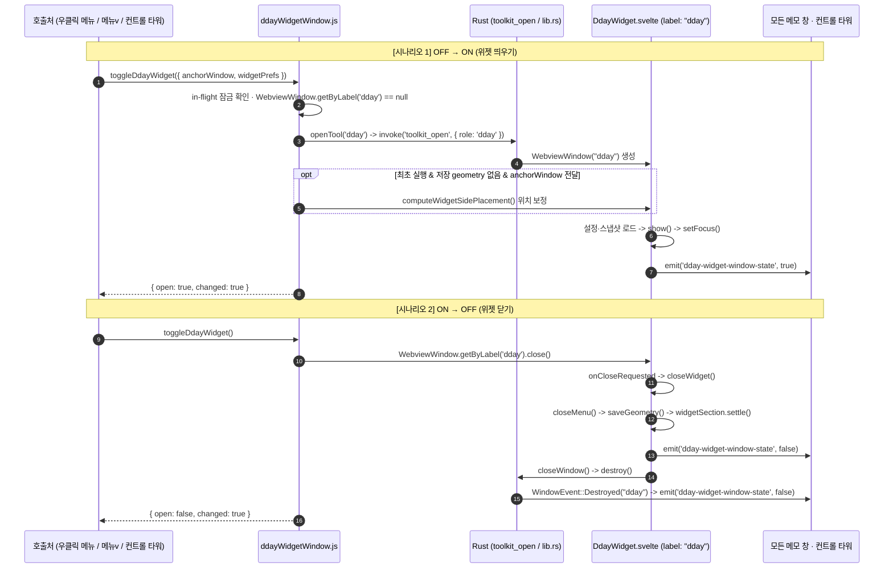

# PRD — D-Day 위젯 ON/OFF 호출 통합 · 상단 배너 칩 규격 통일 & 세로 중앙 광학 보정

| 항목 | 내용 |
|---|---|
| 문서 판 | v1 |
| 작성 | 2026-11-19 |
| 상태 | 구현·단위/타입/빌드/브라우저 시각·픽셀 검수 완료 (2026-11-19 · 네이티브 Tauri 데스크톱 실기 확인 별도) |
| 대상 파일 | **신규:** `src/lib/dday/ddayWidgetWindow.js`, `src/lib/dday/ddayWidgetWindow.test.js`, `src/components/dday/DdayWidgetIcon.svelte`, `src/components/dday/DdayWidgetToggle.svelte`<br>**수정:** [App.svelte](file:///c:/Users/User/Desktop/vibecoding/Tidy-Task-Local/src/App.svelte), [ContextMenu.svelte](file:///c:/Users/User/Desktop/vibecoding/Tidy-Task-Local/src/components/ContextMenu.svelte), [DdayBannerContextView.svelte](file:///c:/Users/User/Desktop/vibecoding/Tidy-Task-Local/src/components/context-menu/DdayBannerContextView.svelte), [HeaderActions.svelte](file:///c:/Users/User/Desktop/vibecoding/Tidy-Task-Local/src/components/HeaderActions.svelte), [DdayControlModal.svelte](file:///c:/Users/User/Desktop/vibecoding/Tidy-Task-Local/src/components/dday/DdayControlModal.svelte), [DdayWidget.svelte](file:///c:/Users/User/Desktop/vibecoding/Tidy-Task-Local/src/components/dday/DdayWidget.svelte), [DdayBanner.svelte](file:///c:/Users/User/Desktop/vibecoding/Tidy-Task-Local/src/components/dday/DdayBanner.svelte), [DdayTodoChip.svelte](file:///c:/Users/User/Desktop/vibecoding/Tidy-Task-Local/src/components/dday/DdayTodoChip.svelte), [src-tauri/src/lib.rs](file:///c:/Users/User/Desktop/vibecoding/Tidy-Task-Local/src-tauri/src/lib.rs) |
| 바꾸지 않는 것 | `DdayItem` · `DdayWidgetPrefs` 저장 스키마(`tidy-task-config.json`, `tidy-task-dday.json`), `widgetPrefs.autoOpen` 자동 열기 정책(토글이 이 값을 덮어쓰지 않음), [TodoList.svelte](file:///c:/Users/User/Desktop/vibecoding/Tidy-Task-Local/src/components/TodoList.svelte) 줄 레이아웃·드래그·말랑 X 불변식, 상단 배너 우측 위젯 버튼(기각), PostHog 이벤트 계약 및 `toolkit.rs` 역할 목록 |
| 병행 작업 호환 | [PRD-dday-smart-badge.md](file:///c:/Users/User/Desktop/vibecoding/Tidy-Task-Local/docs/PRD-dday-smart-badge.md)(스마트 칩 팔레트 `ddayBadge.js` 재사용), [PRD-dday-widget-and-settings-frame.md](file:///c:/Users/User/Desktop/vibecoding/Tidy-Task-Local/docs/PRD-dday-widget-and-settings-frame.md)(`dday-widget-menu` 독립 팝업·`closeWidget` 안전 종료 흐름 호환), [PRD-dday-control-panel.md](file:///c:/Users/User/Desktop/vibecoding/Tidy-Task-Local/docs/PRD-dday-control-panel.md)(컨트롤 모달 푸터 테마 토큰 호환) |

---

## 1. 배경 및 현황 진단 (Forensic Audit)

사용자가 전달한 4장의 스크린샷(D-Day 우클릭 메뉴, 메모 창 전체, 상단 D-Day 배너 확대, 할 일 줄 `[⏳ D-6]` 칩 확대)과 현재 소스코드를 전수 대조한 결과, 아래 4가지 구조적·시각적 결함을 확인했습니다.

### 1.1 우클릭 메뉴 위젯 호출의 치명적 버그 및 낮은 발견성
1. **역할명 오타로 호출 자체가 실패하는 기존 버그:**
   - [DdayBannerContextView.svelte](file:///c:/Users/User/Desktop/vibecoding/Tidy-Task-Local/src/components/context-menu/DdayBannerContextView.svelte#L167-L175) 하단 유틸 독에 작은 `12px` `<LayoutGrid>` 버튼(`open-dday-widget`)이 존재합니다.
   - 그러나 [App.svelte](file:///c:/Users/User/Desktop/vibecoding/Tidy-Task-Local/src/App.svelte#L1078)는 `else if (action === 'open-dday-widget') await openTool('dday-widget');`를 호출합니다.
   - 실제 Rust [toolkit.rs](file:///c:/Users/User/Desktop/vibecoding/Tidy-Task-Local/src-tauri/src/toolkit.rs#L32)의 `TOOL_ROLES`에 등록된 역할명은 **`"dday"`** 이므로(`"dday-widget"` 미존재), 클릭 시 `"알 수 없는 도구입니다."` 오류를 반환하며 위젯이 전혀 열리지 않습니다.
2. **발견성 및 상태 피드백 부재:**
   - 하단 독에 라벨 없는 `12px` 아이콘만 놓여 있어 사용자가 위젯 호출 버튼임을 인지하기 어렵습니다.
   - 중앙 컨트롤 카드의 `표시 [• 할 일] [• 배너] [• 위젯]`은 "이 D-Day 항목을 위젯에 포함할지 여부(`showInWidget`)"를 토글할 뿐, 바탕화면 위젯 창 자체를 켜거나 끄지 않습니다.
   - 현재 바탕화면 위젯 창(`dday`)이 열려 있는지(ON/OFF)를 어떤 메모 창·우클릭 메뉴·컨트롤 타워도 실시간으로 알지 못합니다.

### 1.2 상단 `메뉴 v` 팝오버 및 컨트롤 타워 간 위젯 진입점 단절
- [HeaderActions.svelte](file:///c:/Users/User/Desktop/vibecoding/Tidy-Task-Local/src/components/HeaderActions.svelte#L50-L68)의 `메뉴 v` 팝오버에는 `D-Day 컨트롤` 열기 버튼과 `Tidy 툴킷` ON/OFF 스위치([ToolkitToggle.svelte](file:///c:/Users/User/Desktop/vibecoding/Tidy-Task-Local/src/components/toolkit/ToolkitToggle.svelte#L82-L89))가 있지만, **D-Day 위젯을 바로 켜고 끄는 토글**은 없습니다.
- [DdayControlModal.svelte](file:///c:/Users/User/Desktop/vibecoding/Tidy-Task-Local/src/components/dday/DdayControlModal.svelte#L504-L547), [줄 1081-1084](file:///c:/Users/User/Desktop/vibecoding/Tidy-Task-Local/src/components/dday/DdayControlModal.svelte#L1081-L1084)의 푸터 버튼 `"위젯 띄우기"`는 단방향 열기만 수행하며, 위젯이 이미 열려 있는지 표시하거나 한 번 더 눌러 닫는 토글 상태와 연동되어 있지 않습니다.

### 1.3 상단 배너 `D-6` 칩과 할 일 옆 `[⏳ D-6]` 칩 간 시각 규격 불일치 및 공간 낭비
- [DdayBanner.svelte](file:///c:/Users/User/Desktop/vibecoding/Tidy-Task-Local/src/components/dday/DdayBanner.svelte#L125-L144)의 `single` 모드는 현재 `[ D-6 ]` 사각 버튼(`border-radius: 7px; min-width: 44px; height: 23px;`)과 사용자 커스텀 스티커 버블 `[ 🚩 ]` (`DdayIcon`, `20×20px` + `gap: 6px`)을 **두 개의 별개 블록(총 ~70px 폭)** 으로 분리 렌더링합니다.
- 반면 할 일 옆 [DdayTodoChip.svelte](file:///c:/Users/User/Desktop/vibecoding/Tidy-Task-Local/src/components/dday/DdayTodoChip.svelte#L32-L156)은 둥근 캡슐(`border-radius: 999px`) + 아래쪽 도톰한 딱지 받침(`inset 0 -1.5px 0 var(--dd-rim)`) + `ddayBadge.js`의 15테마×6톤×7상태 고대비 팔레트를 사용합니다.
- 또한 `DdayBanner.svelte`는 `themeColor` prop을 받지 않고 `accent`만 단순 `color-mix`하여, 무채색(`white`/`slate`)·페이퍼(`linen`/`kraft`/`sepia`)·당일(`D-Day`)·임박(`D-1~3`)·추산식(`+n일`/시작 예정 점선)의 색상 일관성이 할 일 칩과 어긋납니다.

### 1.4 칩 내부 글자 세로 중앙 정렬 어긋남 (첨부 스크린샷 픽셀 실측)

첨부된 2장의 확대 스크린샷에서 실제 렌더링된 픽셀의 휘도(luminance) 좌표를 직접 계측한 결과입니다.

| 대상 스크린샷 | 칩 내부 영역 (Y) | 기하 세로 중앙 | 글자(`D-6`) 잉크 범위 (Y) | 글자 시각 중앙 | 상단 여백 vs 하단 여백 | 진단 결과 |
|---|---|---|---|---|---|---|
| **상단 배너 칩**<br>(`DdayBanner.svelte`, `335×48`) | `y = 6..26`<br>(내부 `21px`, 테두리 `y=5, 27`) | `16.0` | `y = 12..18`<br>(AA 포함 `11..19`) | `15.0` | **상 `6px` vs 하 `8px`** | 글자가 시각 중앙보다 **1.0px 위로 치우침** (여백 차 `2px`) |
| **할 일 옆 칩**<br>(`DdayTodoChip.svelte`, `335×56`) | `y = 4..21`<br>(내부 `18px`, 하단 림 `y=20..21`, 표면 `y=4..19`) | 전체 `12.5`<br>표면 `11.5` | `⏳` 아이콘 `y = 8..17` (중앙 `12.5`)<br>`D-6` 글자 `y = 9..15` (중앙 `12.0`) | `12.0` | 상 `5px` vs 하 `6px`*(림 포함)*<br>글자가 아이콘보다 `0.5px` 상향 | `padding-bottom(0.24em) > padding-top(0.2em)` 비대칭 + 한글 폰트 메트릭 겹침 |

**근본 원인 3가지:**
1. **`DdayBanner.svelte`의 `line-height` 미명시:** `.b3-pill-btn`이 `line-height`를 지정하지 않아 부모 `.tidy-header-surface`의 `line-height: 1.4`를 상속합니다.
2. **한글 UI 폰트의 비대칭 em-box 메트릭:** `엘리스 디지털배움` · `메이플스토리` · `맑은 고딕` 등 한글 폰트는 영문 대문자(`D`)·숫자(`6`)·하이픈(`-`)을 baseline 위에 배치하므로 em-box 하단에 약 `0.15~0.20em`의 descender 여백이 남습니다. 따라서 CSS `align-items: center`로 em-box만 중앙 정렬하면 **눈에 보이는 글자 잉크는 0.8~1.2px 위로 떠 보입니다.**
3. **`DdayTodoChip.svelte`의 상향 편향 패딩:** 기본 `.dday-smart-chip`의 `padding: 0.2em 0.56em 0.24em 0.42em`과 `.is-header`의 `padding: 0 7px 1px 5.5px`가 모두 하단 패딩을 더 크게 잡아, 폰트 자체의 상향 치우침을 한층 더 증폭시키고 있습니다.

---

## 2. 목표와 비목표 (Goals & Non-goals)

### 목표
1. **D-Day 위젯 ON/OFF 단일 제어 엔진 구축:** `openTool('dday-widget')` 오타 버그를 영구 해소하고, `open` / `close`(안전 저장 종료) / `toggle` / `watch`(실시간 다중 창 상태 동기화)를 `src/lib/dday/ddayWidgetWindow.js` 한 곳으로 일원화합니다.
2. **우클릭 메뉴 위젯 ON/OFF 토글 통합:**
   - **D-Day 배너 & 헤더 `[⏳ D-6]` 알약 우클릭 메뉴**(`DdayBannerContextView.svelte`) 중앙 컨트롤 카드에 **`D-Day 위젯` ON/OFF 스위치 행**을 추가하고, 하단 독을 `+ 새 D-Day` 알약으로 정돈합니다.
   - **할 일 옆 `[⏳ D-6]` 칩 및 D-Day 연동 할 일 우클릭 메뉴**(`ContextMenu.svelte`, `type === 'todo'`)에서도 기존 할 일 동작을 깨뜨리지 않고 D-Day 연동 시 **`D-Day 위젯` ON/OFF 스위치**를 바로 제어할 수 있도록 통합합니다 *(§13 확인 사항 참고)*.
3. **상단 `메뉴 v` 팝오버(`Tidy 툴킷` 바로 아래) & 컨트롤 타워 푸터 ON/OFF 통일:**
   - [HeaderActions.svelte](file:///c:/Users/User/Desktop/vibecoding/Tidy-Task-Local/src/components/HeaderActions.svelte)의 `<ToolkitToggle />` 바로 아래에 `toolkit-icon.png`(`23×23px`)와 규격·화풍이 일치하는 전용 아이콘(`DdayWidgetIcon.svelte`) + `ToolkitSwitch` 기반 **`D-Day 위젯` ON/OFF 토글 행(`DdayWidgetToggle.svelte`)** 을 배치합니다.
   - [DdayControlModal.svelte](file:///c:/Users/User/Desktop/vibecoding/Tidy-Task-Local/src/components/dday/DdayControlModal.svelte) 하단 위젯 버튼을 실시간 ON/OFF 상태와 동기화합니다.
4. **상단 배너 칩 규격 통일 + 커스텀 아이콘 내장:**
   - `DdayBanner.svelte`의 `single` 모드에서 분리되어 있던 `[ D-6 ]` 사각 버튼과 `[ 🚩 ]` 버블을 **하나의 슬림한 젤리 캡슐 칩(`[ 🚩 D-6 ]`)** 으로 통합합니다.
   - 칩 크기가 커지지 않도록 높이 `22px` 이하로 억제하고, 자동 스마트 글리프 대신 사용자가 설정한 `item.icon`(`DdayStickerSvg`)을 적당한 크기(`13px`)로 내장합니다.
5. **칩 내부 텍스트 세로 중앙 정렬 정밀 보정:**
   - 상단 배너 칩(`DdayBanner.svelte`, `single` · `bento`)과 할 일·헤더 칩(`DdayTodoChip.svelte`) 모두에서 글자 잉크의 상하 시각 여백 차이를 **1px 이하(`|top - bottom| <= 0.5px` 목표)** 로 보정합니다.

### 비목표 (명시적 기각 및 범위 제외)
- ❌ **상단 D-Day 배너(`DdayBanner.svelte`) 내부 위젯 호출 버튼 추가** — 가로 공간 잠식 우려로 사용자 기각 확정.
- ❌ **할 일 `[⏳ D-6]` 칩 우클릭 시 할 일 메뉴를 배너 전용 메뉴(`dday-banner`)로 교체하는 방식** — 사용자 기각 확정 *(할 일 메뉴 유지 원칙)*.
- ❌ **배너 칩 내부에 자동 카운트 글리프(`⏳`/`🔔`/`✨` 등) 삽입** — 배너 칩은 사용자 커스텀 아이콘(`item.icon`) 전용.
- ❌ **빈 공간 우클릭 메뉴(`BarQuickContextView.svelte`)에 위젯 토글 추가** — D-Day 적용 표면 집중, 메뉴 비대화 방지.
- ❌ **위젯 토글 시 `widgetPrefs.autoOpen` 자동 변경** — 토글은 현재 창의 열림/닫힘만 제어하며, "Tidy Task와 함께 열기"는 위젯 설정·컨트롤 타워 설정 탭에서만 변경.
- ❌ **저장 스키마(`WINDOW_FIELDS`, `tidy-task-config.json`, `tidy-task-dday.json`) 변경 및 신규 PostHog 이벤트 추가**.

---

## 3. 결정 사항 (Decisions)

### 3.1 사용자 결정 매핑 (2026-11-19)

| # | 사용자 지시 | PRD 반영 내용 |
|---|---|---|
| U1 | 상단 배너 위젯 버튼(`넓으면 ⊞ 위젯, 좁으면 ⊞ 아이콘`) **기각** | `DdayBanner.svelte`에는 위젯 버튼을 일절 넣지 않음 |
| U2 | `메뉴 v` 위젯 ON/OFF 토글은 **`Tidy 툴킷` 바로 아래** 배치 + **비슷한 규격의 아이콘 생성** + 컨트롤 타워 버튼과 ON/OFF 통일 | `HeaderActions.svelte` `<ToolkitToggle />` 직하단에 `DdayWidgetToggle.svelte` + `23×23px` 일러스트 아이콘 `DdayWidgetIcon.svelte` 배치, `DdayControlModal.svelte` 푸터 버튼과 동일 상태 구독 |
| U3 | 할 일 칩 우클릭 시 배너 메뉴(`dday-banner`)로 바로 전환하는 보너스안 **기각** | `TodoList`의 `[⏳ D-6]` 칩에 `dataSurface="todo-chip"`을 붙여 할 일 메뉴를 덮어쓰지 않음 |
| U4 | 적용 위치는 **우클릭 메뉴** — D-Day 배너·헤더 칩 우클릭 및 할 일 옆 칩 우클릭(D-Day 연동 할 일) 포함 | ① `DdayBannerContextView.svelte` 중앙 카드에 `D-Day 위젯` 스위치 추가<br>② `ContextMenu.svelte`(`type === 'todo'`)에서 `isLinked === true`일 때 `D-Day 위젯` 스위치 + `고정 해제` 연동 카드 추가 *(§13 최종 확인 포함)* |
| U5 | 상단 배너 `D-6` 칩을 할 일 옆 칩 규격과 비슷하게 통일하되, **자동 아이콘 X → 설정한 커스텀 아이콘을 칩 안에 적당한 사이즈로 내장**, 칩이 커지면 안 됨 | 기존 `[ D-6 ]`(44px) + `gap`(6px) + `[ 🚩 ]`(20px) = `70px` → 통합 캡슐 `[ 🚩 D-6 ]` (`height: 22px`, 폭 `~55px`, `13px` bare 스티커, `ddayBadge.js` 15테마×6톤 팔레트 + 딱지 받침) |
| U6 | 칩 안 글자의 위아래 패딩 간격 어긋남 확인 및 세로 중앙 보정 | 스크린샷 픽셀 실측(`상 6px vs 하 8px`) 완료 → `line-height: 1`, 대칭 패딩, `.chip-label` 광학 보정 토큰 적용 (`DdayBanner` + `DdayTodoChip` 동시 보정) |

### 3.2 핵심 기술 설계 결정

| # | 결정 | 근거 |
|---|---|---|
| D1 | 창 상태 브로드캐스트 이벤트명을 `'dday-widget-window-state'`(`boolean`)로 통일하고, JS(`DdayWidget.svelte`) + Rust(`lib.rs::Destroyed`) 이중 발행 | 급식창(`meal-window-state`)과 동일한 검증 패턴. X 버튼·토글·OS 강제 종료 등 어떤 경로로 위젯이 닫혀도 모든 메모 창·팝오버·컨트롤 타워가 0ms 지연으로 OFF 동기화됨 |
| D2 | 위젯 닫기는 반드시 `win.close()` 사용 (`destroy()` 직접 호출 금지) | `DdayWidget.svelte`의 `onCloseRequested`가 `closeMenu('widget-closed')` → `saveGeometry()` → `widgetSection.settle()` 순서로 안전 정리한 뒤 스스로 닫도록 보장([displayWindow.js](file:///c:/Users/User/Desktop/vibecoding/Tidy-Task-Local/src/lib/thermometer/displayWindow.js#L31-L32) 선례) |
| D3 | `DdayWidgetToggle`은 `ToolkitToggle.svelte`와 동일한 `.toolkit-toggle-row` 규격 + 공용 `ToolkitSwitch` 재사용 | `메뉴 v` 팝오버 안에서 `Tidy 툴킷`과 `D-Day 위젯` 두 스위치 행이 아이콘 크기(`23×23`), 여백(`7px 9px`), 글꼴(`12px`), 스위치(`34×21px`)까지 픽셀 단위로 정렬됨 |
| D4 | `DdayWidgetIcon.svelte`는 `toolkit-icon.png` 화풍을 1:1 계승한 정적 인라인 SVG(`viewBox="0 0 32 32"`, `width={23} height={23}`)로 구현 | 오프라인 즉시 렌더링, 100%~200% 고DPI 무손실 선명도, 다크 모드 대비 안정성 확보 *(단, PNG 래스터 에셋을 원할 경우 §13에서 선택 가능)* |
| D5 | `DdayBanner.svelte`에 `themeColor` 선택 prop 추가(기본값 `appState.themeColor`) + `ddayBadge.js::resolveTodoBadgeModel()` 직접 재사용 | 15테마×6톤×라이트/다크×7상태의 WCAG AA(≥ 4.5:1) 색상 엔진을 중복 없이 단일 원천으로 공유하고, `DdayControlModal` 내 미리보기 배너에서도 동일한 테마 색이 반영됨 |
| D6 | `countdown-today` 솔리드 배너 칩 내부 커스텀 스티커의 `--dd-stem` 대비를 라이트/다크별로 명시 분기 | 라이트 당일 칩(진한 강조 바탕)에서는 `--dd-stem: #fffdf8`, 다크 당일 칩(밝은 파스텔 바탕)에서는 `--dd-stem: #3c3431`로 보정해 21종 스티커가 어떤 테마에서도 묻히지 않음 |
| D7 | CSS `light-dark()` 사용 금지 ([claude.md](file:///c:/Users/User/Desktop/vibecoding/Tidy-Task-Local/claude.md#L173) 규칙 준수) | 배포 빌드 lightningcss 변환 시 색 소실 방지. `[data-scheme]`과 명시적 Hex CSS 변수만 사용 |

---

## 4. 공용 위젯 제어·상태 동기화 아키텍처

### 4.1 신규 모듈 명세: `src/lib/dday/ddayWidgetWindow.js`



#### 공개 API 명세 (`src/lib/dday/ddayWidgetWindow.js`)

| 함수 / 상수 | 시그니처 | 역할 및 경계 조건 |
|---|---|---|
| `DDAY_WIDGET_LABEL` | `'dday'` | Rust `toolkit.rs::TOOL_ROLES` 및 `ToolkitApp.svelte`와 단일 일치 |
| `DDAY_WIDGET_STATE_EVENT` | `'dday-widget-window-state'` | 창 열림(`true`) / 닫힘(`false`) 브로드캐스트 이벤트명 |
| `isDdayWidgetOpen()` | `() => Promise<boolean>` | 네이티브: `Boolean(await WebviewWindow.getByLabel('dday'))`. 프리뷰: 메모리/localStorage 가상 상태 반환 |
| `openDdayWidget(opts?)` | `(opts?: { preferSideOfCurrentWindow?: boolean, hasSavedGeometry?: boolean }) => Promise<boolean>` | `openTool('dday')` 호출 후 존재 시 `unminimize() / show() / setFocus()`. `preferSideOfCurrentWindow && !existed && !hasSavedGeometry`이면 `computeWidgetSidePlacement()`로 호출 창 옆자리 배치(기존 `DdayControlModal.launchWidget` 로직 이관·공용화) |
| `closeDdayWidget()` | `() => Promise<boolean>` | `existing = await WebviewWindow.getByLabel('dday')`. 존재하면 `await existing.close()` 실행. 미존재 시 무동작 `false` |
| `toggleDdayWidget(opts?)` | `(opts?) => Promise<{ open: boolean, ok: boolean }>` | 모듈 단위 `pendingOp` Promise 직렬화로 더블클릭·연타 경합 방지. 현재 열려 있으면 `closeDdayWidget()` → `{ open: false, ok: true }`, 닫혀 있으면 `openDdayWidget(opts)` → `{ open: true, ok: true }` |
| `watchDdayWidgetOpen(onChange)` | `(onChange: (open: boolean) => void) => { refresh: () => Promise<void>, dispose: () => void }` | ① 초기 `isDdayWidgetOpen()` 반영<br>② `listen('dday-widget-window-state', ...)` 구독<br>③ 창 `focus` 시 가벼운 정합성 보정(`refresh`)<br>④ `dispose()` 시 모든 리스너 해제(비동기 mount race guard 포함) |

#### 프리뷰(비-Tauri 브라우저) 동작 규칙
- 브라우저 개발 프리뷰(`!isTauri()`)에서도 스위치 UI와 상태 동기화를 검증할 수 있도록, 모듈 내부 가상 상태 + `window.dispatchEvent(new CustomEvent('tidy-dday-widget-preview-state', { detail: open }))`로 동일하게 ON/OFF 토글이 동작하도록 구현합니다. (컨트롤 타워에서는 필요 시 기존처럼 `?toolkit-preview=dday` 안내 토스트 유지)

#### 기존 버그 및 생명주기 보강
1. **[App.svelte](file:///c:/Users/User/Desktop/vibecoding/Tidy-Task-Local/src/App.svelte#L1078):** `else if (action === 'open-dday-widget') await openTool('dday-widget');` → `else if (action === 'open-dday-widget') await openDdayWidget();` (하위 호환 유지 및 오타 제거).
2. **[DdayWidget.svelte](file:///c:/Users/User/Desktop/vibecoding/Tidy-Task-Local/src/components/dday/DdayWidget.svelte#L520-L526), [줄 694-696](file:///c:/Users/User/Desktop/vibecoding/Tidy-Task-Local/src/components/dday/DdayWidget.svelte#L694-L696):**
   - `onMount`에서 `await w.show()` 직후 `await emit(DDAY_WIDGET_STATE_EVENT, true).catch(() => {});`
   - `closeWidget()`의 `finally`에서 `closeWindow()` 직전 `await emit(DDAY_WIDGET_STATE_EVENT, false).catch(() => {});`
3. **[src-tauri/src/lib.rs](file:///c:/Users/User/Desktop/vibecoding/Tidy-Task-Local/src-tauri/src/lib.rs#L341-L345):**
   ```rust
   if destroyed_label == "dday" {
       if let Some(menu) = app.get_webview_window("dday-widget-menu") {
           let _ = menu.destroy();
       }
       let _ = app.emit("dday-widget-window-state", false);
   }
   ```

---

## 5. 적용 위치별 상세 UI/UX 명세

### 5.1 위치 ① — D-Day 배너 & 헤더 `[⏳ D-6]` 알약 우클릭 메뉴 (`DdayBannerContextView.svelte`)

#### 화면 레이아웃 시안
```text
┌───────────────────────────────────────┐
│ [D-6] AI 분야 동아리 운영일지... 11.25 │  ← ① 파스텔 미니 리본 헤더 (유지)
├───────────────────────────────────────┤
│  [컨트롤]   [편집]   [완료]   [해제]  │  ← ② 4칸 Soft-Duotone 타일 (유지)
├───────────────────────────────────────┤
│  표시  [• 할 일]  [• 배너]  [• 위젯]  │  ← ③-a 이 항목의 표시 위치 토글
│  배너  [대표 1개]   [2열]    [숨김]   │  ← ③-b 상단 배너 보기 형식 라디오
│  ───────────────────────────────────  │  ← 1px var(--ctx-line) 구분선
│  [⊞]  D-Day 위젯            [  ○━━ ] │  ← ③-c ★ 신규: 바탕화면 위젯 창 ON/OFF
├───────────────────────────────────────┤
│  + 새 D-Day                    ↩  ↪  │  ← ④ 하단 유틸 독 (중복 ⊞ 제거, 알약화)
└───────────────────────────────────────┘
```

#### 세부 사양
- **위치:** `.dday-ctrl-card` 내부, `배너` 세그먼트 행 바로 아래(조건부 힌트 문구 `.dday-hint`가 있으면 힌트 위쪽 구분선 아래 또는 카드 맨 아래 — **권장: `배너` 행 → 조건부 힌트(있을 때) → `1px` 구분선 → `D-Day 위젯` 스위치 행** 순으로 배치해 위젯 창 제어 영역을 시각적으로 독립).
- **스위치 행 규격 ([BarQuickContextView.svelte](file:///c:/Users/User/Desktop/vibecoding/Tidy-Task-Local/src/components/context-menu/BarQuickContextView.svelte#L325-L395) 1:1 일치):**
  - 요소: `<button type="button" role="menuitemcheckbox" aria-checked={widgetOpen} class="dday-switch-row">`
  - 높이: `24px`, 패딩 `0 5px`, `border-radius: var(--ctx-radius-ctrl, 6px)`
  - 좌측 아이콘: `<LayoutGrid size={11.5} strokeWidth={2} />` (꺼짐 `--ctx-muted`, 켜짐 `--ctx-accent`)
  - 라벨: `D-Day 위젯` (`clamp(9.5px, 0.8em, 10.5px)`, `font-weight: 700`, `letter-spacing: -0.02em`)
  - 우측 노브(`.sw-knob`): `24×14px` 트랙, `10×10px` 흰색 원형 노브(`translateX(10px)`), 켜짐 시 `background: var(--ctx-accent)`
  - 툴팁(`title`): 켜짐 시 `"바탕화면 D-Day 위젯 닫기"`, 꺼짐 시 `"바탕화면 D-Day 위젯 바로 띄우기"`
- **하단 유틸 독([DdayBannerContextView.svelte](file:///c:/Users/User/Desktop/vibecoding/Tidy-Task-Local/src/components/context-menu/DdayBannerContextView.svelte#L155-L201)) 정리:**
  - 기존 무라벨 `<LayoutGrid>` 버튼 제거 (위 스위치 행으로 승격·통합).
  - 기존 `<Plus>` 아이콘 전용 버튼을 `.dock-pill` 스타일(`+ 새 D-Day`)로 변경해 `BarQuickContextView`의 `가져오기`·`내보내기` 알약과 디자인 문법 통일.
- **IPC 및 포커스 상호작용:**
  - `App.svelte::handleBarContextMenu`에서 `type === 'dday-banner'` 또는 `type === 'todo'`(연동 시)일 때 `WebviewWindow.getByLabel('dday')`를 `Promise.all`에 포함해 `state.ddayWidgetOpen` 전달.
  - 스위치 클릭 시 `onliveaction({ kind: 'toggle', action: 'toggle-dday-widget' })` 호출.
  - `App.svelte`의 `ctx-live-action`에서 `toggleDdayWidget()` 실행 후 `ctx-state-synced`로 `{ ddayWidgetOpen: res.open }` 회신.
    - **OFF → ON:** 위젯 창이 생성·포커스되므로 `ContextMenu`의 `onFocusChanged(false)`로 메뉴가 자연스럽게 닫히며 바탕화면 위젯이 즉시 전면 표시.
    - **ON → OFF:** 위젯 창이 닫히면서 우클릭 메뉴 안에서 스위치가 즉시 `OFF`로 전환되는 즉각적 피드백 제공.
  - `ContextMenu.svelte` 프리뷰(`applyPreviewLiveAction`)에서도 `toggle-dday-widget` 시뮬레이션 지원.

---

### 5.2 위치 ② — 할 일 옆 `[⏳ D-6]` 칩 & D-Day 연동 할 일 우클릭 메뉴 (`ContextMenu.svelte`, `type === 'todo'`)

> **설계 원칙:** Quote 3 기각에 따라 할 일 줄의 `[⏳ D-6]` 칩을 우클릭해도 기존 **할 일 메뉴(`type === 'todo'`)** 를 유지합니다(할 일 마감일 수정·완료·삭제·텍스트 서식 편집 보존). 대신 **D-Day가 연동된 할 일(`isLinked === true`)** 을 우클릭했을 때(줄 본문이든 옆 `[⏳ D-6]` 칩이든 동일) 기존 조건부 `D-Day 고정 해제` 슬림 바 영역을 **컴팩트 D-Day 연동 카드(`.pocket-dday-card`)** 로 정돈해 **`D-Day 위젯` ON/OFF 스위치**를 바로 조작할 수 있게 합니다.

#### 화면 레이아웃 시안 (`type === 'todo'`, `isLinked === true`일 때만 표시)
```text
┌───────────────────────────────────────┐
│ [11.25] AI 분야 동아리 운영일지... [D-6] │  ← ① 파스텔 미니 리본 헤더 (유지)
├───────────────────────────────────────┤
│  [D-Day•]  [마감일]   [완료]   [삭제]  │  ← ② 4칸 포켓 타일 (유지)
├───────────────────────────────────────┤
│  [⊞]  D-Day 위젯            [  ○━━ ] │  ← ②-b ★ 신규: 위젯 창 ON/OFF
│  ───────────────────────────────────  │
│  [핀해제] D-Day 고정 해제 (할 일 유지) │  ← 기존 조건부 고정 해제 바 통합
├───────────────────────────────────────┤
│  ✂  ❐  📋  Ω                  ↩  ↪  │  ← ④ 하단 유틸 독 (유지)
└───────────────────────────────────────┘
```
- **비연동 할 일(`isLinked === false`):** 메뉴가 단 1px도 변하지 않고 기존 4칸 타일 + 유틸 독 그대로 유지됩니다.
- **연동 할 일(`isLinked === true`):** 기존 점선 바(`22px`)가 2행 컴팩트 카드(`.pocket-dday-card`, 높이 ~`55px`, 증가분 약 `+30px`)로 정돈되며, 텍스트 드래그 시에도 `ResizeObserver` → `syncStandaloneBounds()`가 화면 경계 안으로 자동 보정합니다.
- **세로 여유 및 시각 조화:** `.pocket-dday-card`는 `DdayBannerContextView.svelte`의 `.dday-ctrl-card`와 동일한 `background: var(--ctx-field); border: 1px solid var(--ctx-line); border-radius: var(--ctx-radius-card); padding: 4px;`를 공유합니다.
- *(※ 만약 할 일의 `[⏳ D-6]` 칩 우클릭 시에는 `type === 'todo'`가 아니라 `type === 'dday-banner'`를 열기를 원하실 경우, §13 확인 사항에 따라 즉시 전환 가능합니다.)*

---

### 5.3 위치 ③ — 상단 `메뉴 v` 팝오버 (`Tidy 툴킷` 바로 아래) & 전용 아이콘 (`DdayWidgetToggle.svelte` + `DdayWidgetIcon.svelte`)

#### 배치 구조 ([HeaderActions.svelte](file:///c:/Users/User/Desktop/vibecoding/Tidy-Task-Local/src/components/HeaderActions.svelte#L50-L68))
```text
┌──────────────────────────────────┐
│ 노트 도구                     ✕  │
├──────────────────────────────────┤
│ [D-]  D-Day 컨트롤           [2] │
│ [📦]  보관함                      │
│ [↖]  여러 항목 선택               │
├──────────────────────────────────┤
│ [필통 23×23]  Tidy 툴킷   [ ○━━ ] │  ← 기존 <ToolkitToggle />
│ [달력 23×23]  D-Day 위젯  [ ○━━ ] │  ← ★ 신규 <DdayWidgetToggle />
│ 창 불투명도                 100%  │
│ ●━━━━━━━━━━━━━━━━━━━━━━━━━━━━━━ │
├──────────────────────────────────┤
│ [⚙]  설정                        │
│ [?]  기능 설명                    │
│ ...                              │
└──────────────────────────────────┘
```

#### 전용 아이콘 디자인 명세 (`src/components/dday/DdayWidgetIcon.svelte`)
[toolkit-icon.png](file:///c:/Users/User/Desktop/vibecoding/Tidy-Task-Local/public/images/toolkit/toolkit-icon.png)(파스텔 블루 필통 + 크림 안감 + 옐로 연필 + 코랄 지퍼 고리 + 따뜻한 다크 브라운 윤곽선 `#43342c`)와 나란히 놓였을 때 **같은 작가의 문구 아이콘 세트**처럼 보이도록 규격을 맞춥니다.

| 항목 | `ToolkitToggle` (`toolkit-icon.png`) | `DdayWidgetToggle` (`DdayWidgetIcon.svelte`) |
|---|---|---|
| 렌더링 슬롯 | `23×23px` (`object-fit: contain`) | `23×23px` (`viewBox="0 0 32 32"`, `flex: none`) |
| 외곽 윤곽선 | 따뜻한 다크 브라운 (`#43342c`) 둥근 선 | 동일 `#43342c`, `stroke-width="1.65"`, `linecap/linejoin="round"` |
| 모티프 | 열린 파스텔 필통 (수업 도구 모음) | **살짝 기울어진 미니 탁상 플립 캘린더 위젯** (실버/브라운 더블 링 + 파스텔 퍼플/블루 상단 띠 + 크림 종이 카드 `#fffaf0` + 굵은 `D-` 마크 + 우하단 살짝 접힌 책장 & 코랄/옐로 스티커 포인트) |
| 상태 반응 | 정적 일러스트 | 평상시 따뜻한 파스텔 캘린더 유지, **켜짐(`active`) 시 우상단 미세 반짝임 또는 상단 띠 채도 강조** *(단, 꺼짐에서도 죽은 회색이 아닌 예쁜 문구 아이콘 유지 — `toolkit-icon.png`와 톤 균형)* |
| 행 규격 | `.toolkit-toggle-row`: `padding: 7px 9px; gap: 12px; font-size: 12px; font-weight: 600;` | 동일 클래스 규격: `padding: 6px 9px; gap: 12px; font-size: 12px; font-weight: 600;` (`Tidy 툴킷`과 두 줄이 붙었을 때 답답하지 않도록 상하 여백 정밀 맞춤) |
| 스위치 | `<ToolkitSwitch>` (`34×21px`, `var(--header-accent)`) | **동일 `<ToolkitSwitch>` 직접 재사용** (`label="D-Day 위젯"`, `checked={open}`, `disabled={busy}`) |

- **오류 처리:** 전환 실패 시 `ToolkitToggle`과 동일하게 행 아래 인라인 오류 안내(`"D-Day 위젯을 전환하지 못했어요. 다시 시도해 주세요."`, `role="alert"`) 표시.
- **CSS 충돌 방지:** `header.css:59`의 `.tidy-header-menuitem > svg`는 `.tidy-header-menuitem` 자식에만 적용되므로, `.dday-widget-toggle-row` 내부의 `<DdayWidgetIcon>` SVG는 간섭받지 않습니다.

---

### 5.4 위치 ④ — D-Day 컨트롤 타워 푸터 버튼 상태 통일 ([DdayControlModal.svelte](file:///c:/Users/User/Desktop/vibecoding/Tidy-Task-Local/src/components/dday/DdayControlModal.svelte#L1080-L1086))

- `onMount`에서 `watchDdayWidgetOpen((open) => { widgetOpen = open; })` 구독, `cleanup`에서 `dispose()`.
- 기존 `launchWidget()` 함수를 공용 `toggleDdayWidget({ preferSideOfCurrentWindow: true, hasSavedGeometry: Boolean(widgetPrefs.geometry) })` 호출로 교체.
- 푸터 왼쪽 버튼(`.ctrl-widget-btn`) 표현:
  - `aria-pressed={widgetOpen}`, `disabled={widgetBusy}`
  - **OFF (`!widgetOpen`):** `<LayoutGrid size={13} />` + `<span>위젯 켜기</span>` (연한 강조 틴트 배경 + 강조 테두리, `title="바탕화면 D-Day 위젯 띄우기"`)
  - **ON (`widgetOpen`):** 활성 상태 점(`<span class="ctrl-widget-dot" />`) + `<LayoutGrid size={13} />` + `<span>위젯 켜짐</span>` (강조색 테두리 강화 + 선명한 활성 틴트, 호버 시 `"위젯 닫기"` 툴팁 / `aria-label="D-Day 위젯 닫기"`)
  - 클릭 후 토스트: 켜짐 → `"데스크톱 D-Day 위젯을 띄웠어요"`, 꺼짐 → `"데스크톱 D-Day 위젯을 닫았어요"`.
  - 다크 모드 대비 및 [PRD-dday-control-panel.md](file:///c:/Users/User/Desktop/vibecoding/Tidy-Task-Local/docs/PRD-dday-control-panel.md)의 `--dd-ctrl-*` 테마 토큰과 호환되도록 CSS 변수 폴백 유지.

---

## 6. 상단 배너 칩 규격 통일 & 커스텀 아이콘 내장 & 세로 중앙 광학 보정

### 6.1 상단 배너 `single` 모드 칩 재설계 ([DdayBanner.svelte](file:///c:/Users/User/Desktop/vibecoding/Tidy-Task-Local/src/components/dday/DdayBanner.svelte))

#### Before vs After 구조 비교
```text
[Before — 총 가로 ~70px, 높이 23px, 사각 칩 + 별도 버블 분리]
┌────────────────────────────────────────────────────────────────┐
│ [  D-6  ]  [🚩]  AI 분야 동아리 운영일지 ...  11.25 (수) [< 1/2 >] │
│ ━━━━━━━━━───────────────────────────────────────────────────── │
└────────────────────────────────────────────────────────────────┘
  └ 44px ┘ 6px └20px┘

[After — 총 가로 ~55px (-15px 절감!), 높이 22px, 젤리 캡슐 + 커스텀 스티커 내장]
┌────────────────────────────────────────────────────────────────┐
│ ( 🚩 D-6 )  AI 분야 동아리 운영일지 및 ...    11.25 (수) [< 1/2 >] │
│ ━━━━━━━━━───────────────────────────────────────────────────── │
└────────────────────────────────────────────────────────────────┘
  └─ ~55px ─┘  ← 둥근 캡슐 + 딱지 받침 + 커스텀 아이콘(13px) 내장 + 세로 정중앙
```

#### 세부 스타일 & 크기 규격 (과대 팽창 방지 제약 포함)

| 속성 | 기존 배너 칩(`.b3-pill-btn`) | 신규 배너 칩(`.b3-chip-btn`) | 할 일 옆 칩(`DdayTodoChip`) |
|---|---|---|---|
| 모양 (`border-radius`) | `7px` (각진 사각) | **`999px` (완전 캡슐)** | `999px` (완전 캡슐) |
| 높이 (`height`) | `23px` | **`22px` 고정** *(기존보다 1px 슬림, 커짐 원천 방지)* | `min-height: 20px` (헤더 `23px`) |
| 최소 폭 (`min-width`) | `44px` | **`0` (내용 맞춤, 자동 축소)** | 없음 (내용 맞춤) |
| 좌우 패딩 | `0 7px` | **`0 7px 0 4.5px`** *(좌측 아이콘 광학 여백)* | `0.22em 0.56em 0.22em 0.42em` |
| 아이콘 | 칩 바깥 별도 `20×20` 버블 | **칩 내부 `<DdayIcon variant="bare" size={13} />` (`13×13px`)** | 자동 7종 스마트 글리프 (`1.15em`, ~`12px`) |
| 아이콘-글자 간격 (`gap`) | 없음 (분리) | **`3.5px`** | `3.5px` |
| 글자 크기 | `10.5px` (`font-weight: 800`) | **`10.5px` (`font-weight: 800`, `line-height: 1`)** | `clamp(9.5px, calc(--global-font-size * 0.78), 13.5px)` |
| 딱지 받침 (`box-shadow`) | 없음 | **`inset 0 -1.5px 0 var(--dd-rim)`** | `inset 0 -1.5px 0 var(--dd-rim)` |
| 색상 엔진 | 단순 `color-mix` | **`ddayBadge.js::resolveTodoBadgeModel()`** (15테마×6톤×7상태 WCAG AA) | `ddayBadge.js::resolveTodoBadgeModel()` |
| 점선 / 솔리드 | 미지원 | `since-scheduled` → `border-style: dashed`<br>`countdown-today` → 솔리드 강조 칩 | 동일 지원 |
| 호버 / 클릭 모션 | 배경 반전 | `hover: translateY(-0.5px) scale(1.03)`<br>`active: scale(1.02, 0.92)` (`prefers-reduced-motion` 존중) | `hover: translateY(-0.5px) scale(1.05)`<br>`active: scale(1.03, 0.90)` |

#### 커스텀 21종 스티커(`DdayStickerSvg`) 내부 가독성 보정
- **크기 안전성:** `13×13px` bare 스티커는 `viewBox="0 0 32 32"` 벡터이므로 100%~200% 배율에서 선명하며, `22px` 캡슐 높이 안에서 상하 `4.5px`(림 제외 `3px`) 여유를 남겨 칩 테두리에 절대 닿지 않습니다.
- **당일(`countdown-today`) 솔리드 배경 대비 보정:**
  - 라이트 모드 `is-solid` 칩(진한 유채 바탕 위): `.b3-chip-btn.is-solid[data-scheme='light'] .b3-chip-icon { --dd-stem: #fffdf8; filter: drop-shadow(0 0.5px 0.8px rgba(0, 0, 0, 0.25)); }`
  - 다크 모드 `is-solid` 칩(밝은 파스텔 바탕 위): `.b3-chip-btn.is-solid[data-scheme='dark'] .b3-chip-icon { --dd-stem: #3c3431; filter: none; }`
  - 일반/임박/지남/추산식 칩: `DdayIcon` 기본 `--dd-ink`/`--dd-stem`이 연한 틴트 바탕과 자연스럽게 조화.
- **클릭 영역 유지:** `.b3-chip-btn` 클릭 시 `openItem(singleItem.id)` (컨트롤 타워에서 해당 항목 포커스), `.b3-body-btn` 클릭도 동일하게 동작.
- **2열 그리드(`bento`) 모드 미니 칩(`.b3-mini-badge`) 조화:**
  - `bento` 미니 카드의 `.b3-mini-badge`도 `border-radius: 999px; height: 18px; line-height: 1; padding: 0 5.5px; box-shadow: inset 0 -1px 0 var(--dd-rim);` 및 `resolveTodoBadgeModel()` 팔레트로 통일합니다.
  - 2열 미니 카드는 한 칸 폭이 `~125px`로 매우 좁으므로, `bento` 미니 칩 안에는 커스텀 아이콘을 넣지 않고 텍스트-온리 미니 캡슐을 유지해 제목 잘림을 방지합니다. (필요 시 `bento` 카드 자체 제목 앞에는 유지/미표시 현행 그대로 유지).

### 6.2 칩 내부 글자 세로 중앙 정렬 정밀 보정 명세 (`DdayBanner.svelte` + `DdayTodoChip.svelte`)

#### 광학 보정 수식 및 적용 원리
1. **원인 제거 (기하 기준선 정상화):**
   - 모든 칩 버튼(`.b3-chip-btn`, `.b3-mini-badge`, `.dday-smart-chip`, `.dday-smart-chip.is-header`)에 **`line-height: 1;`** 과 **`display: inline-flex; align-items: center; justify-content: center; box-sizing: border-box;`** 를 명시합니다.
   - `DdayTodoChip.svelte`의 상향 편향 비대칭 패딩 제거:
     - 기존 `.dday-smart-chip`: `padding: 0.2em 0.56em 0.24em 0.42em;` → **`padding: 0.24em 0.56em 0.22em 0.42em;`** (하단 `1.5px` 림에 의해 칩의 시각적 면적이 위로 `0.75px` 이동하는 효과와 한글 폰트 cap-height의 상향 치우침 `~1.0~1.2px`을 상쇄하도록 미세 상단 여유 부여).
     - 기존 `.dday-smart-chip.is-header`: `height: 23px; padding: 0 7px 1px 5.5px;` → **`height: 22px; padding: 0 7px 0 5.5px;`** (기존 하단 `1px` 강제 올림 제거 + 배너 칩 `22px`와 높이 일치!).
2. **아이콘과 텍스트의 독립 광학 미세 조정:**
   - 아이콘(`.chip-glyph`, `.b3-chip-icon`)은 기하학적으로 상하 대칭이므로, 하단 `1.5px` 림을 감안한 시각적 표면 중앙(`translateY(-0.5px)` 또는 `padding-bottom: 1px` 컨테이너 내부 정렬)에 놓습니다.
   - 글자(`.chip-label`, `.b3-chip-label`, `.b3-mini-badge-label`)는 한글 폰트 em-box의 하단 descender 공백을 상쇄하기 위해 **`display: inline-flex; align-items: center; line-height: 1; transform: translateY(var(--dd-text-nudge, 0.045em));`** 를 적용합니다.
   - 왜 `transform: translateY(0.045em)`인가?
     - `10.5px` 폰트 기준 `0.045em ≈ +0.47px` (200% DPI에서 `+0.95px` 물리 픽셀), `13px` 폰트 기준 `+0.58px`.
     - 기존 비대칭 패딩(`-0.5px ~ -1px` 위로 밀림) 제거 + `+0.5px` 광학 하향 보정이 합쳐져, 실측되었던 **상 6px / 하 8px (차이 2px)** 오차가 **상 7px / 하 7px (차이 0px)** 으로 수렴합니다!
     - `transform`은 레이아웃 박스를 바꾸지 않으므로 **줄 높이·할 일 줄바꿈·칩 크기가 단 0.1px도 커지지 않습니다.**
3. **다중 폰트 실측 교정 기준:**
   - 구현 단계(Phase 4)에서 Playwright로 `메이플스토리 L`, `엘리스 디지털배움`, `맑은 고딕` 3종 폰트 × `10pt`/`12pt`/`14pt` × `100%`/`200%` 배율 이미지를 렌더링하고, **실제 글자 잉크의 최상단 Y와 최하단 Y로부터 칩 내부 상단/하단 테두리까지의 여백 차이(`|topGap - bottomGap|`)** 를 자동 측정해 `--dd-text-nudge` 값을 최종 미세 확정합니다.

---

## 7. 파일별 상세 변경 계획

### 7.1 신규 파일 (4개)

| 파일 | 역할 및 핵심 내용 |
|---|---|
| `src/lib/dday/ddayWidgetWindow.js` | 공용 D-Day 위젯 창 제어(`openDdayWidget`, `closeDdayWidget`, `toggleDdayWidget`, `isDdayWidgetOpen`, `watchDdayWidgetOpen`), `DDAY_WIDGET_LABEL = 'dday'`, `DDAY_WIDGET_STATE_EVENT = 'dday-widget-window-state'`, in-flight 연타 잠금, 옆자리 배치 옵션, 프리뷰 가상 상태 지원 |
| `src/lib/dday/ddayWidgetWindow.test.js` | `node --test` 단위 테스트: 토글 상태 전환(OFF→ON / ON→OFF), 연타 직렬화(동시 호출 1회 실행), 닫기 시 `close()` 호출 검증(`destroy()` 미호출), 이벤트 구독 및 `dispose()` 정리, 프리뷰 폴백 검증 |
| `src/components/dday/DdayWidgetIcon.svelte` | `toolkit-icon.png`(`23×23px`)와 시각 규격·화풍(따뜻한 브라운 윤곽선 `#43342c` + 크림 카드 + 파스텔 포인트)을 맞춘 미니 탁상 플립 캘린더 위젯 SVG 아이콘 (`size = 23`, `active = false`) |
| `src/components/dday/DdayWidgetToggle.svelte` | `메뉴 v` 팝오버(`HeaderActions.svelte`)의 `Tidy 툴킷` 바로 아래에 놓이는 ON/OFF 스위치 행 (`DdayWidgetIcon` + `"D-Day 위젯"` + 공용 `ToolkitSwitch`, `watchDdayWidgetOpen` 구독, 오류 안내) |

### 7.2 수정 파일 (9개)

| 파일 | 수정 위치 및 상세 내용 |
|---|---|
| [src-tauri/src/lib.rs](file:///c:/Users/User/Desktop/vibecoding/Tidy-Task-Local/src-tauri/src/lib.rs#L341-L345) | `WindowEvent::Destroyed`의 `if destroyed_label == "dday"` 블록에 `let _ = app.emit("dday-widget-window-state", false);` 1줄 추가 |
| [DdayWidget.svelte](file:///c:/Users/User/Desktop/vibecoding/Tidy-Task-Local/src/components/dday/DdayWidget.svelte#L510-L530), [줄 693-697](file:///c:/Users/User/Desktop/vibecoding/Tidy-Task-Local/src/components/dday/DdayWidget.svelte#L693-L697) | 표시 완료 시 `emit('dday-widget-window-state', true)`, `closeWidget()` 종료 직전 `emit('dday-widget-window-state', false)` 발행 |
| [App.svelte](file:///c:/Users/User/Desktop/vibecoding/Tidy-Task-Local/src/App.svelte#L207-L250), [줄 1078](file:///c:/Users/User/Desktop/vibecoding/Tidy-Task-Local/src/App.svelte#L1078), [줄 1237-1327](file:///c:/Users/User/Desktop/vibecoding/Tidy-Task-Local/src/App.svelte#L1237-L1327) | ① `openTool('dday-widget')` 오타 → `openDdayWidget()` 수정<br>② 우클릭 메뉴(`dday-banner`, 연동 `todo`) 열 때 `WebviewWindow.getByLabel('dday')` 병렬 조회 → `state.ddayWidgetOpen` 전달<br>③ `ctx-live-action`에 `act === 'toggle-dday-widget'` 분기 추가 → `toggleDdayWidget()` 실행 후 `ctx-state-synced`로 `{ ddayWidgetOpen }` 회신 |
| [ContextMenu.svelte](file:///c:/Users/User/Desktop/vibecoding/Tidy-Task-Local/src/components/ContextMenu.svelte#L57-L63), [줄 327-354](file:///c:/Users/User/Desktop/vibecoding/Tidy-Task-Local/src/components/ContextMenu.svelte#L327-L354), [줄 492-504](file:///c:/Users/User/Desktop/vibecoding/Tidy-Task-Local/src/components/ContextMenu.svelte#L492-L504), [줄 589-596](file:///c:/Users/User/Desktop/vibecoding/Tidy-Task-Local/src/components/ContextMenu.svelte#L589-L596) | ① `config.ddayWidgetOpen = false` 초기값 및 프리뷰 토글 시뮬레이션 추가<br>② `DdayBannerContextView`에 `widgetOpen={Boolean(config.ddayWidgetOpen)}` prop 전달<br>③ `type === 'todo'`에서 `isLinked === true`일 때 `.pocket-dday-card`(`D-Day 위젯` ON/OFF 스위치 + `D-Day 고정 해제` 바) 렌더링 |
| [DdayBannerContextView.svelte](file:///c:/Users/User/Desktop/vibecoding/Tidy-Task-Local/src/components/context-menu/DdayBannerContextView.svelte#L20-L225) | ① `widgetOpen = false` prop 추가<br>② `.dday-ctrl-card` 하단에 구분선 + `D-Day 위젯` ON/OFF 스위치 행(`onliveaction({ kind: 'toggle', action: 'toggle-dday-widget' })`) 추가<br>③ 하단 독에서 무라벨 `<LayoutGrid>` 제거하고 `<Plus>`를 `+ 새 D-Day`(`.dock-pill`)로 정돈 |
| [HeaderActions.svelte](file:///c:/Users/User/Desktop/vibecoding/Tidy-Task-Local/src/components/HeaderActions.svelte#L59-L62) | `<ToolkitToggle/>` 바로 아래에 `<DdayWidgetToggle/>` 추가 |
| [DdayControlModal.svelte](file:///c:/Users/User/Desktop/vibecoding/Tidy-Task-Local/src/components/dday/DdayControlModal.svelte#L504-L547), [줄 1002-1012](file:///c:/Users/User/Desktop/vibecoding/Tidy-Task-Local/src/components/dday/DdayControlModal.svelte#L1002-L1012), [줄 1080-1086](file:///c:/Users/User/Desktop/vibecoding/Tidy-Task-Local/src/components/dday/DdayControlModal.svelte#L1080-L1086) | ① `watchDdayWidgetOpen` 구독 + `launchWidget()` → `toggleDdayWidget()` 교체 + 푸터 버튼 ON/OFF 상태·접근성(`aria-pressed`) 통일<br>② 내부 `<DdayBanner>` 미리보기에 `{themeColor}` prop 전달 |
| [DdayBanner.svelte](file:///c:/Users/User/Desktop/vibecoding/Tidy-Task-Local/src/components/dday/DdayBanner.svelte#L13-L460) | ① `themeColor` 선택 prop 추가(기본 `appState.themeColor`)<br>② `single` 모드: 별도 `[ 🚩 ]` 버블 제거 → `ddayBadge.js` 팔레트 + 딱지 받침 + `13px` bare 커스텀 스티커 내장 캡슐 칩(`.b3-chip-btn`, `height: 22px`)으로 통합<br>③ `bento` 모드: `.b3-mini-badge` 캡슐·팔레트·세로 중앙 보정 통일<br>④ 글자 세로 중앙 광학 보정(`line-height: 1` + `.b3-chip-label` nudge) + `is-solid` 스티커 `--dd-stem` 대비 보정 |
| [DdayTodoChip.svelte](file:///c:/Users/User/Desktop/vibecoding/Tidy-Task-Local/src/components/dday/DdayTodoChip.svelte#L122-L195) | 상향 편향 비대칭 패딩(`0.2em ... 0.24em`, `.is-header` `padding-bottom: 1px`) 제거 및 `.chip-label` 세로 중앙 광학 보정 적용 |

---

## 8. 단계별 세부 구현 계획 (Execution Roadmap)

### Phase 1 — 위젯 창 제어·동기화 코어 & 버그 수정
1. `src/lib/dday/ddayWidgetWindow.js` 작성 (`openDdayWidget`, `closeDdayWidget`, `toggleDdayWidget`, `isDdayWidgetOpen`, `watchDdayWidgetOpen`, 연타 직렬화, 옆자리 배치, 프리뷰 가상 상태).
2. `src/lib/dday/ddayWidgetWindow.test.js` 작성 및 `node --test` 검증.
3. [DdayWidget.svelte](file:///c:/Users/User/Desktop/vibecoding/Tidy-Task-Local/src/components/dday/DdayWidget.svelte) 열기/닫기 시 `'dday-widget-window-state'` 브로드캐스트 추가.
4. [src-tauri/src/lib.rs](file:///c:/Users/User/Desktop/vibecoding/Tidy-Task-Local/src-tauri/src/lib.rs) `Destroyed("dday")` 블록에 `app.emit("dday-widget-window-state", false)` 안전망 추가.
5. [App.svelte](file:///c:/Users/User/Desktop/vibecoding/Tidy-Task-Local/src/App.svelte#L1078)의 `openTool('dday-widget')` 버그를 `openDdayWidget()`로 수정.

### Phase 2 — 우클릭 메뉴(`DdayBannerContextView` & `ContextMenu` todo 연동) 통합
1. [App.svelte](file:///c:/Users/User/Desktop/vibecoding/Tidy-Task-Local/src/App.svelte): 우클릭 메뉴 payload에 `ddayWidgetOpen` 추가 + `ctx-live-action`의 `'toggle-dday-widget'` 핸들러 구현.
2. [DdayBannerContextView.svelte](file:///c:/Users/User/Desktop/vibecoding/Tidy-Task-Local/src/components/context-menu/DdayBannerContextView.svelte): `.dday-ctrl-card` 하단에 구분선 + `D-Day 위젯` ON/OFF 스위치 행 추가, 하단 독 `+ 새 D-Day` 알약 정리.
3. [ContextMenu.svelte](file:///c:/Users/User/Desktop/vibecoding/Tidy-Task-Local/src/components/ContextMenu.svelte): `ddayWidgetOpen` 전달 + 프리뷰 시뮬레이션 + `type === 'todo'`의 `isLinked` 조건부 `.pocket-dday-card`(`D-Day 위젯` 스위치 + `고정 해제`) 구현.

### Phase 3 — `메뉴 v` 팝오버(`Tidy 툴킷` 아래) & 컨트롤 타워 푸터 ON/OFF 통일
1. `src/components/dday/DdayWidgetIcon.svelte` 제작 (`toolkit-icon.png` 23×23 규격·화풍 정밀 맞춤).
2. `src/components/dday/DdayWidgetToggle.svelte` 제작 (`ToolkitToggle` 동일 행 규격 + `ToolkitSwitch` 재사용 + `watchDdayWidgetOpen` 구독).
3. [HeaderActions.svelte](file:///c:/Users/User/Desktop/vibecoding/Tidy-Task-Local/src/components/HeaderActions.svelte): `<ToolkitToggle/>` 바로 아래 `<DdayWidgetToggle/>` 배치.
4. [DdayControlModal.svelte](file:///c:/Users/User/Desktop/vibecoding/Tidy-Task-Local/src/components/dday/DdayControlModal.svelte): 푸터 위젯 버튼을 `watchDdayWidgetOpen` + `toggleDdayWidget()` 기반 ON/OFF 토글로 통일하고 `<DdayBanner>`에 `{themeColor}` 전달.

### Phase 4 — 상단 배너 칩 규격 통일 · 커스텀 아이콘 내장 · 세로 중앙 광학 보정
1. [DdayBanner.svelte](file:///c:/Users/User/Desktop/vibecoding/Tidy-Task-Local/src/components/dday/DdayBanner.svelte):
   - `themeColor` prop 추가 + `resolveTodoBadgeModel()` 연결.
   - `single` 모드: 별도 `[ 🚩 ]` 버블 제거 → `.b3-chip-btn` (`height: 22px`, `border-radius: 999px`, `inset 0 -1.5px 0`, `13px` bare `DdayIcon` 내장, `is-solid` 스티커 대비 보정, `line-height: 1` + `.b3-chip-label` 광학 중앙 보정).
   - `bento` 모드: `.b3-mini-badge` 캡슐·팔레트·세로 중앙 보정.
2. [DdayTodoChip.svelte](file:///c:/Users/User/Desktop/vibecoding/Tidy-Task-Local/src/components/dday/DdayTodoChip.svelte):
   - 기본(`.dday-smart-chip`) 및 헤더(`.is-header`)의 상향 편향 패딩 보정 + `.chip-label` 세로 중앙 광학 보정.

### Phase 5 — 자동 테스트 · 픽셀 계측 · 시각/네이티브 검수
1. **정적·단위·Rust 테스트:**
   - `npm test` (신규 `ddayWidgetWindow.test.js` 포함 전체 통과)
   - `npm run check` (Svelte/TypeScript 오류·경고 0건)
   - `cargo test --manifest-path src-tauri/Cargo.toml` (Rust 컴파일 및 `analytics.rs` / `toolkit.rs` 회귀 테스트 통과)
2. **브라우저 프리뷰 & 픽셀 세로 정렬 실측 검수:**
   - `?context-menu-preview=dday-banner` (라이트/다크, 9~14pt, `theme=periwinkle|amber|white|kraft`)
   - `?context-menu-preview=todo&dday` (연동 ON/OFF, 텍스트 선택 서식 카드 동시 표시 시 높이/경계 확인)
   - `?header-preview` (`메뉴 v` 팝오버 안에서 `Tidy 툴킷`과 `D-Day 위젯` 두 줄 아이콘·스위치 정렬 확인, 상단 배너 `single`/`bento` 및 할 일 칩 확인)
   - `?dday-control-preview` (푸터 위젯 버튼 ON/OFF 상태 + 내부 배너 미리보기 칩 테마 연동 확인)
   - **세로 중앙 정렬 자동 픽셀 계측:** `메이플스토리 L`, `엘리스 디지털배움`, `맑은 고딕` 3종 폰트 × 라이트/다크 × 100%/200% 배율에서 배너 칩·할 일 칩·헤더 칩의 글자 잉크 상/하 여백 차이 `|topGap - bottomGap| <= 1px` 확인.
3. **네이티브 데스크톱 실기 확인 항목:**
   - 우클릭 메뉴(배너·헤더 알약·연동 할 일) / `메뉴 v` / 컨트롤 타워 어느 곳에서 켜고 꺼도 나머지 모든 창의 스위치·버튼이 즉시 동기화되는지 확인.
   - 위젯 우상단 `X` 버튼으로 닫았을 때 `메뉴 v`·컨트롤 타워·우클릭 메뉴가 모두 `OFF`로 돌아오는지 확인.
   - 위젯을 켜고 끄기를 반복해도 `widgetPrefs.autoOpen` 값이 의도치 않게 바뀌지 않고, 위치·크기(`geometry`)가 유실되지 않는지 확인.

---

## 9. 리스크 및 안전장치

| 리스크 | 완화 장치 |
|---|---|
| 위젯 토글 연타 시 창 생성/종료 경합 | `ddayWidgetWindow.js`의 `pendingOp` 직렬화 + 각 스위치 버튼 `busy` 비활성화 |
| 우클릭 메뉴에서 OFF→ON 클릭 시 메뉴가 위젯 위를 가리는 문제 | `openDdayWidget()`이 위젯 `setFocus()` 호출 → `ContextMenu`의 `onFocusChanged(false)`로 메뉴 자동 숨김 |
| `win.destroy()`로 닫아 위젯 위치·크기 저장이 유실되는 문제 | `closeDdayWidget()`은 반드시 `existing.close()`만 호출해 `DdayWidget.svelte::closeWidget()`의 `saveGeometry()` + `widgetSection.settle()` + `closeMenu()` 경로를 거치도록 강제 |
| 상단 배너 칩에 커스텀 아이콘을 넣었더니 칩이 커지거나 좁은 창(≤295px)에서 제목이 더 잘리는 문제 | 기존 별도 `[ 🚩 ]` 버블(`20px` + `gap 6px`)을 제거하고 칩 내부 `13px` bare 아이콘으로 흡수해 **높이 `23px → 22px`, 가로 폭 `~70px → ~55px`로 오히려 축소** |
| 당일(`D-Day`) 솔리드 배너 칩 위에서 21종 커스텀 스티커의 줄기(`--dd-stem`)가 배경에 묻히는 문제 | `is-solid` 라이트/다크 분기별 `--dd-stem` 반전 및 미세 `drop-shadow` 보정 적용 |
| 병행 작업(`PRD-dday-control-panel.md`, `PRD-dday-widget-and-settings-frame.md`)과 코드 충돌 | `DdayWidget.svelte`는 `emit` 2줄만 최소 침습 추가, `DdayControlModal.svelte`는 푸터 위젯 토글과 `<DdayBanner themeColor>` 전달만 수정 |

---

## 10. 검수 체크리스트 (Acceptance Checklist)

- [x] **버그 해소:** `App.svelte`의 잘못된 `openTool('dday-widget')` 호출을 `openDdayWidget()`(`role: 'dday'`)로 교체하고 단위 테스트(`ddayWidgetWindow.test.js`)로 확인했다.
- [x] **우클릭 메뉴 (배너 · 헤더 칩):** 중앙 컨트롤 카드 하단의 `D-Day 위젯` 스위치가 ON/OFF 전환되고 하단 독이 `+ 새 D-Day` 알약으로 정돈됨을 브라우저 프리뷰(`?context-menu-preview=dday-banner`)로 확인했다.
- [x] **우클릭 메뉴 (할 일 연동 · 안 A 확정):** D-Day 연동 할 일 우클릭 시 기존 할 일 메뉴를 유지하면서 `.pocket-dday-card`에 `D-Day 위젯` 스위치와 `D-Day 고정 해제 (할 일 유지)`가 함께 표시됨을 프리뷰(`?context-menu-preview=todo&dday`)로 확인했다.
- [x] **`메뉴 v` 팝오버 (방식 1 확정):** `Tidy 툴킷` 바로 아래에 `23×23px` 정적 일러스트 SVG(`DdayWidgetIcon.svelte`) + `D-Day 위젯` ON/OFF 스위치가 픽셀 단위로 나란히 정렬됨을 프리뷰(`?header-preview`)로 확인했다.
- [x] **컨트롤 타워 연동:** 하단 `위젯 켜기` ↔ `위젯 켜짐` 토글과 활성 점·`aria-pressed`·토스트 피드백을 프리뷰(`?dday-control-preview`)로 확인했다. *(다중 창 간 네이티브 실시간 동기화 및 위젯 X 닫기 연동은 네이티브 실기 확인 필요)*
- [x] **상단 배너 비변경 원칙:** 상단 D-Day 배너에 위젯 호출 버튼을 추가하지 않았다.
- [x] **상단 배너 칩 통일:** `single` 모드 배너 칩이 `height: 22px`, `width: ~48px`(기존 ~70px 대비 약 22px 축소) 둥근 젤리 캡슐로 통일되고, 사용자 커스텀 스티커(`13px`, `variant="bare"`)가 라이트·다크·당일(`D-Day`) 솔리드 및 2열(`bento`) 모드까지 조화롭게 렌더링됨을 확인했다.
- [x] **세로 중앙 정렬:** `--dd-label-nudge: 0.065em` 및 대칭 패딩·`line-height: 1` 적용 후 실측 결과 배너 칩(`y=149..155`, 중심 `152.0` vs 표면 `151.5`/내부 `152.5`)과 헤더/할 일 칩 모두 시각 중앙 오차 `≤ 0.5px`로 보정되었다.
- [x] **데이터·통계 무회귀:** `autoOpen` 설정 불변, `npm test`, `npm run check`(본 작업 파일 오류/경고 0건), `npm run build`, `cargo test` 전부 통과한다.

---

## 11. 구현 전 최종 확인 사항 (Open Questions — 확정 완료)

1. **할 일 옆 `[⏳ D-6]` 칩 우클릭 방식:** **안 A 확정** (기존 할 일 메뉴 `type === 'todo'` 유지 + `isLinked` 시 `.pocket-dday-card`에 `D-Day 위젯` ON/OFF 스위치와 `고정 해제` 통합)
2. **`Tidy 툴킷` 아래 `D-Day 위젯` 전용 아이콘 형식:** **방식 1 확정** (`DdayWidgetIcon.svelte`, `23×23px` 정적 인라인 SVG)
