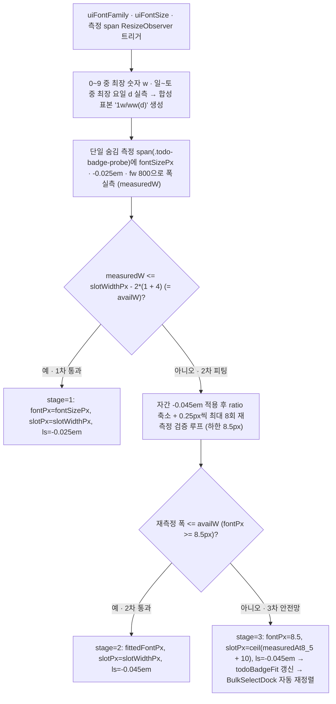

# PRD — 투두리스트 날짜 뱃지 규격 통일 · 말랑 딱지 질감 · UI 크기 스마트 스케일링 · 정제 톤 고도화

| 항목 | 내용 |
|---|---|
| 문서 판 | **v2.0 (최종 PRD · Claude Opus 5.5 High 독립 검수 반영)** |
| 작성 / 개정 | 2026-11-20 |
| 상태 | **구현·자동 검수 완료 (2026-11-20)** *(Tauri 네이티브 데스크톱 확인은 별도)* |
| 기준 방향 | **999px 슬림 말랑 딱지 캡슐 공통 규격 통일**(날짜 ↔ D-Day 쌍둥이 규격, 가로 길이만 역할 분리) + **시안 1 질감(상단 광택 + 하단 1.5px 딱지 림)** + **비대칭 감쇠 UI 스케일링(`0.45 / 0.55`)** + **5단계 색상 의미·구간 불변 정제 파스텔 톤** |
| 대상 | **신규:** `src/lib/todos/todoBadgeMetrics.js`, `src/lib/todos/todoBadgeMetrics.test.js`, `src/lib/todos/todoBadgeFit.svelte.js`, `scripts/qa-todo-deadline-badge.cjs`, `docs/QA-todo-deadline-badge-20261120.md`<br>**수정:** [App.svelte](../src/App.svelte), [TodoList.svelte](../src/components/TodoList.svelte), [DdayTodoChip.svelte](../src/components/dday/DdayTodoChip.svelte), [DdayBanner.svelte](../src/components/dday/DdayBanner.svelte), [bulkDockLayout.js](../src/lib/todos/bulkDockLayout.js), [bulkDockLayout.test.js](../src/lib/todos/bulkDockLayout.test.js), [BulkSelectDock.svelte](../src/components/todo/BulkSelectDock.svelte), [MemoLayoutPreview.svelte](../src/dev/MemoLayoutPreview.svelte), [BulkArchiveMenuPreview.svelte](../src/dev/BulkArchiveMenuPreview.svelte), [claude.md](../claude.md) |
| 바꾸지 않는 것 | 마감일 5단계(🟣지연·🔴오늘·🟠1~3일·🟢4~7일·🔵여유) + ⚪미설정 의미·판별 구간 및 [dateUtils.js](../src/lib/dateUtils.js) `daysUntil` / [calendarModel.js](../src/lib/datePicker/calendarModel.js) `formatShortDate` 표기 형식, [ddayBadge.js](../src/lib/dday/ddayBadge.js) 15테마×6톤×7상태 색상 엔진 및 7종 스마트 SVG 글리프, 날짜 뱃지(창 내 전 행 동일 고정 슬롯 폭) vs D-Day 뱃지(내용 맞춤 가변 폭)의 가로 길이 역할 분리, 할 일 줄 끌기(`data-sort-activator`)·달력 창 트리거(`use:dateTrigger`, `data-todo-deadline-btn`)·`memoLayout.js` 세로 배치 규칙·`WINDOW_FIELDS` 저장 스키마·PostHog 통계 이벤트 |
| 선행·연관 문서 | [PRD-dday-smart-badge.md](PRD-dday-smart-badge.md), [PRD-dday-widget-toggle-and-banner-chip.md](PRD-dday-widget-toggle-and-banner-chip.md), [PRD-bulk-select-dock.md](PRD-bulk-select-dock.md), [PRD-todo-row-gestures.md](PRD-todo-row-gestures.md) |

---

## 1. 배경 및 현황 진단 (Forensic Audit + Opus 5.5 High 검수)

사용자가 전달한 최신 투두리스트 스크린샷(`BulkSelectDock` 적용 상태)과 현재 소스코드를 전수 대조·실측한 결과, 아래의 **규격·축·버그·색 대비 불일치**가 확인되었습니다.

### 1.1 실제 코드 대조 진단표

| 항목 | 현재 날짜 뱃지 ([TodoList.svelte:363-394](../src/components/TodoList.svelte#L363-L394)) | 현재 할 일 D-Day 칩 ([DdayTodoChip.svelte:122-203](../src/components/dday/DdayTodoChip.svelte#L122-L203)) | 현재 상단 배너·헤더 칩 ([DdayBanner.svelte:294-350](../src/components/dday/DdayBanner.svelte#L294-L350)) | 진단 결과 |
|---|---|---|---|---|
| **크기 기준 변수** | `calc(var(--global-font-size, 10pt) * 0.8)` *(메모 본문 글자 기준)* | `clamp(9.5px, calc(var(--global-font-size, 10pt) * 0.78), 13.5px)` *(메모 본문 글자 기준)* | `--dd-s: clamp(0.8, var(--ui-font-scale, 1), 1.5)` → `calc(10.5px * var(--dd-s))` *(UI 글자 기준)* | 같은 창 안의 날짜 뱃지·할 일 D-Day·상단 D-Day가 서로 다른 글자 크기 기준 축과 배율 곡선을 따름 |
| **패널 높이** | `py-[0.3em]` + 상속 `line-height` → `10pt`에서 ~`25~26px`, `12pt`에서 ~`28~30px` | `min-height: 20px; padding: 0.22em ...` → ~`21~22px` | `height: calc(22px * var(--dd-s))` (`22px` @10pt) | 같은 행의 좌측 `11/25(수)`와 우측 `⏳ D-5` 높이가 달라 좌측만 큼직하고 투박함 |
| **가로 폭 규칙** | `min-width: 3.5em; px-[0.6em]` *(가변 폭)* | 내용 맞춤 폭 *(정상)* | 내용 맞춤 폭 *(정상)* | `11/23(월)` · `12/1(화)` · `5/4(월)` · 미설정(달력) 폭이 줄마다 달라져 본문 시작선과 `BulkSelectDock` 정렬 축이 어긋남 |
| **모서리·질감** | `rounded-full`(`999px`), 평면 `1px`, 그림자 없음 | `999px` 캡슐, `inset 0 -1.5px 0 var(--dd-rim)` 딱지 받침 | `999px` 캡슐, `inset 0 -1.5px 0 var(--dd-rim)` 딱지 받침 | 같은 행 좌우 뱃지의 딱지 입체감·광택 단차 발생 |
| **색 대비 (`ddayBadge.js` 실측)** | 흰 바탕: 오늘 `3.15` · 1~3일 `3.15` · 4~7일 `3.38` · 여유 `3.08` · 지연 `4.63`, 미설정 아이콘 `1.94~2.33` | 15테마×6톤×7상태 `ensureContrast ≥ 4.6:1` | `ensureContrast ≥ 4.6:1` | 지연을 뺀 4색이 `10.5px` 볼드 WCAG AA(`4.5:1`) 미달, 미설정은 비텍스트 `3:1` 미달로 옆 D-Day·도크 대비 쨍하게 떠 보임 |
| **모션·전환 잠재 버그** | Tailwind v4.2 `hover:scale-105`(CSS `scale` 속성) + `transition-all` | scoped CSS `transform` 젤리 스프링 | scoped CSS `transform` 젤리 스프링 | CSS `scale` 속성은 [TodoList.svelte:760](../src/components/TodoList.svelte#L760)의 `transform: none !important` 드래그 무효화에 걸리지 않음. 또한 `transition-all`은 폭 변화 시 애니메이션을 유발해 도크가 중간값을 잴 위험 |

### 1.2 추가 확인된 기존 구현 결함 (이번 개편에서 함께 해소)
1. **자정 경과 비반응 ([TodoList.svelte:99](../src/components/TodoList.svelte#L99)):** `getDeadlineInfo(deadline)`가 `daysUntil(deadline)`(`now = new Date()`)을 호출하므로 자정이 지나 `appState.todayKey`가 바뀌어도 날짜 뱃지 색상이 자동으로 갱신되지 않습니다.
2. **비정상 날짜 오분류:** `Number.isNaN(diffDays)`일 때 모든 `<` / `===` 비교가 `false`가 되어 `else`(여유 파랑)로 떨어집니다.
3. **개발 검수 화면 `--ui-font-scale` 누락 ([MemoLayoutPreview.svelte:96-109](../src/dev/MemoLayoutPreview.svelte#L96-L109)):** `--global-font-size`·`--ui-font-size`만 설정하고 `--ui-font-scale`을 빠뜨리고 있습니다.
4. **미리보기 페이지 뱃지 클래스 연동 ([BulkArchiveMenuPreview.svelte:101](../src/dev/BulkArchiveMenuPreview.svelte#L101)):** `.pv-badge[data-todo-deadline-btn]`가 구 규격으로 남아 있어 도크 정렬 검수 시 일치시켜야 합니다.

---

## 2. 목표와 비목표 (Goals & Non-Goals)

### 목표
1. **D-Day 뱃지와 완전한 공통 규격 통일 (가로 길이 역할만 분리):** 날짜 뱃지와 D-Day 뱃지가 **`999px` 슬림 캡슐 형태 · 패널 높이 · UI 글자 크기 연동 곡선 · 시안 1 말랑 딱지 질감(상단 광택 + 하단 `1.5px` 딱지 림) · 굵기 가중(`800`, 요일 `opacity: 0.80`) · `tabular-nums` 자간(`-0.025em`) · 세로 광학 보정(`0.065em`) · 젤리 스프링 모션**을 단일 공통 규격 토큰(`--tb-*`)으로 공유합니다.
   - 단, **가로 길이는 역할별로 분리 유지**합니다(날짜 뱃지 = 창 내 전 행 동일 고정 슬롯 폭 / D-Day 뱃지 = 내용 맞춤 가변 폭).
2. **UI 글자 크기(`6~15pt`) 연동 비대칭 감쇠 스마트 스케일링:** `6pt`부터 `15pt`까지 매 단계 정체 없이 자연스럽게 반응(`18px ~ 28px`, `9.5px ~ 13.39px`)하면서도 저시력 큰 글자(`15pt`)에서 도크 라벨(`13.5px`)보다 작아지거나 과도하게 부풀지 않게 제어합니다.
3. **고유 패널 규격 내 중앙 정렬 & Overflow-Zero 3중 방어 + 도크 실시간 동기화:** 날짜 자릿수·미설정 아이콘과 무관하게 창 내 모든 날짜 뱃지가 동일한 가로×세로 패널 크기를 유지하며, 62종 내장 및 커스텀 폰트(`tnum` 미지원 포함)에서도 **글자 잘림·줄바꿈·튀어나옴 0%**와 **3차 슬롯 확장 시 `BulkSelectDock` 0px 재동기화**를 보장합니다.
4. **마감일 5단계 색상 의미·구간 100% 보존 + 정제 문구 파스텔 톤 고도화:** 보라(지연)·빨강(오늘)·주황(1~3일)·초록(4~7일)·파랑(여유)·회색(미설정)의 의미와 판별 구간은 100% 유지하면서, `ddayBadge.js` 엔진(`resolveTintBase` + `ensureContrast ≥ 4.6`)과 동일한 명도대·대비율(`4.62~6.96:1`)로 정제해 현재 구조(`BulkSelectDock`·`DdayTodoChip`·15테마·다크 모드)와 완벽히 어우러지게 합니다. *(§13 최종 승인 대상)*

### 비목표 (범위 제외)
- ❌ 마감일 잔여일수 판별 구간(`diffDays < 0`, `0`, `<= 3`, `<= 7`, `> 7`) 또는 5색 계열(보라/빨강/주황/초록/파랑) 변경.
- ❌ 날짜 표기 포맷(`M/D(요일)`, `formatShortDate`) 변경.
- ❌ 날짜 뱃지와 D-Day 뱃지의 가로 길이를 동일하게 강제.
- ❌ `DdayBadge.js`의 15테마×6톤×7상태 색상 엔진, 7종 SVG 글리프, 21종 `DdayStickerSvg` 교체.
- ❌ `ReminderPopup.svelte` 및 `ArchiveWindow.svelte`의 뱃지 리디자인.
- ❌ `WINDOW_FIELDS` 저장 스키마 및 PostHog 통계 이벤트 추가/변경.

---

## 3. 용어 정의

| 용어 | 뜻 |
|---|---|
| **공통 뱃지 규격 토큰 (`--tb-*`)** | 날짜 뱃지와 D-Day 뱃지가 함께 공유하는 높이(`--tb-h`), 모서리(`--tb-radius: 999px`), 글자 크기(`--tb-fs`), 자간(`-0.025em`), 광학 보정(`0.065em`), 딱지 림(`1.5px`) CSS/JS 토큰 묶음 |
| **비대칭 감쇠 스케일 (`badgeScale`)** | `uiScale < 1`일 때 `0.45`, `uiScale >= 1`일 때 `0.55`의 감쇠 계수를 적용해 `6~15pt` 전 구간에서 매 단계 높이가 변하며 과팽창을 막는 스케일 곡선 |
| **날짜 고유 슬롯 폭 (`--tb-date-w`)** | 한 투두리스트 창 안에서 모든 날짜 뱃지(2자리·1자리·미설정 아이콘·하단 입력줄 포함)가 동일하게 사용하는 고정 가로 폭(`10pt` 기준 `64px`) |
| **공유 피팅 상태 (`todoBadgeFit.svelte.js`)** | `TodoList`의 폭 실측 결과를 `{ fontPx, slotPx, letterSpacingEm, stage }` 반응형 상태로 보관해 `BulkSelectDock`과 0ms 동기화하는 경량 스토어 |
| **정제 문구 파스텔 톤** | 기존 마감일 5색의 색상 계열·구간은 100% 보존하되, `ddayBadge.js`의 `resolveTintBase` + `ensureContrast(4.6)`로 명도와 채도를 다듬어 15테마·다크 모드·옆 칩과 조화시킨 팔레트 |

---

## 4. 결정 사항 (Decisions)

### 4.1 사용자 결정 및 Opus 5.5 (High) 검수 반영 (2026-11-20)
| # | 결정 출처 | 내용 및 확정 방향 |
|---|---|---|
| U1 | 사용자 + Opus Q1 | **Q1 확정 (안 B · `999px` 슬림 캡슐 + 시안 1 말랑 딱지 질감 통일):** 최신 스크린샷 전체 칩 계열(헤더 `D-5`, 배너 `D-5`, 도크 4버튼, 정렬 캡슐 `36×21`, 키보드 손잡이)이 모두 `999px` 캡슐이고 `6px` 스퀘어클은 체크박스 전용이므로, 모서리는 `999px`로 완전 통일하되 시안 1의 질감(상단 광택 + 하단 `1.5px` 딱지 림 + 굵기·광학 보정 + 미설정 점선 + 스프링)으로 날짜 ↔ D-Day 쌍둥이 규격을 완성합니다. *(※ 만약 사용자가 둥근 사각 모서리를 원하면 `--tb-radius` 1토큰만 `7px`로 즉시 전환 가능)* |
| U2 | 사용자 + Opus Q2 | **Q2 확정 (질감 전 표면 동기화 + 크기 곡선 영역 분리):** 광택·림·모서리·자간(`-0.025em`, 배너 포함)·광학 보정·모션은 4개 표면(목록 날짜·할 일 `DdayTodoChip`·헤더 `.is-header`·배너 `.b3-chip-btn`) 전부 동기화합니다. 크기 곡선 `--tb-*`는 **행 쌍(목록 날짜 뱃지 + 할 일 `DdayTodoChip`)**에 적용하고, 상단 헤더·배너는 머리 영역 형제들과 조화되도록 기존 `--dd-s`(`clamp(0.8, s, 1.5)`, `10pt`에서 동일 `22px` 일치)를 유지합니다. |
| U3 | 사용자 + Opus Q3 | **Q3 확정 (하단 `.todo-date-button` 고정 슬롯 연동):** 미선택(점선 📅) · 선택(날짜 딱지) 모두 가로 폭을 `var(--tb-date-w)`로 고정해 입력칸이 `36px` 밀리는 점프를 막습니다. 시각 높이는 `--tb-h`, 터치/입력줄 높이는 `padding-block: 3px`(28px 입력창과 짝 맞춤), 글자 크기는 `--tb-fs`를 씁니다. |
| U4 | 사용자 + Opus §3 | **비대칭 감쇠 UI 스케일링 (`0.45 / 0.55`):** `6~15pt` 전 구간에서 매 pt마다 높이가 변화하고(`18~28px`), `15pt`에서도 도크 라벨(`13.5px`)과 균형(`13.39px`)을 맞춥니다. |
| U5 | Opus §4 *(§13 승인 대상)* | **5단계 색상 의미·구간 불변 + 정제 문구 파스텔 톤 고도화:** 기존 원색은 라이트 4색(`3.08~3.38:1`) 및 미설정 아이콘(`1.76~2.33:1`)이 대비 미달이라 `ddayBadge.js` 엔진 기반으로 `4.62~6.96:1` 정제 파스텔 톤을 적용합니다. *(§13에서 사용자 최종 승인)* |

### 4.2 핵심 기술 설계 결정 (Opus 검수 결함 해소 포함)
| # | 결정 | 해소 결함 | 근거 |
|---|---|---|---|
| D1 | 순수 계산 모듈 `src/lib/todos/todoBadgeMetrics.js` + 공유 반응형 피팅 상태 `src/lib/todos/todoBadgeFit.svelte.js` 신설 | C1, C2 | `TodoList`가 3차 슬롯 폭 확장(`slotPx`)을 결정하면 공유 상태 `todoBadgeFit`이 갱신되고, `App.svelte`의 `bulkLayoutSignature`에 `#${fit.slotPx}`가 포함되며 `BulkSelectDock`이 `dateSlotPx={fit.slotPx}`를 받아 오차 `0px`로 즉시 재측정합니다. |
| D2 | `bulkDockLayout.js::computeSortCapsulePosition` 폴백 중심 = `48 + fitSlotPx / 2` (`dateSlotPx` 우선, 없으면 `resolveTodoBadgeMetrics(uiFontSizePt).slotWidthPx`) | C2, D8 | `10pt` 기준 `48 + 64 / 2 = 80.0px`(창 client 좌표 `80 + 11 = 91px`)로 기존 `bulkDockLayout.test.js:112`(`75..82`)와 100% 호환되며 3차 확장 시에도 폴백 좌표가 어긋나지 않습니다. |
| D3 | `.todo-badge`에서 Tailwind `transition-all`·`hover:scale-105`·`active:scale-95` 완전 제거, scoped CSS `transform`만 사용 (`transition: transform 200ms var(--tb-spring), background-color 140ms ease, border-color 140ms ease`) | C3, C4 | Tailwind v4.2는 `scale` 속성을 쓰므로 `.todo-badge { transform: none !important }`가 드래그 중 확대를 막지 못하던 잠재 버그를 원천 제거하고, 폭 변경 애니메이션으로 인한 도크 중간값 오측정을 차단합니다. |
| D4 | `getDeadlineInfo(deadline, todayKey)`에 반응형 `appState.todayKey` 전달 + `Number.isNaN(diffDays)` 전용 `invalid` 분기 추가 | H1, H2 | 자정이 지나도 뱃지 색상이 즉시 갱신되며, 잘못된 날짜 문자열이 '여유 파랑'으로 오분류되지 않고 중립 회색 + `ellipsis` + `title`로 안전하게 표시됩니다. |
| D5 | 슬롯 폭에 글자 하한 연동: `slotWidthPx = Math.round(64 * Math.max(badgeScale, fontSizePx / 10.5))` | H3 | `6pt`에서 글자 하한(`9.5px`, `0.905배`)과 폭(`58px`) 비율을 맞춰 불필요한 2차 축소 발동을 막습니다. |
| D6 | 단일 굵기 폰트 대응: 날짜·요일 모두 `font-weight: 800`, 요일 `(월)`은 `opacity: 0.80` 구분 (`DdayTodoChip` `800`과 무게감 일치) | H4 | `메이플스토리 L` 등 단일 굵기 서체에서도 일관된 시각 위계를 유지하고 측정 span과 실제 뱃지의 메트릭을 100% 일치시킵니다. |
| D7 | 숨김 측정 span 계약 엄수 + 합성 최장 표본 `1w/ww(d)` + `ResizeObserver` + 최대 8회 검증 루프 | H5, H6 | ① `data-todo-deadline-btn` 절대 금지 ② `listContentEl` 바깥(`.todo-list-root` 직속 `position: absolute; visibility: hidden; white-space: nowrap;`) 배치로 `measureLayout()` 무간섭 ③ span 자체에 `ResizeObserver` 장착 ④ `0~9` 최장 숫자 `w`와 `일~토` 최장 요일 `d`를 1회 실측한 `1w/ww(d)` 표본으로 `tnum` 미지원 글꼴 대응 ⑤ 축소 후 `0.25px` 단위 최대 8회 실측 검증으로 굴림 비트맵 폴백까지 0% 넘침 보장. |
| D8 | 루트 CSS px 변수 주입 일원화(`App.svelte::applyCSSVars` + `MemoLayoutPreview.svelte`) + `.todo-rows` 6상태 CSS 변수 & `data-dl` 속성화 | M1, M3 | `applyCSSVars()`가 `--tb-h`, `--tb-fs`, `--tb-icon`, `--tb-radius`, `--tb-date-base-w`를 한 번에 주입(CSS `round()` 대안 제거). `.todo-rows`가 `--dl-<state>-bg/-border/-color/-rim/-hover-bg/-hover-border`를 한 번만 계산해 각 행은 `data-dl="today"` 속성만 갖습니다 (`light-dark()` 미사용). |
| D9 | 정렬 안전 `justify-content: safe center` + 당일 솔리드 광택 `0.22` + `--todo-first-line-h` 근거 정정 | M4, M5 | `--todo-first-line-h`는 `--global-font-size` 기준이지만 `max(4px, ...)` 공식상 최소 `36px`이므로 최대 `15pt` 뱃지(`28px`)를 항상 여유 있게 수용합니다. |

---

## 5. 공통 뱃지 규격 명세 (날짜 뱃지 ↔ D-Day 뱃지 1:1 통일)

### 5.1 공통 규격 축 vs 역할별 분리 축

| 설계 속성 | 날짜 뱃지 (`.todo-badge`) | 할 일 D-Day 칩 (`DdayTodoChip`) | 헤더·배너 칩 (`is-header`, `.b3-chip-btn`) | 통일 상태 |
|---|---|---|---|---|
| **모서리 (`--tb-radius`)** | **`999px`** *(슬림 캡슐)* | **`999px`** *(슬림 캡슐)* | **`999px`** *(슬림 캡슐)* | ✅ **전 표면 통일 (Q1)** |
| **패널 높이 (`--tb-h`)** | `18px ~ 28px` (`10pt`: **`22px`**) | `18px ~ 28px` (`10pt`: **`22px`**) | `calc(22px * clamp(0.8, s, 1.5))` (`10pt`: **`22px`**) | ✅ **행 쌍 통일 / 10pt 전 표면 22px (Q2)** |
| **글꼴 (`font-family`)** | `var(--ui-font-family)` | `var(--ui-font-family)` | `var(--ui-font-family)` | ✅ **완전 통일** |
| **글자 크기 (`--tb-fs`)** | `9.5px ~ 13.39px` (`10pt`: **`10.5px`**) | `9.5px ~ 13.39px` (`10pt`: **`10.5px`**) | `calc(10.5px * clamp(0.8, s, 1.5))` (`10pt`: **`10.5px`**) | ✅ **행 쌍 통일 / 10pt 전 표면 10.5px** |
| **굵기·자간·줄높이** | `800` (요일 `opacity: .80`), `tnum`, **`-0.025em`**, `line-height: 1` | `800`, `tnum`, **`-0.025em`**, `line-height: 1` | `800`, `tnum`, **`-0.025em`**, `line-height: 1` | ✅ **전 표면 통일** |
| **세로 광학 보정** | 라벨 래퍼 `translateY(0.065em)`, 아이콘 `-0.5px` | 라벨 `translateY(0.065em)`, 글리프 `-0.5px` | 라벨 `translateY(0.065em)`, 아이콘 `-0.5px` | ✅ **전 표면 통일** |
| **딱지 질감 (`box-shadow`)** | 상단 `1px` 광택(라이트 `.60`/다크 `.06`) + 하단 `1.5px` 림, 미설정 점선 | 상단 `1px` 광택(라이트 `.60`/다크 `.06`, **당일 솔리드 `.22`**) + 하단 `1.5px` 림, 예정 점선 | 동일 상단 광택 + 하단 `1.5px` 림 + 점선 | ✅ **전 표면 통일** |
| **상호작용 모션** | `hover: translateY(-.5px) scale(1.04)` · `active: scale(1.03, .92)` (`90ms`), `cubic-bezier(.34,1.56,.64,1)` | 동일 | 동일 | ✅ **전 표면 통일** |
| **가로 폭 규칙** | **창 내 전 행 동일 고정 슬롯 폭 (`64px` @10pt)** | **내용 맞춤 가변 폭** | **내용 맞춤 가변 폭** | 🔀 **역할 분리 유지** |
| **색상 시스템** | 마감일 5단계 + 미설정 (정제 파스텔 톤) | `ddayBadge.js` 15테마×6톤×7상태 | `ddayBadge.js` 15테마×6톤×7상태 | 🔀 **역할 분리 유지** |

### 5.2 시각 해부도 (같은 행 좌·우 쌍둥이 규격, `@10pt` 기준)

```text
  [좌측 · 날짜 뱃지: 64×22px 슬림 말랑 캡슐]       [우측 · D-Day 뱃지: 가변×22px 슬림 말랑 캡슐]
   ╭────────────────────────────────────╮          ╭──────────────────────────╮  ┐
   │ ░░░░░░░ 상단 1px 미세 광택 ░░░░░░░░░ │          │ ░░░░░ 상단 1px 광택 ░░░░░ │  │
   │             11/25(수)              │          │     ⏳   D-5             │  ├─ 공통 높이 22px
   │ ▓▓▓▓▓▓▓ 하단 1.5px 딱지 림 ▓▓▓▓▓▓▓▓▓ │          │ ▓▓▓▓▓ 하단 1.5px 림 ▓▓▓▓▓ │  │  (999px 캡슐, 10.5px, fw 800)
   ╰────────────────────────────────────╯          ╰──────────────────────────╯  ┘
   └───────────── 64px 고정 ────────────┘          └─────── 내용 맞춤 ────────┘
     · 11/18(수) / 11/23(월) / 12/1(화) / 5/4(월) / 점선 📅 모두 64×22px 동일
     · 텍스트 정중앙 정렬 · BulkSelectDock ↓|↑ 꼬리점과 0.0px 수직 축 일치
```

---

## 6. UI 글자 크기 비대칭 감쇠 스케일링 & Overflow-Zero 명세

### 6.1 단일 상수 표 (`TODO_BADGE_METRICS`, `src/lib/todos/todoBadgeMetrics.js`)

| 상수명 | 값 | 설명 |
|---|---|---|
| `UI_FONT_BASE_PT` | `10` | UI 글자 크기 기본값 (`10pt`) |
| `UI_SCALE_MIN` / `UI_SCALE_MAX` | `0.6` / `1.5` | 설정 `6pt` ~ `15pt` 대응 배율 범위 |
| `DAMPING_DOWN` / `DAMPING_UP` | `0.45` / `0.55` | `rawScale < 1`일 때 `0.45`, `rawScale >= 1`일 때 `0.55` 비대칭 감쇠 |
| `BASE_HEIGHT_PX` | `22` | `10pt` 기준 날짜·D-Day 뱃지 공통 높이 |
| `BASE_DATE_WIDTH_PX` | `64` | `10pt` 기준 날짜 뱃지 고유 슬롯 폭 |
| `BASE_FONT_PX` | `10.5` | `10pt` 기준 뱃지 공통 글자 크기 |
| `BASE_ICON_PX` | `12.5` | `10pt` 기준 내부 아이콘 크기 |
| `MIN_FONT_PX` | `9.5` | 일반 UI 스케일에서의 최소 뱃지 글자 크기 |
| `MIN_FITTED_FONT_PX` | `8.5` | 초광폭 커스텀 폰트 자동 피팅 시 글자 축소 하한 |
| `MIN_H_PAD_PX` | `4` | 날짜 뱃지 텍스트 좌우 최소 안전 여백 (편측) |
| `BORDER_PX` | `1` | 뱃지 테두리 두께 |
| `FIT_VERIFY_MAX_STEPS` | `8` | 2차 축소 후 `0.25px` 단위 재측정 검증 루프 최대 횟수 |

### 6.2 `resolveTodoBadgeMetrics(uiFontSizePt)` 공식 및 `6~15pt` 전 구간 표

```js
rawScale    = clamp(Number(uiFontSizePt || 10) / 10, 0.6, 1.5)
k           = rawScale < 1 ? 0.45 : 0.55
badgeScale  = 1 + (rawScale - 1) * k
heightPx    = Math.round(22 * badgeScale)
fontSizePx  = Math.max(9.5, Math.round(10.5 * badgeScale * 100) / 100)
slotWidthPx = Math.round(64 * Math.max(badgeScale, fontSizePx / 10.5))
iconSizePx  = Math.round(12.5 * badgeScale * 2) / 2
```

| `uiFontSize` | `rawScale` | `badgeScale` | 공통 높이 (`heightPx`) | 날짜 슬롯 폭 (`slotWidthPx`) | 기준 글자 (`fontSizePx`) | 아이콘 (`iconSizePx`) | 비고 |
|---|---|---|---|---|---|---|---|
| `6pt` *(최소)* | `0.60` | `0.820` | **`18px`** | **`58px`** | **`9.50px`** | `10.5px` | 헤더 `--dd-s` 하한(`17.6px`)과 균형 + H3 폭 확보 |
| `7pt` | `0.70` | `0.865` | **`19px`** | **`58px`** | **`9.50px`** | `11.0px` | 매 pt 높이 1px 증가 |
| `8pt` | `0.80` | `0.910` | **`20px`** | **`58px`** | **`9.56px`** | `11.5px` | |
| `9pt` | `0.90` | `0.955` | **`21px`** | **`61px`** | **`10.03px`** | `12.0px` | |
| **`10pt` *(기본)*** | **`1.00`** | **`1.000`** | **`22px`** | **`64px`** | **`10.50px`** | **`12.5px`** | 헤더·배너(`22px`) 및 도크(`21px`)와 황금 비율 |
| `11pt` | `1.10` | `1.055` | **`23px`** | **`68px`** | **`11.08px`** | `13.0px` | |
| `12pt` | `1.20` | `1.110` | **`24px`** | **`71px`** | **`11.66px`** | `14.0px` | |
| `13pt` | `1.30` | `1.165` | **`26px`** | **`75px`** | **`12.23px`** | `14.5px` | |
| `14pt` | `1.40` | `1.220` | **`27px`** | **`78px`** | **`12.81px`** | `15.5px` | |
| `15pt` *(최대)* | `1.50` | `1.275` | **`28px`** | **`82px`** | **`13.39px`** | `16.0px` | 도크 라벨(`13.5px`)과 조화 · `36px` 행 내 여유 수용 |

> **상단 헤더/배너(`--dd-s = clamp(0.8, s, 1.5)`)와의 관계 (Q2):**
> `6pt`에서 행 쌍(`18px`)과 상단(`17.6px`)은 사실상 같고, `15pt`에서는 행 쌍(`28px`)이 상단(`33px`)보다 절제되게 커져 할 일 목록 본문 폭을 보호합니다(의도된 영역별 차이).

### 6.3 Overflow-Zero 3중 방어 파이프라인 (`TodoList` + `todoBadgeFit.svelte.js`)



- **측정 span 배치 계약 (H5):**
  - `.todo-list-root` 직속(`listContentEl` 바깥)에 두어 `measureLayout()` 높이를 건드리지 않습니다.
  - `data-todo-deadline-btn` 속성을 절대 붙이지 않습니다(`BulkSelectDock:124`, `TodoList:60` 오탐 차단).
  - 스타일: `position: absolute; left: 0; top: 0; visibility: hidden; pointer-events: none; white-space: nowrap; font-variant-numeric: tabular-nums; line-height: 1; font-weight: 800;` (내부 요일 `opacity: 0.80`까지 뱃지와 동일 구조).
  - **2차 피팅은 날짜 뱃지 텍스트에만 적용**되며 옆 `DdayTodoChip` 글자 크기(`--tb-fs`)는 그대로 유지됩니다(역할 특성상 날짜 뱃지만 고정 슬롯 폭에 맞춤).

---

## 7. 정제 문구 파스텔 톤 명세 (의미·구간 100% 보존 + WCAG AA 4.6:1+ 달성)

`ddayBadge.js`의 `resolveTintBase(theme, dark)` + `mixHex` + `ensureContrast(ink, bg, 4.6)` 엔진을 그대로 활용해 **지연(보라)·오늘(빨강)·1~3일(주황)·4~7일(초록)·여유(파랑)·미설정(회색)의 6단계 의미와 판별 구간은 100% 유지**하면서, 옆 `DdayTodoChip`·`BulkSelectDock`과 같은 명도대·대비율(`≥ 4.6:1`)로 정제합니다.

### 7.1 현행 vs 정제 톤 대비율 비교 (`ddayBadge.js` 실측 기준)

| 상태 | 판별 조건 (`diffDays`) | 현행 라이트 대비 (`흰 바탕`) | 정제 라이트 `classic` (`bg` / `border` / `ink` / 대비 평소·호버) | 정제 페이퍼 `kraft` (`ink` / 대비) | 정제 다크 `#1f2430` (`bg` / `border` / `ink` / 대비 평소·호버) |
|---|---|---|---|---|---|
| 🟣 **지연됨** | `diffDays < 0` | `4.63:1` | `#f3e9fd` / `#dcbef8` / `#7e22ce` (**`5.95 / 5.40`**) | `#7e22ce` (**`5.2+`**) | `#3c3555` / `#5c487e` / `#d8b4fe` (**`6.48 / 5.77`**) |
| 🔴 **오늘 마감** | `diffDays === 0` | `3.15:1` *(미달)* | `#fdeaea` / `#fac3c3` / `#c41e1e` (**`5.11 / 4.72`**) | `#b91e1f` (**`5.0+`**) | `#46323c` / `#714149` / `#fca5a5` (**`6.21 / 5.62`**) |
| 🟠 **마감 임박** | `1 <= diffDays <= 3` | `3.15:1` *(미달)* | `#fcebe2` / `#f8cab1` / `#b43e0f` (**`4.98 / 4.62`**) | `#aa3b10` (**`4.96+`**) | `#473832` / `#734e35` / `#fdba74` (**`6.62 / 5.89`**) |
| 🟢 **1주일 이내** | `4 <= diffDays <= 7` | `3.38:1` *(미달)* | `#e1f2ed` / `#afddcf` / `#047455` (**`4.99 / 4.64`**) | `#066d51` (**`5.0+`**) | `#234443` / `#276758` / `#6ee7b7` (**`6.96 / 6.09`**) |
| 🔵 **여유** | `diffDays > 7` | `3.08:1` *(미달)* | `#e9f1fe` / `#c0d7fc` / `#1d4ed8` (**`5.90 / 5.52`**) | `#1d4ed8` *(바탕 비율 0.14 보정, **`5.41`**)* | `#2b3b54` / `#38557d` / `#93c5fd` (**`6.27 / 5.56`**) |
| ⚪ **미설정 / 오류** | `!deadline` 또는 `NaN` | `1.94~2.33:1` (다크 `1.76:1`) *(미달)* | `rgba(100,116,139,.05)` / 점선 `rgba(100,116,139,.38)` / `#8a919e` (**`3.17`**) | `#7d848f` (**`3.14`**) | `rgba(148,163,184,.08)` / 점선 `rgba(148,163,184,.32)` / `#6b7280` (**`3.10`**) |

- **딱지 림(`rim`) & 광택(`gloss`) 토큰:**
  - 라이트: `rim = mixHex(primary, tintBase, 0.24)`, `gloss = rgba(255, 255, 255, 0.60)`
  - 다크: `rim = '#12151c'`, `gloss = rgba(255, 255, 255, 0.06)` (당일 솔리드 D-Day 칩은 `rgba(255, 255, 255, 0.22)`)
- **CSS 전달 방식 (M3):** `TodoList.svelte`의 `.todo-rows` 컨테이너(`style`)에 6상태+invalid의 `--dl-<state>-bg`, `--dl-<state>-border`, `--dl-<state>-color`, `--dl-<state>-rim`, `--dl-<state>-hover-bg`, `--dl-<state>-hover-border`를 한 번만 주입하고, 각 행 버튼은 `data-dl={dlInfo.kind}` 속성만 가집니다.

---

## 8. 적용 표면별 상세 명세

### 8.1 할 일 목록 날짜 뱃지 ([TodoList.svelte:363-394](../src/components/TodoList.svelte#L363-L394))
- **반응형 오늘 기준 (H1):** `getDeadlineInfo(todo.deadline, appState.todayKey)`로 자정 경과 즉시 색상 전환.
- **비정상 날짜 처리 (H2):** `Number.isNaN(diffDays)`면 `data-dl="invalid"`, 중립 회색 + `text-overflow: ellipsis` + `title={String(todo.deadline)}`.
- **CSS 레이아웃 & 모션 (C3, C4, M5):**
  - Tailwind의 `px-[0.6em] py-[0.3em] font-bold border rounded-full transition-all hover:scale-105 active:scale-95` 모두 제거.
  - scoped CSS `.todo-badge`:
    - `box-sizing: border-box; width: var(--tb-date-w, 64px); height: var(--tb-h, 22px); padding: 0 4px;`
    - `display: inline-flex; align-items: center; justify-content: safe center; border-radius: var(--tb-radius, 999px);`
    - `font-family: var(--ui-font-family); font-size: var(--tb-date-fs, var(--tb-fs, 10.5px)); font-weight: 800; line-height: 1; font-variant-numeric: tabular-nums; letter-spacing: var(--tb-date-ls, -0.025em);`
    - `white-space: nowrap; overflow: hidden; flex-shrink: 0; cursor: pointer; user-select: none;`
    - `transition: transform 200ms cubic-bezier(0.34, 1.56, 0.64, 1), background-color 140ms ease, border-color 140ms ease;`
    - `:hover`: `transform: translateY(-0.5px) scale(1.04);` (드래그 중 `[data-dnd-dragging]`/`[data-dnd-dropping]` 시 `transform: none !important;`)
    - `:active`: `transform: scale(1.03, 0.92); transition-duration: 90ms;`
    - `.todo-badge-label`: `display: inline-flex; align-items: center; transform: translateY(var(--tb-label-nudge, 0.065em));`
    - `.todo-badge-dow`: `opacity: 0.80;`

### 8.2 D-Day 뱃지 ([DdayTodoChip.svelte](../src/components/dday/DdayTodoChip.svelte) · [DdayBanner.svelte](../src/components/dday/DdayBanner.svelte))
- **`DdayTodoChip` (할 일 줄 기본):** `--global-font-size * 0.78` 제거 → `height: var(--tb-h, 22px); font-size: var(--tb-fs, 10.5px); border-radius: var(--tb-radius, 999px); padding: 0 0.54em 0 0.40em; box-shadow: inset 0 -1.5px 0 var(--dd-rim), inset 0 1px 0 var(--dd-gloss);` 적용. `.chip-glyph`는 `width: var(--tb-icon, 12.5px); height: var(--tb-icon, 12.5px);`로 일치.
- **`DdayTodoChip.is-header` & `DdayBanner.svelte`:** 기존 `--dd-s: clamp(0.8, var(--ui-font-scale, 1), 1.5)` 크기 곡선은 유지하되, 상단 `1px` 광택(`0.60`/`0.06`, 당일 솔리드 `0.22`) · 자간(`-0.025em`) · `0.065em` 보정 · 스프링 모션을 동일하게 맞춤.

### 8.3 하단 새 할 일 입력줄 ([TodoList.svelte:462-490](../src/components/TodoList.svelte#L462-L490)) (Q3)
- `.todo-date-button`의 가로 폭을 미선택·선택 모두 `width: var(--tb-date-w, 64px);`로 고정해 날짜 선택 전후 입력칸이 좌우로 튀지 않게 함.
- 시각 뱃지 높이는 `height: var(--tb-h, 22px); border-radius: var(--tb-radius, 999px);`, `padding-block` / 히트 영역은 `28px` 입력창과 짝이 맞도록 `::before { inset: -3px 0; }` 히트 확장을 두고 글자 크기는 `--tb-fs`를 사용.

### 8.4 다중 선택 도크 ([BulkSelectDock.svelte](../src/components/todo/BulkSelectDock.svelte) · [bulkDockLayout.js](../src/lib/todos/bulkDockLayout.js)) (C1, C2)
- `App.svelte` L1802 `bulkLayoutSignature`에 `#${todoBadgeFit.slotPx}` 결합, `BulkSelectDock`에 `dateSlotPx={todoBadgeFit.slotPx}` 전달.
- `computeSortCapsulePosition(input)`: `badgeCenterClientX` 실측이 없을 때(목록 0건/1프레임 폴백) `const slotW = input.dateSlotPx ?? resolveTodoBadgeMetrics(input.uiFontSizePt ?? 10).slotWidthPx; estHalfBadge = slotW / 2;` (`uiFontSizePt`/`dateSlotPx` 모두 없을 때만 기존 `globalFontSizePt * 2.35` 폴백으로 기존 단위 테스트와 호환).

---

## 9. 파일 변경 지도 & 단계별 구현 계획

1. **Phase 1 — 순수 규격·색상 엔진 (`todoBadgeMetrics.js`, `todoBadgeMetrics.test.js`)**
   - `TODO_BADGE_METRICS`, `resolveTodoBadgeMetrics(uiFontSizePt)` (`0.45/0.55` 비대칭 감쇠), `computeFittedDateBadge(...)`, `splitShortDateParts(label)`, `resolveDeadlinePaletteSet(themeColor, dark)` 구현 및 단위 테스트(`15테마 × 2모드 × 6상태` WCAG AA `≥ 4.6:1` 및 미설정 `≥ 3.0:1`, `6~15pt` 전 구간, 1·2·3차 피팅 검증).
2. **Phase 2 — 공유 상태 & 루트 변수 & 도크 동기화 (`todoBadgeFit.svelte.js`, `App.svelte`, `MemoLayoutPreview.svelte`, `bulkDockLayout.js`, `BulkSelectDock.svelte`)**
   - `App.svelte` / `MemoLayoutPreview.svelte` 루트 `--tb-*` 변수 + `--ui-font-scale` 주입.
   - `BulkArchiveMenuPreview.svelte:101` 규격 일치 및 `bulkDockLayout.test.js` 폴백 테스트 추가.
3. **Phase 3 — 날짜 뱃지 & D-Day 뱃지 4개 표면 통일 (`TodoList.svelte`, `DdayTodoChip.svelte`, `DdayBanner.svelte`)**
   - `getDeadlineInfo(deadline, todayKey)` 반응형 갱신 + `data-dl` O(1) 변수 주입 + `.todo-badge-probe` `ResizeObserver` 8회 검증 루프 + scoped CSS 전환 + 하단 `.todo-date-button` 슬롯 고정.
4. **Phase 4 — 자동 Playwright 계측 · 다중 폰트/테마 시각 검수 (`scripts/qa-todo-deadline-badge.cjs`, `scripts/qa-bulk-dock.cjs`)**
   - `6pt / 10pt / 12pt / 15pt` × `메이플스토리 L / KCC 간판체 / 배달의민족 도현 / 맑은 고딕` × 라이트/페이퍼(`kraft`)/다크 전수 검수.
   - `npm test`, `npm run check`, `npm run build`, `scripts/qa-bulk-dock.cjs`, `scripts/qa-header.cjs` 전수 통과.
5. **Phase 5 — 문서 마무리 (`docs/QA-todo-deadline-badge-20261120.md`, `claude.md`)**

---

## 10. 검수 기준 (Acceptance Checklist)

- [ ] **전 행 폭 일치:** 한 창 내 모든 날짜 뱃지(`11/18(수)`, `12/1(화)`, `5/4(월)`, 미설정 📅, 하단 입력줄)의 `rect.width` 편차 **`0px`**.
- [ ] **날짜 ↔ D-Day 쌍둥이 높이·규격 일치:** 같은 행 날짜 뱃지와 `DdayTodoChip`의 `rect.height` 편차 **`0px`** (`6pt: 18px`, `10pt: 22px`, `12pt: 24px`, `15pt: 28px`).
- [ ] **Overflow-Zero:** `6~15pt` × `KCC 간판체`·`배달의민족 도현`·`메이플스토리 L`·`맑은 고딕` 전 조합에서 `scrollWidth <= clientWidth`, 줄 수 `1줄`, 넘침 `0px`.
- [ ] **세로·가로 중앙 정렬:** 날짜 텍스트 중앙 X와 뱃지 박스 중앙 X 차이 `≤ 0.5px`; Playwright 스크린샷 알파 스캔 기준 글자 잉크 상·하 여백 차이 `메이플스토리 L ≤ 0.5px`, 4종 폰트 평균/최대 `≤ 1.0px`.
- [ ] **3차 확장 도크 동기화:** 3차 슬롯 폭 확장 시 `BulkSelectDock` 정렬 캡슐 중심과 날짜 뱃지 중앙 차이 `≤ 0.5px`.
- [ ] **색 대비 검증:** `15테마 × 라이트/다크 × 5색` 대비율 **`≥ 4.6:1`**, 미설정 아이콘 **`≥ 3.0:1`**, `light-dark()` 미사용 (`node --test` 전수 검증).
- [ ] **불변식·회귀:** 자정 경과 `todayKey` 전환 반영, 드래그 중 뱃지 확대 없음(`transform: none`), `npm test` · `npm run check` · `npm run build` · `scripts/qa-bulk-dock.cjs` · `scripts/qa-header.cjs` 통과.

---

## 11. 최종 시안 1장 구성 체크포인트 (제출 시안 검증 기준)

1. **같은 행 쌍둥이 규격:** `11/25(수)` (`64×22px`)와 우측 `⏳ D-5` (가변×`22px`)가 높이·상단 광택·`1.5px` 림·`999px` 캡슐·세로 정렬에서 완전 일치.
2. **혼합 행 칼각 정렬:** `11/18(수)` · `11/20(금)` · `11/23(월)` · `11/25(수)` · `12/1(화)` · 점선 📅 모두 동일 폭(`64px`), 텍스트 중앙 정렬, 본문 시작선 수직 일직선.
3. **도크 2축 정밀 정렬:** `BulkSelectDock` 체크 축(`x=23px`)과 `↓|↑` 캡슐 꼬리점이 날짜 열 중앙(`dockInner 80px`, 창 `x=91px`)에 수직 정렬.
4. **6상태 정제 파스텔 톤 조화:** 지연(보라)·오늘(빨강)·1~3일(주황)·4~7일(초록)·여유(파랑)·미설정(회색 점선)이 모두 등장해 옆 `D-5`·도크 버튼과 한 결의 문구 파스텔 명도대를 이루며 즉시 구분됨.
5. **하단 입력줄 + UI 글자 크기 스케일 비교:** 하단 입력줄의 고정 폭(`64×22px`) 점선 📅 딱지, 상단 헤더/배너 `D-5`와의 질감 통일, 그리고 `6/10/12/15pt` 스케일링 비교 포함.

---

## 12. 최종 승인 확인 (구현 착수 전 확인 사항)

1. **색깔 톤 최종 확정 (Opus 5.5 High 권고):**
   - **정제 파스텔 톤 채택 (권고):** 마감일 5단계 색상의 의미와 판별 구간(보라/빨강/주황/초록/파랑/회색)은 100% 그대로 유지하되, 기존 원색의 WCAG 대비 미달(`3.08~3.38:1`)을 해소하고 옆 `DdayTodoChip`·`BulkSelectDock`과 같은 문구 파스텔 명도대로 맞추기 위해 **§7의 정제 파스텔 톤(`4.98~6.96:1`)** 을 적용하는 것에 동의하시나요? *(기존 원색 그대로를 원하시면 §7만 기존 Hex 유지로 즉시 되돌려 구현 가능합니다.)*
2. **모서리·규격 통일(Q1~Q3):** 본 v2.0의 **`999px` 슬림 말랑 딱지 캡슐 + 비대칭 감쇠(`0.45/0.55`) + 하단 입력줄 슬롯 폭 고정** 사양 및 최종 시안 1장을 확인하신 뒤 **"구현 시작"**을 알려주시면 Phase 1부터 바로 착수하겠습니다.
